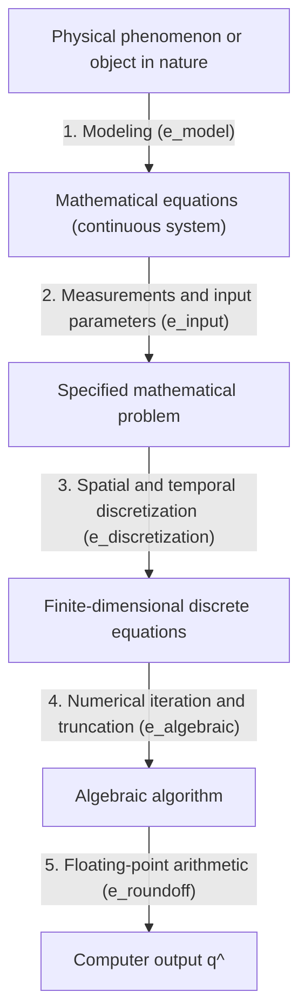

Even when a computation finishes without errors, the resulting value may not be accurate enough for its purpose.
The core concepts organize the sources of error and explain how to interpret results.
Before choosing an individual method, distinguish input uncertainty from errors introduced during computation.

---

## An error hierarchy: five factors behind a numerical value

Conceptually, the total error between a computed value $\hat{q}$ obtained by scientific simulation and the true physical quantity $q_{\mathrm{real}}$ in the real world decomposes into the following five contributions.

$$
\hat{q} - q_{\mathrm{real}} = e_{\mathrm{input}} + e_{\mathrm{model}} + e_{\mathrm{discretization}} + e_{\mathrm{algebraic}} + e_{\mathrm{roundoff}}.
$$

| Error category | Mechanism | Main checks and mitigation |
|---|---|---|
| **Input error ($e_{\mathrm{input}}$)** | Uncertainty in sensor measurements, variability in material constants, uncertain initial conditions | Monte Carlo methods, quasi-random sampling, sensitivity analysis |
| **Modeling error ($e_{\mathrm{model}}$)** | Simplified physical laws, such as neglecting viscosity, linearization, or averaging turbulence | Comparison with experimental data, extension to more detailed theoretical models |
| **Discretization error ($e_{\mathrm{discretization}}$)** | Approximating derivatives by finite differences or definite integrals by the trapezoidal rule; finite spatial grid spacing $\Delta x$ or time step $\Delta t$ | Checking asymptotic convergence rates at grid spacings $\Delta x \to 0$ (Richardson extrapolation) |
| **Algebraic iteration error ($e_{\mathrm{algebraic}}$)** | Residuals caused by stopping iterative computations such as Newton or Krylov subspace methods after finitely many steps | Reducing the residual tolerance $\tau$, increasing the iteration limit |
| **Rounding error ($e_{\mathrm{roundoff}}$)** | Representing and computing real numbers with finite precision in IEEE 754 formats (64-bit/32-bit) | Using double precision (`f64`), applying numerically stable equivalent formulations |

This decomposition expresses the difference in output at each stage in terms of the same final quantity.
It does not assume that the errors are independent random variables.
Increasing the number of iterations does not automatically reduce input or discretization errors, so first identify the dominant contribution.

---

## Four common misconceptions in numerical computing and mathematical counterexamples

The following mathematical counterexamples clarify intuitive misconceptions that commonly arise in numerical computing.

### Misconception 1: "A near-zero residual means an accurate solution"

**Mathematical counterexample**: In ill-conditioned systems or algebraic equations with multiple roots, a small residual and an accurate solution can diverge.
For example, consider the nearly singular symmetric matrix

$$
\mathbf{A} =
\begin{bmatrix}
1 & 1 \\
1 & 1 + 10^{-4}
\end{bmatrix},
\qquad
\mathbf{b} =
\begin{bmatrix} 2 \\ 2 + 10^{-4} \end{bmatrix}
$$

The true solution is $\mathbf{x}^* = (1, 1)^\mathsf{T}$.
Solving $\tilde{\mathbf{b}} = (2, 2 + 10^{-4} + 10^{-7})^\mathsf{T}$ with a measurement error of only $10^{-7}$ in the right-hand side produces $\tilde{\mathbf{x}} = (0.999, 1.001)^\mathsf{T}$, with forward error reaching $10^{-3}$.
Yet the residual norm from substituting this solution into the measured equation remains at the level of machine precision ($\approx 10^{-16}$).
Residual assessment must be accompanied by sensitivity analysis that multiplies by the problem's condition number $\kappa(\mathbf{A})$.

### Misconception 2: "A higher-order algorithm always produces more accurate results"

**Mathematical counterexample**: Accuracy analysis for high-degree interpolating polynomials and high-order Runge–Kutta methods assumes, among other conditions, that the target function is sufficiently smooth throughout its domain to the required order.
Smoothness alone does not determine convergence of high-degree interpolation.
Interpolating Runge's function $f(x) = 1 / (1 + 25x^2)$ with high-degree polynomials on equally spaced nodes produces oscillations near the interval endpoints whose amplitude diverges exponentially as the degree increases (the Runge phenomenon).
For problems with discontinuities or steep gradients, low-order shape-preserving splines or total variation diminishing (TVD) methods give better approximations than high-order methods.

### Misconception 3: "If Result returns Ok, the algorithm has converged"

**Mathematical counterexample**: Optimization solvers and nonlinear root finders retain the accepted approximate solution held by the API and return it in an `Ok` struct even when the maximum iteration count is reached or progress stagnates after the step shrinks to the machine precision limit.
The termination reason inside the struct then indicates `IterationLimit` or `Stagnation`.
The caller must inspect `result.termination()` to check whether the tolerance was actually achieved, rather than merely checking `is_ok()`.

### Misconception 4: "Changes in the last digits of parallel computation results are bugs"

**Mathematical counterexample**: Finite-precision floating-point addition is not associative (that is, $(a + b) + c \neq a + (b + c)$).
General parallel systems may change the addition order according to thread completion order, producing variation in the last bits.
SciOxide's executors instead **combine results deterministically in the partition order specified by the plan (`ExecutionPlan::reduce`)**, so completion order does not affect results for the same inputs, partitions, operations, and arithmetic environment.
Changing the number of workers may change the addition order.
Even then, exact accumulation (`RangeAccumulator`) in `scioxide-core` rounds the sum only once, producing the same bit pattern regardless of term order or worker count.

---

## How the core concepts fit together

This section systematically explains the shared contracts and mathematical foundations to understand before studying individual numerical crates, in the following order (matching the sidebar).

1. [**Floating-point numbers and condition numbers**](floating-point-and-conditioning/): Details the internal structure of IEEE 754, machine epsilon and unit roundoff, cancellation, special values and identity elements for empty inputs, and Wilkinson's backward error analysis.
2. [**Scalar types and trait contracts**](scalars-and-traits/): Organizes type abstraction through `RealScalar`, `NumericScalar`, and `AffineValue`, criteria for choosing `f32` / `f64`, and separation of models and methods through problem traits.
3. [**Scaling theory for tolerances and residuals**](tolerances-and-residuals/): Covers the respective roles of absolute tolerance $\tau_{\mathrm{abs}}$ and relative tolerance $\tau_{\mathrm{rel}}$, the crossover scale, nondimensionalization, norm selection, and the design of multiple stopping conditions.
4. [**Type-safe error contracts and recovering partial results**](errors-and-partial-results/): Discusses the 20 categories of the opaque type `SciOxideError`, transactions in the solve process, recovering partial results at iteration limits, and `PartialResultTrust`.
5. [**Workspaces, execution policies, and reproducibility**](workspaces-and-reproducibility/): Explains localized memory allocation (the execution forms and capacity protocol), `ExecutionPolicy`, floating-point non-associativity, and three levels of reproducibility.
6. [**Connecting and composing crates**](composition/): Traces how numerical error from earlier stages propagates to later stages through first-order sensitivity analysis in pipelines combining multiple crates, along with error floors and principles of tolerance allocation.

---

## Roles of core concepts (concepts) and the foundation crate (scioxide-core)

To avoid duplicating concepts or scattering related issues, this book assigns general mathematical and computational mathematics theory to "Core concepts," while [`scioxide-core`](../scioxide-core/) explains SciOxide's specific API contracts and implementation algorithms.

| Topic | Core concepts (theory and general principles of computational mathematics) | scioxide-core (API contracts and implementation algorithms) |
|---|---|---|
| **Floating-point arithmetic** | IEEE 754 internals, $\varepsilon_{\mathrm{mach}}$ and $u$, cancellation, condition numbers, backward error, special values and identity elements for empty inputs | Elementary function dispatch (4 ULP), stable transformations (16 ULP), `FloatDecomposition`, argument reduction contracts |
| **Scalar types** | Fields and order structures (`PartialOrd`), criteria for choosing `f32` and `f64`, separation through problem traits | Contracts of `RealScalar`, `NumericScalar`, and `AffineValue`, UFCS methods, complex division |
| **Tolerances** | Roles of absolute and relative tolerances, crossover scales, norm selection (RMS/maximum norm), stopping criteria | Type contracts of the `Tolerance` family, `is_satisfied`, residual scaling |
| **Errors and results** | Design principles of `Err` and unsuccessful `Ok`, six transaction phases, partial-result reliability categories (`PartialResultTrust`) | `SciOxideErrorView`, identifiers, solve counts (`SolveScope`, `SolveCounts`), `AttemptRecord` |
| **Workspaces and reproducibility** | Execution forms (owned, borrowed, planned), capacity protocols, floating-point non-associativity and three levels of reproducibility | Resolution formula for `ExecutionPlan`, partitioning and linear merging, `Capacity`, `ThreadExecutor` |
| **Composition** | Sensitivity analysis in multistage pipelines, error floors, optimal tolerance allocation | Allocation of nested computation count limits (`SolveScope`), integration contracts for multistage methods |

## Summary and further reading

To reduce errors, first determine whether inputs, modeling, discretization, iteration, or rounding dominate.
Residuals and termination reasons provide part of the information needed for that decision.
Read from [Floating-point numbers and condition numbers](floating-point-and-conditioning/) onward in order, and consult individual crate chapters for specific operations.
