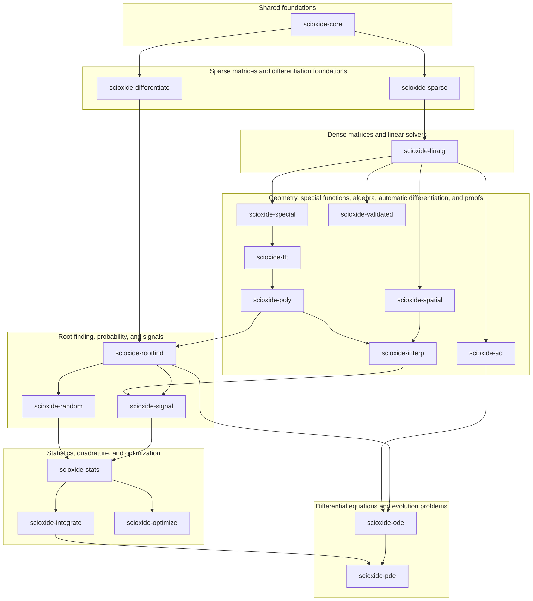

SciOxide consists of 19 crates organized by numerical computing field.
Choose the crates you need from the quantity to compute and the shape of your data.

All crates follow the contracts of the shared foundation `scioxide-core` (`RealScalar`, `Tolerance`, `ExecutionPolicy`, `SciOxideError`), and their normal published dependencies and build dependencies are restricted to SciOxide itself.
This allows them to be combined according to their roles in each field.

---

## 1. Crate dependency hierarchy

SciOxide's crates form a clear topological order based on normal Cargo dependencies.
Arrows point from a dependency to its consumer.
To keep the diagram readable, arrows reachable through another path are omitted.
The following table lists all direct normal dependencies.
Boxes in the diagram group fields for readability.
On small screens, use the table to inspect each crate's dependencies.

---

## 2. All 19 crates

| Crate | Mathematical objects | Main algorithms and capability contracts | Main crate dependencies |
|---|---|---|---|
| [**`scioxide-core`**](../scioxide-core/) | Shared numerical computing contracts | `RealScalar`, `Tolerance`, range-safe arithmetic and exact accumulation (`RangeAccumulator`), execution policies, solve counts | (none) |
| [**`scioxide-sparse`**](../scioxide-sparse/) | Sparse matrix data structures and factorizations | CSR/CSC/COO representations, reordering (AMD/RCM), incomplete factorizations and direct methods (Krylov methods belong to linalg) | `core` |
| [**`scioxide-linalg`**](../scioxide-linalg/) | Dense matrices and iterative solvers | LU, Cholesky, QR, SVD, eigendecomposition, Krylov subspace methods (CG, GMRES, and others), backward error diagnostics | `core`, `sparse` |
| [**`scioxide-spatial`**](../scioxide-spatial/) | Spatial and computational geometry | k-d tree nearest-neighbor search, Delaunay triangulation, Voronoi diagrams, convex hulls, SO(3) spatial rotations | `core`, `linalg`, `sparse` |
| [**`scioxide-differentiate`**](../scioxide-differentiate/algorithms/) | Numerical differentiation | Fixed-step forward and central differences, Ridders and Richardson adaptive extrapolation with estimated errors, differences at arbitrary nodes, sparse Jacobians through coloring, complex-step methods, gradients, Jacobians, Hessians, and directional derivatives | `core` |
| [**`scioxide-ad`**](../scioxide-ad/) | Automatic differentiation | Forward mode (dual numbers `Dual` and `MultiDual`), reverse mode (caller-owned tape `Tape`), Taylor jets `Jet`, batch evaluation of many items `BatchPlan` (no truncation error) | `core`, `linalg`, `sparse` |
| [**`scioxide-special`**](../scioxide-special/) | Special functions | Bessel, Airy, error functions, gamma and beta functions, elliptic integrals, hypergeometric functions (accuracy checked against reference values, error estimates in detailed results) | `core`, `linalg` |
| [**`scioxide-fft`**](../scioxide-fft/) | Fast Fourier transforms | One-dimensional and N-dimensional complex FFTs (the N-dimensional API handles two dimensions), real FFTs, discrete cosine transforms (DCT), discrete sine transforms (DST), chirp-z transforms, nonuniform FFTs (NUFFT), Hankel transforms and FFTLog | `core`, `linalg`, `special` |
| [**`scioxide-poly`**](../scioxide-poly/) | Polynomials and orthogonal bases | Exact and approximate polynomial arithmetic, orthogonal polynomials (Chebyshev/Legendre/Hermite/Laguerre), root condition and inclusion-radius diagnostics, resultants and discriminants (computing all roots belongs to rootfind) | `core`, `fft`, `linalg`, `special` |
| [**`scioxide-interp`**](../scioxide-interp/) | Numerical interpolation | Cubic splines, PCHIP, Akima, B-splines, two-dimensional bicubic interpolation, scattered-data RBF interpolation | `core`, `linalg`, `poly`, `sparse`, `spatial` |
| [**`scioxide-rootfind`**](../scioxide-rootfind/) | Root finding for nonlinear equations | Bracketing methods (Brent, Toms748), Newton–Raphson, secant methods, nonlinear systems (Broyden, Newton–Krylov) | `core`, `differentiate`, `linalg`, `poly`, `sparse`, `special` |
| [**`scioxide-signal`**](../scioxide-signal/) | Digital signal processing | IIR/FIR filter design (Butterworth, Chebyshev, Bessel), windows, convolution and cross-correlation, spectral analysis | `core`, `fft`, `interp`, `linalg`, `rootfind`, `sparse`, `special` |
| [**`scioxide-random`**](../scioxide-random/) | Random numbers and sampling | PRNGs (PCG, Philox), sampling continuous and discrete probability distributions, quasi-random numbers (Sobol and Halton sequences) | `core`, `differentiate`, `linalg`, `rootfind`, `sparse`, `special` |
| [**`scioxide-stats`**](../scioxide-stats/) | Descriptive statistics, estimation, and testing | Online moments (incremental updates), covariance matrices, kernel density estimation (KDE), hypothesis tests, isotonic regression | `core`, `linalg`, `random`, `rootfind`, `signal`, `special` |
| [**`scioxide-integrate`**](../scioxide-integrate/) | Numerical quadrature | Gauss–Legendre/Kronrod quadrature, double-exponential (DE) formulas, adaptive quadrature (QAG), Monte Carlo quadrature | `core`, `linalg`, `poly`, `random`, `sparse`, `spatial`, `stats` |
| [**`scioxide-optimize`**](../scioxide-optimize/) | Mathematical optimization | Quasi-Newton (BFGS/L-BFGS), Nelder–Mead, constrained optimization (SQP, interior-point methods, augmented Lagrangian methods), linear programming (simplex) and mixed-integer programming, global search | `core`, `differentiate`, `interp`, `linalg`, `random`, `sparse`, `spatial`, `special`, `stats` |
| [**`scioxide-ode`**](../scioxide-ode/) | Systems of ordinary differential equations | Initial value problems (explicit RK DOP853, implicit Radau IIA, BDF), adaptive steps, event detection, DAE/DDE/SDE/BVP | `ad`, `core`, `differentiate`, `linalg`, `rootfind`, `sparse` |
| [**`scioxide-pde`**](../scioxide-pde/) | Partial differential equations | One-dimensional and multidimensional finite differences (FDM), finite volumes (FVM), finite elements (FEM), conservation laws, method of lines (MOL), elasticity and incompressible flow, adaptive mesh refinement (AMR) | `ad`, `core`, `differentiate`, `integrate`, `linalg`, `ode`, `poly`, `rootfind`, `sparse`, `spatial` |
| [**`scioxide-validated`**](../scioxide-validated/) | Validated interval arithmetic | Directed-rounding interval arithmetic, solution inclusion theorems, interval Newton proofs of existence and uniqueness (x86/x86_64/AArch64) | `core`, `linalg`, `sparse` |

---

## 3. Task-based index

### Solving systems of equations
- Small to medium dense linear systems $\to$ [`scioxide-linalg`](../scioxide-linalg/)
- Preserving structure, reordering, and direct factorization of large sparse matrices $\to$ [`scioxide-sparse`](../scioxide-sparse/)
- Iterative solvers for sparse matrices or matrix-free operators (CG, GMRES, and others) $\to$ [`scioxide-linalg`](../scioxide-linalg/)
- Finding zeros of nonlinear systems $\mathbf{F}(\mathbf{x}) = \mathbf{0}$ $\to$ [`scioxide-rootfind`](../scioxide-rootfind/)

### Computing derivatives and approximating functions
- Numerical derivatives and gradients of black-box functions or discrete point sequences $\to$ [`scioxide-differentiate`](../scioxide-differentiate/algorithms/)
- Exact gradients and Jacobians of functions written in Rust (no truncation error) $\to$ [`scioxide-ad`](../scioxide-ad/)
- Smooth interpolation curves passing exactly through discrete data points $\to$ [`scioxide-interp`](../scioxide-interp/)
- Function approximation using orthogonal polynomial expansions $\to$ [`scioxide-poly`](../scioxide-poly/)
- Special function values in physics and engineering $\to$ [`scioxide-special`](../scioxide-special/)

### Simulating evolution in time or space
- Time evolution of ordinary differential equations (ODEs), differential-algebraic equations (DAEs), and delay systems (DDEs) $\to$ [`scioxide-ode`](../scioxide-ode/)
- Partial differential equations for heat conduction, waves, fluids, elasticity, and other fields (one-dimensional and multidimensional PDEs) $\to$ [`scioxide-pde`](../scioxide-pde/)
- Geometric searches on spatial point sets (nearest neighbors, Delaunay triangulation, Voronoi diagrams) $\to$ [`scioxide-spatial`](../scioxide-spatial/)

### Frequency analysis, statistics, and sampling
- Fourier transforms, frequency spectra, and DCTs $\to$ [`scioxide-fft`](../scioxide-fft/)
- Filter design (low-pass/high-pass/band-pass), convolution, and correlation $\to$ [`scioxide-signal`](../scioxide-signal/)
- Pseudorandom numbers, sampling probability distributions, and quasi-random sequences $\to$ [`scioxide-random`](../scioxide-random/)
- Summary statistics, online covariance, kernel density estimation, and hypothesis tests $\to$ [`scioxide-stats`](../scioxide-stats/)

### Finding minima and optima, or rigorously enclosing solutions
- Objective minimization, constrained optimization, and nonlinear least squares $\to$ [`scioxide-optimize`](../scioxide-optimize/)
- Numerical quadrature for definite integrals, areas, and expected values $\to$ [`scioxide-integrate`](../scioxide-integrate/)
- Proving existence and uniqueness of the true solution despite floating-point rounding error, within a range satisfying inclusion conditions $\to$ [`scioxide-validated`](../scioxide-validated/)

---

## 4. Structure of each crate chapter and how to read it

Each chapter contains an overview, a selection guide, algorithms, examples, and an API guide.

1. **Chapter overview (`index.mdx`)**: Problems in the field, a first computation, reading its result, and a chapter roadmap.
2. **Selection guide (`choosing.mdx`)**: Decision flows for methods and options, with detailed comparison tables.
3. **Algorithms (`algorithms/`)**: Method derivations, applicability conditions, computational complexity, errors, and stability.
4. **Worked examples (`examples/`)**: Executable interactive cells solving real problems in physics, chemistry, engineering, finance, and mathematics.
5. **API guide (`api/` or `api.mdx`)**: Complete public API explanations, contracts, minimal working code, and tables organized by purpose.

## Summary and further reading

Choose crates from the data structures and the problem to solve.
The dependency diagram shows implementation relationships, while the task-based tables provide entry points for users.
After narrowing the candidates, compare applicability conditions in each chapter's selection guide and check types and return values in its API guide.
