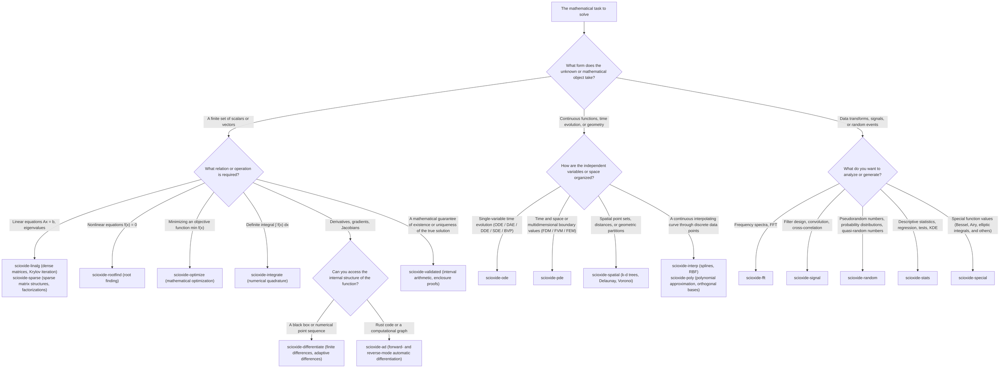

First express what you want to compute in terms of equations or data structures.
Distinguishing linear equations, differential equations, statistical estimation, and other tasks narrows down the relevant crates.

---

## A crate selection flow based on your task

The following diagram provides a starting point for broadly classifying a task and finding the relevant crate.
If the diagram is difficult to read, you can also use the [task-based tables in the crate directory](../../crates/).

---

## Comparing numerical methods that are easily confused

Methods that address similar problems may require different inputs and produce different kinds of results.
Use the following comparisons to choose one that fits your purpose.

### 1. Numerical differentiation (`scioxide-differentiate`) and automatic differentiation (`scioxide-ad`)

| Item | Numerical differentiation (`scioxide-differentiate`) | Automatic differentiation (`scioxide-ad`) |
|---|---|---|
| **Target** | Black-box functions, external libraries, discrete calls | Rust functions written generically over the numeric type `R: Real` |
| **Principle** | Finite difference stencils (forward and central differences; inward one-sided differences at boundaries), Ridders-type adaptive extrapolation, complex steps | The chain rule at each arithmetic operation (`Dual` and `MultiDual` in forward mode; `Var` recorded on a tape `Tape` in reverse mode) |
| **Sources of error** | For real finite differences, truncation error $\mathcal{O}(h^p)$ competes with amplified rounding error. Complex steps avoid subtractive cancellation but require a holomorphic complex extension | No truncation error from a finite difference step. Rounding error and approximation error in the differentiated model itself remain |
| **Computational cost** | A central difference stencil has $2n$ nodes. SciOxide's path, including the evaluation at the base point, uses $2n+1$ evaluations | Reverse mode computes the full gradient at a constant multiple of the cost of a few function evaluations |

### 2. General numerical methods (`scioxide-rootfind` and others) and validated computation (`scioxide-validated`)

- **General numerical methods**: Iteration computes an approximate solution satisfying the specified residual or step size tolerance.
  In ill-conditioned systems or near singularities, rounding error may produce false convergence to a value far from the true solution.
- **Validated computation (`scioxide-validated`)**: Directed-rounding interval arithmetic, the Krawczyk operator, and interval Newton methods prove existence or uniqueness of a solution in a specified interval when their inclusion conditions hold.
  These conditions may fail, leaving the result inconclusive.
  Proof computations require hardware rounding control checks and therefore run in native environments (x86/x86_64/AArch64).

### 3. Interpolation (`scioxide-interp`, `scioxide-poly`) and smoothing or regression (`scioxide-stats`, `scioxide-optimize`)

- Interpolation constructs a curve satisfying $f(x_i)=y_i$ at the given points $(x_i,y_i)$.
  On a computer, it incurs rounding error and also passes through the observation noise.
  Distinguish noise fitting from the Runge phenomenon, which occurs in high-degree polynomial interpolation on equally spaced points even without noise.
- **Smoothing and regression**: Rather than requiring passage through every data point, optimize the balance between the sum of squared residuals and curve smoothness (smoothing splines), or the fit of model parameters (nonlinear least squares, isotonic regression).
  These methods suit reducing observation error and identifying coefficients in physical laws.

### 4. Root finding (`scioxide-rootfind`) and optimization (`scioxide-optimize`)

- **Root finding**: Search for a zero satisfying the equation $f(x) = 0$.
  The available methods address equations directly, including bracketing methods that capture sign changes and Newton methods using Jacobians.
- **Optimization**: Search for a minimum (or maximum) of a scalar objective function $f(x)$.
  Casually converting a root-finding problem into an optimization problem for $\min \|f(x)\|^2$ risks becoming trapped in a local minimum where no root exists, because the gradient vanishes in flat regions of the objective.
  Prefer root-finding solvers when searching for zeros.

### 5. Differences between Monte Carlo, quasi-Monte Carlo, and sparse grids (`scioxide-random`, `scioxide-integrate`)

- **Monte Carlo (MC)**: Estimate a mean using independent pseudorandom numbers.
  The convergence rate is $\mathcal{O}(N^{-1/2})$ regardless of the dimension $d$, under assumptions such as finite variance.
  The exponent is independent of dimension, but the error coefficient depends on the integrand.
- **Quasi-Monte Carlo (QMC)**: Deterministic quadrature using low-discrepancy (quasi-random) point sequences such as Sobol or Halton sequences.
  It achieves an asymptotic convergence rate of $\mathcal{O}((\log N)^d / N)$ for functions of bounded variation, and can produce smaller errors than MC when the effective dimension and smoothness are suitable.
  Dimension alone does not determine which is better.
- **Sparse grids**: Thin tensor products of one-dimensional orthogonal quadrature rules using the Smolyak algorithm.
  Properties such as smooth mixed derivatives allow computation with fewer points than a full tensor product.
  The convergence rate depends on the quadrature rules and function regularity; the benefit decreases for discontinuous functions.

---

## Designing mathematical pipelines that combine crates

When using multiple crates, check whether each stage's output satisfies the input conditions of the next computation.

1. **Inverse estimation pipeline for material properties**: `scioxide-interp` (generate a high-order spline interpolation curve from experimental measurements) $\to$ `scioxide-integrate` (evaluate an enthalpy integral) $\to$ `scioxide-rootfind` (recover the equilibrium temperature corresponding to a specified heat quantity).
2. **Nonlinear oscillation and spectral analysis pipeline**: `scioxide-ode` (integrate the Duffing oscillator equation with the DOP853 solver) $\to$ `scioxide-signal` (apply a window to the signal sampled at equal intervals) $\to$ `scioxide-fft` (compute the frequency spectrum).
3. **Parameter identification and inverse problem optimization pipeline**: `scioxide-ad` or `scioxide-differentiate` (compute the Jacobian of model residuals) $\to$ `scioxide-optimize` (determine physical parameters that fit experimental data through the Levenberg–Marquardt method).
4. **Uncertainty propagation (UQ) pipeline**: `scioxide-random` (generate samples of initial conditions and material properties using Sobol quasi-random numbers) $\to$ `scioxide-ode` (repeatedly solve ensemble trajectories) $\to$ `scioxide-stats` (compute a kernel density estimate and confidence intervals for the terminal state).
   *Note: Computing ensemble trajectories in parallel requires a parallel executor (`ThreadExecutor`); execution in browser Wasm is sequential.*

---

## Conditions to check after selecting a crate

When a crate offers several methods, narrow the candidates using the following conditions.
Match the problem's properties to the API's assumptions rather than deciding from type or function names alone.

| What to check | Effect on the choice |
|---|---|
| Input domain and smoothness | Whether derivatives or higher-order approximations are available |
| Matrix sparsity, symmetry, and positive definiteness | Which storage formats, factorizations, or iterative methods are suitable |
| Availability of analytical derivatives | Whether to supply derivatives or use numerical differentiation |
| Whether an error estimate or a proof is needed | Whether to use an ordinary approximation method or validated computation |
| Whether computations repeat with the same structure | Whether plans, factorization factors, or workspaces can be reused |

Also check what is returned when the conditions are not met and how nonconverged results are handled.

## Summary and next steps

Choose a crate from the desired quantity and the form of the equations, and check its applicability conditions and return-value contracts.
Even similar methods serve different roles depending on whether they compute an approximation or prove existence.
When connecting multiple crates, carry the units, domains, and errors of intermediate values through the pipeline as well.

- Detailed capabilities and dependencies of each crate: [Crate directory](../../crates/)
- The mathematics of floating-point arithmetic and condition numbers: [Core concepts: floating-point arithmetic and condition numbers](../../concepts/floating-point-and-conditioning/)
- Individual crate guides: see the main sections in the sidebar
