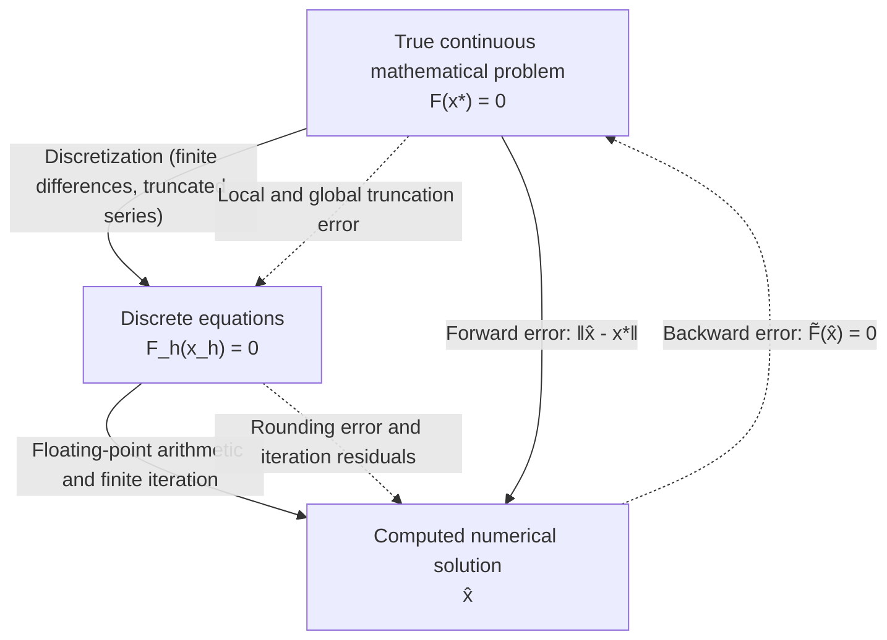

This page collects the symbols and terms used in the book.
Distinguish exact mathematical solutions from computed approximations, and mathematical convergence from solver termination conditions.

Consult each crate's API guide for the domains and termination conditions of individual APIs.

## Basic mathematical symbols and notation conventions

Unless stated otherwise, mathematical notation in this book follows these standard conventions.

| Symbol | Meaning and mathematical usage | Notes and computer representations |
|---|---|---|
| $\mathbf{x}, \mathbf{y}, \mathbf{z}$ | Column vector (an element of $\mathbb{R}^n$ or $\mathbb{C}^n$) | `scioxide_linalg::Vector<S>` |
| $\hat{\mathbf{x}}$ | Numerical approximation obtained by finite-precision computation or an iterative method | A solution vector containing discretization and rounding errors |
| $\mathbf{x}^*$ | The true exact solution of a continuous mathematical problem | The theoretical limiting solution |
| $\mathbf{A}, \mathbf{B}$ | Matrix (linear operator), with entries written as $A_{ij}$ or $(\mathbf{A})_{ij}$ | `Matrix<S>`, `CsrMatrix<S>` |
| $\mathbf{A}^\mathsf{T}$ | Transpose of a real matrix | Transpose operator |
| $\mathbf{A}^\mathsf{H}$ | Hermitian conjugate (adjoint) of a complex matrix: $(\mathbf{A}^\mathsf{H})_{ij} = \overline{A_{ji}}$ | `AdjointOperator` |
| $\Vert \mathbf{x}\Vert _2$ | Euclidean vector norm (2-norm): $\Vert \mathbf{x}\Vert _2 = \sqrt{\sum_{i=1}^n \lvert x_i\rvert^2}$. The same definition applies to complex components | `VectorView::norm2` |
| $\Vert \mathbf{x}\Vert _\infty$ | Maximum norm (infinity norm): $\Vert \mathbf{x}\Vert _\infty = \max_{i} \lvert x_i \rvert$ | `NormSelection::Infinity` in residual reports |
| $\Vert \mathbf{A}\Vert _2$ | Induced matrix 2-norm (largest singular value $\sigma_{\max}(\mathbf{A})$) | `SvdValues::singular_values()` |
| $\mathbf{J}$ | Jacobian of a multivariable map $\mathbf{f}: \mathbb{R}^n \to \mathbb{R}^m$: $J_{ij} = \frac{\partial f_i}{\partial x_j}$ | `scioxide_ad::jacobian` |
| $\mathbf{H}$ | Hessian of a scalar function $f: \mathbb{R}^n \to \mathbb{R}$: $H_{ij} = \frac{\partial^2 f}{\partial x_i \partial x_j}$ | `scioxide_ad::hessian` |
| $\nabla f$ | Gradient vector of a scalar function: $\nabla f = \left(\frac{\partial f}{\partial x_1}, \dots, \frac{\partial f}{\partial x_n}\right)^\mathsf{T}$ | `scioxide_ad::grad` |
| $\epsilon_{\mathrm{mach}}$ | Floating-point machine epsilon (`f64::EPSILON` $\approx 2.22 \times 10^{-16}$) | The difference between 1 and the next larger representable number. Unit roundoff under round to nearest is $u=\epsilon_{\mathrm{mach}}/2$ |
| $\kappa(\mathbf{A})$ | Condition number of matrix $\mathbf{A}$: $\kappa(\mathbf{A}) = \Vert \mathbf{A}\Vert  \Vert \mathbf{A}^{-1}\Vert $ | Maximum amplification of input perturbations into the solution |
| $\mathcal{O}(h^p)$ | Landau notation: at step size $h \to 0$, the error decreases within a bound given by a constant $C h^p$ | Convergence order $p$ |

## Error categories and key concepts in numerical analysis

How to reduce an error depends on its cause.
Examine contributions from inputs, discretization, iteration, and rounding separately.

| Term | English | Definition and mathematical meaning |
|---|---|---|
| **Forward error** | Forward Error | The difference between a computed numerical solution $\hat{\mathbf{x}}$ and the true exact mathematical solution $\mathbf{x}^*$: $\Delta \mathbf{x} = \hat{\mathbf{x}} - \mathbf{x}^*$. Direct measurement is often difficult because the true solution is unknown. |
| **Residual** | Residual | The discrepancy when substituting a numerical solution into an equation: $\mathbf{r} = \mathbf{b} - \mathbf{A}\hat{\mathbf{x}}$ for a linear system or $\mathbf{r} = \mathbf{f}(\hat{\mathbf{x}})$ for a nonlinear system. It can be evaluated directly on a computer. |
| **Backward error** | Backward Error | The smallest input problem perturbation $\Delta \mathbf{A}, \Delta \mathbf{b}$ for which the computed solution $\hat{\mathbf{x}}$ becomes an exact solution. This is the foundation of Wilkinson's backward error analysis. |
| **Truncation error** | Truncation Error | Mathematical approximation error caused by truncating a Taylor series to finitely many terms or using finite time or space discretization steps ($\Delta t, \Delta x$) for differential equations. |
| **Rounding error** | Round-off Error | Rounding, loss of small contributions, and cancellation inevitably arising when representing and computing real numbers with a fixed bit length (such as IEEE 754 double precision). |
| **Problem condition number** | Condition Number | A geometric property of the problem describing how strongly small relative changes in input data are amplified into the true solution. It is independent of the quality of the algorithm. |
| **Algorithmic stability** | Numerical Stability | A property describing how errors during computation affect the result. Backward stability requires that small input perturbations can explain the computed result |
| **Stiffness** | Stiffness | A property of ODE or PDE systems in which stability restricts explicit methods to smaller steps than accuracy requires. Consider methods with wider stability regions, such as implicit methods |

## Solver execution and termination diagnostic conventions

SciOxide's iterative solvers return a candidate numerical solution together with a termination reason explaining why computation stopped (a domain-specific termination enum, such as `RootTermination` or `LinearSolveTermination`) and diagnostics such as residuals and iteration counts.

An outer control loop or higher-level application must not interpret `Ok` alone as successful convergence; it must verify that the termination reason meets the target acceptance criteria.

- Residual-based acceptance compares the scale specified by the solver with the allowed width.
  Do not infer the criterion from the name `Converged` alone; check the contracts of [linear solvers](../scioxide-linalg/) or [root-finding methods](../scioxide-rootfind/).
- Interval-width acceptance (`RootTermination::BracketTolerance`) indicates that the maintained interval has narrowed to the location tolerance.
  Inferring root existence from a sign change requires continuity; a sign change in a discontinuous function alone does not guarantee a root.
- After iteration-limit termination (`IterationLimit`), inspect the partial result and the conditions that remain unmet.
- Termination due to stagnation or a small step does not mean the target residual was achieved.
  For example, interpret optimization's `StepSmall` according to the [optimization termination conditions](../scioxide-optimize/).
- Numerical breakdown means that the operations needed for an update cannot continue.
  [Errors and partial results](../concepts/errors-and-partial-results/) explains the distinction between failures returned as `Err` and termination reasons retained in reports.

## Software and numerical computing terminology

In Japanese text, terms of English origin use established katakana spellings.
Terms without established katakana spellings and API type names are written in English, with their meanings explained at first use.

| Term | Meaning |
|---|---|
| Seed | A value determining a random generator's initial state |
| Native output word / uniform random word | The generator's native integer output / a random integer with uniformly distributed bits. Their ranges may differ |
| Context | An object passing execution capabilities or computation accounting information |
| Worker / executor | An execution unit for partitioned work / an object managing its execution |
| Provider | An implementation supplying operations such as BLAS or external capabilities |
| Constructor / adapter | A function constructing values / a type connecting interfaces |
| Allocator / buffer | A mechanism allocating memory / storage temporarily holding data |
| Stride / step size | Memory spacing between array elements / a measure of movement or update size in iteration |
| Lifetime / lifecycle | The period during which a Rust reference is valid / the progression from object construction through reuse and termination |
| Plan | An object retaining precomputed coefficients or execution procedures for repeated use |
| Method object | A value retaining method settings and performing computations through methods |
| One-shot function | A function combining preparation and computation in one call |
| Making output available | Exposing computed results through return values or caller-provided output storage |
| Primal value | In automatic differentiation, the function value itself, distinguished from derivatives. Different from a complex function's principal value |
| decoration | Information about domains, continuity, and similar properties accompanying interval arithmetic results |
| luxury level | A setting specifying how much output RANLUX discards |
| minimum image | A rule choosing the nearest periodic copy when computing distances with periodic boundaries |
| Proof data / guaranteed enclosing interval | Data for rechecking a mathematical claim / an interval guaranteed to contain the true value |

## Related reference material

- [**Master API index and task lookup**](master-api-index/): The public APIs of all 19 crates, cross-linked to the concrete examples and explanatory sections that use them.
- [**Bibliography guide**](bibliography/): Original papers on the theories and algorithms explained in each chapter, and classic books on numerical analysis.

## Summary and further reading

Approximate solutions, residuals, and forward errors are different quantities.
When reading norms or tolerances, check the units and scales of the quantities involved.
Interpret termination reasons according to each crate's definitions, and find the items you need through the [master index](master-api-index/).
