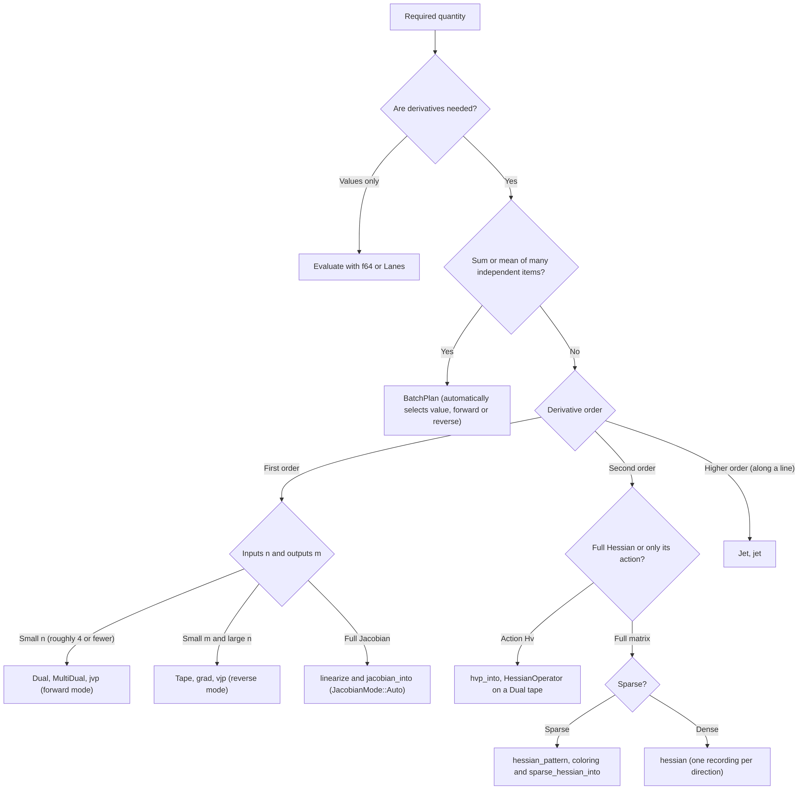

With `scioxide-ad`, write a function once for `R: Real` and obtain different derivatives simply by choosing another number type and transform.
This page summarizes how to select number types and transforms from the desired derivative, the number of inputs $n$ and outputs $m$, and the number of points at which the same function is differentiated.
Computational cost is compared in units of the work needed to evaluate the primal value once.
[Automatic differentiation algorithms](../algorithms/) and its child pages derive the algorithms and computational costs.

## Selection procedure

The first distinction is whether the target is a sum or mean of many independent items (Monte Carlo paths or training samples).
If so, `BatchPlan` packs items into lanes for evaluation and selects the number type from whether gradients are needed and the number of differentiated values.
Otherwise, select by the desired derivative order and input/output dimensions.
When differentiating one function at many points, choose a form that reuses the tape and workspace on every path ([One-shot calls and tape reuse](#one-shot-calls-and-tape-reuse)).

## Comparing number types

| Number type | Stores | Cost per evaluation | Memory | Suitable uses |
|---|---|---|---|---|
| `f32`, `f64` | Value | 1 | None | Ordinary evaluation, isolated tests |
| `Lanes<S, W>` | `W` independent values | About 1 (`W` values simultaneously with SIMD) | None | Values at many points or paths |
| `Dual<V>` | Value and one directional derivative | Small constant factor | None | One directional derivative, one input |
| `MultiDual<V, N>` | Value and derivatives in `N` directions | Derivative work is about `N` times larger | None | Gradients with a few inputs, `N` Jacobian columns |
| `Jet<V, N>` | `N` normalized Taylor coefficients | $O(N^2)$ for nonlinear operations | None | Higher-order coefficients along a line, series solutions |
| `Var<'t, V>` | Value on a tape | Small constant factor for recording and reverse sweep | Proportional to statement count | Gradients with many inputs and few outputs, VJP |

Wrapper types can be nested.
`Dual<Lanes<f64, 8>>` gives a directional derivative at 8 points; `Dual<Dual<f64>>` gives a directional second derivative; `Var<Dual<f64>>` (recorded on `Tape<Dual<f64>>`) gives a Hessian-vector product; and `Jet<Jet<f64, M>, N>` gives mixed Taylor coefficients in two variables.
Values have identical bits with every number type, so adding derivatives by changing the type leaves the primal value unchanged.
Only the eight elementary functions of `Lanes` (such as `exp`) may differ from scalar functions in the last few ulp.
See [Number types, lanes and generic code](../algorithms/number-types-and-lanes/) for details.

The rough crossover between forward and reverse mode is around 4 inputs.
The derivative work in `MultiDual` grows in proportion to the number of directions, while tape recording and reverse sweeps impose fixed work independent of the input count.
`BatchPlan`'s `DerivativeMode::Auto` likewise selects forward mode when the total number of parameters and inputs is 4 or fewer, and reverse mode otherwise.
The crossover depends on the function and build, so try both when performance matters.

## Jacobians and sweep direction

For the Jacobian $J$ of a map $F: \mathbb{R}^n \to \mathbb{R}^m$, computational costs for each requested quantity are as follows.

| Required quantity | Forward mode | Reverse mode | scioxide-ad API |
|---|---|---|---|
| $Jv$ (one direction) | 1 evaluation | 1 recording and 1 tangent sweep | `jvp`, `Dual`, `Linearization::jvp_into` |
| $J^\mathsf{T}w$ (one direction) | $n$ evaluations | 1 recording and 1 reverse sweep | `vjp`, `Linearization::vjp_into` |
| Gradient ($m = 1$) | $n$ evaluations ($n$ directions in one with `MultiDual`) | 1 recording and 1 reverse sweep | `grad`, `value_and_grad`, `Tape::gradient_into` |
| Full $J$ | $n$ sweeps | $m$ sweeps | `jacobian`, `Linearization::jacobian_into` |
| Sparse $J$ | As many sweeps as colors | - | `sparse_jacobian`, or `jacobian_pattern`, `scioxide_sparse::derivative_coloring`, `sparse_jacobian_into` |

With `JacobianMode::Auto` (the default), `Linearization::jacobian_into` selects reverse sweeps per output when $m < n$ holds, and tangent sweeps per input otherwise.
Use `TapeOptions::with_jacobian_mode` to fix the choice to `Forward` or `Reverse`.
One recording supports any number of products; when using both $Jv$ and $J^\mathsf{T}w$ at the same point, call `linearize` once and repeat products on the `Linearization`.
For iterative solvers, `jacobian_operator` returns an operator applying $Jv$ and $J^\mathsf{T}w$ without constructing the Jacobian.

## Second and higher derivatives

| Required quantity | API | Computational cost |
|---|---|---|
| $Hv$ (one direction) | `hvp`, `Tape<Dual<f64>>::hvp_into` | Small constant factor of a gradient (1 recording and 1 reverse sweep) |
| Repeated $Hv$ (iterative solvers) | `Tape<Dual<f64>>::hessian_operator` | 1 recording and 1 reverse sweep per application, no allocation |
| Dense $H$ | `hessian` | $n$ recordings |
| Sparse $H$ | `sparse_hessian`, or `hessian_pattern`, `derivative_coloring`, `sparse_hessian_into` | As many recordings as colors |
| Directional second derivative $v^\mathsf{T}Hv$ | `Dual<Dual<f64>>`, `jet` ($2c_2$) | 1 evaluation |
| Order-$k$ coefficients along a line | `Jet<f64, N>`, `jet` | 1 evaluation, $O(N^2)$ for nonlinear operations |
| Mixed partial derivative $\partial^{i+j}f/\partial s^i \partial t^j$ | `Jet<Jet<f64, M>, N>` | 1 evaluation, $O(M^2N^2)$ operations |

Before constructing the full Hessian, consider methods requiring only its action $Hv$ (such as Newton's method with conjugate gradients).
When the Hessian is needed and variable interactions are local (a chain or grid), coloring can reduce the number of recordings to the number of colors.
Coloring is greedy and does not guarantee the minimum number of colors.
See [Second derivatives and Hessian operators](../algorithms/second-order-derivatives/), [Structural patterns and sparse derivative recovery](../algorithms/sparse-derivatives/) and [Taylor jets and higher-order coefficients](../algorithms/taylor-jets/) for derivations and computational costs.

## One-shot calls and tape reuse

`grad`, `value_and_grad`, `vjp`, `jacobian`, `hvp`, `hessian`, `sparse_jacobian`, `sparse_hessian`, `jvp` and `jet` are one-shot functions: they use default policies and allocate a tape and results on every call.
Starting from an empty tape, a reverse-mode one-shot call executes the function twice (first to count statements and grow the tape, then to record).
Use them for a single differentiation or for experimentation.

When differentiating the same function at many points, create one tape with `Tape::default()` and repeat `gradient_into` or `linearize`.
The first recording grows the tape to the required size; transforms on a tape that has recorded the same function do not allocate (except for structured-operation scratch storage).
The caller also supplies output storage, preventing allocation during repeated calls such as optimization iterations.
Select policies (nonfinite values, kinks, Jacobian direction and byte limits) with `TapeOptions`.
The caller owns the tape and uses one per thread.
To return derivatives through an interface accepting `&self`, as in optimization or root finding, place the tape in a `RefCell` and reuse it in the same way.
See [Tape lifecycle and reuse](../algorithms/tape-lifecycle/) for details.

## Sums of many items

For $\sum_i f(\theta, a_i, d_i)$ or its mean (Monte Carlo expectations or mean per-sample loss), `BatchPlan` has lower computational cost than creating a separate tape per item.
`BatchPlan` packs `W` items into one `Lanes` and computes shared parts depending on parameters $\theta$ only once per block with `prepare`.
When only the mean over table rows and its parameter gradient are needed, `batch_mean` and `batch_mean_and_grad` perform the same evaluation in a single call.

| Required quantity | `BatchPlan` method | Number type used |
|---|---|---|
| Sum or mean value only | `evaluate_into` (no gradient) | `Lanes<S, W>` |
| Parameter gradients and per-item input gradients | `evaluate_into` (request gradients with `BatchOutputs`) | `MultiDual<Lanes, N>` for 4 or fewer differentiated values, `Var<Lanes>` otherwise |
| Directional derivative | `jvp_into` | `Dual<Lanes<S, W>>` |
| Hessian-vector product | `hvp_into` | Forward-over-forward or forward-over-reverse |

Values have identical bits with every method, and block results are summed using a fixed tree in block-number order, so changing the worker count does not change the result.
`Mean` also returns the standard error $s/\sqrt{n}$; gradient standard errors are estimated from batch means.
See [Batch evaluation of many items](../algorithms/batches/) for details.

## When automatic differentiation cannot be used

When part of a function cannot be written with `Real` operations (an external library, iterative solver or table lookup), the options are as follows.

| Situation | Method |
|---|---|
| Scalar function whose value and first and second derivatives can be computed | `Real::map_scalar` (available for all number types; exact through total order 2) |
| Vector function for which reverse products (and tangent products) can be written | `ExternalRule` and `Var::external` (tape only) |
| Linear solves or equation solutions | `solve_into`, `implicit_solution_into` (do not differentiate the algorithm's iterations) |
| Insufficient memory for a long loop | `checkpointed_loop` and `CheckpointSchedule` |
| Only function values are available | Finite-difference numerical differentiation ([scioxide-differentiate](../../scioxide-differentiate/)) |

Finite differences require step-size selection and have truncation error; accuracy is often limited to error of roughly unit roundoff $u$ raised to the power $2/3$.
[Choosing numerical differentiation](../../scioxide-differentiate/choosing/) covers when to use the two methods.

## Summary

For a sum of many independent items, use `BatchPlan`; otherwise, select the number type from the desired derivative order and input/output dimensions.
For first derivatives, forward mode with `Dual` or `MultiDual` is cheaper up to around 4 inputs, tape-based reverse mode is cheaper for many inputs and few outputs, and `jacobian_into`'s `JacobianMode::Auto` selects the direction for a full Jacobian.
For second derivatives, first consider whether the action $Hv$ suffices; if the full matrix is needed, use coloring of the sparse structure.
When differentiating the same function repeatedly, reuse a tape and output storage instead of one-shot functions.
Continue to [Automatic differentiation algorithms](../algorithms/) for a derivation of the computational cost model used here.
To start with an example close to your problem, proceed to the [Example index](../examples/).
