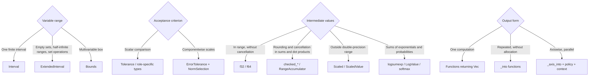

Before calling a numerical function, the caller decides five things.
These are the variable ranges, what to accept and on what scale, how many iterations or evaluations to allow, how to represent intermediate values, and where to write results.
This page gives criteria for choosing `scioxide-core` types and functions for each decision.
For computations taking arrays and operators, also choose how to construct layouts and implement operators.

## Decision flow

The diagram lists four questions from top to bottom; the questions are independent.
Computational resource limits do not branch according to problem properties, so select them from the [computational resource limits](#computational-resource-limits) table instead of the diagram.



## Domain types

| Range | Type | Invariants | Main uses |
|---|---|---|---|
| Finite closed interval $[a, b]$ | `Interval<S>` | Finite endpoints with $a \le b$; $a = b$ is allowed | Bracketing a scalar root, one-dimensional integration domains |
| Closed set including empty or infinite-ended ranges | `ExtendedInterval<S>` | Finite endpoints are included; infinity is not stored as an endpoint | Intersections and convex hulls of allowed ranges |
| Multivariable box | `Bounds<S>` | `(Option<S>, Option<S>)` per variable; a side with `None` is unbounded; at least one variable | Multivariable optimization, bounded finite differences |

All types check endpoints at construction: NaN or infinity produces `NonFinite`, and reversed endpoints produce `InvalidInput`.
The `width()` and `midpoint()` methods of `Interval` return correctly rounded values.
`midpoint()` avoids intermediate overflow, so the midpoint of $[-\mathrm{MAX}, \mathrm{MAX}]$ is 0 ($\mathrm{MAX}$ is the largest finite value).
A result outside the finite range produces `NumericalInstability`; the width of that same interval is an example.
The `intersection` and `hull` methods of `ExtendedInterval` only select endpoints and perform no arithmetic, so they introduce no rounding.
They do not provide interval enclosures through outward rounding.
Use [scioxide-validated](../../scioxide-validated/) when enclosures are required.

The following cell constructs the chosen range with `ExtendedInterval` and checks whether `Interval::new` succeeds with the same endpoints.
Its inputs are left endpoint $a$ and right endpoint $b$ (integers from $-10$ to 10), and the range kind (finite, either half-infinite kind, or empty).
For each operation, the table shows the resulting set kind, lower and upper endpoints, whether it contains 0, and the failure category if it fails.
The final two rows show intersection and convex hull with $[0, 10]$.
Unbounded sides and endpoints of empty sets appear as "None."
Reversing the endpoints makes `Interval::new` reject them with `InvalidInput`; the rightmost column shows that category's name.

```rust
//| id: core-domain-types
//| ref: core-domain-types
//| title: "Interval types and set operations"
//| run: reactive
//| crates: [scioxide-core]
//| inputs:
//|   left: {"type":"range","label":"Left endpoint a [-]","description":"The interval's lower endpoint.","min":-10,"max":10,"step":1,"value":-2}
//|   right: {"type":"range","label":"Right endpoint b [-]","description":"The interval's upper endpoint. A value below a reverses the endpoints.","min":-10,"max":10,"step":1,"value":5}
//|   domain_mode: {"type":"select","label":"Range kind","description":"Finite, half-infinite, or empty.","options":["[a, b]","[a, +∞)","(-∞, b]","Empty set"],"value":"[a, b]"}
//| cases:
//|   - {"id":"half-line","label":"[a, +∞)","description":"A range unbounded above. Its convex hull is also unbounded above.","inputs":{"domain_mode":"[a, +∞)"}}
//|   - {"id":"reversed","label":"Reversed endpoints","description":"At a = 5 and b = -2, both types reject the input with InvalidInput.","inputs":{"left":5,"right":-2}}
//|   - {"id":"empty","label":"Empty set","description":"The intersection is empty, and the convex hull is [0, 10].","inputs":{"domain_mode":"Empty set"}}
//| tests:
//|   - case: default
//|     expect:
//|       - {"artifact":"sets","path":"/rows/0/1","equals":"Finite closed interval"}
//|       - {"artifact":"sets","path":"/rows/0/2","approx":{"value":-2,"atol":1e-12}}
//|       - {"artifact":"sets","path":"/rows/0/3","approx":{"value":5,"atol":1e-12}}
//|       - {"artifact":"sets","path":"/rows/2/2","approx":{"value":0,"atol":1e-12}}
//|       - {"artifact":"sets","path":"/rows/2/3","approx":{"value":5,"atol":1e-12}}
//|       - {"artifact":"sets","path":"/rows/3/2","approx":{"value":-2,"atol":1e-12}}
//|       - {"artifact":"sets","path":"/rows/3/3","approx":{"value":10,"atol":1e-12}}
//|       - {"artifact":"interval","path":"/rows/0/0","approx":{"value":7,"atol":1e-12}}
//|       - {"artifact":"interval","path":"/rows/0/1","approx":{"value":1.5,"atol":1e-12}}
//|   - case: half-line
//|     expect:
//|       - {"artifact":"sets","path":"/rows/1/1","equals":"Unbounded above"}
//|       - {"artifact":"sets","path":"/rows/1/3","equals":null}
//|       - {"artifact":"sets","path":"/rows/2/3","approx":{"value":10,"atol":1e-12}}
//|       - {"artifact":"sets","path":"/rows/3/3","equals":null}
//|   - case: reversed
//|     expect:
//|       - {"artifact":"sets","path":"/rows/0/5","equals":"InvalidInput"}
//|       - {"artifact":"sets","path":"/rows/1/5","equals":"InvalidInput"}
//|       - {"artifact":"interval","path":"/rows/0/0","equals":null}
//|   - case: empty
//|     expect:
//|       - {"artifact":"sets","path":"/rows/1/1","equals":"Empty set"}
//|       - {"artifact":"sets","path":"/rows/2/1","equals":"Empty set"}
//|       - {"artifact":"sets","path":"/rows/3/3","approx":{"value":10,"atol":1e-12}}
use scioxide_core::{ExtendedInterval, SciOxideError, SciOxideErrorKind, Interval};

let (a, b) = (left, right);
// Rows contain (operation, set kind, lower endpoint, upper endpoint, contains 0, failure category).
type Row = (
    &'static str,
    &'static str,
    Option<f64>,
    Option<f64>,
    &'static str,
    &'static str,
);
let rejected = |operation: &'static str, error: &SciOxideError| -> Row {
    let kind = match error.kind() {
        SciOxideErrorKind::InvalidInput => "InvalidInput",
        _ => "Other category",
    };
    (operation, "Cannot construct", None, None, "-", kind)
};
let described = |operation: &'static str, set: &ExtendedInterval<f64>| -> Row {
    let contains_zero = if set.contains(0.0) {
        "Contains"
    } else {
        "Does not contain"
    };
    match set.bounds() {
        None => (operation, "Empty set", None, None, contains_zero, "-"),
        Some((lower, upper)) => {
            let shape = match (lower, upper) {
                (Some(_), Some(_)) => "Finite closed interval",
                (Some(_), None) => "Unbounded above",
                (None, Some(_)) => "Unbounded below",
                (None, None) => "All real numbers",
            };
            (operation, shape, lower, upper, contains_zero, "-")
        }
    }
};

let interval = Interval::new(a, b);
let mut rows = vec![match &interval {
    Ok(interval) => described("Interval::new(a, b)", &ExtendedInterval::from(*interval)),
    Err(error) => rejected("Interval::new(a, b)", error),
}];
let set = match domain_mode.as_str() {
    "[a, b]" => ExtendedInterval::new(Some(a), Some(b)),
    "[a, +∞)" => ExtendedInterval::new(Some(a), None),
    "(-∞, b]" => ExtendedInterval::new(None, Some(b)),
    _ => Ok(ExtendedInterval::empty()),
};
match &set {
    Ok(set) => {
        let reference =
            ExtendedInterval::new(Some(0.0), Some(10.0)).map_err(|e| e.to_string())?;
        rows.push(described("ExtendedInterval", set));
        rows.push(described(
            "Intersection with [0, 10]",
            &set.intersection(&reference),
        ));
        rows.push(described("Convex hull with [0, 10]", &set.hull(&reference)));
    }
    Err(error) => rows.push(rejected("ExtendedInterval::new", error)),
}
let digits = serde_json::json!({ "significantDigits": 6 });
let set_columns = serde_json::json!([
    { "key": "0", "label": "Operation" },
    { "key": "1", "label": "Set kind" },
    { "key": "2", "label": "Lower endpoint [-]", "type": "number", "format": digits, "nullText": "None" },
    { "key": "3", "label": "Upper endpoint [-]", "type": "number", "format": digits, "nullText": "None" },
    { "key": "4", "label": "Contains 0" },
    { "key": "5", "label": "Failure category kind()" }
]);
emit_table_with_columns!(
    set_columns,
    rows,
    metadata = serde_json::json!({ "id": "sets" })
);

// Show width and midpoint only when Interval construction succeeds.
let (width, midpoint) = match &interval {
    Ok(interval) => (
        Some(interval.width().map_err(|e| e.to_string())?),
        Some(interval.midpoint().map_err(|e| e.to_string())?),
    ),
    Err(_) => (None, None),
};
let interval_columns = serde_json::json!([
    { "key": "0", "label": "Width width() [-]", "type": "number", "format": digits, "nullText": "Cannot construct" },
    { "key": "1", "label": "Midpoint midpoint() [-]", "type": "number", "format": digits, "nullText": "Cannot construct" }
]);
emit_table_with_columns!(
    interval_columns,
    vec![(width, midpoint)],
    metadata = serde_json::json!({ "id": "interval" })
);
```

At the defaults ($a = -2$, $b = 5$, finite range), `Interval` and `ExtendedInterval` are both $[-2, 5]$, with width 7 and midpoint 1.5.
The intersection with $[0, 10]$ is $[0, 5]$, and the convex hull is $[-2, 10]$.
The convex hull is the smallest closed interval containing both sets, not their union.

Choosing $[a, +\infty)$ gives `ExtendedInterval` no upper endpoint; its intersection is $[0, 10]$ and its convex hull is $[-2, +\infty)$, unbounded above.
Because `Interval::new(a, b)` is constructed from two finite endpoints regardless of the chosen range kind, the first row remains $[-2, 5]$.
Choosing the empty set makes the intersection empty and the convex hull equal to the other set, $[0, 10]$.
Reversing the endpoints ($a = 5$, $b = -2$) makes both `Interval::new` and `ExtendedInterval::new` return `InvalidInput`.

When an endpoint computed by intersection or convex hull is zero, the lower endpoint is normalized to $-0$ and the upper to $+0$ (the IEEE 1788 convention).
The result is therefore unchanged when the operands are swapped, and $-0$ also equals 0 as a value.

The failure category `kind()` is a variant of `SciOxideErrorKind`; use `view()` to read argument names or reasons programmatically.
[Error categories and detailed views](../algorithms/errors-and-diagnostic-views/) lists the categories and explains their details.

## Tolerance roles

For many types, the threshold is $\tau(s) = \tau_{\mathrm{abs}} + \tau_{\mathrm{rel}}\, s$.
Here $\tau_{\mathrm{abs}}$ is absolute tolerance, $\tau_{\mathrm{rel}}$ is relative tolerance, and $s$ is a representative scale with the same units as the assessed quantity.
The units of that quantity and the choice of $s$ differ by role.

| Assessed quantity | Type | Absolute term units | Example representative scale |
|---|---|---|---|
| State change | `StepTolerance` | State units | State magnitude |
| Equation residual | `ResidualTolerance` | Residual units | Magnitude of terms forming the residual |
| Objective gradient | `GradientTolerance` | Objective / state units | Objective magnitude |
| Numerical rank | `RankThreshold` | Singular value units | Largest singular value |
| Constraint violation | `FeasibilityTolerance` | Constraint units | Magnitudes of constraint terms |
| Distance from an integer | `IntegralityTolerance` | Dimensionless ($[0, 0.5)$) | None |
| Local vector error | `ErrorTolerance` | Componentwise (`AbsoluteTolerance`) | Componentwise scales, reduced with `NormSelection` |
| Convergence based only on relative accuracy | `RelativeTolerance` | None (relative term only) | Method-dependent |

The `Default` of role-specific types and `ErrorTolerance` uses $\sqrt{\varepsilon}$ for both absolute and relative terms ($\varepsilon$ is the scalar type's machine epsilon).
The `Default` of `IntegralityTolerance` is $\sqrt{\varepsilon}$, and the `Default` of `RelativeTolerance` is $\varepsilon$.
[Tolerance roles and acceptance contracts](../algorithms/error-and-tolerance-contracts/) explains acceptance rules and norm differences.

## Computational resource limits

Separately from tolerances, set positive integer limits `Budget` for each count-limited item in `SolveBudgets::with_limit(kind, budget)`.

| `BudgetKind` | Target | Treatment in nested solves |
|---|---|---|
| `Iteration` | Iterations | Local |
| `Proposal` | Candidate proposals (such as line-search trial points) | Local |
| `Evaluation` | Callback invocations | Shared with outer solves |
| `Subdivision` | Adaptive subdivisions | Shared with outer solves |
| `Sample` | Random samples | Shared with outer solves |
| `Node` | Search-tree nodes | Shared with outer solves |

Local items check limits against the solve's own counts; shared items also add inner solve work to outer solve counts when checking limits.
Reaching a limit is returned as a value such as `Admission::Denied` or `Invocation::BudgetExhausted`, distinguished from numerical breakdown.
Limit `Evaluation` for problems with expensive evaluations, or `Iteration` when you want to detect slow iteration progress early.

`Budget` cannot represent zero.
Choose among the following three construction methods according to the value's source.

| Value source | Construction | Behavior for zero |
|---|---|---|
| Constant written in source | `budget!(256)`, `budget!(64 * 1024)` | Compilation error |
| Runtime `usize` | `Budget::try_from(n)?` | `InvalidInput` (`OutOfRange`) |
| Validated `NonZeroUsize` | `Budget::from(n)` | Cannot occur |

Because `budget!` produces a constant, it can also be used in constant definitions such as `const MAX_TERMS: Budget = budget!(256);`.
`Budget::ONE` provides the smallest limit.

## Arithmetic paths

| Situation | Use | Accuracy contract |
|---|---|---|
| Values are in range with little cancellation | `f32` / `f64` and `RealScalar` methods | Elementary function ULP contracts |
| Sums of differently scaled terms, dot products with cancellation | `checked_sum`, `checked_sum_of_products`, `RangeAccumulator`, `ProductSum` | One rounding, independent of order |
| Intermediate products or quotients leave the range | `checked_float_product_factors`, `checked_product_quotient` | Relative error at most $\gamma_k$ for a product of $k + 1$ factors (when the result is normal); quotients of products within 4 ULP |
| The result itself is outside double-precision range | `Scaled`, `ScaledValue`, `ScaledAccumulator` | `i64` exponents, range checked on projection |
| Sums of exponentials, probabilities, likelihoods | `logsumexp`, `weighted_logsumexp`, `LogValue`, `softmax_into` | 16 ULP for real log-sums and nonnegative weights; proportional to the cancellation condition number for signed weights |
| Cancellation near zero (such as $\cos x - 1$) | `cosm1`, `exprel`, `powm1`, `xlog1py`, and others | 16 ULP for real arguments |
| Array sizes and index calculations | `backend::checked_add`, `backend::checked_mul`, `backend::checked_product` | Overflow reported as `SizeOverflow` |

Here $\gamma_k = k u / (1 - k u)$, and $u = \varepsilon / 2$ is unit roundoff.
[Range-safe arithmetic](../algorithms/range-safe-arithmetic/) and [Logarithmic sums, weighted sums, and normalization](../algorithms/logarithmic-reductions/) give bound derivations and applicability conditions.

## Array and operator entry points

Pass multidimensional arrays as views associating storage slices with layouts.
Pass operators as trait-implementing types or closures.

| Input | Entry point | Selection condition |
|---|---|---|
| Unpadded row-major array | `NdView::row_major(data, &shape)`, `NdViewMut::row_major`, `StridedLayout::row_major(&shape)` | Rank at most 8; no stride array needed |
| Transpose, padded array, or rank at least 9 | `StridedLayout::new(&extents, &strides)` and `NdView::new` / `NdViewMut::new` | A layout for which distinct coordinates can be proved to map to distinct locations |
| Broadcasting (read-only) | `StridedLayout::new_broadcast` and `NdView::new` | Elements share locations, for example through zero strides; unavailable for writing |
| Multiple right-hand sides | `BlockVectorView::new`, `BlockVectorViewMut::new` | Column-major, with length exactly rows × right-hand sides |
| Stateful operators or operators using workspaces | Types implementing `LinearOperator`, `AdjointOperator`, `Preconditioner` | Include nested work in accounting or borrow a dense matrix kernel |
| Operator expressible as a formula | `ClosureOperator::new(rows, cols, apply)` | Methods using only $A x$ |
| Operator also requiring an adjoint | `ClosureOperator::new(…).with_adjoint(adjoint)` | Methods using $A^{\mathsf{H}} x$, or VJPs |
| Preconditioning expressible as a formula | `ClosurePreconditioner::new(dimension, apply)` | $M^{-1} x$ can be written as a closure |

Closure operators and preconditioners construct a result in workspace before copying it to output, adding one output-length copy and a finiteness check.
[Borrowed layouts and affine values](../algorithms/borrowed-layouts-and-affine-values/) and [Operator protocols and closure operators](../algorithms/operator-protocols-and-structure/) explain layout and operator rules.

## Output forms

Function name suffixes distinguish how results are received.

| Form | Examples | Storage | Execution | Suitable use |
|---|---|---|---|---|
| Returns `Vec` | `softmax`, `log_softmax` | Allocate the result once | Sequential | One computation, prototyping |
| `_into` | `softmax_into`, `log_softmax_into`, `affine_combination_into` | Caller output and workspace; no allocation | Sequential | Inside iteration |
| `_axis` | `softmax_axis`, `log_softmax_axis`, `logsumexp_axis`, `weighted_logsumexp_axis` | Allocate result and required work storage | Sequential | A single axiswise array computation |
| `_axis_into` | `softmax_axis_into`, `log_softmax_axis_into`, `logsumexp_axis_into`, `weighted_logsumexp_axis_into` | Caller-provided `NdViewMut` and workspace | Specified by `ExecutionPolicy` and `ExecutionContext` | Repeated axiswise computations, parallel execution |

`_into` functions validate all inputs before writing to output.
On failure, output is unchanged, but workspace contents may change.
`_axis` and `_axis_into` take input through `NdView` and compute independently for each lane along the specified axis.
Per-lane computations are identical regardless of policy, so results do not depend on `ExecutionPolicy`.

Specify parallelism separately through `ExecutionPolicy` (intent) and `ExecutionContext` (executor, cancellation, clock).
Functions without a context argument use `ExecutionContext::sequential_native()` and can select kernels using native processor capabilities.
Pass `ExecutionContext::native(&executor)` to use the same kernels with your own executor, or `ExecutionContext::sequential()` for sequential execution without native capabilities.
[Execution policies, partitioning, and execution contexts](../algorithms/execution-and-partitions/) explains partition selection and reproducibility.

## Summary

Choose among `Interval`, `ExtendedInterval`, and `Bounds` according to endpoint finiteness and the need for set operations.
Choose acceptance types according to the role of the assessed quantity, and specify iteration or evaluation limits separately through `Budget` and `SolveBudgets`.
Write constant limits with `budget!` to detect erroneous zeros at compile time.
According to intermediate range and cancellation, choose ordinary floating-point arithmetic, exact accumulation, extended-range values, or logarithmic representations.
Pass row-major arrays through `row_major`, formula-defined operators and preconditioners through `ClosureOperator` and `ClosurePreconditioner`, and move allocations outside iteration with `_into` or `_axis_into` forms for repeated calls.
When a function fails, inspect its category through `kind()` before reading the argument or reason through `view()`.

## Further reading

- [The mathematics of the shared foundation](../algorithms/): Check accuracy contract categories and the scope of each algorithm page.
- [Protect intermediate values before the final result](../examples/range-safe-arithmetic/): Compare arithmetic paths through worked examples.
- [Error categories and detailed views](../algorithms/errors-and-diagnostic-views/): Read the 20 `kind()` categories and `view()` details to identify failure causes.
- [Shared contracts API guide](../api/): Look up all types and functions by purpose.
