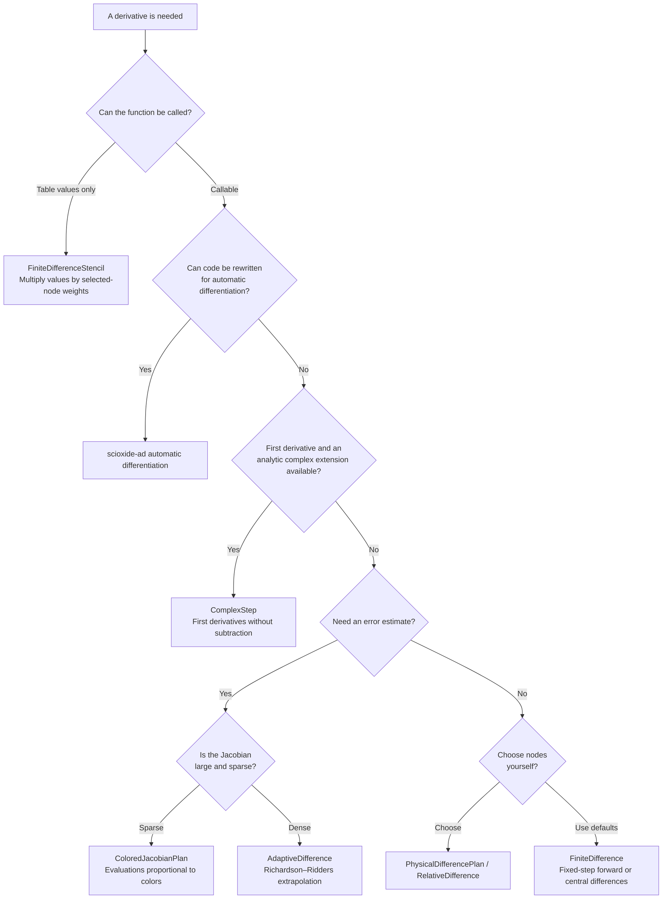

Derivative methods depend on the function representation, required derivative shape, and allowable accuracy and cost.
This page presents method-selection decisions, compares errors, evaluation counts, sample ranges, and error estimates, and measures evaluation counts and errors for an actual function.
It then compares automatic and analytic differentiation and explains `DerivativeStrategy` for switching derivative sources by policy.
Terms such as one-shot function, method value, Plan, and error estimate are defined in [Call forms](oxref:differentiate-call-forms-terms).

## Decisions to make first

Check these five points before choosing a method.

| Question | Effect on method choice |
|---|---|
| How is the function represented? | Use automatic differentiation for Rust code that can be rewritten generically over scioxide-ad's `Real` trait, complex steps if complex evaluation is available, differences for black-box functions, or node weights `FiniteDifferenceStencil` for tables alone |
| What derivative shape is required? | Scalar first or second derivatives, gradients, Jacobians, Hessians, directional derivatives, and sparse Jacobians require different operations and evaluation counts |
| Is the evaluation point near a domain boundary? | Supply bounds `Bounds`. Samples stay inside; if boundary distance is less than the step, use inward one-sided differences. Adaptive differences start with large steps, so supply bounds or smaller steps |
| What accuracy and error estimates are required? | Use adaptive differences or coloring for estimates; for rounding-scale accuracy, use automatic differentiation or complex steps for first derivatives |
| What are evaluation cost and function noise? | Expensive evaluations favor fewer calls; with noise, choose steps from noise magnitude |

## Method-selection flow



If central differences with default steps suffice, one-shot functions `derivative`, `second_derivative`, `gradient`, `jacobian`, `hessian`, and `jvp` return values only.
Complex-step, coloring, and node-difference one-shot functions are `complex_step_derivative`, `sparse_jacobian`, and `physical_difference_derivative`, respectively.
Use the method values and Plans in the diagram to change bounds, steps, tolerances, or limits, or read termination reasons and error estimates.

Complex steps obtain first derivatives without subtraction.
Second derivatives apply real-node differences to complex-step first derivatives.
Even with optimal node spacing, their error is therefore about $\varepsilon^{2/3}$: smaller than real three-point second-difference error $\varepsilon^{1/2}$, but above the rounding magnitude of first derivatives ([Complex-step second derivatives, Hessians, and directional derivatives](oxref:differentiate-complex-second)).
Noisy functions do not satisfy analytic-extension assumptions; use differences and choose steps from noise magnitude ([Rounding, noise, and optimal step size](oxref:differentiate-noisy-functions)).

## Method comparison

These are double-precision guidelines when relative function-value errors are a few times unit roundoff.
$n$ is the variable count; $L_i$ is the actual number of adaptive levels (differences after one step reduction) used at coordinate $i$, often 3–16 under default limit 16; $c$ is the color count; $L_c$ is levels used by color $c$.
Sample ranges indicate typical distances of coordinate $x_i$'s sample points from the evaluation point.

| Method | Truncation order | Typical attainable error | Gradient evaluations | Sample range | Error estimate |
|---|---|---|---|---|---|
| Forward difference `FiniteDifference` | 1 | $\sqrt{\varepsilon} \approx 1.5 \times 10^{-8}$ | $n + 1$ ($n$ with `base`) | $\sqrt{\varepsilon} \max(1, \lvert x_i \rvert)$ | None |
| Central difference `FiniteDifference` | 2 | $\varepsilon^{2/3} \approx 3.7 \times 10^{-11}$ | $2n + 1$ ($2n$ with `base`) | $\varepsilon^{1/3} \max(1, \lvert x_i \rvert)$ | None |
| Adaptive difference `AdaptiveDifference` | Increases with levels | Estimated error at or below default tolerance $\sqrt{\varepsilon}(1 + \lvert D \rvert)$ | $1 + 2 \sum_i L_i$ (default $1 + 6n$–$1 + 32n$) | $0.5 \max(1, \lvert x_i \rvert)$ initially | Yes |
| Coloring `ColoredJacobianPlan` (Jacobian) | As adaptive differences | As adaptive differences | $1 + 2 \sum_c L_c$ (with or without bounds) | As adaptive differences | Yes |
| Complex steps `ComplexStep` | 2 (negligible at default $h = \varepsilon$) | Function-evaluation rounding (uncertified) | $n + 1$ | $\varepsilon$ in the imaginary direction; unchanged real part | None |
| Node differences `PhysicalDifferencePlan` and others | Depends on node count | Depends on nodes and noise | Sum of per-coordinate node counts | Supplied nodes | None |

For smooth functions of moderate magnitude, actual adaptive errors are often far below default tolerance (at most $10^{-13}$ in the measurements below).
The initial adaptive step $0.5 \max(1, \lvert x_i \rvert)$ is large; near domain endpoints, such as $x = 0$ for $\ln x$, supply bounds `Bounds` or a small step `with_step` ([Domain boundaries and one-sided differences](../algorithms/bounds-and-one-sided/)).
Fixed-step and complex-step completion `Completed` makes no accuracy claim; only adaptive differences and coloring return error estimates.
Adaptive estimates are not upper bounds either; steps or tolerances mismatched to quantity scales can return wrong values with small estimated errors or `Converged` ([Temperature sensitivity of the Arrhenius equation with complex steps](../examples/arrhenius-complex-step/), [Derivatives and error estimates for the van der Waals equation](../examples/van-der-waals-adaptive/)).

## Measuring cost and accuracy

The cells in this and the next section compute the gradient of $f(\mathbf{x}) = \sum_i e^{x_i} \sin x_{i+1}$ (cyclic indices) at $x_i = 0.3 + 0.2\,i$.
The exact gradient is $\partial f / \partial x_i = e^{x_i} \sin x_{i+1} + e^{x_{i-1}} \cos x_i$.
The following block defines shared code for the two cells.
`cyclic` represents $f$; `cyclic_complex` evaluates the same expression with complex numbers for complex steps; `cyclic_gradient` independently computes the exact gradient with f64's inherent methods; `cyclic_point` supplies evaluation points.
`summarize` extracts evaluations, iterations, maximum exact-gradient error, maximum estimated error, and termination reason from a result.

```rust
//| id: differentiate-choosing-cyclic-model
//| kind: definitions
//| title: "Cyclic-sum function, complex version, exact gradient, and result summary"
//| crates: [scioxide-core, scioxide-differentiate]
use scioxide_core::{Complex, RealScalar};
use scioxide_differentiate::DifferentiationResult;

/// f(x) = Σᵢ e^{xᵢ} sin x_{i+1} (cyclic indices).
pub(crate) fn cyclic(p: &[f64]) -> f64 {
    (0..p.len())
        .map(|i| RealScalar::exp(p[i]) * RealScalar::sin(p[(i + 1) % p.len()]))
        .sum()
}

/// Analytic extension evaluating the same expression with complex numbers.
pub(crate) fn cyclic_complex(z: &[Complex<f64>]) -> Complex<f64> {
    (0..z.len()).fold(Complex::new(0.0, 0.0), |s, i| {
        s + z[i].exp() * z[(i + 1) % z.len()].sin()
    })
}

/// Reference: ∂f/∂xᵢ = e^{xᵢ} sin x_{i+1} + e^{x_{i−1}} cos xᵢ (independent computation with f64 inherent methods).
pub(crate) fn cyclic_gradient(x: &[f64]) -> Vec<f64> {
    let n = x.len();
    (0..n)
        .map(|i| x[i].exp() * x[(i + 1) % n].sin() + x[(i + n - 1) % n].exp() * x[i].cos())
        .collect()
}

/// Evaluation point xᵢ = 0.3 + 0.2 i (i = 0, …, n − 1).
pub(crate) fn cyclic_point(n: usize) -> Vec<f64> {
    (0..n).map(|i| 0.3 + 0.2 * i as f64).collect()
}

/// Summary of one method's result.
pub(crate) struct Summary {
    pub(crate) evaluations: usize,
    pub(crate) iterations: usize,
    pub(crate) error: f64,
    pub(crate) estimate: Option<f64>,
    pub(crate) termination: String,
}

/// Maximum error against the exact gradient and maximum estimated error (None for methods without estimates).
pub(crate) fn summarize(
    result: &DifferentiationResult<f64>,
    exact: &[f64],
) -> Result<Summary, String> {
    let report = result.report();
    let values = result.values().ok_or("Gradient not published")?;
    let error = values
        .iter()
        .zip(exact)
        .fold(0.0_f64, |m, (a, b)| m.max((a - b).abs()));
    let estimate = result
        .errors()
        .map(|e| e.iter().fold(0.0_f64, |m, v| m.max(*v)));
    Ok(Summary {
        evaluations: report.evaluations(),
        iterations: report.iterations(),
        error,
        estimate,
        termination: report.termination().to_string(),
    })
}
```

The first cell computes gradients with owned forms of four methods and compares evaluations and maximum exact-gradient errors.
The input is variable count $n$.
The table's “Evaluation formula” is $n + 1$ for forward differences, $2n + 1$ for central differences, $n + 1$ for complex steps, and $1 + 2 \times (\text{iterations})$ for adaptive differences (adaptive iterations equal the sum of levels $\sum_i L_i$).
The chart is a scatter plot of error against evaluations, showing the relation between computational work and accuracy.

```rust
//| id: differentiate-cost-accuracy-map
//| ref: differentiate-cost-accuracy-map
//| title: "Gradient evaluations and errors by method"
//| run: reactive
//| uses: [differentiate-choosing-cyclic-model]
//| crates: [scioxide-core, scioxide-differentiate]
//| inputs:
//|   n: {"type":"range","label":"Variable count n","description":"Number of variables in the differentiated function.","min":1,"max":12,"step":1,"value":4}
//| cases:
//|   - {"id":"twelve-variables","label":"n = 12","description":"Evaluations grow proportionally to n as predicted. Larger coordinates also increase difference errors, while complex-step errors remain at rounding magnitude.","inputs":{"n":12}}
//| tests:
//|   - case: default
//|     expect:
//|       - {"artifact":"costs","path":"/rows/0/1","equals":5}
//|       - {"artifact":"costs","path":"/rows/0/3","range":{"min":1e-9,"max":1e-6}}
//|       - {"artifact":"costs","path":"/rows/1/1","equals":9}
//|       - {"artifact":"costs","path":"/rows/1/3","range":{"min":1e-12,"max":1e-9}}
//|       - {"artifact":"costs","path":"/rows/2/1","range":{"min":25,"max":129}}
//|       - {"artifact":"costs","path":"/rows/2/3","range":{"max":1e-12}}
//|       - {"artifact":"costs","path":"/rows/2/5","equals":"Converged"}
//|       - {"artifact":"costs","path":"/rows/3/1","equals":5}
//|       - {"artifact":"costs","path":"/rows/3/3","range":{"max":1e-14}}
//|   - case: twelve-variables
//|     expect:
//|       - {"artifact":"costs","path":"/rows/0/1","equals":13}
//|       - {"artifact":"costs","path":"/rows/1/1","equals":25}
//|       - {"artifact":"costs","path":"/rows/1/3","range":{"max":1e-9}}
//|       - {"artifact":"costs","path":"/rows/2/1","range":{"min":73,"max":385}}
//|       - {"artifact":"costs","path":"/rows/3/1","equals":13}
//|       - {"artifact":"costs","path":"/rows/3/3","range":{"max":1e-14}}
use scioxide_core::{Complex, SciOxideError};
use scioxide_differentiate::{
    AdaptiveDifference, ComplexStep, DifferenceScheme, FiniteDifference,
};

let n = n as usize;
let x = cyclic_point(n);
let exact = cyclic_gradient(&x);
let f = |p: &[f64], y: &mut [f64]| {
    y[0] = cyclic(p);
    Ok::<(), SciOxideError>(())
};
// Supply the complex version of the same expression for complex steps.
let g = |z: &[Complex<f64>], y: &mut [Complex<f64>]| {
    y[0] = cyclic_complex(z);
    Ok::<(), SciOxideError>(())
};
let fixed = |scheme| {
    FiniteDifference::default()
        .with_scheme(scheme)
        .gradient(f, &x, None, None)
};
let results = [
    ("Forward difference", fixed(DifferenceScheme::Forward), Some(n + 1)),
    (
        "Central difference",
        fixed(DifferenceScheme::Central),
        Some(2 * n + 1),
    ),
    (
        "Adaptive difference",
        AdaptiveDifference::default().gradient(f, &x, None),
        None,
    ),
    (
        "Complex-step method",
        ComplexStep::default().gradient(g, &x),
        Some(n + 1),
    ),
];
let (mut rows, mut series) = (Vec::new(), Vec::new());
for (name, result, formula) in results {
    let s = summarize(&result.map_err(|e| e.to_string())?, &exact)?;
    // Adaptive differences evaluate f(x) once and each coordinate twice per level.
    let formula = formula.unwrap_or(1 + 2 * s.iterations);
    // Exclude exactly zero errors from the scatter plot because logarithmic axes cannot display them.
    if s.error > 0.0 {
        let point = [s.evaluations as f64, s.error];
        series.push(serde_json::json!({ "name": name, "points": [point] }));
    }
    rows.push((
        name,
        s.evaluations,
        formula,
        s.error,
        s.estimate,
        s.termination,
    ));
}
let sci3 = serde_json::json!({ "notation": "scientific", "significantDigits": 3 });
let columns = serde_json::json!([
    { "key": "0", "label": "Method" },
    { "key": "1", "label": "Evaluations [count]", "type": "integer" },
    { "key": "2", "label": "Evaluation formula [count]", "type": "integer" },
    { "key": "3", "label": "Maximum gradient error [-]", "type": "number", "format": sci3 },
    { "key": "4", "label": "Maximum estimated error [-]", "type": "number", "format": sci3, "nullText": "None" },
    { "key": "5", "label": "Termination reason" }
]);
emit_table_with_columns!(
    columns,
    rows,
    metadata = serde_json::json!({ "id": "costs" })
);
emit_scatter_chart!(
    &series,
    options = &serde_json::json!({
        "xLabel": "Evaluations [count]",
        "yLabel": "Maximum gradient error [-]",
        "xType": "log",
        "yType": "log"
    })
);
```

At default $n = 4$, forward differences use 5 evaluations with error $5.5 \times 10^{-8}$, and central differences use 9 with error $4.6 \times 10^{-11}$.
Adaptive differences reduce error to $1.7 \times 10^{-14}$ in 47 evaluations, return estimated error $4.3 \times 10^{-10}$ exceeding actual error, and stop with `Converged`.
Complex steps give error $8.9 \times 10^{-16}$ in 5 evaluations, the highest accuracy per evaluation for this function.
Every row's evaluation count matches its formula.
At $n = 12$, formulas give 13 calls for forward differences and complex steps, 25 for central differences, and 151 for adaptive differences, moving scatter points rightward.
Coordinates reach $x_{11} = 2.5$, and both $e^{x_i}$ and the steps proportional to $\max(1, \lvert x_i \rvert)$ grow, increasing difference errors ($4.9 \times 10^{-10}$ for central differences).
Complex-step error remains at rounding magnitude, $1.8 \times 10^{-15}$.

## Comparing noisy functions

The second cell adds noise of magnitude $\sigma$ to the same function and compares forward, central, and adaptive gradient errors and adaptive termination ($n = 4$).
Noise multiplies pseudorandom $\eta(\mathbf{x})$ in $[-1, 1)$, generated from point bits, by $\sigma$, giving identical values at identical points.
No complex-step comparison is made because the noisy function has no analytic complex extension.

Central-difference error can be estimated by truncation $h^2 \lvert f''' \rvert / 6$ plus noise contribution $\sigma / h$.
Minimizing this over $h$ gives $h^\ast = (3\sigma / \lvert f''' \rvert)^{1/3}$.
This cell uses $h^\ast = (3\sigma)^{1/3}$, assuming a third derivative of magnitude 1; when $\sigma$ (such as $\sigma = 0$) makes $h^\ast$ smaller than default step $\varepsilon^{1/3}$, it uses the default.
The input is noise magnitude $\sigma$; the table shows each method's step, evaluations, maximum gradient error, maximum estimated error, and termination.

```rust
//| id: differentiate-cost-accuracy-noise
//| ref: differentiate-cost-accuracy-noise
//| title: "Noisy-function gradient errors by method"
//| run: reactive
//| uses: [differentiate-choosing-cyclic-model]
//| crates: [scioxide-core, scioxide-differentiate]
//| inputs:
//|   sigma: {"type":"select","label":"Noise magnitude σ","description":"Amplitude of noise added to function values.","options":["0","1e-10","1e-6"],"value":"1e-6"}
//| cases:
//|   - {"id":"no-noise","label":"σ = 0","description":"Without noise, default steps are near optimal and central-difference error returns to order 10^-11.","inputs":{"sigma":"0"}}
//|   - {"id":"small-noise","label":"σ = 1e-10","description":"With small noise, adaptive differences stop with Converged and estimates exceed actual errors.","inputs":{"sigma":"1e-10"}}
//| tests:
//|   - case: default
//|     expect:
//|       - {"artifact":"noisy","path":"/rows/0/3","range":{"min":1}}
//|       - {"artifact":"noisy","path":"/rows/1/3","range":{"min":1e-3,"max":1}}
//|       - {"artifact":"noisy","path":"/rows/2/1","approx":{"value":0.014422495703074084,"rtol":1e-12}}
//|       - {"artifact":"noisy","path":"/rows/2/3","range":{"max":1e-4}}
//|       - {"artifact":"noisy","path":"/rows/3/5","equals":"RoundoffLimit"}
//|   - case: no-noise
//|     expect:
//|       - {"artifact":"noisy","path":"/rows/1/3","range":{"max":1e-9}}
//|       - {"artifact":"noisy","path":"/rows/3/3","range":{"max":1e-12}}
//|   - case: small-noise
//|     expect:
//|       - {"artifact":"noisy","path":"/rows/3/5","equals":"Converged"}
use scioxide_core::SciOxideError;
use scioxide_differentiate::{
    AdaptiveDifference, DifferenceScheme, DifferenceStep, FiniteDifference,
};

let sigma: f64 = sigma.parse().map_err(|_| "Cannot read σ")?;
// Noise model: mix coordinate bit patterns with splitmix64 into a value in [-1, 1).
let eta = |p: &[f64]| {
    let mut z = p.iter().fold(0x2545_F491_4F6C_DD1D_u64, |h, v| {
        h.rotate_left(17) ^ v.to_bits()
    });
    z = (z ^ (z >> 30)).wrapping_mul(0xBF58_476D_1CE4_E5B9);
    z = (z ^ (z >> 27)).wrapping_mul(0x94D0_49BB_1331_11EB);
    z ^= z >> 31;
    (z >> 11) as f64 / (1_u64 << 53) as f64 * 2.0 - 1.0
};
let x = cyclic_point(4);
// The reference is the exact gradient of the noiseless function.
let exact = cyclic_gradient(&x);
let f = |p: &[f64], y: &mut [f64]| {
    y[0] = cyclic(p) + sigma * eta(p);
    Ok::<(), SciOxideError>(())
};
// Steps for display: since 0 < x_i < 1, defaults are √ε and ε^(1/3).
let h_star = (3.0 * sigma).cbrt().max(f64::EPSILON.cbrt());
let tuned = DifferenceStep::absolute(h_star).map_err(|e| e.to_string())?;
let forward = FiniteDifference::default().with_scheme(DifferenceScheme::Forward);
let results = [
    (
        "Forward difference, default step",
        Some(f64::EPSILON.sqrt()),
        forward.gradient(f, &x, None, None),
    ),
    (
        "Central difference, default step",
        Some(f64::EPSILON.cbrt()),
        FiniteDifference::default().gradient(f, &x, None, None),
    ),
    (
        "Central difference, step h*",
        Some(h_star),
        FiniteDifference::default()
            .with_step(tuned)
            .gradient(f, &x, None, None),
    ),
    (
        "Adaptive difference",
        None,
        AdaptiveDifference::default().gradient(f, &x, None),
    ),
];
let mut rows = Vec::new();
for (name, step, result) in results {
    let s = summarize(&result.map_err(|e| e.to_string())?, &exact)?;
    rows.push((
        name,
        step,
        s.evaluations,
        s.error,
        s.estimate,
        s.termination,
    ));
}
let sci3 = serde_json::json!({ "notation": "scientific", "significantDigits": 3 });
let columns = serde_json::json!([
    { "key": "0", "label": "Method" },
    { "key": "1", "label": "Step h [-]", "type": "number", "format": sci3, "nullText": "Per level" },
    { "key": "2", "label": "Evaluations [count]", "type": "integer" },
    { "key": "3", "label": "Maximum gradient error [-]", "type": "number", "format": sci3 },
    { "key": "4", "label": "Maximum estimated error [-]", "type": "number", "format": sci3, "nullText": "None" },
    { "key": "5", "label": "Termination reason" }
]);
emit_table_with_columns!(
    columns,
    rows,
    metadata = serde_json::json!({ "id": "noisy" })
);
```

At default $\sigma = 10^{-6}$, default-step errors jump to the noise-contribution scale $\sigma / h$, reaching $5.1 \times 10^{-2}$ for central differences ($h = 6.1 \times 10^{-6}$) and 48 for forward differences ($h = 1.5 \times 10^{-8}$).
Central differences with noise-based step $h^\ast = 1.4 \times 10^{-2}$ limit error to $1.4 \times 10^{-5}$ with the same 9 evaluations.
After 83 evaluations, adaptive differences stop with `RoundoffLimit` because shrinking steps no longer improves estimated error.
Their error $1.8 \times 10^{-5}$ is comparable to central differences with $h^\ast$, but estimated error $1.1 \times 10^{-6}$ understates actual error by over an order of magnitude.
Even on `RoundoffLimit`, all entries have estimates and values are published, but `is_success()` is false.

At $\sigma = 10^{-10}$, adaptive differences stop with `Converged`, and estimated error $3.4 \times 10^{-9}$ exceeds actual error $9.0 \times 10^{-10}$.
Central differences with $h^\ast = 6.7 \times 10^{-4}$ then have error $1.8 \times 10^{-7}$, below default-step error $5.1 \times 10^{-6}$.
At $\sigma = 0$, $h^\ast$ matches the default step and central-difference error returns to $4.6 \times 10^{-11}$, as in the preceding table.

## Choosing automatic and analytic derivatives

| Method | Requirements | Error | Cost |
|---|---|---|---|
| Analytic derivatives | Derivative formulas and implementation | Rounding comparable to function evaluation | Depends on formula |
| Automatic differentiation (scioxide-ad) | Rust code generic over trait `Real` | Rounding only, without truncation | Forward mode costs a few function evaluations per direction; reverse mode per output |
| Complex steps | Function allowing complex evaluation and analytic extension | First derivatives have function-evaluation rounding (uncertified) | $n + 1$ complex evaluations |
| Differences (this crate) | Function values alone | Balance of truncation and rounding | $n + 1$–$1 + 2 \sum_i L_i$ real evaluations |

When code can be rewritten, automatic differentiation has no truncation error, and reverse-mode cost for multivariate gradients is independent of variable count.
Use differences for external programs, black-box or noisy functions, or independent checks of automatic derivatives.
Complex steps suit first-derivative checks and reference values when a function can be written with complex numbers.
See [Choosing automatic differentiation](../../scioxide-ad/choosing/) for numerical types and traversal directions.

## Derivative-source policies

When supplying derivatives to solvers, express source priorities with [`DerivativeStrategy`](https://docs.rs/scioxide-differentiate/0.1.0/scioxide_differentiate/enum.DerivativeStrategy.html).
Solvers in scioxide-rootfind, scioxide-optimize, and scioxide-ode accept this policy to decide where Jacobians or gradients come from.
`select(provider)` queries `provider` for candidates `DerivativeCandidate` in policy order and returns the first candidate yielding `Ok(Some(value))` with its value.
It advances only on `Ok(None)`, immediately returns `provider` errors, and gives `InvalidInput` (`UnsupportedConfiguration`) when candidates are exhausted.
`select` itself neither evaluates functions nor counts evaluations.

| Policy | Candidate order |
|---|---|
| `Analytic`, `Automatic`, `Forward`, `Central` | Only one of analytic derivatives, automatic differentiation, forward differences, or central differences |
| `AnalyticOrForward` (default) | Analytic derivatives, forward differences |
| `AnalyticOrCentral` | Analytic derivatives, central differences |
| `AnalyticOrAutomaticOrForward` | Analytic derivatives, automatic differentiation, forward differences |

Only policies `Central` and `AnalyticOrCentral` use central differences; complex-step and adaptive differences are not candidates.
Defaults vary by solver: scioxide-optimize line-search minimizers (BFGS, L-BFGS, steepest descent, nonlinear conjugate gradients, and Newton) use `AnalyticOrCentral`; scioxide-ode implicit solvers use `AnalyticOrAutomaticOrForward`; scioxide-rootfind and other scioxide-optimize solvers use `AnalyticOrForward`.
All policies and candidates are exercised in [Selecting analytic, automatic, and finite-difference derivatives by policy](../examples/derivative-strategy-planck/).

## Summary

Choose `FiniteDifferenceStencil` for tables alone, automatic differentiation for rewritable code, complex steps for first derivatives of complex-evaluable functions, adaptive differences for estimates, or coloring for sparse Jacobians.
Fixed-step central differences give errors about $10^{-11}$ with $2n + 1$ evaluations, without error estimates.
Adaptive differences return estimates at several times the evaluation cost, but those estimates are not upper bounds.
Their large initial steps require bounds or smaller steps near domain endpoints.
For noisy functions, defaults are too small; select steps from noise magnitude or use adaptive `RoundoffLimit` and estimated errors as diagnostics.
When supplying derivatives to solvers, choose source order with `DerivativeStrategy`.

## Further reading

- [Shared contracts and structure of numerical-differentiation algorithms](../algorithms/): examine call forms, evaluation counting, and error rules for the selected method.
- [Complex-step differentiation and analytic extensions](../algorithms/complex-step/): examine assumptions and behavior when functions violate them.
- [Rounding, noise, and optimal step size](../algorithms/roundoff-and-noisy-functions/): examine step-selection reasoning for noisy functions.
- [Numerical-differentiation examples](../examples/): examine selected methods applied to concrete models.
