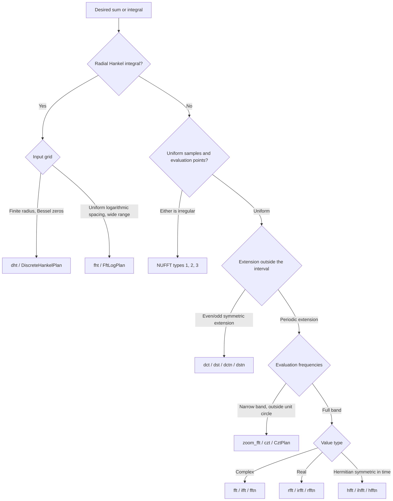

Start by deciding which sum or integral to compute and how samples are arranged.
Then determine whether values are real or complex, which axes to transform, how to extend outside the interval, and which frequencies to evaluate.
Independently of transform type, the number of repeated calculations determines whether to use a function or a plan.
This page compares costs and limitations in that order.

## Decision flow

The diagram's branches select the definition of the computed sum.
Choosing the DFT does not make the original continuous signal periodic.
If the join discontinuity from periodically extending a finite sequence is problematic, consider a window or symmetric extension (DCT/DST).
On every branch, use multidimensional functions or plans for dimension at least 2 and plans for repeated same-shape transforms ([Dimensions and transform axes](#dimensions-and-transform-axes), [Single and repeated computations](#single-and-repeated-computations)).

## Lengths and algorithms

FFTs in `scioxide-fft` accept arbitrary lengths $n \ge 1$; plans select algorithms from their prime factors.
Every length costs $O(n\log n)$, but constants and workspace vary by algorithm.

| Length $n$ | Selected algorithm | One execution and workspace | Notes |
|---|---|---|---|
| Only prime factors 2, 3, 5, 7 | Mixed-radix Cooley–Tukey (radices 2, 3, 4, 5, 7) | Smallest $O(n\log n)$ constant. Workspace: $2n$ complex values | `next_fast_len(n)` returns the smallest such length at least $n$ |
| Prime $p$ at most $2^{20}$, with $p-1$ having only prime factors at most 7 | Rader (length-$p-1$ circular convolution). Bluestein if its estimated cost is lower | 2 FFTs of length $p-1$ plus $O(p)$; workspace: $p + 2(p-1)$ complex values | `FftPlan::diagnostics` reports the selection |
| Otherwise | Bluestein (convolution of product-of-2,3,5,7 length $L \ge 2n-1$) | 2 FFTs of length $L$ plus $O(L)$; workspace: $n + 2L$ complex values | Since $L \ge 2n-1$, more work and workspace than nearby mixed-radix FFTs |
| 1 | Identity | None | |

Workspace counts are values returned by `workspace_requirements` for complex-layout `FftPlan`; the first $n$ values hold a copy of the scaled input.

Changing length changes the sum being computed.
Zero-padding to length `next_fast_len` changes bin frequencies $k/L$, so values are no longer the length-$n$ DFT.
Use zero-padding with its meaning understood, to prevent circular wraparound in convolution ([Convolution and correlation](../algorithms/convolution-correlation-and-analytic-signals/)) or to sample the discrete-time Fourier transform more finely.
If the DFT values themselves are required, retain the slower length.
[FFT algorithms and arbitrary lengths](../algorithms/planner-and-arbitrary-lengths/) derives the algorithms.

## Real, complex, and Hermitian input

The DFT of a real sequence satisfies $X_{n-k}=\overline{X_k}$ (Hermitian symmetry).
`rfft` uses this symmetry to return only $\lfloor n/2\rfloor+1$ complex bins.
Even lengths use a length-$n/2$ complex FFT; odd lengths use a real-data decomposition or a length-$n$ complex FFT, storing approximately half the full spectrum.

| Input and purpose | Functions | Results and limitations |
|---|---|---|
| Transform general complex samples | `fft`, `ifft`, `fftn` | Full positive- and negative-frequency spectrum. Half the computation is redundant for real input |
| Frequency components of real samples | `rfft`, `rfftn` | `HermitianSpectrum` (`HermitianSpectrumNd` in multiple dimensions) carries logical length or shape |
| Packed bins to real samples | `irfft`, `irfftn` | `InvalidInput` unless input is Hermitian symmetric within rounding error |
| Hermitian-symmetric time sequence to real spectrum | `hfft`, `hfftn` | Reverse direction: `ihfft`, `ihfftn`. Same validation as `irfft` |

Bin count $\lfloor n/2\rfloor+1$ alone does not distinguish even from odd original lengths.
`HermitianSpectrum` carries logical length; specify it with `FftInput::hermitian(logical_len, bins)` or similar when passing borrowed bins to a plan.
See [Real FFTs and Hermitian symmetry](../algorithms/real-and-hermitian-transforms/) for details.

## Dimensions and transform axes

| Data | Functions/plans | Cost | Notes |
|---|---|---|---|
| Packed row-major multidimensional array | `fftn`, `rfftn`, `dctn`, `dstn` and inverses | $O(V\sum_a\log n_a)$ for element count $V$ and selected axis lengths $n_a$ | Unselected axes remain independent sequences (batches) |
| Strided arrays, repeated same-shape transforms | `FftNdPlan` (passing `NdView`), `RealTransformNdPlan` | Same. Prepare only once | `execute_in_place` can overwrite input |
| CZT, NUFFT, Hankel, or FFTLog along one multidimensional-array axis | Each plan's `execute_axis_into` | Per-sequence cost × sequence count | Query workspace with `AxisWorkspaceRequest::Axis` |

A multidimensional real transform packs only the last selected axis.
`dctn` and `dstn` select types per axis; to mix DCT and DST, pass a sequence of `RealTransformKind` to `RealTransformNdPlanSpec`.
[Packing real arrays](oxref:fft-real-nd-layout) examines shapes and packing.

## Nonuniform samples and evaluation points

Use a nonuniform Fourier transform (NUFFT) or direct summation when sample positions or evaluation frequencies are not uniform.
Interpolating to a uniform grid before applying an FFT adds interpolation-model error to the sum.
NUFFT also spreads and interpolates on grids internally, but reduces this error to the requested accuracy through Kaiser–Bessel kernel width.

| Type | Input → output | Function |
|---|---|---|
| Type 1 | Weights at irregular positions $x_j$ → integer modes | `nufft_type1` |
| Type 2 | Integer-mode coefficients → values at irregular positions | `nufft_type2` |
| Type 3 | Weights at irregular positions → arbitrary frequencies $\omega_k$ | `nufft_type3` |

Let $M$ be the point count, $N$ the mode count (the product of per-axis mode counts in $d$ dimensions), and $w$ the kernel width; costs compare as follows.

| Method | Work | Error | Limitations |
|---|---|---|---|
| Direct sum | $O(MN)$ | Rounding error only | Slow for large $MN$. Useful as an independent check |
| NUFFT types 1, 2 | $O(Mw^d + G\log G)$; $G$ is oversampled-grid count (at default factor 2, each axis uses the smallest power of 2 at least $2N_a$) | Estimated error relative to input $\ell^1$ norm meets the request | Requests below the rounding estimate give `NumericalInstability`. Outputs much smaller than $\lVert c\rVert_1$ have large relative errors |
| NUFFT type 3 | Same. $G$ depends on the product of point spread and frequency spread | Same (2 spreading/interpolation stages increase the estimate) | A wide spread of both points and frequencies makes the grid large |
| Interpolation + FFT | $O(M + N\log N)$ | Adds interpolation-model error not controlled by requested accuracy | Data with highly variable sample spacing |

NUFFT only evaluates exponential sums; it does not solve inverse problems estimating unknown coefficients from irregular observations.
Type 2 is a different sum, not the inverse of type 1.
[NUFFT kernels and requested accuracy](../algorithms/nufft-kernel-and-accuracy/) covers the relationship between requested accuracy and estimated error.

## Evaluation-frequency range

Use the FFT for uniform samples evaluated uniformly over the full band.
For fine evaluation in only part of the band, use a zero-padded FFT, `zoom_fft`, or `czt`.
Every method only samples the same discrete-time Fourier transform more finely; none improves the ability to separate close frequencies (resolution, approximately $1/T$, where $T$ is observation time).

| Method | Evaluation points | Work (input $n$, output $m$) | Limitations |
|---|---|---|---|
| FFT | $n$ points across the full band | $O(n\log n)$ | Grid spacing fixed at $f_s/n$ |
| Zero-padded FFT | $P$ points across the full band (spacing $f_s/P$) | $O(P\log P)$ | For a narrow band, computes and discards $P-m$ out-of-band points |
| `zoom_fft` | $m$ points in unit-circle band $[f_0, f_1]$ | 2 FFTs of length $L = $ `next_fast_len(n + m − 1)` plus $O(n+m)$ | Absolute-error bound relative to weighted input sum $B$; outputs much smaller than $B$ have large relative errors |
| `czt` (spiral off the unit circle) | $z_k = e^{\rho_0 + k\rho + 2\pi i(t_0 + kt)}$ | Same. Direct-sum $O(nm)$ when $nm \le 4096$ or $\chi = \lvert\rho\rvert\max(n,m)^2 > 0.5$ | Error bound multiplied by $e^{2\chi}$. Large radial changes switch to slower direct summation |

Obtaining the same band points from a length-$P$ zero-padded FFT requires $P = f_s/\Delta f$, so $m \ll P$ makes `zoom_fft` less work.
Read the selected algorithm with `CztPlan::algorithm`.
[CZT algorithm selection and error](../algorithms/czt-algorithms-and-accuracy/) gives the derivation and error bound.

## Boundary conditions and DCT/DST types

The DFT period is $N$ samples, with the final sample one position before the first sample of the next period.
Different first and last sample values therefore do not by themselves imply a jump in the periodic extension.
A problematic jump occurs when the change from $x_{N-1}$ to $x_0$ is much larger than changes between neighboring samples.

DCT corresponds to even extension and DST to odd extension, but endpoint symmetry centers and parities vary by type.
Remembering only “DCT for Neumann, DST for Dirichlet” and swapping types can mismatch the grid positions.
Use the following table to check where and how input $x_0,\dots,x_{n-1}$ is extended (integers are sample locations, half-integers between samples).

| Type | Left extension | Right extension | Boundary conditions and grid |
|---|---|---|---|
| DCT-I | Even about $j = 0$ | Even about $j = n-1$ | Neumann at both ends, endpoint-inclusive grid |
| DCT-II | Even about $j = -1/2$ | Even about $j = n-1/2$ | Neumann at both ends, cell-centered grid |
| DCT-III | Even about $j = 0$ | Odd about $j = n$ | Left Neumann, right Dirichlet, endpoint-inclusive grid |
| DCT-IV | Even about $j = -1/2$ | Odd about $j = n-1/2$ | Left Neumann, right Dirichlet, cell-centered grid |
| DST-I | Odd about $j = -1$ | Odd about $j = n$ | Dirichlet at both ends, interior grid points only |
| DST-II | Odd about $j = -1/2$ | Odd about $j = n-1/2$ | Dirichlet at both ends, cell-centered grid |
| DST-III | Odd about $j = -1$ | Even about $j = n-1$ | Left Dirichlet, right Neumann, endpoint-inclusive grid |
| DST-IV | Odd about $j = -1/2$ | Even about $j = n-1/2$ | Left Dirichlet, right Neumann, cell-centered grid |

Pass the forward-transform type to invert to inverse transforms.
`idct(…, DctType::II, …)` performs DCT-III; I and IV are self-dual.
The minimum length is 2 for DCT-I and 1 for other types.
[DCT, DST, and boundary conditions](../algorithms/dct-dst-and-boundaries/) derives extensions and boundary conditions; [Diagonalizing the discrete Laplacian](../algorithms/laplacian-diagonalization/) covers discrete-Laplacian diagonalization.
Obtaining basis coefficients by a transform is separate from constructing a differential equation's right side and boundary conditions.

## Radial grids

An axisymmetric function's Fourier transform becomes the Hankel transform $\int_0^\infty f(r)J_\nu(kr)\,r\,dr$.
`scioxide-fft` offers two discretizations with very different grids and costs.

| Aspect | Discrete Hankel transform (`dht`, `DiscreteHankelPlan`) | FFTLog (`fht`, `FftLogPlan`) |
|---|---|---|
| Grid | $r_m = R\,j_m/j_{n+1}$ ($j_m$ are the positive zeros of $J_\nu$) | $n$ points uniform in $\ln r$ |
| Suitable functions | Functions negligible outside radius $R$ | Functions spanning many decades with power-law decay at both ends |
| Preparation | Validate the caller's first $n+1$ zeros and construct an $n\times n$ matrix from $n(n+1)/2$ Bessel values | Compute $n$ multipliers using complex log-gamma |
| One execution | Matrix-vector product, $O(n^2)$ | 2 complex FFTs of length $n$ plus $O(n)$ |
| Inverse | Separate quadrature, not an exact inverse | Exact inverse of the discrete map (apart from rounding) |
| Limitations | Nonconsecutive initial zeros give `InvalidInput`. Likewise $\nu \le -1/2$. Large $n$ makes $O(n^2)$ expensive | Ringing at periodic-extension joins in $\ln r$. Multipliers hitting Γ poles give `Singular` |

The caller supplies discrete-Hankel zeros (obtainable with `scioxide-special`).
FFTLog error does not guarantee continuous-integral accuracy; examine bias $q$ and `fftlog_low_ringing_offset` choices in [FFTLog and logarithmic grids](../algorithms/fftlog/).
[Radial transforms and the discrete Hankel transform](../algorithms/radial-transforms/) covers zero validation and sample-count choices.

## Single and repeated computations

| Usage | Entry points | Allocation and reuse |
|---|---|---|
| Single computation | `fft`, `rfft`, `dct`, `czt`, `nufft_type1`, and others | Prepare and discard a plan per call, returning results in a new `Vec` or similar |
| Repeated identical specification | `FftPlan`, `RealTransformPlan`, `CztPlan`, `NufftPlan`, and others | Prepare a plan and workspace once. `execute_into` makes no heap allocation with sufficient workspace |
| Repeated multiple lengths | `FftPlanCache` | Retain `FftPlan` tables in a bounded LRU. Plans differing only in direction and normalization share tables |
| External FFT implementation | `FftPlanningContext` and `FftProvider` | Specify implementation resource limits (`FftProviderLimits`). These plans are not cached |

Plans fix direction and normalization at preparation, so prepare another plan for the opposite direction.
When reusing one `FftWorkspace` across plans, call `check` or `try_reserve` with each plan's requirements before use.
Workspace grows to the maximum requirement without shrinking; capacity allocated for previous plans also counts toward limits.

Only prepared-plan `execute_into` (and `execute_axis_into`, `execute_in_place`) can avoid allocation.
Plan and workspace preparation and convenience-function calls allocate; allocations inside external implementations follow their contracts.
[FFT plans, workspaces, and caches](../algorithms/plans-workspaces-and-providers/) covers caches, and [External FFT implementations and CPU instruction sets](../algorithms/providers-and-cpu-backends/) covers external injection and CPU instruction-set selection.

## Choosing normalization

`Normalization` selects which direction receives the scaling factor.
For a Fourier transform of length $N$ (selected axis-length product in multiple dimensions), the choices are as follows.

| `Normalization` | Forward | Inverse | Suitable uses |
|---|---|---|---|
| `Inverse` | $1$ | $1/N$ | Analysis reading amplitudes with $\lvert X_k\rvert/N$ |
| `Forward` | $1/N$ | $1$ | Spectral methods requiring Fourier coefficients $\hat f_k$ directly |
| `Orthonormal` | $1/\sqrt N$ | $1/\sqrt N$ | Preserve sums of squares or treat the transform as an orthogonal matrix |
| `Unscaled` | $1$ | $1$ | Apply convolution scaling together at the end. A round trip multiplies by $N$ |

DCT/DST, chirp Z-transforms, and NUFFT count $N$ differently; discrete Hankel transforms and FFTLog do not take `Normalization` ([Normalization](oxref:fft-normalization)).
[Normalization and Parseval's identity](oxref:fft-normalization-conventions) derives Parseval's identity.

## Choosing independent checks

Round-trip differences show forward/inverse consistency but miss shared errors (incorrect frequency axes or duplicate normalization).
Also check other relations: Parseval's identity, defining sums, known transform pairs, or right sides constructed from known solutions.

Construct frequency axes with `fftfreq` or `rfftfreq` and state sampling-interval units.
When manually editing spectra, check normalization and conjugate symmetry too.
Small round-trip error alone does not establish continuous-signal reconstruction or continuous-integral accuracy.

| Transform | Example independent checks |
|---|---|
| FFT, `rfft` | Defining sums for small $n$, Parseval's identity, pure-tone locations and amplitudes |
| DCT/DST | Type-specific defining sums, discrete-Laplacian eigenvectors |
| `zoom_fft`, `czt` | Direct sums at the same frequencies |
| NUFFT | Direct sums for selected outputs and comparison with estimated error |
| Hankel, FFTLog | Analytic transform pairs such as Gaussians |

## Summary

Length changes algorithms and cost, but every length can be computed in $O(n\log n)$; zero-padding changes the sum, so use it for a defined purpose.
Use `rfft` for real input, `fftn`/`rfftn` for multidimensional arrays, NUFFT for irregular positions, `zoom_fft` for narrow bands, and DCT/DST types chosen by extension-center position for symmetric extensions.
For radial integrals, choose the discrete Hankel transform ($O(n^2)$) for finite radius or FFTLog ($O(n\log n)$) for wide logarithmic ranges.
Prepare a plan and workspace for repeated same-shape transforms, choosing normalization from the application separately from the plan.
Check results with direct sums or known transform pairs in addition to round-trip differences.

## Further reading

- [Fast Fourier transforms and spectral methods](../algorithms/) examines shared notation, normalization, input validation, and failure handling for the chosen transform.
- [Sampling, aliasing, and the frequency axis](../algorithms/sampling-and-frequency-axis/) examines the correspondence between bin indices and physical frequencies.
- [API guide](../api/) lists arguments, output types, and workspace requirements for the chosen functions and plans.
