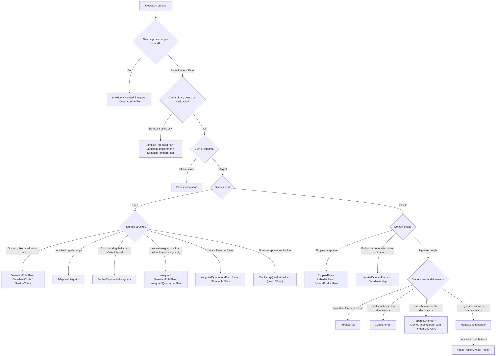

Choose quadrature by the properties of the integrand $f$ (smoothness, singularities, oscillation, and localized rapid changes), domain shape (bounded interval, infinite interval, hyperrectangle, simplex, sphere, or a domain depending on outer coordinates), dimension $d$, whether $f$ can be evaluated at arbitrary points, and the allowed evaluation count.
Analyzing the integrand's behavior before computation avoids unnecessary subdivision and makes independent checks easier to choose.
Placing known weights, singularity locations, and oscillatory phases in the Plan instead of evaluating them inside the integrand benefits both accuracy and evaluation count.

The following diagram shows the broad selection sequence.
The tables below the diagram detail each branch.

## One-shot functions and configured Plans

After choosing a candidate, choose how to call it.
Use a one-shot function when you only need a value with default settings.
A one-shot function creates a Plan with default settings and a workspace on the spot, executes sequentially, and returns an answer only on success.
The first 6 functions in the table (from `integrate` through `integrate_iterated`) return a value and error estimate in `Integral`.
Unsuccessful termination becomes an error: limits give `EvaluationLimit`, `IterationLimit`, `ResourceLimit`, or `TruncationLimit` of `ConvergenceFailure`; stagnation and divergence give `Stagnation` and `Divergence`; and absence of a representable evaluation point gives `NumericalInstability` (`Breakdown`).
The error estimate is the same estimate as `error_estimate()` in the Plan's report and is not an upper bound.
For successful termination without a report estimate, it is 0 if the domain has measure 0, and otherwise the scalar's largest finite value.

| Problem | One-shot function | Default method | Type to configure |
|---|---|---|---|
| Finite interval $[a,b]$ (including endpoint singularities) | `integrate(f, a, b)` | Globally adaptive G7K15 with Wynn's ε extrapolation, 50 bisections | `AdaptiveIntegrator` |
| Known breakpoints, jumps, or singularities | `integrate_piecewise(f, a, b, &points)` | Adaptive G7K15 with breakpoints on subdomain boundaries (without extrapolation), 50 bisections | `WeightedQuadraturePlan::breakpoints` |
| $f(x)\cos\omega x$ and $f(x)\sin\omega x$ on a finite interval | `integrate_fourier(f, a, b, omega, weight)` | Modified Clenshaw–Curtis with Chebyshev moments (16 levels) on strongly oscillatory intervals; adaptive G7K15 elsewhere; 50 bisections | `WeightedQuadraturePlan::fourier` |
| Half-lines $[a,\infty)$ and $(-\infty,b]$, or the real axis | `integrate_unbounded(f, domain)` | exp–sinh transformation (reflect $(-\infty,b]$ using $x=-t$); sinh–sinh for the real axis; 15 levels | `DoubleExponentialIntegrator` |
| Hyperrectangle | `integrate_box(f, &lower, &upper)` | Adaptive G7K15 for $d=1$; adaptive cubature with the Genz–Malik rule for $d\ge2$; 50 bisections | `CubaturePlan` |
| Domain with endpoints depending on outer coordinates | `integrate_iterated(f, bounds, d)` | Nested adaptive G7K15 on each axis; 50 bisections across all axes | `IteratedDomainPlan` |
| Scalar-valued integral on a high-dimensional hyperrectangle | `integrate_monte_carlo(f, &lower, &upper, &rng)` | 4096 uniform samples from random stream 0, 95% Student-t interval. Rejects zero-width axes | `MonteCarloIntegrator` |
| Stored samples | `trapezoid`, `simpson`, `cumulative_trapezoid` | Trapezoidal and Simpson rules on nonuniform grids | `SampledTrapezoidPlan`, `SampledSimpsonPlan` |
| Infinite series | `sum_series(term, first)` | Order-8 Levin u transformation, at most 256 terms | `SeriesSummation` |

All use absolute and relative tolerances of $\sqrt\varepsilon$ (about $1.49\times10^{-8}$ for `f64`).
Configure a Plan or integrator in the rightmost column to change tolerances, limits, or methods, inspect termination reasons and evaluation counts, or use an estimate returned after reaching a limit.
For repeated integration with the same Plan, prepare the Plan and workspace in advance and call `integrate_into`.
`integrate_monte_carlo` returns the statistics `MonteCarloStatistics`, `sum_series` returns `SeriesResult`, and sampled-data functions return no error estimate.

## Smooth one-dimensional functions and local features

If $f$ is smooth on the interval $[a,b]$, a rule with a fixed evaluation count is often sufficient.
Fixed rules (those implementing `FixedRule`) terminate with `FixedRuleCompleted` and return no error estimate except for `GaussKronrod`, which has an embedded pair.
Check accuracy by comparing different node counts or orders.
Derivations appear in [Newton–Cotes formulas and composite rules](../algorithms/newton-cotes-and-romberg/), [Euler–Maclaurin expansion and Romberg extrapolation](../algorithms/romberg-extrapolation/), [Gaussian quadrature and Clenshaw–Curtis rules](../algorithms/gaussian-and-clenshaw-curtis/), and [Embedded pairs and globally adaptive quadrature](../algorithms/adaptive-quadrature/).

| Function properties | First candidate | Reason and cautions | Related example |
|---|---|---|---|
| Smooth, with a fixed evaluation count desired | `GaussianRulePlan::gauss_legendre(n)` | Integrates polynomials through degree $2n-1$ exactly with $n$ nodes. If $f$ is analytic inside the ellipse $E_\rho$, the error is $O(\rho^{-2n})$ | [Transmission through a two-dimensional aperture](../examples/aperture-cubature/) |
| Endpoints should be included among the nodes | `ClenshawCurtis::new(n)`, or `Lobatto` of `GaussianRulePlan` | Clenshaw–Curtis uses $n+1$ nested Chebyshev extrema. Lobatto includes both endpoints and has degree of exactness $2n-3$ | — |
| Restricted to an equally spaced grid | `NewtonCotes::new(nodes, endpoints, panels)` | Composite trapezoidal, Simpson, Boole, and other rules. Rules with more than 11 nodes are not provided because their weights alternate in sign | — |
| An error indication is also desired from one fixed rule | For example, `GaussKronrod::new(GaussKronrodRule::G7K15)` | Returns the difference between the Gauss rule and its Kronrod extension as an error estimate. Does not subdivide | — |
| Analytic, with repeated step halving desired | `Romberg::new(LevelOptions)` | Extrapolation eliminates the even-power expansion of trapezoidal error. Nonsmooth points of $f$ reduce its effectiveness | — |
| Narrow peaks, rapid changes, or boundary layers | `AdaptiveIntegrator::new(AdaptiveRule::GaussKronrod, options)` | Globally bisects intervals with large G7K15 error estimates. Evaluation count is $15+30s$ ($s$ is the bisection count) | [Narrow peaks](../examples/narrow-peak/) |
| Piecewise functions whose endpoints may be evaluated | `AdaptiveRule::Simpson` | Compares nested Boole rules with 9 nodes per interval. Uses at least 15 bisections and 130 evaluations before success | — |
| Feature locations are known | `integrate_piecewise`, `WeightedQuadraturePlan::breakpoints`, or separate calls on subintervals | Places breakpoints on G7K15 subdomain boundaries without evaluating them | [Narrow peaks](../examples/narrow-peak/) |

## Endpoint singularities and infinite intervals

When the integrand diverges at an endpoint or the interval extends to infinity, absorb that behavior into a variable transformation or weight function.
Double-exponential transformations are covered in [Double-exponential transformations for improper integrals and endpoint singularities](../algorithms/improper-singular-and-oscillatory/), and endpoint weights in [Weighted quadrature for endpoint weights, principal values, and complex contours](../algorithms/weighted-rules-and-sensitivities/).

| Situation | First candidate | Reason and cautions | Related example |
|---|---|---|---|
| Algebraic or logarithmic endpoint singularity (unknown exponent) | `DoubleExponentialIntegrator`（`DoubleExponentialDomain::Finite`） | The tanh–sinh transformation makes endpoint contributions decay double exponentially. Successful convergence gives only `HeuristicToleranceReached` (`DegenerateDomain` for a zero-width interval) | [The pendulum period as a singular integral](../examples/pendulum-singular-quadrature/) |
| Locations of interior singularities are known | `Finite { interval, singular_points }` | Split at each singularity and apply tanh–sinh on each subinterval. The callback's `DoubleExponentialPoint::nearest_endpoint` gives an accurate distance to the endpoint | — |
| Semi-infinite interval $[a,\infty)$ or the entire real axis | `DoubleExponentialDomain::HalfLine { lower }`, `RealLine` | exp–sinh or sinh–sinh transformation. Tail truncation is an empirical decision based on observed decay | [The Stefan–Boltzmann constant and band fractions of blackbody radiation](../examples/blackbody-radiation/) |
| Endpoint weight $(x-a)^\alpha(b-x)^\beta$ and logarithms (known exponents) | `WeightedQuadraturePlan::endpoint`, `EndpointWeight::new(alpha, beta, left_log, right_log)` | Integrates using modified moments of the weight; the callback returns only the smooth factor. $\alpha,\beta>-1$ | — |
| Resolve endpoint singularities by subdivision | `integrate`, `AdaptiveIntegrator::with_extrapolation(true)` | Extrapolates the bisection sequence with Wynn's ε algorithm. The one-shot call `integrate` uses this extrapolation. Signs of divergence give `ProbablyDivergent` | — |
| Classical weights $x^\alpha e^{-x}$ or $e^{-x^2}$ | `GaussianRulePlan` (`GeneralizedLaguerre`, `HermiteH`, etc.) | See the classical-weight table below | [Quantum harmonic oscillator expectations and degree of exactness of Gauss–Hermite quadrature](../examples/quantum-oscillator-expectations/) |

## Oscillatory integrals and complex contours

For oscillatory integrals with cancelling positive and negative contributions, resolving the oscillations with nodes makes the evaluation count grow proportionally to the number of oscillations.
If the phase is known, the oscillatory factor can be treated as a weight.
Linear phases and Fourier tails are covered in [Cancellation in oscillatory integrals and tails of Fourier integrals](../algorithms/fourier-integrals-and-tails/), nonlinear phases in [Oscillatory integrals with nonlinear phases (Levin and Filon)](../algorithms/phase-aware-oscillatory/), and complex contours in [Weighted quadrature for endpoint weights, principal values, and complex contours](../algorithms/weighted-rules-and-sensitivities/).

| Situation | First candidate | Reason and cautions | Related example |
|---|---|---|---|
| $f(x)\cos(\omega x)$ and $f(x)\sin(\omega x)$ on a finite interval | `WeightedQuadraturePlan::fourier(interval, points, omega, FourierWeight, options)` | Integrates with a modified Clenshaw–Curtis rule using Chebyshev moments of the oscillatory factor | [Integrating a damped high-frequency signal](../examples/damped-oscillation/) |
| Fourier integrals on a half-line or the real axis | `FourierTailPlan::new(FourierDomain, omega, FourierWeight, options)` | Extrapolates partial sums over successive periods. Success is `HeuristicToleranceReached`; `FourierDomain::RealLine` requires the integrals over $(-\infty,0]$ and $[0,\infty)$ to converge separately (it is not a symmetric principal value) | [Integrating a damped high-frequency signal](../examples/damped-oscillation/) |
| Nonlinear phase $f(x)\cos(\omega g(x))$ | `OscillatoryQuadraturePlan::new(OscillatoryMethod::Levin, ...)` | Levin collocation uses only $g$ and $g'$. Declare a lower bound on $\lvert g'\rvert$ for each subdomain | [Fresnel integrals and the Cornu spiral](../examples/fresnel-cornu-spiral/) |
| The inverse phase function is known | `OscillatoryMethod::Filon` | Uses a Filon–Clenshaw–Curtis rule in phase coordinates $\varphi=g(x)$. Supply a branch of the inverse function | — |
| Contour integral in the complex plane | `ContourPlan::new(parameter_interval, breakpoints, options)` | Supply the contour mapping $z(t)$ and $z'(t)$ and apply adaptive G7K15 in the parameter $t$. The caller chooses branches | — |

## Gaussian quadrature with classical weights

If the integrand contains a known weight function $w(x)$, use `GaussianRulePlan` for the orthogonal polynomial family associated with that weight rather than computing the weight inside $f$.

$$
\int f(x)\,w(x)\,dx \approx \sum_{i=1}^n w_i\,f(x_i).
$$

Handling the weight in the rule lets its nodes and weights represent endpoint singularities or decay on an infinite interval, leaving the callback to return only the smooth factor.
Use a weighted family by passing `GaussianSupport` to `integrate_weighted` or `integrate_weighted_into`.
`FixedRule::integrate` accepts only families whose weight is identically 1 (Legendre, `Jacobi { alpha: 0, beta: 0 }`, and `Gegenbauer { lambda: 0.5 }`).

| Family (`OrthogonalFamily`) | Standard domain | Weight function $w(x)$ | `GaussianSupport` | Main uses |
|---|---|---|---|---|
| `Legendre` | $[-1,1]$ | $1$ | `Interval` | Smooth integrals on finite intervals |
| `ChebyshevT` | $[-1,1]$ | $(1-x^2)^{-1/2}$ | `Interval` ($1/\sqrt{(x-a)(b-x)}$ in $[a,b]$) | Inverse square-root endpoint singularities |
| `ChebyshevU` | $[-1,1]$ | $(1-x^2)^{1/2}$ | `Interval` | Fields vanishing as a square root at endpoints |
| `Jacobi { alpha, beta }` | $[-1,1]$ | $(1-x)^\alpha(1+x)^\beta$ | `Interval` | Asymmetric algebraic endpoint singularities; Beta distributions ($\alpha,\beta>-1$) |
| `Gegenbauer { lambda }` | $[-1,1]$ | $(1-x^2)^{\lambda-1/2}$ | `Interval` | Symmetric algebraic endpoint behavior ($\lambda>-1/2$, $\lambda\ne0$) |
| `Laguerre` | $[0,\infty)$ | $e^{-x}$ | `HalfLine(c)` | Semi-infinite intervals with exponential decay |
| `GeneralizedLaguerre { alpha }` | $[0,\infty)$ | $x^\alpha e^{-x}$ | `HalfLine(c)` | Algebraic behavior at the origin and exponential decay ($\alpha>-1$) |
| `HermiteH` | $(-\infty,\infty)$ | $e^{-x^2}$ | `RealLine` | Quantum harmonic oscillator; heat kernel |
| `HermiteHe` | $(-\infty,\infty)$ | $e^{-x^2/2}$ | `RealLine` | Expectations under the standard normal distribution |

Do not multiply by the same weight again in the callback.
For example, a Gauss–Laguerre callback returns only the factor excluding $e^{-x}$.

Variants that include endpoints among the nodes exist only for the Legendre and Jacobi families.
Gauss rules (`Gauss`) have degree of exactness $2n-1$; Radau rules including one endpoint (`RadauLeft` and `RadauRight`) have $2n-2$; and Lobatto rules including both endpoints (`Lobatto`, $n\ge2$) have $2n-3$.

## Principal values and sampled data

| Situation | First candidate | Reason and cautions |
|---|---|---|
| Cauchy principal value $\mathrm{PV}\int_a^b f(x)/(x-c)\,dx$ | `WeightedQuadraturePlan::principal_value(interval, pole, options)` | Treats the pole as a weight. Rejects a pole at an endpoint |
| Stored samples at nonuniform coordinates | `SampledTrapezoidPlan::new(&coords)`, `SampledSimpsonPlan::new(&coords)` | Coordinates need only be strictly monotonic. Cumulative integration `cumulative_into` and integration along array axes `axis_into` are also available |
| $2^k+1$ equally spaced stored samples | `SampledRombergPlan::new(samples, spacing)` | Extrapolates nested trapezoidal rules. Accepts only equal spacing |

Sampled-data Plans return neither reports nor error estimates.
Principal values are covered in [Weighted quadrature for endpoint weights, principal values, and complex contours](../algorithms/weighted-rules-and-sensitivities/), and sampled data in [Integration of sampled data](../algorithms/sampled-data-integration/).
Check accuracy against different sample spacings or differences from another rule.

## Infinite series

| Series properties | First candidate | Reason and cautions |
|---|---|---|
| Alternating series; linear convergence | `SeriesSummation::new(SeriesMethod::LevinU, ...)` or `WynnEpsilon` | Accelerates the partial-sum sequence. Does not prove convergence |
| Logarithmic convergence ($a_n \sim n^{-p}$) | `SeriesMethod::LevinU` | Remainder estimate $(n+1)a_n$ suits logarithmic convergence |
| Terms sample a smooth function, and the tail integral and derivatives are known | `SeriesMethod::EulerMaclaurin` | Provides a remainder upper bound under user-supplied analytical information |

If you only need the sum with default Levin u settings, the one-shot function `sum_series(term, first)` computes it from a term function and returns `SeriesResult` only on success (a term-count limit gives `TruncationLimit` of `ConvergenceFailure`).
`SeriesTermination::is_success()` is true for `BoundedTailReached`, `ExactEmpty`, and `HeuristicToleranceReached`.
The Levin u and Wynn ε convergence criterion `HeuristicToleranceReached` also counts as success, but only stops when successive accelerated values agree; it does not prove convergence.
Acceleration is covered in [Infinite series acceleration (Levin u and Wynn ε)](../algorithms/series-acceleration/), and Euler–Maclaurin summation in [Euler–Maclaurin summation and conditional upper bounds](../algorithms/euler-maclaurin-summation/).

## Multidimensional integration

As the dimension $d$ increases, a tensor product of one-dimensional rules requires $n^d$ evaluations.
This is called the curse of dimensionality.
Tensor product rules and cubature are covered in [Tensor product rules and Genz–Malik adaptive cubature](../algorithms/multidimensional-and-monte-carlo/), iterated integration in [Iterated integration with variable endpoints and coordinate mappings](../algorithms/domains-and-geometric-rules/), simplices and spheres in [Quadrature rules for simplices and spheres](../algorithms/simplex-and-sphere-rules/), and sparse grids and QMC in [Sparse grids and randomized quasi-Monte Carlo](../algorithms/sparse-grids-and-qmc/).
Monte Carlo is covered in [Estimators and statistics for Monte Carlo integration](../algorithms/monte-carlo-integration/), importance sampling in [Proposal distributions and effective sample size for importance sampling](../algorithms/importance-sampling-proposals/), and VEGAS and MISER in [Adaptive Monte Carlo (VEGAS and MISER)](../algorithms/adaptive-monte-carlo/).

| Situation | Candidate | Evaluation count and result properties | Related example |
|---|---|---|---|
| Smooth on a two- or three-dimensional hyperrectangle | `ProductRule::new(rule, options)` | A tensor product of one-dimensional fixed rules, with $n^d$ nodes in total. An error estimate is available only if the rule has an embedded pair | [Transmission through a two-dimensional aperture](../examples/aperture-cubature/) |
| Local variation on a low-dimensional hyperrectangle | `CubaturePlan::new(&bounds, options)` | For $d\ge2$, adaptively subdivides with a $2^d+2d(d-1)+4d+1$-node Genz–Malik rule per subdomain. Success is `HeuristicToleranceReached` | [Transmission through a two-dimensional aperture](../examples/aperture-cubature/) |
| Feature locations are known | `CubaturePlan::with_breakpoints(axis, fractions)` | Subdivide the initial domain along each axis | — |
| Endpoints depend on outer coordinates | `IteratedDomainPlan::new(dimension, options)` and `CoordinateMap` | Nested adaptive G7K15 on each axis. The mapping Jacobian is signed | — |
| Triangles, tetrahedra, or simplices | `SimplexRule::positive(dim, min_degree, options)`, `SimplexRule::new(dim, s, options)` | `positive` uses interior rules with positive weights for dimensions 1–3 and degrees 0–7. `new` uses Grundmann–Möller rules of total degree $2s+1$ and may have negative weights | — |
| Sphere | `LebedevRule::new(degree, options)`, `SphereProductRule::new(polar, azimuth, options)` | For the same spherical harmonic degree, Lebedev rules use about 2/3 as many nodes as product rules. Lebedev degrees range from 3 to 131 | [Dipole antenna radiated power and the Lebedev rule](../examples/dipole-radiation-lebedev/) |
| Smooth in moderate dimensions, with differing variable importance | `SparseGridPlan::new(dimension, options)` | Dimension-adaptive Smolyak rules with nested Clenshaw–Curtis rules. The error estimate is empirical | [Comparing sparse grids, QMC, and MC on Genz test functions](../examples/genz-high-dimensional-benchmark/) |
| Smooth in moderate dimensions, with statistical uncertainty desired | Pass `scioxide_random::QmcReplicatePlan` to `MonteCarloIntegrator` | Constructs a Student-t interval from the variation among independent replicates of randomized Sobol sequences | [Comparing sparse grids, QMC, and MC on Genz test functions](../examples/genz-high-dimensional-benchmark/) |
| High dimensions, discontinuities (indicator functions), or complex boundaries | Pass `RandomStreams` to `MonteCarloIntegrator::new(&bounds, options)` | The decay rate of the standard error $O(N^{-1/2})$ is independent of dimension. Relative error is large for rare events | [High-dimensional reliability by Monte Carlo integration](../examples/high-dimensional-reliability/) |
| Localized peaks | `VegasTrainer`, `MiserTrainer` | Reduces variance with learned importance mappings or stratification. Training samples are excluded from estimation | — |

## Parameter sensitivities and guaranteed enclosures

| Purpose | Candidate | Result properties | Related example |
|---|---|---|---|
| Directional derivative (JVP) or gradient (VJP) of $\int_{a(p)}^{b(p)} f(x,p)\,dx$ with respect to $p$ | `QuadratureSensitivityPlan::adaptive`, `fixed`, `frozen` | Supply actions of integrand derivatives with `SensitivityIntegrand`. Moving endpoints are handled by Leibniz terms. Read `report.termination().is_success()` for success | [Checking sensitivities of moving integration endpoints](../examples/moving-boundary-sensitivity/) |
| An interval guaranteed to contain the integral | `scioxide_validated::integrate` and `QuadratureVerifier` in `scioxide-validated` | The user supplies interval extensions of values and derivatives, and interval arithmetic encloses trapezoidal remainders under $C^2$ assumptions and four-point Gauss–Legendre remainders under `EightTimesContinuouslyDifferentiable` assumptions. `scioxide_validated::integrate` handles only $C^2$ assumptions on finite intervals | — |

Sensitivity computation is covered in [Parameter sensitivities and integral JVPs and VJPs](../algorithms/parameter-sensitivities/).
Every error estimate in `scioxide-integrate` is an estimate, not a proof.
When an upper bound is the basis of a design, use an enclosure from `scioxide-validated`.

## Setting tolerances and limits

Adaptive tolerances and limits are supplied through `SubdivisionOptions` (adaptive bisection methods) and `LevelOptions` (`Romberg` and `DoubleExponentialIntegrator`).
The stopping criterion divides each component's error estimate $E_i$ by $\varepsilon_{\mathrm{abs},i} + \varepsilon_{\mathrm{rel}}|Q_i|$ and checks whether their combined value under the chosen norm is at most 1.
For real values, this is equivalent to $E \le \varepsilon_{\mathrm{abs}} + \varepsilon_{\mathrm{rel}}|Q|$.

- The absolute tolerance $\varepsilon_{\mathrm{abs}}$ has the same units as the integral.
  When the integral is near 0 (for example, in oscillatory integrals with strong cancellation), relative tolerance is ineffective, so absolute tolerance becomes the actual stopping criterion.
- The relative tolerance $\varepsilon_{\mathrm{rel}}$ determines the significant digits of the integral.
- The defaults for `SubdivisionOptions` are absolute and relative tolerances both $\sqrt{\varepsilon}$ (about $1.49\times10^{-8}$ for `f64`), the maximum norm, at most 50 bisections, no evaluation-count limit, and sequential execution.
  For vector values, `ErrorTolerance::try_vector` supplies componentwise absolute tolerances.
- The defaults for `LevelOptions` are the same tolerances and 15 levels.
  `Romberg` accepts 6–30 levels, and `DoubleExponentialIntegrator` accepts 4–15.
- Limits are hard: the next unit of work is not started if it would exceed a limit.
  For example, an adaptive G7K15 bisection checks all 30 evaluations for its two children together.
- Tolerances below the rounding error floor cannot yield an estimate below that floor and stop with `Stagnation`.

## Determining success

`IntegrationTermination::is_success()` is true for `FixedRuleCompleted`, `ToleranceReached`, `HeuristicToleranceReached`, `SampleBudgetCompleted`, and `DegenerateDomain`.
`HeuristicToleranceReached` means that an empirical estimate (such as observed tail decay) satisfies the tolerance and counts as success.
Converged double-exponential transformations, Fourier tails, `CubaturePlan` in two or more dimensions, and sparse grids use this termination reason.
For infinite series, `SeriesTermination::HeuristicToleranceReached` also counts as success.
Neither kind of success implies an upper bound on the true error.
Read values from results stopped by `BudgetLimit`, `RefinementLimit`, `Stagnation`, `ProbablyDivergent`, or similar reasons as estimates, without assuming that they meet the tolerance.

## Summary

First determine whether a proven upper bound is needed, whether the integrand can be evaluated at arbitrary points, whether the problem is a sum or an integral, and its dimension and domain shape; then narrow the candidates using the diagram and tables.
Place known weights, singularities, and oscillatory phases in the Plan, passing only the smooth factor to the callback.
Compare node counts for fixed rules without error estimates; for adaptive and statistical methods, distinguish termination reasons and error kinds (estimates, empirical estimates, and standard errors).
Set both absolute and relative tolerances to match the problem's scale, and use evaluation counts and termination reasons to check whether the default $\sqrt{\varepsilon}$ and 50 bisections suffice.

## Further reading

- [Mathematics and algorithm structure of numerical integration](../algorithms/): examine termination reasons, error-estimate components, and workspace contracts.
- [Embedded pairs and globally adaptive quadrature](../algorithms/adaptive-quadrature/): examine the error estimate and stopping rules of the most general-purpose option, `AdaptiveIntegrator`.
- [Numerical integration examples and applications](../examples/): examine method selection and independent checks on concrete problems.
- [Numerical integration API guide](../api/): examine all public items and specifications of the types listed in the tables.
