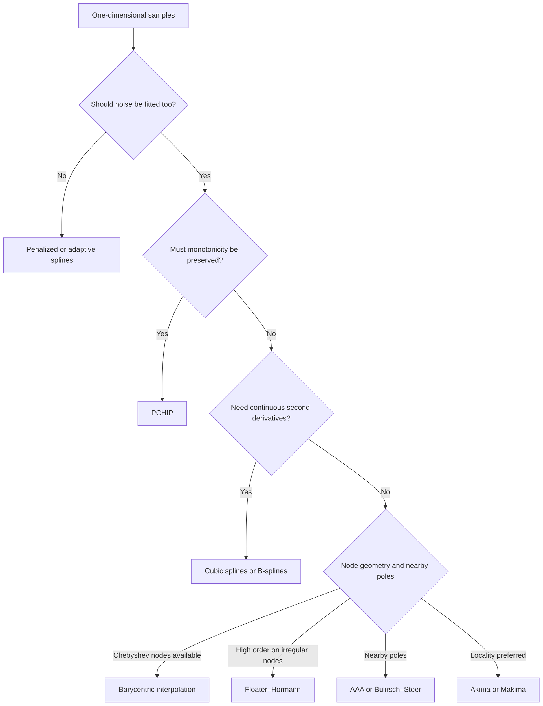

A common mistake is choosing the smoothest interpolant unconditionally.
For physically monotone properties or reaction rates, a $C^2$ cubic spline can overshoot near sharp slope changes, creating reversed gradients or negative values.
Choose from dimension, sample geometry (uniform, irregular, rectilinear, scattered), shape constraints, and evaluation frequency.

## Choosing one-dimensional interpolants

For samples $(x_i, y_i)_{i=0}^n$, ask about noise, shape, smoothness, then node flexibility to select the API.
The diagram shows this order; tables below compare properties.



### Properties of one-dimensional methods

Continuity describes joins at nodes; locality describes how far a changed sample affects interpolated values.
Errors assume sufficiently smooth $f$ sampled at spacing $h$.
A degree-at-most-$n$ polynomial through $n + 1$ points $x_0, \dots, x_n$ has this remainder for some $\xi$.

```text
f(x) − p(x) = f⁽ⁿ⁺¹⁾(ξ) / (n + 1)! · ∏ᵢ₌₀ⁿ (x − xᵢ)
```

Here $\xi$ is an unknown point in the smallest interval containing nodes and $x$.
Barycentric, Newton, and Neville construct the same polynomial and share this error; differences concern computational cost and rounding.
Hermite remainders have the same form with each node counted twice.

| Interpolant | Continuity | Locality | Error for smooth $f$ | Strengths and cautions | Main uses |
| :--- | :--- | :--- | :--- | :--- | :--- |
| [`BarycentricInterpolator`](https://docs.rs/scioxide-interp/0.1.0/scioxide_interp/struct.BarycentricInterpolator.html) | $C^\infty$ | Global | Remainder above; analytic $f$ at Chebyshev nodes gives geometric decay in $n$ | Second barycentric formula evaluates in $O(n)$; weights cost $O(n^2)$, or closed-form $O(n)$ for Chebyshev and uniform nodes. Accuracy depends on the Lebesgue constant | Spectral approximation at Chebyshev nodes |
| [`NewtonInterpolator`](https://docs.rs/scioxide-interp/0.1.0/scioxide_interp/struct.NewtonInterpolator.html) | $C^\infty$ | Global | Same polynomial and error as barycentric | Divided differences cost $O(n^2)$ and point evaluation $O(n)$. `insert_point` appends a rightmost node in a new interpolant in $O(n)$, preserving existing coefficients | Sequentially added measurements |
| [`HermiteInterpolator`](https://docs.rs/scioxide-interp/0.1.0/scioxide_interp/struct.HermiteInterpolator.html) | $C^\infty$ | Global | Remainder $f^{(2n+2)}(\xi)\prod_i (x - x_i)^2/(2n+2)!$ | One polynomial of degree at most $2n + 1$ satisfying values and first-derivative samples | Samples with known derivatives, such as positions and velocities |
| [`NevilleInterpolator`](https://docs.rs/scioxide-interp/0.1.0/scioxide_interp/struct.NevilleInterpolator.html) | $C^\infty$ | Global | Same polynomial and error as barycentric | No precomputation; point evaluation $O(n^2)$. Returns final correction as an error estimate, not bound | One evaluation from few points |
| [`BulirschStoerInterpolator`](https://docs.rs/scioxide-interp/0.1.0/scioxide_interp/struct.BulirschStoerInterpolator.html) | $C^\infty$ away from poles | Global | No general degree formula; may converge faster than polynomials for functions with poles close to the real axis | Rational numerator and denominator degrees differ by at most 1, representing pole or asymptote behavior. Evaluation $O(n^2)$; poles or vanishing table denominators give `NumericalInstability` (`Breakdown`) | Near-pole functions, step extrapolation |
| [`FloaterHormannInterpolator`](https://docs.rs/scioxide-interp/0.1.0/scioxide_interp/struct.FloaterHormannInterpolator.html) | $C^\infty$ | Global blend of local polynomials | $O(h^{d+1})$ at blending degree $d \ge 1$ ($f \in C^{d+2}$) | Pole-free on the real axis; reproduces polynomials through $d$. Weights $O(nd^2)$, evaluation $O(n)$ | High-order irregular sampling |
| [`PchipInterpolator`](https://docs.rs/scioxide-interp/0.1.0/scioxide_interp/struct.PchipInterpolator.html) | $C^1$ | Local | $O(h^3)$ for uniform nodes where $f' \ne 0$; order falls for strongly unequal adjacent widths or near extrema with zeroed slopes | Monotone data stay monotone intervalwise without interior extrema; monotonicity holds componentwise | Physical tables, vapor pressure, enthalpy, cumulative distributions |
| [`AkimaInterpolator`](https://docs.rs/scioxide-interp/0.1.0/scioxide_interp/struct.AkimaInterpolator.html) | $C^1$ | Local | Secant-estimated slopes do not attain cubic-spline $O(h^4)$ | Akima and Makima use two secants on each side, localizing sharp-change effects; monotonicity is not guaranteed | Abrupt or flat sample regions |
| [`CubicSpline`](https://docs.rs/scioxide-interp/0.1.0/scioxide_interp/struct.CubicSpline.html) | $C^2$ | Depends on all samples | $O(h^4)$ for clamped and not-a-knot; natural ends give near-end $O(h^2)$ when true second derivatives are nonzero | Continuous second derivatives; natural interpolation minimizes bending energy $\int s''(x)^2\,dx$ | Trajectories, animation, machine-tool paths |
| [`BSpline`](https://docs.rs/scioxide-interp/0.1.0/scioxide_interp/struct.BSpline.html) | $C^{p-k}$ (degree $p$, knot multiplicity $k$) | Local | Best degree-$p$ spline approximation is $O(h^{p+1})$; actual errors depend on coefficient selection | Multiplicities lower continuity to represent corners or jumps; evaluation uses only $p + 1$ bases per axis | Geometric modeling, isogeometric analysis |

Global polynomial and rational construction appears in [Global polynomial, Hermite, and Neville interpolation](../algorithms/global-polynomial-and-rational/), [Rational approximation and pole diagnostics](../algorithms/rational-approximation/), and [Floater–Hormann interpolation and Padé approximation](../algorithms/floater-hormann-and-pade/); piecewise cubics in [PCHIP, cubic splines, and Akima](../algorithms/pchip-and-splines/).

## PCHIP versus cubic splines

PCHIP and cubic splines are frequently compared.
Both use piecewise cubics, differing only in nodal slope selection.

| Property | PCHIP | Cubic spline |
|---|---|---|
| Joins | Continuous through first derivatives | Continuous through second derivatives |
| Monotone samples | Preserves monotonicity intervalwise | Can overshoot |
| Slopes | Weighted harmonic means of adjacent secants per node | Enforce interior second-derivative continuity and solve a global tridiagonal system, cyclic for periodic boundaries |
| Endpoint conditions | One-sided three-point formulas limited in sign and magnitude | Specified boundary conditions |
| Error for smooth $f$ | $O(h^3)$ where $f' \ne 0$ | $O(h^4)$ for clamped and not-a-knot |
| Computational cost | Preparation $O(n)$, point evaluation $O(\log n)$ | Preparation $O(n)$, point evaluation $O(\log n)$ |

Choose PCHIP in these cases.

- Physical laws establish increasing or decreasing properties, such as density or viscosity versus temperature or saturated vapor pressure versus pressure.
  Splines may create unsampled extrema near abrupt changes, giving unphysical values.
- Tables such as cumulative distributions forbid decreases.

Choose cubic splines when continuity of acceleration as well as velocity matters, as in robot-arm or vehicle paths.
Cubic third derivatives are generally discontinuous; jerk continuity requires separate design.

## Spline boundary conditions

`CubicSpline::new(x, y)` uses not-a-knot ends; pass other conditions to `CubicSpline::with_boundary(x, y, boundary)` with [`SplineBoundary`](https://docs.rs/scioxide-interp/0.1.0/scioxide_interp/enum.SplineBoundary.html).
Cubics on $n$ intervals have $4n$ coefficients; interpolation and interior $S'$ and $S''$ continuity give $4n - 2$ constraints, leaving two endpoint conditions.

| Boundary | Condition | Use |
|---|---|---|
| `Natural` | $S''(x_0) = S''(x_n) = 0$ | Free beam ends; accuracy falls near ends with nonzero true second derivatives |
| `Clamped(v0, vn)` | $S'(x_0) = v_0$, $S'(x_n) = v_n$ | Known endpoint velocities or gradients |
| `NotAKnot` | Third derivatives also continuous at $x_1$ and $x_{n-1}$ | Unknown endpoints; default for `new`. Two points give a line, three an interpolating parabola |
| `Periodic` | Matching values, $S'$, and $S''$ at both ends | Closed curves or periodic phenomena. Every value component must differ by at most $\sqrt{\varepsilon}\max(\lvert y_0\rvert, \lvert y_n\rvert, 1)$ (machine epsilon $\varepsilon$); replace the final value with the first |

All boundaries support two or more points.
The node-only coefficient system is tridiagonal, cyclic if periodic; factor once in $O(n)$ and solve per real value component.
Derivations and orders appear in [Cubic-spline tridiagonal equations and boundaries](oxref:interp-cubic-spline-system).

## Choosing two-dimensional interpolants

Two-dimensional methods depend on rectilinear tensor grids versus irregular scattered points.

| Geometry | Methods |
|---|---|
| Rectilinear grid | `BilinearInterpolator`, `BicubicInterpolator`, tensor-product `BSpline` (`BSpline::interpolate`) |
| Scattered points | `RbfInterpolator`, Delaunay methods (`interpolate_scattered`), local models |

- Rectilinear grids On Cartesian products of $x$ and $y$ axes, binary cell search costs $O(\log N_x + \log N_y)$ and cell evaluation $O(1)$.
  Bilinear cells are linear separately in $x$ and $y$, with continuous values but boundary gradient jumps and error $O(h^2)$.
  `BicubicInterpolator` is bicubic Hermite interpolation estimating first and mixed nodal derivatives from quadratics through neighbors, or three-point differences.
  Gradients are continuous ($C^1$), and axes of at least three nodes reproduce quadratics.
  Continuous-gradient bicubic interpolation is common for image enlargement and structured-field reconstruction.
  Monotone grid data have `BicubicInterpolator::monotone`.
  It preserves both axis monotonicities within cells and corner-value bounds but does not reproduce quadratics.
  Bilinear and bicubic samples use row-major $N_y \times N_x$ with $x$ fastest; tensor B-splines use last-axis-fastest order.
- Scattered points Weather stations or LiDAR elevations have irregular coordinates without grid structure.
  Radial basis functions (RBFs) form surfaces by linear combinations of bases depending only on Euclidean distance $r = \|\boldsymbol{x} - \boldsymbol{x}_i\|_2$.
  `RbfInterpolator` handles planar points without polynomial terms.
  `RbfInterpolator::new(points, values, kernel)` factors Gaussian and inverse-multiquadric kernels by Cholesky, others by partially pivoted LU, switching to SVD on breakdown or failed rank/conditioning checks (memory $O(n^2)$, preparation $O(n^3)$, evaluation $O(n)$).
  Extrapolation domains are bounding rectangles rather than point convex hulls.
  `RbfConditioning` records factorization, SVD fallback, numerical rank, rank threshold, reciprocal condition, and its norm.
  Reciprocal conditions are 1-norm estimates after LU or Cholesky and $\sigma_{\min}/\sigma_{\max}$ after SVD.
  Rank deficiency under the configured test or reciprocal condition below its minimum even after SVD gives `Singular`.
  `RbfRegularization::Diagonal(λ)` adds diagonal $\lambda > 0$, improving conditioning at the cost of exact nodal agreement.
  Other irregular-point interpolants borrow Delaunay triangulations from `scioxide-spatial`.
  They include `SimplexLinearInterpolator` (linear per $D$-dimensional simplex, $C^0$), `CloughTocherInterpolator` (planar $C^1$ cubic triangles), `NaturalNeighborInterpolator` (planar Sibson natural neighbors, $C^0$), and `NearestNeighborInterpolator` (nearest values, piecewise constant), all on the convex hull.
  For one query set, `interpolate_scattered(points, values, queries)` constructs the triangulation and evaluates simplex-linear interpolation.
  For many points requiring only nearby fits, use local models: `LocalModelPlan` with local polynomials or RBFs.

## Specifying extrapolation policies

Pass [`ExtrapolationPolicy`](https://docs.rs/scioxide-interp/0.1.0/scioxide_interp/enum.ExtrapolationPolicy.html) per evaluation to control outside-domain queries; there is no default.
Univariate scalar forms without policies (`value_at`, `values_at`, `derivative_at`, `integrate`) act as `Reject`, always rejecting outside points.

1. `ExtrapolationPolicy::Reject` Reject outside points with `DomainError`.
2. `ExtrapolationPolicy::Clamp` Extend intervals and boxes constantly at each boundary; outside-axis derivatives are zero and integrals add boundary value times exterior length.
   For convex hulls, evaluate composition with Euclidean projection and differentiate that composition for gradients.
   Projection switches with mismatched one-sided composed gradients beyond rounding give `DomainError` (`Undefined`).
3. `ExtrapolationPolicy::BoundedContinue { max_distance }` Extend the representation only within `max_distance` of each axis boundary, including equality.
   Farther points give errors.
4. `ExtrapolationPolicy::MethodDefined` Extend global polynomials, outermost spline polynomials, or nearest-simplex formulas unchanged.
   Values can grow rapidly with distance.
   Poles and unrepresentable values give errors.

Natural neighbors accept only `Clamp` outside hulls.
Spherical longitude wraps; colatitude does not extend beyond $[0, \pi]$.

No policy guarantees extrapolation accuracy; check extrapolated values independently.

## Choosing smoothing, spherical, and rational methods

| Requirement | API | Check |
|---|---|---|
| Smooth noisy values and differentiate | [Penalized and adaptive splines](../algorithms/smoothing-and-parametric-splines/) | Residual target, roughness, termination |
| Fit curves through spatial point sequences | [Parametric splines](../algorithms/smoothing-and-parametric-splines/) | Chord-length or other parameters, residual target, termination |
| Represent arcs or surfaces with positive weights | [NURBS](../algorithms/b-splines-tensor-and-nurbs/) | Parameter versus arc length |
| Handle spherical seams and poles | [Spherical splines](../algorithms/spherical-splines/) | Colatitude, longitude, area element |
| Estimate poles from samples | [AAA](../algorithms/rational-approximation/) | Nonsample errors and doublets |
| Interpolate without real-axis poles | [Floater–Hormann](../algorithms/floater-hormann-and-pade/) | Degree and node separation |
| Rational approximation from Taylor coefficients | [Padé](oxref:interp-pade) | Denominator rank and coefficient residuals |
| Compare interpolants on one triangulation | [Scattered interpolation](../algorithms/scattered-tessellations/) | Value correspondence and convex hull |
| Quantify uncertainty from covariance assumptions | [Kriging](../algorithms/local-models-and-kriging/) | Known or estimated means, noise |

## Summary

In one dimension, decide noise fitting, monotonicity, and second-derivative continuity in order; choose PCHIP for monotonicity and splines for curvature continuity.
Match spline boundaries to endpoint knowledge and align periodic endpoint values.
For two dimensions choose bilinear, bicubic, or tensor splines on grids, RBF or Delaunay methods on scattered points, checking RBF conditioning reports.
Specify extrapolation per evaluation and assess its accuracy separately.

## Further reading

- [Numerical algorithms](../algorithms/): examine assumptions, derivations, errors, and complexity.
- [Examples](../examples/): examine selected methods with independent checks on calibration, terrain, temperatures, and other subjects.
- [API guide](../api/): look up method types, constructors, errors, and workspace items.
