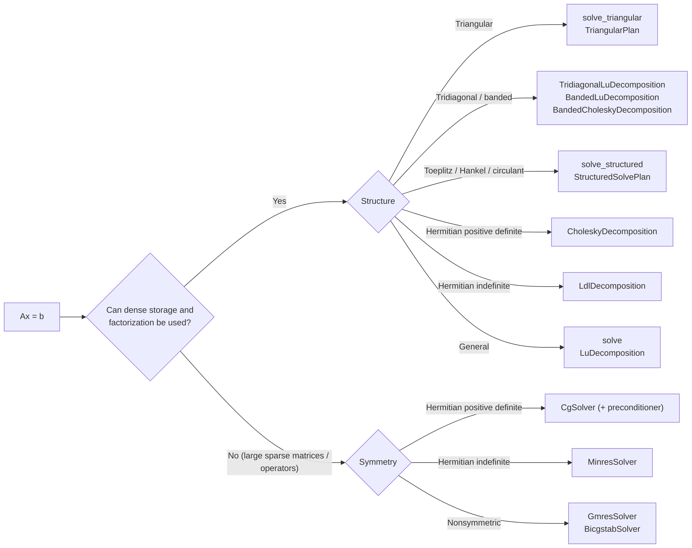

Even for the same equation, suitable solvers vary greatly with matrix properties and size.
General LU on a symmetric positive-definite matrix doubles the arithmetic, while dense factorization of banded matrices increases storage and work by orders of magnitude.
Large sparse matrices cannot fit in memory as dense matrices; even sparse factorization can exhaust memory if it creates many new nonzeros (fill).
This page gives criteria for choosing `scioxide-linalg` functions and types from problem and matrix properties, then compares three paths for the same problem.

As the diagram shows, solvers for linear systems $Ax = b$ depend on whether dense storage and factorization are feasible and on matrix structure and symmetry.
Each diagram node lists the shortest call first when a report-free call exists.
Select least-squares, eigenproblem, and matrix-function methods in the tables after the diagram.



## Linear systems

| Matrix property | Functions and types | Arithmetic work (order $n$) | Cautions |
|---|---|---|---|
| General square | `solve`, `LuDecomposition` | $\tfrac23 n^3$ | Power-of-two row/column scaling followed by partial pivoting. Backward stable in practice, with exceptions having large growth factors |
| Hermitian positive definite | `CholeskyDecomposition` | $\tfrac13 n^3$ | Numerically non-positive-definite input fails with `DomainError`. Success is not a positive-definiteness proof. Use `CholeskyPivoting::Diagonal` for semidefinite matrices |
| Hermitian indefinite | `LdlDecomposition` | $\tfrac13 n^3$ | Bounded rook pivoting. Singular matrices still factor; `inertia` gives inertia (counts of positive, negative, and zero eigenvalues) |
| Triangular | `solve_triangular`, `TriangularPlan` | $n^2$ | Forward/backward substitution. Unit diagonals, banded/packed formats, and transposed solves use `TriangularPlan` |
| Tridiagonal | `TridiagonalLuDecomposition`, `CyclicTridiagonalPlan` | $O(n)$ | Periodic boundaries are reordered and solved with bandwidth-2 band LU |
| Banded with lower bandwidth $k_l$ and upper bandwidth $k_u$ | `BandedLuDecomposition`, `BandedCholeskyDecomposition` | $O(n k_l (k_l + k_u))$; Cholesky of bandwidth $k$ costs $O(nk^2)$ | Storage $O(n(k_l + k_u))$ |
| Toeplitz / Hankel / circulant | `solve_structured`, `StructuredSolvePlan` | $O(n^2)$ per right-hand side | Hermitian Toeplitz uses Levinson–Durbin (positive definiteness unnecessary); columns with prediction error at most $\sqrt{\varepsilon}$ and other Toeplitz/Hankel use pivoted GKO; circulants use DFT diagonalization (direct sums, not FFT). Reserving plan workspace with `with_dense_fallback` enables dense-LU retries for columns missing tolerance |
| Large sparse matrices / operators | `CgSolver`, `MinresSolver`, `GmresSolver`, `BicgstabSolver` | One product per iteration (two for BiCGSTAB) | Preconditioners: scioxide-sparse `JacobiPreconditioner`, `IncompleteFactor`, `AmgPreconditioner` |
| Reusing low-precision factors | `IterativeRefinement` | $O(n^2)$ per correction | Guideline $\kappa(A)\,u_f < 1$ ($u_f$ is factorization unit roundoff) |

If sparse factorization is feasible, scioxide-sparse direct methods (`scioxide_sparse::solve`, `SparseLu`, `SparseCholesky`, `SparseLdl`) are also candidates.
Factorization returns `Err` only for structural breakdowns (exactly zero LU pivots or non-positive-definite Cholesky inputs) and overflowing factor entries; solution acceptance is decided when solving.
Ordinary `solve(&b)` uses default `DirectSolveOptions` (`RankPolicy::Exact`, without a minimum condition requirement or backward-error computation) for acceptance and, like one-call functions, returns errors on rejection.
Use detailed `solve_with_options(&b, &DirectSolveOptions)` to specify rank policies, minimum reciprocal condition numbers, or backward-error computation.
Rejection in detailed forms retains an `Ok` result without exposing a solution; the report's termination reason explains why ([LU, Cholesky, and LDL factorizations and direct-solution acceptance](../algorithms/direct-and-structured-solvers/)).
For many right-hand sides with one matrix, factor once and repeat `solve`.
One-call functions refactor on every call.

## Least squares and rank

| Situation | Functions and types | Cautions |
|---|---|---|
| Overdetermined systems of full column rank | `least_squares`, `HouseholderDecomposition` | Avoid normal equations $A^{\mathsf T}A x = A^{\mathsf T}b$, which square the condition number |
| Possible rank deficiency | `least_squares`, `HouseholderMinimumNormPlan`, `ThinSvdDecomposition` with `RankPolicy` | `least_squares` determines numerical rank with column-pivoted QR and `RankPolicy::DimensionScaledEpsilon`, returning minimum-norm solutions. Choose thresholds from data-error levels |
| Ill-conditioning requiring regularization | `ThinSvdDecomposition::solve` (truncation and damping), `HouseholderDecomposition::solve_damped` | Tikhonov regularization $\min \lVert Ax - b \rVert_2^2 + \lambda \lVert x \rVert_2^2$ ([Singular value decomposition, numerical rank, and regularized solutions](../algorithms/svd-and-rank/)) |
| Large sparse matrices | `LsqrSolver`, `LsmrSolver` | Convergence strongly depends on $\kappa(A)$ |
| Adding/removing rows or columns | `QrUpdateDecomposition` | Update without refactoring |

## Eigenvalue problems

| Problem | Functions and types |
|---|---|
| All eigenvalues/eigenvectors of Hermitian matrices | `HermitianEigenDecomposition` (`HermitianEigenvaluesResult` for eigenvalues alone, `tridiagonal` for tridiagonal matrices) |
| General matrices | `GeneralEigenDecomposition`, `GeneralEigenvaluesResult`; invariant subspaces use `SchurDecomposition` |
| $Ax = \lambda Bx$ (Hermitian pairs with positive-definite $B$) | `GeneralizedHermitianEigenDecomposition` |
| General matrix pencils | `GeneralizedSchurDecomposition` (QZ decomposition) |
| Some eigenvalues of large matrices | `PartialSpectrumSolver` (Krylov–Schur, thick-restart Lanczos, shift-and-invert), `LobpcgSolver` |
| Leading singular values of large matrices | `PartialSvdSolver`, `RandomizedLowRank` |

For Hermitian matrices, perturbation $E$ changes eigenvalues by at most $\lVert E \rVert_2$ (Weyl's theorem).
For nonnormal matrices, changes can be amplified by the eigenvector matrix's condition number (Bauer–Fike theorem, [Eigenvalue problems and Schur decomposition](../algorithms/eigenproblems/)).
Partial-spectrum types are [method values](oxref:linalg-execution-forms) holding only settings; dimensions are read from operators on each call, allowing one value to serve operators of different sizes.

## Matrix functions and matrix equations

For $f(A)$ itself, use one-call `matrix_function(&a, MatrixFunction::Exp)`, or `MatrixFunctionPlan` for repeated evaluation with the same matrix.
`MatrixFunction` selects exponentials, logarithms, square roots, powers, sign functions, trigonometric and hyperbolic functions, and others.
For only the vector action $f(A)v$, use method values `ExponentialAction` and `FunctionAction`, which avoid forming matrix $f(A)$.
`SparsePowerPlan` and `SparseFunctionPlan` materialize sparse powers and functions as sparse matrices; `with_max_entries` limits stored nonzeros (unlimited by default).
Sylvester, Lyapunov, and algebraic Riccati equations have one-call functions `solve_sylvester`, `solve_lyapunov`, and `solve_riccati`.
For the same coefficients and varied right-hand sides, use `SylvesterPlan`, `LyapunovPlan`, and `RiccatiPlan`, reading original-equation residuals and backward errors from reports.

## Call forms

Choose call forms for the same computation by purpose (definitions in [Workspaces, execution contexts, and attempt records](oxref:linalg-execution-forms)).

- For one right-hand side without reports, use one-call functions (`solve`, `least_squares`, `solve_triangular`, `solve_structured`, `matrix_function`, `solve_sylvester`, `solve_lyapunov`, `solve_riccati`).
- To retain factors and vary right-hand sides, use ordinary forms (`factor`, `solve`); to change acceptance or execution settings and inspect reports, use detailed forms (`factor_with_options`, `solve_with_options`).
- For parallelism, cancellation, deadlines, external BLAS providers, or repeated same-size computations inside iterations without allocations, supply workspaces and execution contexts to borrowed forms (`factor_into`, `solve_into`) or scoped forms (such as `norm2_scoped`).

Solver selection remains the same with external CBLAS-compatible libraries.
Enable `blas`, wrap a provider implementing `BlasProvider` in `BlasDispatch`, and attach it to borrowed-form contexts with `LinalgExecutionContext::with_blas`; BLAS operations such as products, triangular solves, vector dot products/norms, and internal factorization products may then use the provider.
Each call's product accuracy and declared provider capabilities determine eligibility; ineligible calls follow `BlasFallbackPolicy`, using SciOxide's native implementation or returning an error ([External BLAS provider contracts](../algorithms/blas-provider/)).

## Solving the same problem through three paths

Consider Poisson's equation discretized with five-point differences at $N \times N$ interior points of a unit square.
There are $n = N^2$ unknowns, and the matrix is symmetric positive definite.
Row-wise numbering gives bandwidth $N$, with at most five nonzeros per row.
Second differences are exact for quadratics; choosing right-hand side $b_{ij} = 2h^2\bigl(x_i(1-x_i) + y_j(1-y_j)\bigr)$ ($h = 1/(N+1)$) therefore gives exact discrete solution $u_{ij} = x_i(1-x_i)\,y_j(1-y_j)$.

The following cell solves the same equation with dense `CholeskyDecomposition`, banded `BandedCholeskyDecomposition`, and `CgSolver` using the banded view as an operator (no preconditioner, zero initial guess).
Both direct methods use ordinary `solve`, returning errors on rejection, so the table leaves their termination reasons blank.
CG uses detailed `solve_with_options` to inspect the report, with relative residual tolerance $10^{-12}$.
Inputs are interior points per side $N$ (4–20) and CG iteration limit (5–200).
The table lists termination reasons, stored counts, estimated operation counts, iterations, and maximum discrepancies from the exact solution.
CG storage includes the banded matrix and four working vectors of length $n$.
Operation estimates count $n^3/3$ for dense Cholesky, $nN^2$ for banded Cholesky, and per-iteration band products $2(2N+1)n$ plus vector operations $10n$ for CG.
The final outcome uses CG termination: convergence means satisfied, and limit termination means an intermediate value was returned.
Tests compare stored counts against formulas and each path's solution against the exact solution.

```rust
//| id: linalg-choosing-three-paths
//| ref: linalg-choosing-three-paths
//| title: "Solve two-dimensional Poisson equations through dense, banded, and iterative paths"
//| run: reactive
//| crates: [scioxide-core, scioxide-linalg]
//| inputs:
//|   grid: {"type":"range","label":"Interior points per side N","description":"There are N² unknowns.","min":4,"max":20,"step":4,"value":16}
//|   cg_limit: {"type":"range","label":"CG iteration limit [count]","description":"At its limit, CG stops with IterationLimit.","min":5,"max":200,"step":5,"value":200}
//| cases:
//|   - {"id":"small-grid","label":"N = 4","description":"Right-hand-side symmetry gives a small Krylov subspace; CG converges in three iterations.","inputs":{"grid":4}}
//|   - {"id":"large-grid","label":"N = 20","description":"Dense work grows as N⁶, and CG converges in 40 iterations.","inputs":{"grid":20}}
//|   - {"id":"cg-limit","label":"CG limit 10 iterations","description":"At N = 16, CG stops before convergence with IterationLimit, returning the best iterate.","inputs":{"cg_limit":10}}
//| tests:
//|   - case: default
//|     expect:
//|       - {"artifact":"paths","path":"/rows/0/2","equals":65536}
//|       - {"artifact":"paths","path":"/rows/1/2","equals":4352}
//|       - {"artifact":"paths","path":"/rows/0/5","range":{"max":1e-14}}
//|       - {"artifact":"paths","path":"/rows/1/5","range":{"max":1e-14}}
//|       - {"artifact":"paths","path":"/rows/2/1","equals":"Converged"}
//|       - {"artifact":"paths","path":"/rows/2/5","range":{"max":1e-13}}
//|       - {"path":"/outputs/1/state","equals":"satisfied"}
//|   - case: small-grid
//|     expect:
//|       - {"artifact":"paths","path":"/rows/0/2","equals":256}
//|       - {"artifact":"paths","path":"/rows/2/4","equals":3}
//|       - {"artifact":"paths","path":"/rows/2/5","range":{"max":1e-14}}
//|       - {"path":"/outputs/1/state","equals":"satisfied"}
//|   - case: large-grid
//|     expect:
//|       - {"artifact":"paths","path":"/rows/0/2","equals":160000}
//|       - {"artifact":"paths","path":"/rows/1/5","range":{"max":1e-14}}
//|       - {"artifact":"paths","path":"/rows/2/4","equals":40}
//|       - {"artifact":"paths","path":"/rows/2/5","range":{"max":1e-13}}
//|       - {"path":"/outputs/1/state","equals":"satisfied"}
//|   - case: cg-limit
//|     expect:
//|       - {"artifact":"paths","path":"/rows/0/5","range":{"max":1e-14}}
//|       - {"artifact":"paths","path":"/rows/2/1","equals":"IterationLimit"}
//|       - {"artifact":"paths","path":"/rows/2/4","equals":10}
//|       - {"artifact":"paths","path":"/rows/2/5","range":{"min":1e-6,"max":1e-3}}
//|       - {"path":"/outputs/1/state","equals":"partial"}
use scioxide_core::{Budget, ResidualTolerance, Triangle};
use scioxide_linalg::{
    BandedCholeskyDecomposition, CgSolver, CholeskyDecomposition, CholeskyPivoting,
    HermitianBandMatrix, HermitianInput, LinearSolveTermination, Matrix, Preconditioning,
    StructuredOperation, Vector,
};

let side = grid as usize;
let n = side * side;
let h = 1.0 / (side + 1) as f64;
// Five-point difference entries (diagonal 4, vertical/horizontal neighbors −1).
let entry = |i: usize, j: usize| -> f64 {
    let same_row = i / side == j / side;
    if i == j {
        4.0
    } else if (i.abs_diff(j) == 1 && same_row) || i.abs_diff(j) == side {
        -1.0
    } else {
        0.0
    }
};
// Exact solution u = x(1 − x) y(1 − y) and its right-hand side 2h²(x(1 − x) + y(1 − y)).
let q = |k: usize| {
    let t = (k + 1) as f64 * h;
    t * (1.0 - t)
};
let exact: Vec<f64> = (0..n).map(|k| q(k / side) * q(k % side)).collect();
let rhs: Vec<f64> = (0..n)
    .map(|k| 2.0 * h * h * (q(k / side) + q(k % side)))
    .collect();
let b = Vector::from_vec(rhs);
let error = |x: &[f64]| {
    x.iter()
        .zip(&exact)
        .fold(0.0_f64, |m, (p, e)| m.max((p - e).abs()))
};

// Dense Cholesky (ordinary form; rejection is an error).
let dense_entries = (0..n * n).map(|k| entry(k / n, k % n)).collect();
let dense = Matrix::from_vec(n, n, dense_entries).map_err(|e| e.to_string())?;
let x_dense =
    CholeskyDecomposition::factor(&dense, HermitianInput::Exact, CholeskyPivoting::None)
        .and_then(|f| f.solve(&b))
        .map_err(|e| e.to_string())?;
// Lower-triangular band storage (N + 1 entries down from column c's diagonal).
let band_data = (0..n * (side + 1))
    .map(|k| {
        let (c, d) = (k / (side + 1), k % (side + 1));
        if c + d < n { entry(c + d, c) } else { 0.0 }
    })
    .collect();
let band =
    HermitianBandMatrix::new(n, side, Triangle::Lower, band_data).map_err(|e| e.to_string())?;
let x_band = BandedCholeskyDecomposition::factor(&band)
    .and_then(|f| f.solve(StructuredOperation::Normal, &b))
    .map_err(|e| e.to_string())?;
// CG using a banded view as an operator (detailed form: no preconditioner, zero initial guess, inspect report).
let tolerance = ResidualTolerance::new(0.0, 1e-12).map_err(|e| e.to_string())?;
let limit = Budget::try_from(cg_limit as usize).map_err(|e| e.to_string())?;
let cg = CgSolver::new(tolerance, limit)
    .solve_with_options(&band.view(), &b, Preconditioning::None, None)
    .map_err(|e| e.to_string())?;
let report = cg.report();
let termination = report.termination();
let status = match termination {
    LinearSolveTermination::Converged => "Converged",
    LinearSolveTermination::LeastSquaresConverged => "LeastSquaresConverged",
    LinearSolveTermination::ConditionLimit => "ConditionLimit",
    LinearSolveTermination::IterationLimit => "IterationLimit",
    LinearSolveTermination::EvaluationLimit => "EvaluationLimit",
    LinearSolveTermination::Stagnation => "Stagnation",
    LinearSolveTermination::Breakdown(_) => "Breakdown",
    LinearSolveTermination::ExecutionStopped(_) => "ExecutionStopped",
};
let iterations = report.iterations();
let cg_error = error(cg.solution().as_slice());

let nf = n as f64;
let cg_work = iterations as f64 * nf * (2.0 * (2 * side + 1) as f64 + 10.0);
let dense_error = error(x_dense.as_slice());
let band_error = error(x_band.as_slice());
let band_len = n * (side + 1);
let (dense_work, band_work) = (nf.powi(3) / 3.0, nf * (side * side) as f64);
let rows: Vec<(&str, Option<&str>, usize, f64, Option<usize>, f64)> = vec![
    (
        "Dense Cholesky",
        None,
        n * n,
        dense_work,
        None,
        dense_error,
    ),
    (
        "Banded Cholesky",
        None,
        band_len,
        band_work,
        None,
        band_error,
    ),
    (
        "CG (unpreconditioned)",
        Some(status),
        band_len + 4 * n,
        cg_work,
        Some(iterations),
        cg_error,
    ),
];
let sci2 = serde_json::json!({ "notation": "scientific", "significantDigits": 2 });
let columns = serde_json::json!([
    { "key": "0", "label": "Path" },
    { "key": "1", "label": "Termination reason", "nullText": "Ordinary form (rejection is an error)" },
    { "key": "2", "label": "Stored entries", "type": "integer" },
    { "key": "3", "label": "Estimated operation count [count]", "type": "number", "format": sci2 },
    { "key": "4", "label": "Iteration count", "type": "integer", "nullText": "—" },
    { "key": "5", "label": "Maximum discrepancy from exact solution [-]", "type": "number", "format": sci2 }
]);
emit_table_with_columns!(
    columns,
    rows,
    metadata = serde_json::json!({ "id": "paths" })
);

let outcome = if termination.is_success() {
    Outcome::satisfied("All three paths returned solutions meeting tolerance")
} else if matches!(termination, LinearSolveTermination::Breakdown(_)) {
    Outcome::failed("CG recurrence broke down")
} else {
    Outcome::partial("CG stopped before convergence")
        .explanation("The CG row shows the best iterate whose true residual was checked.")
};
let mut outcome = outcome
    .status(status)
    .diagnostic("CG iterations", iterations as f64, None)
    .diagnostic("CG discrepancy from exact solution", cg_error, None);
if let Some(residual) = report.true_residual() {
    outcome = outcome.diagnostic("CG relative residual", residual.scaled_norm(), None);
}
emit_outcome!(outcome);
```

At default $N = 16$ ($n = 256$), dense and banded Cholesky agree with the exact solution within $1.6 \times 10^{-16}$; CG terminates with `Converged` after 31 iterations and discrepancy $5.7 \times 10^{-16}$.
Dense storage contains 65536 entries versus 4352 for banded storage; estimated factorization counts $5.6 \times 10^{6}$ and $6.6 \times 10^{4}$ differ by approximately 85-fold.
CG's estimated $6.0 \times 10^{5}$ operations exceed banded Cholesky.
The banded operator multiplies $2N + 1$ entries per row despite at most five being nonzero.
With scioxide-sparse CSR storing only nonzeros as the operator, each product uses approximately $5n$ multiplications and CG work becomes comparable to banded Cholesky.

Increasing $N$ makes dense work grow as $N^6$ and banded Cholesky as $N^4$.
CG uses 3, 10, 21, 31, and 40 iterations for $N = 4, 8, 12, 16, 20$.
The right-hand side has square symmetries ($x \leftrightarrow 1-x$, $y \leftrightarrow 1-y$, $x \leftrightarrow y$), restricting the Krylov subspace to eigenvectors sharing those symmetries.
With $m = N/2$, this subspace has $m(m+1)/2$ distinct eigenvalues (3, 10, 21, 36, 55); exact-arithmetic CG reaches the exact solution in at most that many iterations.
At $N \le 12$ the iteration counts equal these numbers; at $N = 16, 20$ tolerance is met earlier.
The iteration bound to reach tolerance scales with the square root of condition number $\kappa_2(A)$; for five-point differences $\kappa_2(A)$ scales with $N^2$, so iterations grow approximately as $N$ for large $N$.
A CSR operator's per-iteration work scales as $n = N^2$, giving CG work $N^3$ and making iterative methods more favorable for larger problems.
Poorly conditioned problems need more iterations and therefore preconditioning.

Setting the CG iteration limit to 10 gives termination `IterationLimit` and an outcome indicating an intermediate value.
The detailed form returns the best iterate whose true residual was checked in `Ok`, with exact-solution discrepancy $6.8 \times 10^{-5}$ and relative residual $2.2 \times 10^{-2}$.
Ordinary `solve(a, b)` with the same limit turns this result into a `ConvergenceFailure` error.

## Summary

For linear systems, if dense storage and factorization are feasible, select Cholesky, LDL, LU, triangular, tridiagonal, banded, or Toeplitz methods by structure; otherwise choose CG, MINRES, GMRES, or other iterations by symmetry.
Solve least squares with QR rather than normal equations; handle rank deficiency and ill-conditioning through SVD, rank policies, and damped solves.
Eigenproblem types distinguish Hermitian/general, standard/generalized, and complete/partial spectra.
Choose one-call functions for one right-hand side without reports, ordinary forms for factor reuse, detailed forms for acceptance criteria and termination reasons, and borrowed forms for allocation-free or parallel computation.
Storage and work vary greatly by path even for the same problem (approximately 15-fold storage and 85-fold factorization work at default $N = 16$); relative advantages of banded direct and iterative solvers change with problem size and conditioning.
External BLAS does not change solver selection; the `blas` feature selects where kernels such as products and triangular solves execute.

## Further reading

- [Mathematics and shared conventions of linear algebra](../algorithms/): examine error measures and acceptance conventions, and find the scope of each algorithm page.
- [Workspaces, execution contexts, and attempt records](../algorithms/workspaces-and-execution/): examine call-form definitions and reserving workspace for allocation-free borrowed forms.
- [Tridiagonal, banded, and Toeplitz matrices and structured direct solvers](../algorithms/structured-systems/): examine structured factorizations and conditions for switching from Levinson–Durbin to pivoted GKO.
- [Krylov subspace methods and preconditioning](../algorithms/krylov-and-preconditioning/): examine iterative convergence and reductions in iterations from preconditioning.
- [External BLAS provider contracts](../algorithms/blas-provider/): examine which calls reach providers and when native fallback occurs.
