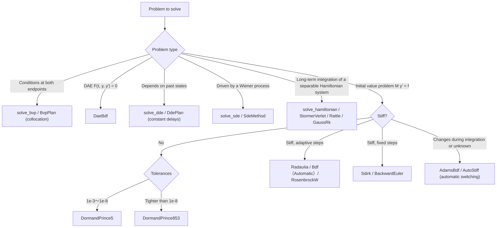

Method selection first branches by problem type: initial value problem, DAE, DDE, SDE, Hamiltonian system, or boundary value problem.
For initial value problems, the next criteria are stiffness and the need for adaptive step sizes, dense output, and events.
Explicit methods on stiff systems require extremely small steps for stability.
Implicit methods on nonstiff systems waste work on Jacobians and linear systems.

The methods in `scioxide-ode` include adaptive methods adjusting step sizes from error estimates and fixed-step methods using a supplied step size.
Values at specified times (dense output) and event detection are available only for methods providing dense output.
This distinction reflects implementation support rather than mathematical properties of the methods.

For only the endpoint value at default settings, the one-shot `solve_ivp` suffices (or `solve_ivp_at` for values at a sequence of times).
Both use `DormandPrince5` and default tolerances ($\varepsilon_\text{abs} = 10^{-6}$, $\varepsilon_\text{rel} = 10^{-3}$).
Use integrator objects and `OdeOptions` to select the method, tolerances, output, and limits.

## Selection flow

## Method properties

| Method | Family | Order | Step | Dense output and events | Mass matrix | Suitable cases | Explanation |
|---|---|:---:|---|---|:---:|---|---|
| `ForwardEuler`, `ExplicitMidpoint`, `Heun` | Explicit RK | 1, 2, 2 | Fixed | None | None | Checking convergence order, teaching | [Explicit RK](../algorithms/explicit-runge-kutta-and-control/) |
| `ClassicalRk4` | Explicit RK | 4 | Fixed | None | None | Fixed-period control, checking order by halving steps | [Explicit RK](../algorithms/explicit-runge-kutta-and-control/) |
| `Rkf45` | Explicit RK | 5(4) | Adaptive | Cubic Hermite | None | Comparison with existing computations | [Explicit RK](../algorithms/explicit-runge-kutta-and-control/) |
| `DormandPrince5` | Explicit RK | 5(4) | Adaptive | Fourth order | None | First choice for nonstiff problems | [Explicit RK](../algorithms/explicit-runge-kutta-and-control/) |
| `Verner65` | Explicit RK | 6(5) | Adaptive | Cubic Hermite | None | Accuracy between DP5 and DOP853 | [Explicit RK](../algorithms/explicit-runge-kutta-and-control/) |
| `DormandPrince853` | Explicit RK | 8(5,3) | Adaptive | Seventh order | None | Long integrations of smooth problems at tight tolerances | [Explicit RK](../algorithms/explicit-runge-kutta-and-control/) |
| `RosenbrockW`（`Ros2`, `Ros34Pw2`） | Linearly implicit W method | 2, 3 | Adaptive | Cubic Hermite | None | Stiff problems where Newton iteration is undesirable | [Rosenbrock-W](../algorithms/rosenbrock-and-stiffness-switching/) |
| `BackwardEuler` | Implicit RK | 1 | Fixed | None | Available | L-stable, for strong damping | [Implicit RK](../algorithms/implicit-runge-kutta-and-mass-matrices/) |
| `ImplicitTrapezoid` | Implicit RK | 2 | Fixed | None | Available | A-stable, when oscillations should not be damped | [Implicit RK](../algorithms/implicit-runge-kutta-and-mass-matrices/) |
| `Sdirk` | Diagonally implicit RK | 3 | Fixed | None | Available | L-stable; one factorization can be shared by all stages | [Implicit RK](../algorithms/implicit-runge-kutta-and-mass-matrices/) |
| `RadauIia` | Implicit RK (three stages) | 5(3) | Adaptive | Collocation polynomial | Available | High-order L-stability; strong stiffness | [Implicit RK](../algorithms/implicit-runge-kutta-and-mass-matrices/) |
| `GaussRk` | Implicit RK (two stages) | 4 | Fixed | None | Available | A-stable and symplectic | [Geometric integration](../algorithms/geometric-integrators/) |
| `AdamsBashforth`, `AdamsMoulton` | Variable-step Adams | 1〜5 | Fixed or automatic | Interpolation polynomial | None | Nonstiff problems with costly right-hand-side evaluations | [Multistep methods](../algorithms/multistep-methods/) |
| `Bdf` (BDF or NDF) | Variable-step backward differentiation | 1〜5 | Fixed or automatic | Interpolation polynomial | Available | Smooth, stiff problems over long intervals | [Multistep methods](../algorithms/multistep-methods/) |
| `AutoStiff`, `AdamsBdf` | Automatic switching | Order of the active method | Adaptive | When both methods provide it | When supported by the stiff method | Problems where stiffness appears or disappears | [Stiffness switching](../algorithms/rosenbrock-and-stiffness-switching/) |
| `StormerVerlet`, `Rattle` | Splitting methods | 2 | Fixed | None | Kinetic-energy mass | Separable Hamiltonian systems, holonomic constraints | [Geometric integration](../algorithms/geometric-integrators/) |

“Fixed” methods use the step size supplied through `OdeOptions::with_initial_step` (or an estimated size if omitted) without adjusting it from error estimates.
Adams and BDF use fixed order and step size with `new(order)` (`MultistepOrder::Fixed`).
Constructing them with `with_order_policy(MultistepOrder::Automatic(k))` starts at order 1 and adjusts order and step size to the tolerances.
The type `AdamsBdf` is `AutoStiff` pairing variable-order Adams and BDF.
Select implicit-method linear solvers through `OdeStageBackend` (dense LU, sparse LU, or matrix-free GMRES); they do not change automatically between methods ([Jacobians and linear stages](../algorithms/jacobians-and-linear-stages/)).

## Recognizing stiffness

A system is stiff when all eigenvalues of its linearized Jacobian $J = \partial f / \partial y$ have negative real parts whose magnitudes span many orders.
For an explicit method applied to a system with a large stiffness ratio

$$
S = \frac{\max_i |\operatorname{Re}\lambda_i|}{\min_i |\operatorname{Re}\lambda_i|}
$$

the fastest-decaying mode's stability condition ($|1 + h\lambda_{\max}| \le 1$ for forward Euler) determines the step size.
This requires steps much smaller than the timescale on which the solution changes.

In practice, stiffness is indicated by the following signs.

- Loosening tolerances does not increase step size or appreciably reduce evaluation counts.
- A high fraction of steps are rejected.
- Step sizes remain small and fluctuate despite a smooth solution.

In these cases, switch to `Bdf` (`Automatic`), `RosenbrockW`, `RadauIia`, or a fixed-step L-stable implicit method.

If stiffness occurs only over part of the interval or is unknown, use `AutoStiff` (`AdamsBdf` for an Adams–BDF pair).
The switching indicator is $|h|\,\rho(J)$; $\rho(J)$ is estimated by power iteration using Jacobian–vector products $Jv$.
The product $Jv$ uses the stiff method's current Jacobian if available; otherwise it uses `OdeSystem::jacobian_product` or a forward difference requiring one right-hand-side evaluation.
By default, two consecutive indicators above 1 or three consecutive explicit-step rejections trigger a switch to the stiff method.
After at least eight accepted stiff steps, six consecutive indicators below 1/4 trigger a switch back.
This separation of thresholds (hysteresis) is configurable through `StiffnessSwitchOptions`.
Power iteration can miss unexcited fast modes, so the switching reason (`OdeSwitchReason`) does not prove stiffness ([Stiffness switching](../algorithms/rosenbrock-and-stiffness-switching/)).

## Setting tolerances

Adaptive methods accept a step when the norm of local error normalized by the componentwise tolerance scale

$$
\mathrm{scale}_i = \varepsilon_{\mathrm{abs}, i} + \varepsilon_{\mathrm{rel}} \max\bigl(|y_{i,n}|, |y_{i,n+1}|\bigr)
$$

is at most 1.
The defaults for `OdeOptions::new()` are $\varepsilon_{\mathrm{abs}} = 10^{-6}$, $\varepsilon_{\mathrm{rel}} = 10^{-3}$, and the root-mean-square norm.
Passing scioxide-core's `ErrorTolerance` to `with_error_tolerance` also supports componentwise absolute tolerances.

- For quantities crossing zero (angles, velocities), relative tolerance alone makes the scale vanish near zero.
  Supply an absolute tolerance appropriate to the quantity's resolution.
- For positive quantities approaching zero (trace concentrations, populations), too small an absolute tolerance tracks meaningless digits and forces small steps.
  Use a physically meaningful lower bound as absolute tolerance ([Robertson kinetics](../examples/robertson-kinetics/)).
- Scale components with different units using componentwise absolute tolerances.

Tolerances target one-step local error; they do not bound global error.
Comparing solutions with tolerances changed by successive orders of magnitude estimates reliable result digits.

## Problems beyond initial value problems

| Problem | One-shot call | Configurable type | Main constraints | Explanation |
|---|---|---|---|---|
| Residual-form index-one DAEs | None | `DaeSystem`, `DaeBdf` | Specify differential and algebraic variables with `DaePartition`. High-index systems are unsupported | [Index-1 DAEs](../algorithms/dae-index-one/) |
| Constant-delay DDEs | `solve_dde` | `DdePlan`, `DdeOptions` | Positive constant delays and initial history. Method of steps using Dormand–Prince 5(4) and dense output | [Delay equations](../algorithms/delay-equations/) |
| SDE | `solve_sde` | `SdeMethod`, `SdeProblem` | Specify Itô (Euler–Maruyama) or Stratonovich (stochastic Heun); the caller supplies Wiener increments | [Stochastic differential equations](../algorithms/stochastic-equations/) |
| Separable Hamiltonian systems | `solve_hamiltonian` | `StormerVerlet`, `Rattle` | Fixed steps. `Rattle` supports real holonomic constraints | [Geometric integration](../algorithms/geometric-integrators/) |
| Two-point boundary value problems | `solve_bvp` | `BvpPlan` | Three-stage Lobatto IIIA collocation with residual-based mesh refinement; supports unknown parameters and singular endpoint terms | [Boundary value problems](../algorithms/boundary-value-collocation/) |

## Computing solution derivatives

| Method | API | Computational cost | Suitable cases | Explanation |
|---|---|---|---|---|
| Forward sensitivities | `ForwardSensitivitySystem` | Add equations of the same size as the state for each differentiated direction | Few directions (parameters and initial values), with sensitivities needed along the whole trajectory | [Forward sensitivities and ensembles](../algorithms/forward-sensitivities-and-ensembles/) |
| Adjoints | `OdeAdjointSolver`, `DaeAdjointSolver` | One forward and one backward integration, storing or recomputing the forward trajectory | Many parameters, with only a scalar-objective gradient needed | [Adjoints](../algorithms/adjoint-gradients/) |
| Parameter sweeps | `solve_ensemble_into` | One integration per independent trajectory | Output distributions rather than gradients | [Forward sensitivities and ensembles](../algorithms/forward-sensitivities-and-ensembles/) |

## Summary

Choose the API by problem type; for initial value problems, choose the method by stiffness and the need for adaptive steps, dense output, and events.
Candidates are `DormandPrince5` for nonstiff problems, `DormandPrince853` at tight tolerances, and `Bdf` (`Automatic`), `RosenbrockW`, or `RadauIia` for stiff problems needing adaptive steps.
For unknown stiffness, let `AutoStiff` handle it and inspect switching counts and reasons in the report.
Among implicit Runge–Kutta methods, only `RadauIia` supports adaptive steps, dense output, and events; the others use fixed steps.
Set tolerances to match component scales and verify results against solutions at different tolerances.

[Error, order, and stability](../algorithms/error-order-and-stability/) covers stability and error theory; [Examples](../examples/) compares methods on concrete problems.
