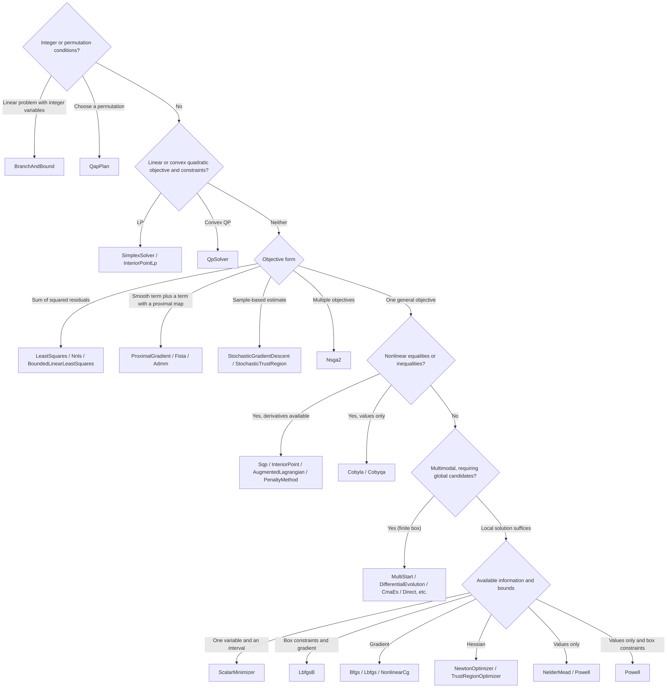

When choosing an optimization method, first consider mapping the problem's structure (convexity, linearity, sums of squared residuals, box-only constraints, integer variables, multimodality) to a dedicated type that uses that structure.
Any problem can be passed to derivative-free black-box optimization, but exploiting structure can reduce required derivatives or evaluations.
Diagnostics also depend on structure, including gradients, KKT residuals, and dual certificates.
The diagram summarizes the decision flow; the sections below explain each branch.
For a problem-type index of solvers and explanations, see [Problems and methods](#problems-and-methods) at the end of the page.

## Mathematical structure and dedicated types

If the objective has special structure, use a type expressing it rather than general `ObjectiveFn`.

| Problem structure | Type | Representative solvers | Why use the structure |
| :--- | :--- | :--- | :--- |
| Sum of squared residuals | `LeastSquaresProblem` / `LeastSquaresFn` | `LeastSquares` (`LeastSquaresGlobalization::GaussNewton` or `LevenbergMarquardt`) | Forms gradient $\mathbf{J}^\mathsf{T}\mathbf{r}$ and Hessian approximation $\mathbf{J}^\mathsf{T}\mathbf{J}$ from the Jacobian, converging rapidly for small residuals without second derivatives |
| Linear least squares (nonnegative/box) | `LinearLeastSquaresProblem` | `Nnls`, `BoundedLinearLeastSquares` | Handles boundary components by KKT conditions rather than clipping an unconstrained solution |
| Linear programming | `LpProblem` | `SimplexSolver`, `InteriorPointLp` | Uses vertices or a central path; primal/dual certificates can be checked independently with `ProgrammingVerifier::verify` |
| Convex quadratic programming | `QpProblem` | `QpSolver` | With $\mathbf{Q} \succeq 0$ and linear constraints, the KKT system is linear and solvable by active-set or primal-dual interior-point methods. An explicit Hessian that is not positive semidefinite gives `InvalidInput` |
| Mixed-integer programming | `MipProblem` | `BranchAndBound` | Computes lower bounds by LP relaxation and prunes the search tree. Returns a numerical gap |
| General nonlinear constraints | `ConstrainedProblem` (objective paired with `Constraints`) | `Sqp`, `InteriorPoint`, `AugmentedLagrangian` | Distinguishes equalities, inequalities, and bounds, deciding termination through four KKT residuals |

Bound handling is method-specific.
`LbfgsB` and `Powell` accept `BoundedObjective` pairing an objective and box and search inside that box.
`Bfgs`, `Lbfgs`, `NonlinearCg`, `GradientDescent`, `NewtonOptimizer`, `TrustRegionOptimizer`, and `NelderMead` do not handle bounds; a bounded objective gives `InvalidInput` before callbacks run.
Register bounds for nonlinear constrained methods with `Constraints::bounds`; global search receives a box with all finite endpoints through `BoundedObjective`.
Only `BranchAndBound` (`MipProblem`) handles integer variables; quadratic-assignment `QapPlan` searches permutations.

## Choosing a calling form

Call the same method in the following forms according to the control needed (definitions in [Optimization problems and interpreting results](oxref:optimize-call-forms)).

| Purpose | Form | Example |
|---|---|---|
| Solve once with defaults and receive only a successful result | One-shot function | `minimize(f, &x0)`, `minimize_bounded(f, &x0, &bounds)`, `minimize_constrained(f, &x0, &constraints)`, `minimize_global(f, &[(lo, hi)], seed)`, `minimize_scalar(f, a, b)`, `least_squares(r, &x0, m)`, `curve_fit(model, &xdata, &ydata, &p0)`, `nnls(&a, &b)`, `bvls(&a, &b, &bounds)`, `quadratic_assignment(a, b, direction)`, `lp.solve()`, `qp.solve()`, `mip.solve()` |
| Supply derivatives, change tolerances or limits, read partial results | Standard method-object form | `Bfgs::new(options).minimize(&f, &x0)`, `LeastSquares::new(options)?.solve(&problem, &x0)`, `SimplexSolver::default().with_tolerances(tolerances).solve(&lp)` |
| Choose a local method at runtime | `Optimizer` trait | `minimize(&f, &x0)` of `Box<dyn Optimizer<f64>>` |
| Solve the same quadratic-assignment matrices repeatedly | Plan | `QapProblemView::new(a, b, &fixed)?.prepare()?` followed by `plan.solve(direction, None)` or `plan.solve_with_options(direction, None, &options)` |
| Eliminate inner-iteration allocation and share cancellation or limits with an outer solver | Output-buffer API | `solver.minimize_into(&f, &x0, &mut result, &mut workspace, context)` |

One-shot functions approximate gradients by differences (central for `minimize`; forward for `minimize_bounded`, `minimize_constrained`, `least_squares`, `curve_fit`).
If analytical or automatic derivatives are available, attach them with `ObjectiveFn::with_gradient` or related methods and pass them to method objects.
`minimize` assumes a smooth objective; use `NelderMead` or `Powell` for nonsmooth objectives.

## Unconstrained and box-constrained local methods

For an unconstrained problem $\min_{\mathbf{x}} f(\mathbf{x})$, choose by available information (values only, gradient, Hessian) and variable count $n$.
This also covers variables subject only to lower and upper bounds.
For one variable with a specified interval $[a, b]$, use `minimize_scalar` (Brent) or `ScalarMinimizer` (golden section or Brent).
Brent combines parabolic interpolation and golden-section steps, requiring at most one new evaluation per iteration.

### Methods using only values

If an objective comes from an external simulation and derivatives and automatic differentiation are unavailable, choose a values-only (derivative-free) method.

- `NelderMead` (simplex method): moves a simplex of $n+1$ vertices by reflection, expansion, contraction, and shrinkage.
  Suits few-variable problems (roughly $n \lesssim 10$).
  With noise, the simplex may shrink to the noise scale and stop.
  Does not handle bounds; passing a boxed objective gives `InvalidInput`.
- `Powell` (conjugate-direction method): starts with coordinate directions and builds conjugate directions through repeated one-dimensional minimizations.
  A box can be specified with `BoundedObjective`; in smooth valleys it often progresses with fewer evaluations than Nelder–Mead.

For both, `Converged` checks value spread or displacement, not a certificate of gradient stationarity.
For nonlinear constraints, use `Cobyla` or `Cobyqa` discussed below.

### Methods using gradients

With gradients from analytical or automatic differentiation (`scioxide-ad`), choose a first-order or quasi-Newton method.
Without a supplied gradient, default `DerivativeStrategy::AnalyticOrCentral` uses central differences (`LbfgsB` defaults to forward-difference `AnalyticOrForward`).

- `Bfgs`: an initial choice for medium-sized problems (roughly $n \lesssim 1000$).
  Applies a rank-two update to an inverse-Hessian approximation using displacement $\mathbf{s}_k$ and gradient change $\mathbf{y}_k$.
  Superlinear convergence theory requires positive definite curvature near the solution, Hessian regularity, an appropriate line search, and related assumptions.
  Dense-matrix memory use is $O(n^2)$.
- `Lbfgs`: an option for many variables.
  Retains only the latest $m$ pairs (default 10) of $(\mathbf{s}_k, \mathbf{y}_k)$, limiting memory to $O(mn)$.
- `LbfgsB`: L-BFGS for variables with only lower and upper bounds.
  Applies an inverse L-BFGS model to the projected gradient and searches a feasible line segment.
  Decides termination using the projected gradient in original coordinates.
  Supply objective and box through `BoundedObjective`.
- `NonlinearCg`: use when memory must remain $O(n)$.
  Uses the Polak–Ribière+ coefficient and restarts from steepest descent when conjugacy is lost.
- `GradientDescent`: a baseline for checking gradient implementations and line searches.
  Slow for large condition numbers.

If line search cannot find an acceptable step length, all these methods stop with `LineSearchFailed`, which is unsuccessful.

### Methods using Hessians

If second derivatives are available, choose Newton or trust-region methods.

- `NewtonOptimizer`: pure Newton iteration has quadratic convergence theory when the initial value is near a local minimum and the Hessian is positive definite and locally Lipschitz continuous.
  Normalizes the Hessian by its largest absolute entry and factors by $\mathrm{LDL}^\mathsf{T}$; if no descent direction results, adds diagonal shifts starting at $\sqrt{\varepsilon}$, increasing tenfold up to 16 times and refactoring.
  If no descent direction is still obtained, returns error `NumericalInstability`.
- `TrustRegionOptimizer`: suitable for indefinite curvature or distant initial values.
  Minimizes a model within a radius, accepting only objective-decreasing steps with acceptance ratio above 0.15.
  The default subproblem method is dogleg.
- `TrustRegionSubproblem::SteihaugCg`: a truncated conjugate-gradient subproblem selected with `TrustRegionOptions::with_subproblem`, suitable for many variables.
  If the objective supplies Hessian-vector products (`ObjectiveFn::with_hessian_vector_product` for a closure), no dense Hessian is formed.
  However, second-order termination (`second_order_stopping: true`) forms a dense Hessian analytically or by differences and does not use Hessian-vector products.

## Choosing constrained optimization methods

For constrained problems, choose by derivative availability, constraint count and nonlinearity, and initial-point feasibility.
Bundle objective and constraints in `ConstrainedProblem`.

| Solver | Suitable problems | Caveats |
| :--- | :--- | :--- |
| `Sqp` (sequential quadratic programming) | Smooth equalities, inequalities, and bounds, requiring an accurate KKT point | Defaults to a dense subproblem per iteration, suited to medium sizes. Sensitive to dependent constraint Jacobians and poor scaling |
| `InteriorPoint` (primal-dual interior point) | Many inequalities or bounds; initial point may be infeasible | Terminates when original KKT residuals meet tolerance. Barrier parameter alone does not determine success |
| `AugmentedLagrangian` | Mainly equality constraints, seeking feasibility without excessive penalty coefficients | Requires an inner BFGS solve for each outer iteration |
| `PenaltyMethod` | Prototyping or exploring an approximate feasible region | Increasing the penalty coefficient makes the Hessian ill-conditioned; violations decrease only inversely with the coefficient |
| `Cobyla` / `Cobyqa` | Objective and constraint derivatives unavailable | Model gradients are estimates; `Converged` does not certify stationarity |

For linear constraints and linear or convex quadratic objectives, `SimplexSolver`, `InteriorPointLp`, and `QpSolver` are faster than nonlinear solvers and also provide dual certificates.

## Composite, sampled, and multiple objectives

- A smooth term plus a convex nonsmooth term (L1 regularization, interval indicator functions): use `ProximalGradient` or accelerated `Fista`.
  Use `Admm` for two blocks linked by linear constraint $A\mathbf{x} + B\mathbf{z} = \mathbf{c}$.
  The user supplies proximal maps (`ProximalMap`) and block updates (`AdmmBlockUpdate`).
- Objectives or gradients estimated from samples (minibatch losses, simulation means): use `StochasticGradientDescent` with a fixed sample count or `StochasticTrustRegion`, which adaptively increases repeated observations to build first-order models.
  `EstimatedStationarity` is estimate-based termination, not a certificate.
- Multiple objectives: use `Nsga2` to collect a finite approximation of nondominated solutions in `ParetoArchive`.
  Does not establish recovery of the entire frontier.

## Multimodality and global search

For multimodal objectives, the point reached by a local solver depends on the initial value.
It may converge to a local minimum or stop due to stagnation or iteration limits.
When global candidates are needed, choose as follows.
None of these methods certifies global optimality; termination at the computation-count limit (`SearchBudgetCompleted`) is unsuccessful.

| Method | Suitable situations |
| :--- | :--- |
| `MultiStart` | Piecewise smooth functions with valley floors easily refined by local methods. Combines starting-point design (uniform or user-provided points) with a local solver such as bounded Powell |
| `BasinHopping` / `DualAnnealing` | Search by moving between local solutions. Temperature has objective-value units |
| `DifferentialEvolution` | Discontinuous or noisy black-box functions with unreliable gradients |
| `minimize_global` (one-shot function) | One differential-evolution run with defaults, supplying only a box and seed |
| `CmaEs` | Continuous black-box functions with strongly correlated variables |
| `Direct` | Low-dimensional problems requiring systematic deterministic subdivision of the whole box |
| `Shgo` | Select local starting points from a sampled simplicial complex. Specify sample design, local-solver factory, and seed |
| `SurrogateSearch` | Expensive evaluations with a desired limit of tens to hundreds of evaluations |

Refine candidates locally with `Bfgs` or related methods and check reproducibility with other seeds or methods.

## Discrete problems

Solve linear problems with integer variables using `BranchAndBound` and interpret the result through the gap and termination reason in `MipResult`.
Quadratic assignment over permutations uses `QapPlan` (FAQ relaxation and 2-opt), returning validated permutations without establishing global optimality.
Nonlinear integer programming and global search with integer variables are not provided.
For nonlinear problems with integer variables, linearize to `MipProblem` or solve a continuous relaxation and check rounded candidates.

## Problems and methods

The table maps problem types to solvers and explanatory pages; the right column lists quantities used to assess results.

| Problem | Methods | Explanation | Assessment information |
|---|---|---|---|
| One variable, bounded interval | `ScalarMinimizer`, `minimize_scalar` | [One-dimensional minimization](../algorithms/scalar-minimization/) | Interval width and evaluation count |
| Unconstrained, gradient available | `Bfgs`, `Lbfgs`, `NonlinearCg`, `GradientDescent` | [First-order, nonlinear conjugate-gradient, and quasi-Newton methods](../algorithms/first-order-and-quasi-newton/), [Conditioning and convergence comparison](../algorithms/first-order-convergence/), [Curvature-update safeguards and SR1](../algorithms/quasi-newton-updates/), [Coordinate scaling, descent directions, and line search](../algorithms/line-search-and-scaling/), [Strong Wolfe bracketing and zoom](../algorithms/strong-wolfe-zoom/) | Gradient norm and line-search acceptance |
| Unconstrained, Hessian available | `NewtonOptimizer`, `TrustRegionOptimizer` | [Newton and trust-region methods](../algorithms/newton-and-trust-region/), [Truncated conjugate gradients and negative curvature](../algorithms/truncated-cg-trust-region/), [Second-order termination and saddle points](../algorithms/second-order-stopping-saddle/) | Hessian inertia, acceptance ratio, radius |
| Values only (box constraints only with `Powell`) | `NelderMead`, `Powell` | [Derivative-free local optimization](../algorithms/derivative-free-local/), [Powell's conjugate-direction method](../algorithms/powell-conjugate-directions/) | Simplex size, value spread, direction rank |
| Box constraints, gradient available | `LbfgsB` | [Box constraints and projected L-BFGS](../algorithms/bound-constrained-lbfgsb/), [Generalized Cauchy point and active-set identification](../algorithms/lbfgsb-cauchy-point-and-active-set/) | Projected gradient and active bounds |
| Equalities/inequalities, derivatives available | `Sqp`, `InteriorPoint`, `AugmentedLagrangian`, `PenaltyMethod` | [Nonlinear constraints and KKT conditions](../algorithms/nonlinear-constraints/), [KKT residuals and multiplier sensitivity](../algorithms/kkt-residuals-and-sensitivity/), [Penalty and augmented Lagrangian methods](../algorithms/penalty-and-augmented-lagrangian/), [Sequential quadratic programming (SQP)](../algorithms/sqp-and-interior-point/), [Nonlinear interior-point methods](../algorithms/nonlinear-interior-point/) | Primal feasibility, stationarity, complementarity |
| Equalities/inequalities, values only | `Cobyla`, `Cobyqa` | [Derivative-free constrained optimization](../algorithms/derivative-free-constrained/) | Feasibility and model geometry |
| Sum of squared residuals | `LeastSquares` | [Nonlinear least squares](../algorithms/nonlinear-least-squares/), [Robust losses and observation weights](../algorithms/robust-and-weighted-least-squares/), [Identifiability and statistical fitting](../algorithms/identifiability-and-fitting/), [Passing solvers to statistical estimation](../algorithms/statistical-fitting-solvers/) | Original gradient and Jacobian singular values |
| Linear residuals and nonnegative/box constraints | `Nnls`, `BoundedLinearLeastSquares` | [Nonnegative and bounded linear least squares](../algorithms/linear-least-squares/) | Rank and bound status |
| Linear programming | `SimplexSolver`, `InteriorPointLp` | [Linear programming and duality](../algorithms/linear-programming/), [Linear/quadratic programming certificates and verification](../algorithms/programming-certificates/), [Infeasibility/unboundedness certificates and verification of external results](../algorithms/infeasibility-certificates/) | Primal-dual residuals and certificate verification |
| Convex quadratic programming | `QpSolver` | [Convex quadratic programming and KKT systems](../algorithms/quadratic-programming/), [Box-constrained convex QP and projected gradients](../algorithms/bound-constrained-qp/) | KKT residuals and convexity checks |
| Mixed-integer linear programming | `BranchAndBound` | [Mixed-integer programming and branch and cut](../algorithms/mixed-integer-programming/), [Branch-and-cut search state and limits](../algorithms/branch-and-cut-search/) | Incumbent/lower-bound gap |
| Assignment with interfacility relationships | `QapPlan` | [Quadratic assignment and permutation search](../algorithms/quadratic-assignment/), [Evaluating quadratic-assignment heuristics](../algorithms/quadratic-assignment-evaluation/) | Permutation and original cost |
| Nonsmooth composite objective | `ProximalGradient`, `Fista`, `Admm` | [Proximal gradient and FISTA](../algorithms/composite-and-splitting/), [Variable splitting with ADMM](../algorithms/admm-splitting/) | Gradient mapping, primal/dual residuals |
| Multimodal objective (finite box) | `MultiStart`, `BasinHopping`, `DualAnnealing`, `DifferentialEvolution` | [Global-search limits and basin-hit probabilities](../algorithms/global-search/), [Multistart methods](../algorithms/multistart/), [Basin hopping and dual annealing](../algorithms/basin-hopping-and-annealing/), [Differential evolution](../algorithms/differential-evolution/) | Seed distribution of best values and evaluation count |
| Expensive objectives, deterministic partitioning, distribution-based search | `Direct`, `Shgo`, `SurrogateSearch`, `CmaEs` | [Global search with DIRECT and SHGO](../algorithms/deterministic-and-surrogate-global/), [Surrogate-model search](../algorithms/surrogate-search/), [CMA-ES](../algorithms/cma-es/) | Evaluation count and observation history |
| Multiple objectives, noisy evaluations | `Nsga2`, `StochasticGradientDescent`, `StochasticTrustRegion` | [Multiobjective optimization and NSGA-II](../algorithms/multiobjective-and-stochastic/), [Stochastic gradient descent and stochastic trust-region methods](../algorithms/stochastic-gradient-and-trust-region/) | Dominance, spread, standard errors |

## Summary

Narrow solver choices by integer/permutation conditions, linear/convex quadratic structure, objective form, nonlinear constraints, number of modes, then available derivatives.
Use one-shot functions for a single default solve and method objects to supply derivatives or settings, read partial results, or reuse workspace.
Dedicated types, such as sums of squared residuals, linear/convex quadratic Plans, and box-only constraints, provide the corresponding algorithm's assumptions and diagnostics.
A bounded objective passed to a local method without bound support gives `InvalidInput`; choose `LbfgsB` or `Powell` for boxes and solvers accepting `ConstrainedProblem` for general constraints.
For nonlinear constraints, `Sqp` and `InteriorPoint` decide termination through KKT residuals; without derivatives, use `Cobyla` or `Cobyqa`.
Global-search and sampled-objective methods return finite-search or estimation results, not certificates; check them through local optimization and reproducibility.

## Further reading

- [Optimization problems and interpreting results](../algorithms/): examine the chosen method's assumptions, success conditions, complexity, and breakdown modes.
- [Nonlinear constraints and KKT conditions](../algorithms/nonlinear-constraints/): relate constrained methods' stopping residuals to optimality conditions.
- [Practical optimization examples and engineering applications](../examples/): run the selected method on concrete problems and interpret results with independent checks.
- [Optimization API guide](../api/): examine the selected solver's settings, workspace, result types, and diagnostics.
