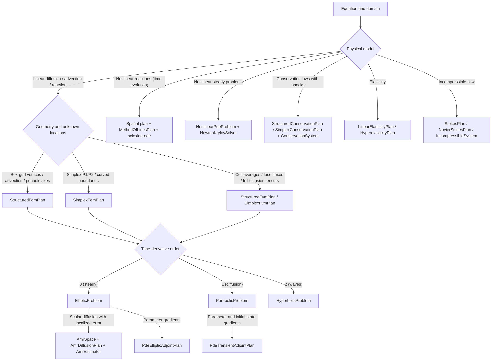

`scioxide-pde` uses separate types for spatial discretization (plans) and solving.
First choose the physical model; for linear diffusion, advection, and reaction, choose spatial plans from geometry and unknown locations, then solver plans from the time-derivative order.
Elasticity, incompressible flow, shock-containing conservation laws, and nonlinear reactions combine dedicated plans with `scioxide-ode`, `scioxide-rootfind`, and `scioxide-linalg` solvers.
Adaptive refinement and parameter sensitivities are additional requirements after selecting the solution method.

---

## Equation types and solver plans

Spatial plans assemble operator $A$, lumped mass $M$, and load $\mathbf{b}(t)$ at time $t$; solver plans solve them.
The three solver plans accept any spatial plan implementing `SpatialDiscretization` ([Shared spatial-discretization contract](oxref:pde-spatial-discretization-contract)).

| Problem | Discrete equation | Solver | Defaults and alternatives | Explanation |
|---|---|---|---|---|
| Steady (elliptic) | $A\mathbf{u}=\mathbf{b}$ | `EllipticProblem` | Selects tridiagonal, cyclic tridiagonal, or sparse LU direct solvers from matrix shape. Inject iterative methods with `EllipticWorkspace::with_linear_solver` | [Solving elliptic linear systems](../algorithms/elliptic-linear-solves/) |
| Diffusion (parabolic) | $M\mathbf{u}'=\mathbf{b}(t)-A\mathbf{u}$ | `ParabolicProblem` | Adaptive Radau IIA. `ParabolicScheme` selects backward Euler, Crank–Nicolson, or explicit Dormand–Prince 5(4); `with_ode_method` selects built-in `scioxide-ode` methods | [Time integration of parabolic equations](../algorithms/parabolic-time-integration/) |
| Waves (hyperbolic) | $M\mathbf{u}''=\mathbf{b}(t)-A\mathbf{u}$ | `HyperbolicProblem` | Advances a first-order displacement/velocity system with adaptive Dormand–Prince 5(4). Change with `with_ode_method` | [Wave equations and the CFL condition](../algorithms/hyperbolic-waves-and-cfl/) |
| Nonlinear time evolution | $\mathbf{M}\dot{\mathbf{y}}=\mathbf{f}(t,\mathbf{y})$ | `MethodOfLinesPlan` and `OdeProblem` from `scioxide-ode` | Caller writes right-hand sides, normalized by mass and field scale for any integrator | [Method of lines and semidiscrete systems](../algorithms/method-of-lines-and-nonlinear/) |
| Nonlinear steady problems | $\mathbf{f}(t_\ast,\mathbf{u})=\mathbf{0}$ | `NonlinearPdeProblem` and `NewtonKrylovSolver` from `scioxide-rootfind` | `PdeJacobianMode` selects dense/sparse/operator Jacobians; fieldwise preconditioning may be added | [Nonlinear steady problems](../algorithms/nonlinear-steady-problems/) |
| Conservation laws with shocks | $\lvert K\rvert\,\dot{\bar u}_K=-\sum_f \hat F_f\lvert f\rvert$ | `ConservationSystem` and explicit methods from `scioxide-ode` | The system declares step limits, and inadmissible stage trials are rejected | [CFL conditions and time integration for conservation laws](../algorithms/conservation-time-integration/) |

Time-evolution plans accept time-dependent sources and boundary data and every boundary-condition kind.
Select intermediate fields through `PdeOutputSchedule` and restart stopped computations from states or checkpoints ([Time-evolution outputs, restart, and termination reasons](../algorithms/transient-outputs-and-restart/)).
For diffusion with nonlinear reactions, write right-hand sides using plan operators and lumped masses, then integrate by the method of lines ([Two-dimensional Turing pattern formation](../examples/turing-pattern-formation/), [Method of lines for a two-temperature model](../examples/two-temperature-method-of-lines/)).

## Geometry and spatial discretization

Three plan families support linear diffusion, advection, and reaction, each handling $D=1,2,3$ in one type.
When resolving a problem with another family, boundary conditions and coefficients retain the same meanings, but unknown locations differ.

| Aspect | [`StructuredFdmPlan`](../algorithms/multidimensional-spatial-plans/) | [`SimplexFemPlan`](../algorithms/simplex-finite-elements/) | [`StructuredFvmPlan` / `SimplexFvmPlan`](../algorithms/multidimensional-finite-volumes/) |
|---|---|---|---|
| Mesh | Structured grids (`SegmentMesh`, `QuadMesh`, `HexMesh`) | Intervals, triangles, tetrahedra (`IntervalMesh`, `TriangleMesh`, `TetrahedronMesh`) | Structured grids or simplex meshes |
| Unknown locations | Vertices | P1 vertices; P2 vertices and edge midpoints | Cells |
| Field count | Multiple coupled components | Multiple coupled components | One only |
| Diffusion | Per-axis coefficients (through diagonal anisotropy) | Full component/direction tensors | Full tensors |
| Advection | Centered averages (no upwinding) | None | None |
| Reaction | Component coupling matrix | Component coupling matrix | Scalar |
| Periodic axes | Supported | Unsupported | Unsupported |
| Boundary-condition sets | `StructuredBoundaries` | `TaggedBoundaries` | `StructuredBoundaries` for structured grids, `TaggedBoundaries` for simplices |
| Accuracy guideline | Interior truncation error is second order on uniform or smoothly varying grids, first order on arbitrary nonuniform grids | For smooth solutions, P1 is second order and P2 third order at interior points. Quadratic geometry (`SimplexFemGeometry::Quadratic`) reduces curved-boundary geometric errors | Smooth cell values are second order; material interfaces inside cells reduce this to first order |
| Lumped mass | Vertex control volumes | HRZ method scaling the diagonal to total mass | Cell volumes |
| Suitable uses | Box domains, periodic boundaries, coupled advection systems | Curved boundaries, component coupling, higher-order elements | Direct face-flux balances (`face_fluxes`), anisotropy on nonorthogonal meshes |

Derivations and convergence orders for the three one-dimensional plans appear in [FDM, FEM, and FVM for elliptic problems](../algorithms/elliptic-fdm-fem-fvm/); unknown-location differences in [Mesh and field locations](oxref:pde-mesh-field-locations).
Vertex and cell fields have distinct `scioxide-spatial` types; compare different families by interpolation to common evaluation points or through fluxes and integral quantities.

Linear solvers depend on matrix properties.
For diffusion without advection and symmetric reactions, symmetric Dirichlet elimination preserves symmetry, allowing CG injection into workspaces.
Advection in `StructuredFdmPlan` makes matrices nonsymmetric and produces positive off-diagonal entries when grid Péclet number $\lvert v\rvert h/k$ exceeds 2.
FVM nonorthogonal corrections also involve neighboring cell values, generally making matrices nonsymmetric.
Use default sparse LU or inject GMRES or similar methods for nonsymmetric matrices.

Align discontinuous material interfaces with grid points (cell faces for FVM).
FDM samples coefficients at face centers, FVM at cell centers, and FEM at quadrature points; unaligned interfaces shift the apparent interface and reduce errors to first order ([Discontinuous coefficients and material interfaces](../algorithms/material-interfaces/)).

## Boundary conditions and compatibility

All families use boundary vocabulary `BoundaryCondition`, with exactly one condition per exterior-face/component pair.
Neumann data are outward conormal flux $\mathbf{n}\cdot K\nabla u$ and Robin data $\mathbf{n}\cdot K\nabla u+\alpha u=g$, not the normal derivative itself ([Boundary conditions and outward signs](../algorithms/boundary-conditions/)).
Periodicity is mesh topology `AxisTopology::Periodic` rather than a boundary condition; specify no conditions on seam faces.
Conflicting Dirichlet values at a node, as at corners in two or more dimensions, are rejected by default; choose treatment with `BoundaryConditions::with_dirichlet_conflict_policy`.

| Boundary situation | Solution uniqueness | Handling in `EllipticProblem` |
|---|---|---|
| Any Dirichlet condition | Unique | Solve directly |
| Robin conditions with $\alpha>0$, remaining boundaries Neumann | Unique | Solve directly |
| All boundaries Neumann or periodic, without reaction (or advection for FDM) | Indeterminate by a constant; no solution unless total load is zero | Rejected without a gauge selected through `EllipticOptions::with_gauge`. Incompatible loads default to `DomainError`; `CompatibilityPolicy::Project` solves the projected load |
| Nullspaces not inferred from structure | Indeterminate | Supply an orthonormal basis through `EllipticProblem::with_nullspace` and solve with `EllipticGauge::Orthogonal` |

Use `EllipticGauge::WeightedMean(c)` for physical mean values; when solving projected loads, inspect diagnostics for the load change ([Compatibility, gauges, and conservative fluxes for elliptic problems](../algorithms/compatibility-gauges-and-fluxes/)).
Incompressible pressure is also indeterminate by a constant; `IncompressibleOptions::new()` automatically applies a weighted-zero-mean gauge on closed connected components ([Pressure gauges and flux compatibility](oxref:pde-pressure-gauge)).

## Time integration of diffusion equations

Semidiscrete diffusion systems are stiff, with eigenvalues along the negative real axis and largest magnitude growing as $O(h^{-2})$ with grid spacing $h$.
Explicit methods bound Fourier number $r=\alpha\Delta t/h^2$ ($\alpha$ is diffusivity) by method-specific constants, requiring time steps proportional to $h^2$; choose implicit methods on fine grids.

| `ParabolicScheme` | Order | Stability | Time step | Suitable cases |
|---|---|---|---|---|
| `RadauIia` (default) | Adaptive order 5 | L-stable | Determined by tolerance | Accuracy requirements with automatic step selection |
| `BackwardEuler` | 1 | L-stable | Fixed by `with_step` | Strong damping of high wavenumbers; first-order time accuracy |
| `CrankNicolson` | 2 | A-stable (not L-stable) | Fixed by `with_step` | Fixed-step second-order accuracy with smooth initial data; add Rannacher startup for discontinuous initial data |
| `ExplicitDopri5` | Adaptive 5(4) | Bounded stability region | `CflPolicy::Automatic` supplies an upper limit | Coarse grids where limit $O(h^2)$ is acceptable |

For large Fourier numbers, Crank–Nicolson's short-wavelength amplification factor approaches $-1$, leaving sign-alternating grid-scale oscillations from discontinuous initial data.
`ParabolicOptions::with_rannacher_startup` replaces the first few intervals by two backward Euler half-steps to damp these components and combines only with built-in `CrankNicolson` ([Crank–Nicolson oscillations and Rannacher startup](../algorithms/crank-nicolson-and-rannacher/)).
Requested-time outputs `PdeOutputSchedule::Times` require integrators with dense output and are unavailable for backward Euler and Crank–Nicolson.

## Wave-equation time steps and grid resolution

Explicit integration requires the numerical domain of dependence to contain the physical one (Courant–Friedrichs–Lewy condition, Courant number $\nu=c\Delta t/h\le1$).
This is only necessary for convergence; default Dormand–Prince 5(4) has stricter stability condition $\nu\le0.4986$ for second-order centered differences on uniform grids.
`HyperbolicProblem` starts with `HyperbolicOptions::with_initial_step`'s step (estimated if omitted), then advances using the smaller of local-error control and the `CflPolicy::Automatic` limit.
Increasing limits with `CflPolicy::MaximumStep` or removing them with `Disabled` can make solutions unstable while termination remains `Completed`, so check discrete energy separately ([CflPolicy and step selection](oxref:pde-wave-cfl-policy-steps)).

Even with stable steps, spatial grids slow shorter waves more (numerical dispersion).
Second-order centered differences have phase-speed error approximately $\pi^2/(6P^2)$ for $P$ grid points per wavelength; use $P\ge13$ points for the shortest relevant wavelength to stay within 1% ([Numerical wave dispersion](../algorithms/hyperbolic-numerical-dispersion/)).
With stable steps, default Dormand–Prince 5(4) phase errors are below spatial dispersion, so improve long-time accuracy through grid resolution rather than time tolerances.

## Physical-model plans

Elasticity and incompressible-flow plans assemble dedicated weak forms on two- or three-dimensional simplex meshes; conservation-law plans assemble finite-volume updates on structured grids and simplex meshes.
Solution procedures differ by plan.

| Goal | Plan | Elements and unknowns | Solving | Explanation |
|---|---|---|---|---|
| Small-strain elasticity | `LinearElasticityPlan` | P1/P2 displacement or mixed P2/P1 (`ElasticityFormulation`). Plane strain, plane stress, or 3D (`ElasticityKinematics`) | Caller solves systems `assemble_csr` and `rhs`. Displacement forms use CG/Cholesky; mixed forms MINRES/LU | [Finite elements for elasticity](../algorithms/elasticity/) |
| Finite-strain elasticity | `HyperelasticityPlan` | Compressible neo-Hookean residuals and consistent tangents | Caller Newton–Krylov solves; large boundary displacement uses load increments. Evaluate same-state tangents once with `linearize` | [Hyperelasticity and consistent tangents](../algorithms/hyperelasticity/) |
| Steady slow flow | `StokesPlan` | Taylor–Hood (P2 velocity, P1 pressure) and pressure gauges | Plan `solve` methods solve saddle-point systems with block-preconditioned GMRES. Inject iterations/preconditioners into workspaces | [Mixed finite elements for incompressible flow](../algorithms/incompressible-flow/), [Saddle-point solvers for incompressible flow](../algorithms/incompressible-solvers/) |
| Steady Navier–Stokes | `NavierStokesPlan` | Same as `StokesPlan` | Plan `solve` methods solve conservative residuals and analytic tangents with Newton–Krylov and frozen Stokes preconditioning. At high Reynolds numbers, prepare initial guesses through continuation | [Saddle-point solvers for incompressible flow](../algorithms/incompressible-solvers/) |
| Unsteady incompressible flow | `IncompressibleSystem` | Velocity-only ODE (recover pressure from saddle-point systems) | Advance with explicit `scioxide-ode` methods. Step limits follow viscosity (the same value as the constraint-defect relaxation timescale) and, for Navier–Stokes, advection | [Time evolution of incompressible flow](../algorithms/incompressible-time-stepping/) |
| Conservation laws with shocks | `StructuredConservationPlan` / `SimplexConservationPlan` | Cell averages, numerical fluxes, reconstruction | Advance `ConservationSystem` with explicit Runge–Kutta methods from `scioxide-ode` (such as SSP `ForwardEuler`/`Heun`) | [Conservation laws and numerical fluxes](../algorithms/conservation-laws/) |

For Poisson ratios near 1/2, displacement elements become excessively stiff from volume constraints (volumetric locking); choose `ElasticityFormulation::MixedP2P1`.
P1 displacement also stiffens under bending through shear locking; use P2 or mixed forms for bending-dominated problems ([Cantilever deflection and locking](../examples/cantilever-beam/)).

Choose conservation-law equations, fluxes, and reconstruction as follows.

| Choice | Candidates | Selection |
|---|---|---|
| Equations | `LinearAdvection`, `Burgers`, `IdealGasEuler`, custom `ConservationLaw` | Custom implementations must guarantee signal speeds enclosing waves and convex admissible sets |
| Numerical flux | `Godunov` (exact Riemann solutions for linear advection/Burgers), `Rusanov` (any equation), `Hlle`/`Hllc` (`IdealGasEuler`) | `Hllc` preserves sharp contacts; `Hlle` prioritizes robustness near vacuum. `Rusanov` adds diffusion proportional to maximum wave speed |
| Reconstruction | `Constant`, structured-grid `Minmod`/`MonotonizedCentral`, simplex `BarthJespersen` | Second-order reconstruction reduces smooth-region errors. Discontinuous-solution $L^1$ errors decrease at most first order regardless of reconstruction; for linear discontinuities such as contacts, approximately $h^{1/2}$ with constant reconstruction and $h^{2/3}$ with second-order reconstruction |

[Conservation-law reconstruction and boundaries](../algorithms/conservation-reconstruction/) explains reconstruction and exterior states; [CFL conditions and time integration for conservation laws](../algorithms/conservation-time-integration/) explains step limits and admissibility checks.

## Adaptive refinement and sensitivities

Uniform refinement wastes degrees of freedom when errors concentrate near corners or interfaces.
For parameter gradients, discrete adjoints cost less than finite differences that resolve the problem for every parameter.

| Requirement | Plan | Scope and limitations | Explanation |
|---|---|---|---|
| Error-based adaptive refinement | `AmrSpace`, `AmrDiffusionPlan`, `AmrEstimator`, `AmrMarking` | P1/P2 on simplex meshes and Q1 nodal spaces on grid cells. Assembles scalar diffusion; caller solves linear systems with CG or others. No periodic identifications or curved geometry | [Adaptive refinement from error estimates](../algorithms/adaptive-mesh-refinement/) |
| Field transfer between revisions | `AmrCellTransfer`, `AmrNodalTransfer` | Cell averages preserve totals under both refinement and coarsening. Nodal fields use interpolation for refinement alone, $L^2$ projection when coarsening is included | [Field transfer between adaptive-refinement revisions](../algorithms/adaptive-field-transfer/) |
| Steady sensitivities | `PdeEllipticAdjointPlan` | Four linear plans assemble derivatives of coefficients, sources, boundary data, and Robin coefficients. Mesh coordinates are not differentiated | [Discrete adjoints and steady-problem sensitivities](../algorithms/adjoints-and-sensitivities/) |
| General residual sensitivities | `PdeDiscretizationDerivatives` | Caller supplies nonlinear residuals or custom parameter-derivative operators and linear solvers | [Adjoints of general residuals](oxref:pde-adjoint-general-residual) |
| Time-evolution sensitivities | `PdeTransientAdjointPlan` | Differentiates discrete maps for fixed-step backward Euler, Crank–Nicolson, and Dormand–Prince 5(4). Does not differentiate Rannacher startup | [Discrete adjoints for time-dependent problems](../algorithms/transient-adjoints/) |

Estimators are not error bounds; account for effectivity-index magnitudes when deciding to stop refinement ([Corner singularities and adaptive refinement on an L-shaped domain](../examples/l-shaped-amr/)).
Discrete adjoints return gradients of discretized objectives, differing from continuous-problem gradients by discretization error.

## Summary

For linear diffusion, advection, and reaction, choose FDM/FEM/FVM plans from geometry and unknown locations, then `EllipticProblem`, `ParabolicProblem`, or `HyperbolicProblem` from time-derivative order.
`StructuredFdmPlan` handles advection and periodic axes, `SimplexFemPlan` curved boundaries and component coupling, and FVM plans face-flux balances and full diffusion tensors.
For all-Neumann elliptic problems, select gauges and check load compatibility; for Crank–Nicolson with discontinuous initial data, add Rannacher startup.
Long-time wave accuracy depends on points per wavelength as well as stable time steps.
Elasticity, incompressible flow, conservation laws, and nonlinear problems combine dedicated plans with other crates' solvers, adding adaptive refinement and sensitivities afterward.

## Further reading

- [Discretizing space and solving fields](../algorithms/): review notation, boundary signs, and error decomposition before reading the selected plan's derivation.
- [FDM, FEM, and FVM for elliptic problems](../algorithms/elliptic-fdm-fem-fvm/): examine one-dimensional differences between three discretization families and their convergence orders.
- [Partial differential equation examples and applications](../examples/): find examples using the selected plan and their independent checks.
- [Partial differential equation API guide](../api/): examine spatial and solver plan contracts, error classifications, and workspaces.
