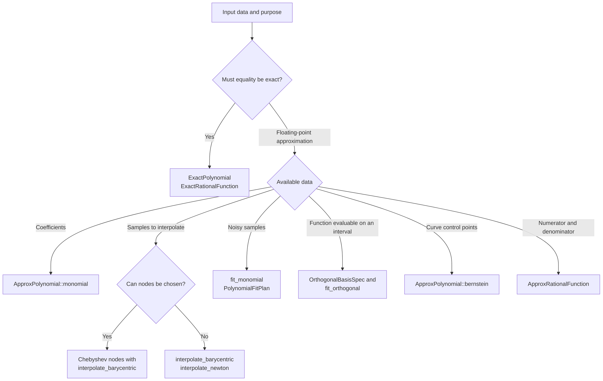

Coefficient operations, interpolation through samples, and approximation of noisy data call for different representations.
First decide whether equality must be exact; if approximation suffices, inspect your available data and desired result.
Assess accuracy from coordinate scales and input-error models as well as basis names.

## Selection by input and purpose

The diagram's leaves are constructors to use first.
For high-degree interpolation of fixed equally spaced samples, consider low-degree fitting or piecewise interpolation instead.
For approximations, compare evaluation costs, scratch space, and failure conditions in the following tables.

## Comparing bases and evaluation

| Representation | Stored coordinates | Single-point evaluation | Conditions to examine | Mathematics |
|---|---|---|---|---|
| Monomial | Ascending-power coefficients | Horner's method, $O(n)$ | Power magnitudes on intervals far from the origin and coefficient cancellation | [Representations and Horner's method](../algorithms/representation-and-horner/) |
| Newton | Divided differences and ordered nodes | Nested products, $O(n)$ | Node ordering and divided-difference sensitivity | [Interpolation](../algorithms/interpolation-and-chebyshev/) |
| Barycentric | Nodes, nodal values, and weights | Second barycentric formula, $O(n)$ (weight preparation $O(n^2)$) | Lebesgue constant of the node configuration | [Interpolation](../algorithms/interpolation-and-chebyshev/), [Rounding errors in barycentric formulas](../algorithms/barycentric-rounding-and-weights/) |
| Orthogonal expansion | Specified-family coefficients and prepared recurrences | Clenshaw's algorithm, $O(n)$ | Weights, normalization, affine coordinates, and evaluation outside the reference interval | [Preparing, evaluating, and converting orthogonal bases](../algorithms/orthogonal-bases-and-calculus/) |
| Bernstein | Interval and control points | de Casteljau's algorithm, $O(n^2)$ | Convex-hull property fails outside the interval | [Bernstein representation and de Casteljau's algorithm](../algorithms/multivariate-and-bernstein/) |

Only Bernstein form allocates a scratch vector (as long as the control-point count) for single-point `evaluate`; other bases do not allocate.
For allocation-free multipoint `evaluate_batch_into`, supply scratch space whose length is queried with `workspace_requirements(m)` ($m$ is the point count).
Construction and failure conditions are as follows.

| Representation | Construction entry points and cost | Scratch allocation per point | Main construction errors | Typical ill-conditioned cases |
|---|---|---|---|---|
| Monomial | `monomial`, $O(n)$, owns coefficients | None | Empty or nonfinite coefficients | Intervals far from the origin, high-degree expansions from equally spaced samples |
| Newton | `interpolate_newton` (real only), divided differences $O(n^2)$ | None | Empty input, length mismatch, duplicate/nonfinite nodes, overflowing/underflowing divided differences | Division by differences of close nodes or poor node ordering |
| Barycentric | `interpolate_barycentric` (real/complex), weights $O(n^2)$ and $O(n)$ scratch allocation | None | Empty input, length mismatch, duplicate/nonfinite nodes, weights underflowing to zero | Node configurations with large Lebesgue constants |
| Orthogonal expansion | `OrthogonalBasisSpec` (`classical`, `on_interval`, `new`), then `orthogonal`. For plan reuse, `prepare` then `orthogonal_with_plan`. Recurrence preparation $O(n)$ | None | Nonpositive scales or out-of-range family arguments (`DomainError`), coefficients exceeding prepared degree | Evaluation outside the reference interval |
| Bernstein | `bernstein(control_points, a, b)`, $O(n)$ | Control-point count | Empty/nonfinite control points, $a\ge b$ or nonfinite endpoints | Evaluation outside the interval |

Evaluation itself rejects nonfinite points and unrepresentable values, derivatives, or envelopes.
Unbounded relative diagnostics (such as zero values with positive envelopes) report positive infinity in condition estimates rather than errors.
The `condition()` diagnostic in the result of `evaluate_with_derivative` estimates the condition number by dividing the basis-specific envelope by $|p(x)|$.
Envelopes are $\sum_k|a_k||x|^k$ for monomials, $\sum_k|c_k|\prod_{j<k}|x-x_j|$ for Newton form, $\sum_k|c_k||\phi_k(x)|$ for orthogonal expansions, and $\max_k|b_k|$ for Bernstein form (when $t\in[0,1]$).
Barycentric form adds the point's Lebesgue function $\Lambda(x)=\sum_j|\ell_j(x)|$ to the ratio of sample-value terms $\sum_j|\ell_j(x)y_j|$ to $|p(x)|$.
All are estimates and do not prove accuracy rankings between bases.

Even exact agreement at interpolation nodes can accompany large approximation errors between nodes.
If high-degree equally spaced interpolation oscillates, first reconsider node placement and degree.
With noise, consider whether every sample must be interpolated, and inspect [Weighted least-squares](../algorithms/least-squares-and-vandermonde/) residuals and rank.
Basis conversion is explicit and cannot recover rounding errors already present in the input.

## Interpolation versus fitting

| Situation | Choice | Reason |
|---|---|---|
| Function evaluable at arbitrary points | Chebyshev-node interpolation or orthogonal-basis fitting | Lebesgue constants grow only logarithmically with degree; errors decrease geometrically for analytic functions |
| Fixed equally spaced samples with little noise | Low-degree fitting or piecewise interpolation | High-degree equally spaced interpolation has exponentially growing Lebesgue constants |
| Noisy samples | `PolynomialFitPlan` with weights $w_i=1/\sigma_i^2$ ($\sigma_i$ is sample standard deviation) | Weights multiply squared residuals. Avoid interpolating noise and select degree from rank and residuals |
| Same nodes and weights, varying values | Repeat `fit` of prepared `PolynomialFitPlan` | Prepare sample matrices and SVD only once |
| Functions with poles or asymptotes | Rational functions (constructed by scioxide-interp AAA/Padé) | Polynomials cannot represent behavior near poles |

[scioxide-interp](../../scioxide-interp/) handles piecewise interpolation and splines.
See the [node-placement example](../examples/runge-nodes/) for numerical Runge comparisons and the [Chebyshev approximation example](../examples/chebyshev-approximation/) for choosing degree from coefficient decay.

## Orthogonal families and coordinates

| Interval and weight | Family | Application notes |
|---|---|---|
| $[-1,1]$, $1/\sqrt{1-x^2}$ | Chebyshev first kind | For function approximation. Distinguish root nodes from extrema (Lobatto nodes) |
| $[-1,1]$, $\sqrt{1-x^2}$ | Chebyshev second kind | Related to first-kind derivatives by $T_n'=nU_{n-1}$ |
| $[-1,1]$, $1$ | Legendre | Distinguish continuous orthogonality from sample-matrix orthogonality on discrete samples |
| $[-1,1]$, $(1-x)^\alpha(1+x)^\beta$ | Jacobi / Gegenbauer | Check parameter domains ($\alpha,\beta>-1$ for Jacobi; $\lambda>-1/2$ and $\lambda\ne0$ for Gegenbauer). Gegenbauer weight is $(1-x^2)^{\lambda-1/2}$ |
| $[0,\infty)$, $x^\alpha e^{-x}$ | Laguerre / generalized Laguerre | Weighted problems on semi-infinite intervals |
| All real numbers, $e^{-x^2}$ or $e^{-x^2/2}$ | HermiteH / HermiteHe | Different zero scales and leading coefficients |

Reference variable $t$ and physical variable $x$ are related by $t=(x-\mathrm{shift})/\mathrm{scale}$.
`OrthogonalBasisSpec::on_interval(family, a, b)` obtains center $\mathrm{shift}=(a+b)/2$ and scale $\mathrm{scale}=(b-a)/2$ from interval $[a,b]$.
`on_interval` supports only families on $[-1,1]$ (Chebyshev, Legendre, Jacobi, Gegenbauer); for Laguerre and Hermite, supply center and scale directly with `classical` or `new`.
Specify normalization with `BasisNormalization` (`Classical`, `Monic`, `Orthonormal`).
Supplying the same sequence as monomial coefficients does not produce the same function.
See [Orthogonal polynomial families](../algorithms/orthogonal-families/) for initial values and recurrences.

## Exact coefficients and approximation policies

`ExactCoefficient` and `ExactField` are traits implemented by caller-supplied coefficient types.
Floating-point types do not implement them, so `ExactPolynomial<f64>` cannot be constructed.
The [exact multipoint evaluation with product trees example](oxref:poly-exact-multipoint-evaluation) uses a finite field, while [checking intersection counts](oxref:poly-exact-sturm-count) uses small rational numbers.
Exact coefficients preserve equality, but their bit lengths can grow with each operation, so computational scale must be estimated separately.

Approximate polynomials retain `PolynomialApproximationPolicy`, and binary operations require matching policies.
Data-only constructors use defaults; alternative policies use `_with_options` forms such as `monomial_with_options`.
Stored degree depends only on exact trailing zeros; tolerance-based effective-degree classification (`classify_coefficients`) does not remove coefficients.
Relaxing tolerances does not reduce the input's physical uncertainty.

## Reduction, elimination, and root diagnostics

| Question | Entry points | Diagnostics to inspect |
|---|---|---|
| Need quotient and remainder | `div_rem` ([Polynomial division and deflation](../algorithms/division-gcd-and-rational/)) | 1-norm reconstruction residual and sensitivity |
| Remove a nearly common factor | `approximate_gcd`, `ApproxRationalFunction::simplify` ([Approximate GCD](../algorithms/approximate-gcd/), [Rational-function reduction](../algorithms/rational-functions/)) | Selected degree and each original input's normalized remainder |
| Denominator factors are known | `ApproxPartialFractionPlan` ([Partial fraction decomposition](../algorithms/partial-fractions/)) | Factor-product errors, numerator reconstruction errors, and decomposition reciprocal condition number |
| Eliminate variables | `approximate_resultant`, `SylvesterElimination` ([Floating-point resultants and numerical rank](../algorithms/approximate-elimination/)) | Value scale and equilibrated matrix rank |
| Detect proximity to repeated roots | `approximate_discriminant`, `SylvesterDiscriminant` | Discriminants and diagnostics of defining matrices |
| Assess root candidates | `root_condition`, `polynomial_root_diagnostics`, `checked_basis_evaluation` ([Root matrices and root sensitivity](../algorithms/root-conditioning/)) | Root condition numbers, root-candidate backward errors, and disk/cluster status |

Approximate cancellation can change the original rational function; compare values on the intended interval as well as coefficients.
The `DomainError` returned where denominator evaluation is indistinguishable from zero is distinct from tolerances used to identify approximate factors.
The [rational-saturation example](../examples/rational-saturation/) distinguishes them.

## Unavailable features and other chapters

| Desired result | This chapter | Crate and entry point |
|---|---|---|
| All polynomial roots | Provides only root matrices and candidate diagnostics, without solvers | scioxide-rootfind's `polynomial_roots` ([Computing all roots of real polynomials](../../scioxide-rootfind/algorithms/polynomial-root-pipeline/)) |
| Certified root counts | Disks and clusters are estimates, without proofs | scioxide-validated's `polynomial_roots` ([Choosing validated methods](../../scioxide-validated/choosing/)) |
| Gaussian quadrature weights and rules | Provides orthogonal-polynomial zeros (Golub–Welsch nodes) and Jacobi matrices, without weights | scioxide-integrate's `GaussianRulePlan` ([Gaussian quadrature and Clenshaw–Curtis rules](../../scioxide-integrate/algorithms/gaussian-and-clenshaw-curtis/)) |
| Rational approximation from samples (AAA) | Unavailable | scioxide-interp's `aaa` ([Rational approximation and pole diagnostics](../../scioxide-interp/algorithms/rational-approximation/)) |
| Padé approximation from Taylor coefficients | Unavailable | scioxide-interp's `PadeApproximant` ([Floater–Hormann interpolation and Padé approximation](../../scioxide-interp/algorithms/floater-hormann-and-pade/)) |
| Best polynomial approximation of general functions (Remez) | Unavailable | No crate provides it. Only scioxide-signal's `design_fir_remez` (Parks–McClellan) uses Remez exchange, limited to equiripple FIR design |
| Factorization finding all factors | Unavailable | No crate provides it. Exact `gcd` and partial fractions with supplied factors are available |

Using Chebyshev-node interpolation instead of best approximation gives maximum error at most $1+\Lambda_n$ times the best-approximation error.
$\Lambda_n$ is the nodes' Lebesgue constant, satisfying $\Lambda_n\le\frac{2}{\pi}\log(n+1)+1$ for $n+1$ Chebyshev nodes (Trefethen, *Approximation Theory and Approximation Practice*, Chapter 15).
Thus even at $n=100$, $\Lambda_n<4$, keeping Chebyshev interpolation error below five times best-approximation error.

## Summary

First decide whether exact equality is required; for approximations, choose constructors from available data (coefficients, samples, functions, control points, or numerator/denominator).
Compare basis evaluation costs, scratch space, and construction errors in the tables, and examine how node placement and coordinate scales determine conditioning.
Choose Chebyshev nodes when function evaluation is freely available, and weighted least squares with weights $w_i=1/\sigma_i^2$ for noise.
Proceed to scioxide-rootfind for all roots, scioxide-integrate for Gaussian quadrature weights, and scioxide-interp for AAA/Padé construction; use Chebyshev interpolation as an alternative to best approximation.
Do not confuse estimates from reduction or root diagnostics with exact equalities or certified enclosures.

## Further reading

- [Numerical algorithms](../algorithms/): review the three error distinctions and notation before proceeding to method derivations.
- [Examples](../examples/): compare the same decisions on concrete subjects and check results independently.
- [API guide](../api/): look up contracts and errors for selected constructors and types.
