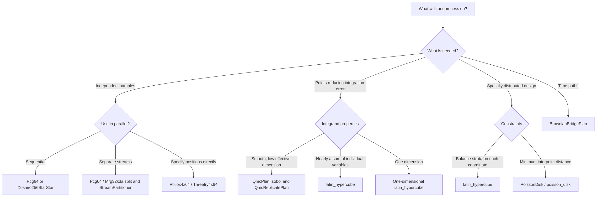

In computations using randomness, choose the generator, probability law, sampling form, and point configuration separately.
Choosing solely by generator speed or period overlooks overlapping parallel streams and errors from point configurations unsuited to the integrand.
This page presents a procedure for choosing types from the purpose and compares their properties.
Algorithm details appear in the pages under [Mathematics of random numbers, distributions, and sampling designs](../algorithms/).

## Selection flow



## Comparing generators

| Generator | State | Period | Advancement and partitioning | Suitable uses |
|---|---|---|---|---|
| `Pcg64` | 128 bits + increment | $2^{128}$ per stream | `skip_ahead`; `split(u64)` selects from $2^{64}$ streams; `substream` divides each stream into blocks of $2^{64}$ transitions | General sequential and parallel computation |
| `Xoshiro256StarStar` | 256 bits | $2^{256} - 1$ | `jump` ($2^{128}$), `long_jump` ($2^{192}$) | Sequential computation, a few workers separated by jumps |
| `Xoshiro128StarStar` | 128 bits | $2^{128} - 1$ | `jump` ($2^{64}$), `long_jump` ($2^{96}$) | Computation using 32-bit native output words |
| `Mrg32k3a` | $2 \times 3$ words | About $2^{191}$ | `skip_ahead`, partitions spaced by $2^{127}$ stream and $2^{76}$ substream transitions | Computation requiring the RngStreams stream structure |
| `Philox4x64`, `Threefry4x64` | Key and counter | $2^{66}$ words per stream | `seek`, `fork`, `split`, `jump` | Parallel computation determining randomness directly from sample indices |
| `SplitMix64` | 64 bits | $2^{64}$ | `skip_ahead` ($O(1)$) | Seed expansion, simple tests |
| `Lcg64` | 64 bits | $2^{64}$ | `skip_ahead` | Compatibility and teaching; lattice structure in outputs makes it unsuitable for multidimensional computation |
| `Mt19937`, `Ranlux` family, `Taus2`, `Taus113`, `Gfsr4`, `Mrg`, `Cmrg` | Generator-dependent | Generator-dependent | None (save and restore only) | Reproducing sequences from existing computations |

Every generator can save its state through `SerializableState`.
For generators with limited-range native words (such as `Mrg` and the `Ranlux` family), paths using uniform words, such as index sampling and integer laws, first convert native words to full-width uniform words by exact integer rejection.
Floating-point uniform values use one native word, so their spacing is determined by the native word width ([Conversion to uniform words and floating-point values](oxref:random-algorithms-uniform-conversion)).
Do not use any generator for cryptographic purposes such as keys or authentication tokens.

## Choosing a probability-law family

Choose probability laws by the quantity's support (possible value range), tail weight, skewness, and whether it represents an extreme.
Classify tail weight by the decay of survival function $S(x) = \Pr(X > x)$ as $x \to \infty$.
Gaussian tails decay at rate $e^{-x^2/2}$ and exponential tails at rate $e^{-x}$; power tails decay like $x^{-\alpha}$ and have no moments of order $\alpha$ or higher.
The table's “Extremes” column indicates use as a limiting law for block maxima (generalized extreme value) or for amounts exceeding thresholds (generalized Pareto).

| Support | Tail weight | Skewness | Extremes | Representative laws | Further reading |
|---|---|---|---|---|---|
| All real numbers | Gaussian or exponential (`GeneralizedNormal` has $e^{-\lvert x \rvert^\beta}$) | Symmetric | Not applicable | `Normal`, `Logistic`, `HyperbolicSecant`, `GeneralizedNormal` | [Classical continuous-distribution families](../algorithms/continuous-law-families/) |
| All real numbers | Power (`StudentT` has moments only of orders below its degrees of freedom $\nu$; `Cauchy` has no mean) | Symmetric (`LevyStable` has skewness controlled by $\beta$) | Not applicable | `StudentT`, `Cauchy`, `LevyStable` | [Extreme-value and heavy-tailed distributions](../algorithms/extreme-value-and-heavy-tails/) |
| All real numbers | Law-dependent (hyperbolic tails decay as exponentials times polynomials) | Parameters adjust left and right skew | Not applicable | `SkewNormal`, `AsymmetricLaplace`, `JonesFaddySkewT`, `NormalInverseGaussian`, `GeneralizedHyperbolic`, `JohnsonSU` | [Skewed, hyperbolic, and transformed distributions](../algorithms/skew-hyperbolic-and-transformed-laws/) |
| Positive half-line | Exponential (`WeibullMin` has $e^{-x^k}$; `Gompertz` is lighter than exponential; `LogNormal` is heavier but has all moments) | Right-skewed | Not applicable | `Exponential`, `Gamma`, `WeibullMin`, `LogNormal`, `InverseGaussian`, `Gompertz`, `GeneralizedExponential` | [Classical continuous-distribution families](../algorithms/continuous-law-families/) |
| Positive half-line (`GeneralizedPareto` is bounded to $[0, -1/c]$ for shape $c < 0$) | Power (`Pareto` has $x^{-b}$, `Burr12` has $x^{-cd}$, `GeneralizedPareto` has $x^{-1/c}$ for $c > 0$ and is exponential for $c = 0$) | Right-skewed | Limit of threshold exceedances (`GeneralizedPareto`) | `Pareto`, `Burr12`, `GeneralizedPareto` | [Extreme-value and heavy-tailed distributions](../algorithms/extreme-value-and-heavy-tails/) |
| Determined by shape $c$ (bounded below for $c < 0$, all reals for $c = 0$, bounded above for $c > 0$) | Right tail is power for $c < 0$, exponential for $c = 0$, absent for $c > 0$ | Parameter-dependent (`GumbelRight` is right-skewed) | Limit of block maxima | `GeneralizedExtremeValue`, `GumbelRight` | [Extreme-value and heavy-tailed distributions](../algorithms/extreme-value-and-heavy-tails/) |
| Bounded interval | No tails | Parameters adjust from symmetric to strongly skewed | Not applicable | `Uniform`, `Trapezoid`, `Cosine`, `Beta`, `Bradford`, `JohnsonSB`, `Argus`, `TruncatedPareto` ($[1, c]$) | [Classical continuous-distribution families](../algorithms/continuous-law-families/) |
| Nonnegative integers (`Binomial` has $0, \dots, n$; `Geometric` and `Zipf` start at 1) | Law-dependent (`Poisson` decays factorially, `Geometric` geometrically, `Zipf` by a power) | Mostly right-skewed (`Binomial` is left-skewed for $p > 1/2$) | Not applicable | `Binomial`, `Poisson`, `NegativeBinomial`, `Geometric`, `Zipf` | [Discrete distributions and counting laws](../algorithms/discrete-and-multivariate-distributions/) |
| Circle or sphere | No tails (bounded support) | Symmetric about the mean direction | Not applicable | `VonMises`, `WrappedCauchy`, `VonMisesFisher`, `UniformDirection` | [Probability laws for circular angles](../algorithms/circular-and-directional-laws/), [Probability laws for spherical directions](../algorithms/spherical-directional-laws/) |
| Vectors, matrices, groups | Law-dependent (`MultivariateNormal` is Gaussian, `MultivariateStudentT` has power tails) | Law-dependent | Not applicable | `MultivariateNormal`, `MultivariateStudentT`, `Dirichlet`, `Multinomial`, `Wishart`, `OrthogonalGroup` | [Multivariate, matrix, and group probability laws](../algorithms/multivariate-and-matrix-laws/) |
| Test-statistic values | Law-dependent | Law-dependent | Not applicable | `FisherF`, `NoncentralChiSquared`, `Kolmogorov`, `StudentizedRange` | [Test-statistic laws and finite-sample KS distributions](../algorithms/test-statistic-laws/), [Studentized range and Tukey multiple comparisons](../algorithms/studentized-range-laws/), [F distributions, noncentral laws, and power](../algorithms/f-and-noncentral-laws/) |
| Laws outside the groups above | User-law-dependent | User-law-dependent | Not applicable | `Affine`, `Truncated`, `Mixture`, `AdaptiveRejectionSampler`, `TransformedDensitySampler`, `RatioUniformsSampler`, `InversionSampler` | [Distribution capabilities, tail probabilities, and numerical inversion](../algorithms/laws-tails-and-multivariate-models/) |

For shape-only laws (such as `Pareto`, `GeneralizedPareto`, and `GeneralizedExtremeValue`), add location and scale with `Affine`.
Only the exponential law among continuous distributions and the geometric law among discrete distributions have the memoryless property $\Pr(X > s + t \mid X > s) = \Pr(X > t)$.
`Gompertz` and `GeneralizedExponential` have hazards (instantaneous failure rates) increasing with time and model aging or wear lifetimes.
The normal law arises in measurement errors as the limit of sums of small independent contributions (the central limit theorem); `Logistic` and `HyperbolicSecant` are symmetric alternatives with heavier exponential tails.

Generic samplers for user densities require different properties.
`AdaptiveRejectionSampler` requires a guarantee that $\log f$ is concave; `TransformedDensitySampler` requires concavity of $-1/\sqrt{f}$.
`RatioUniformsSampler` uses a rectangle (`RatioUniformsBounds`) enclosing the acceptance region returned by the density provider through `BoundedDensity::ratio_uniforms_bounds`; `InversionSampler` uses log-CDF and log-survival values instead of density.

## Sample forms and state after failure

Use `sample` for one sample or `sample_n` for a result needed only once.
For repeated batches of the same size, allocate workspace once and use `sample_n_into` to write into caller-provided output.
On failure, owned `sample_n` leaves the generator advanced by the number of consumed words.
Pass `SamplingPolicy::rollback` to `sample_n_into` to restore the generator on failure, or `SamplingPolicy::advance_on_error` to retain consumption.

## Choosing point configurations

| Method | Type or function | Error and properties | Suitable problems |
|---|---|---|---|
| Independent uniform points | `Rng::next_float` | RMSE $\sigma_f/\sqrt{N}$, independent of dimension | High dimensions, nonsmooth functions |
| One-dimensional stratification | One-dimensional `latin_hypercube` | Eliminates between-stratum variance; RMSE $\propto N^{-3/2}$ when smooth | One-dimensional integration |
| Latin hypercube | `latin_hypercube` | Removes main-effect variance for each variable; interaction variance remains | Nearly additive functions, sensitivity analysis |
| Randomized QMC | `QmcPlan::sobol`, `QmcReplicatePlan` | Decreases faster than MC for smooth, low-effective-dimension functions; estimate error with replicates | Smooth integration in moderate dimensions |
| Poisson disk | `PoissonDisk`, `poisson_disk` | Interpoint distances at least $r$ | Spatially distributed sampling locations, 1–6 dimensions |

The ANOVA decomposition of $f$ into individual-variable main effects $f_j(x_j)$ and interactions explains the methods' differences.
Latin hypercubes place one point in each of $N$ strata along each coordinate, reducing variance of the main-effect sum $\sum_j f_j(x_j)$ to within-stratum fluctuations while retaining as much interaction variance as independent points.
Randomized Sobol sequences integrate smooth low-order terms quickly but help less for terms involving many variables simultaneously.

The next cell compares RMSEs of three methods in $d$ dimensions with the same point count $N$ across $R = 32$ independent repetitions.
The integrands are the additive function $f_{\mathrm{add}} = \sum_j 12 (x_j - \tfrac12)^2$ and interaction-only function $f_{\mathrm{int}} = \prod_j \sqrt{12}(x_j - \tfrac12)$.
For $x \sim U(0, 1)$, $\mathrm{E}[12(x - \tfrac12)^2] = 1$ and $\mathrm{E}[144(x - \tfrac12)^4] = 144/80 = 1.8$, so $f_{\mathrm{add}}$ has integral $d$ and variance $\sigma_f^2 = 0.8d$.
$f_{\mathrm{int}}$ has integral zero and variance $\prod_j \mathrm{E}[12(x_j - \tfrac12)^2] = 1$.
These closed forms provide independent reference checks.
Inputs are the integrand, dimension $d$, point-count exponent $k$ ($N = 2^k$), and seed $s$ for root generator `Pcg64`.
Repetition $r$ uses streams $3r$, $3r + 1$, and $3r + 2$ selected from the root through `split` for independent points, Latin hypercubes, and Sobol shifts respectively.
`split` selects streams by index from the root seed, giving a distinct stream to each repetition–method pair, unlike incrementing seeds by one.
The output table shows each method's RMSE and ratio to theoretical independent-point RMSE $\sigma_f/\sqrt{N}$.

```rust
//| id: random-choosing-point-sets
//| ref: random-choosing-point-sets
//| title: "Compare errors of independent points, LHS, and randomized Sobol by integrand structure"
//| run: button
//| crates: [scioxide-core, scioxide-random]
//| inputs:
//|   integrand: {"type":"select","label":"Integrand","options":["Sum Σ 12(xⱼ − 1/2)²","Product Π √12 (xⱼ − 1/2)"],"value":"Sum Σ 12(xⱼ − 1/2)²"}
//|   dimension: {"type":"range","label":"Dimension d","min":2,"max":10,"step":1,"value":5}
//|   exponent: {"type":"range","label":"Point-count exponent k (N = 2ᵏ)","min":6,"max":11,"step":1,"value":8}
//|   seed: {"type":"range","label":"Root-generator seed s","min":1,"max":1000,"step":1,"value":3}
//| cases:
//|   - {"id":"product","label":"Product integrand","description":"With no main effects, all three RMSEs are around the independent-point theoretical value.","inputs":{"integrand":"Product Π √12 (xⱼ − 1/2)"}}
//|   - {"id":"more-points","label":"Sum, N = 2048","description":"An eightfold point-count increase lowers Latin-hypercube and Sobol ratios more strongly than independent points.","inputs":{"exponent":11}}
//| tests:
//|   - case: default
//|     expect:
//|       - {"artifact":"rmse","path":"/rows/0/1","approx":{"value":0.125,"atol":1e-12}}
//|       - {"artifact":"rmse","path":"/rows/1/2","range":{"min":0.6,"max":1.5}}
//|       - {"artifact":"rmse","path":"/rows/2/2","range":{"min":0.002,"max":0.03}}
//|       - {"artifact":"rmse","path":"/rows/3/2","range":{"min":1e-5,"max":2e-3}}
//|   - case: product
//|     expect:
//|       - {"artifact":"rmse","path":"/rows/0/1","approx":{"value":0.0625,"atol":1e-12}}
//|       - {"artifact":"rmse","path":"/rows/1/2","range":{"min":0.6,"max":1.5}}
//|       - {"artifact":"rmse","path":"/rows/2/2","range":{"min":0.5,"max":1.5}}
//|       - {"artifact":"rmse","path":"/rows/3/2","range":{"min":0.5,"max":1.5}}
//|   - case: more-points
//|     expect:
//|       - {"artifact":"rmse","path":"/rows/1/2","range":{"min":0.6,"max":1.5}}
//|       - {"artifact":"rmse","path":"/rows/2/2","range":{"min":5e-4,"max":0.01}}
//|       - {"artifact":"rmse","path":"/rows/3/2","range":{"min":1e-7,"max":5e-4}}
use scioxide_core::RealScalar;
use scioxide_random::{
    BitGenerator, Pcg64, QmcPlan, QmcScramble, QuasiRng, Rng, SeedableRng, SplittableRng,
    latin_hypercube,
};

let d = dimension.round() as usize;
let n = 1_usize << exponent.round() as u32;
let replications = 32_usize;
let additive = integrand.starts_with("Sum");
// Integrand and closed-form integral and variance (independent reference checks).
let f = |x: &[f64]| {
    if additive {
        x.iter().map(|v| 12.0 * (v - 0.5) * (v - 0.5)).sum::<f64>()
    } else {
        x.iter()
            .map(|v| RealScalar::sqrt(12.0_f64) * (v - 0.5))
            .product::<f64>()
    }
};
let (exact, variance) = if additive {
    (d as f64, 0.8 * d as f64)
} else {
    (0.0, 1.0)
};
let mut squares = [0.0_f64; 3];
// Select streams from the root generator. Repetition r uses streams 3r, 3r + 1, and 3r + 2 separately for the three methods.
let root = Pcg64::from_seed(seed.round() as u64);
for r in 0..replications as u64 {
    // Independent uniform points.
    let mut rng = root.split(3 * r).map_err(|e| e.to_string())?;
    let mut point = vec![0.0; d];
    let mut sum = 0.0;
    for _ in 0..n {
        for v in &mut point {
            *v = rng.next_float().map_err(|e| e.to_string())?;
        }
        sum += f(&point);
    }
    let error = sum / n as f64 - exact;
    squares[0] += error * error;
    // Latin hypercube.
    let design: Vec<f64> =
        latin_hypercube(n, d, &mut root.split(3 * r + 1).map_err(|e| e.to_string())?)
            .map_err(|e| e.to_string())?;
    let error = design.chunks_exact(d).map(&f).sum::<f64>() / n as f64 - exact;
    squares[1] += error * error;
    // Sobol sequence randomized by DigitalShift. The shift seed is one word from stream 3r + 2.
    let shift = root
        .split(3 * r + 2)
        .map_err(|e| e.to_string())?
        .next_u64()
        .map_err(|e| e.to_string())?;
    let plan = QmcPlan::sobol(d)
        .map_err(|e| e.to_string())?
        .with_scramble(QmcScramble::DigitalShift(shift))
        .map_err(|e| e.to_string())?;
    let points = plan
        .sequence::<f64>()
        .map_err(|e| e.to_string())?
        .points(n)
        .map_err(|e| e.to_string())?;
    let error = points.chunks_exact(d).map(&f).sum::<f64>() / n as f64 - exact;
    squares[2] += error * error;
}
// Theoretical independent-point RMSE σ_f/√N.
let theory = RealScalar::sqrt(variance / n as f64);
let mut rows = vec![("Independent-point theory σ_f/√N", theory, 1.0)];
let names = [
    "Independent uniform points",
    "Latin hypercube",
    "Sobol randomized by DigitalShift",
];
for (name, square) in names.into_iter().zip(squares) {
    let rmse = RealScalar::sqrt(square / replications as f64);
    rows.push((name, rmse, rmse / theory));
}
let sci3 = serde_json::json!({ "notation": "scientific", "significantDigits": 3 });
let columns = serde_json::json!([
    { "key": "0", "label": "Method" },
    { "key": "1", "label": "RMSE（R = 32）[-]", "type": "number", "format": sci3 },
    { "key": "2", "label": "Ratio to theoretical σ_f/√N [-]", "type": "number", "format": sci3 }
]);
emit_table_with_columns!(
    columns,
    rows,
    metadata = serde_json::json!({ "id": "rmse" })
);
```

With default inputs (sum, $d = 5$, $N = 256$, seed 3), theoretical independent-point RMSE is $\sigma_f/\sqrt{N} = 0.125$.
Measured RMSEs are $1.27 \times 10^{-1}$ for independent points (1.02 times theory), $1.09 \times 10^{-3}$ for Latin hypercubes (0.0087 times), and $3.13 \times 10^{-5}$ for randomized Sobol (0.00025 times).
RMSE estimated from $R = 32$ repetitions has relative standard error $1/\sqrt{2R} = 0.125$ if errors are normal, so the independent-point ratio 1.02 is consistent with theory.
For the additive function, individual-variable main effects account for all variance; Latin hypercubes remove them, leaving only within-stratum fluctuations.

Ratios change with point count.
Latin-hypercube RMSE decreases as $N^{-3/2}$, so its ratio to independent-point theory $\propto N^{-1/2}$ decreases approximately as $N^{-1}$.
At $N = 64$, the ratios are 0.89 for independent points, 0.022 for Latin hypercubes, and 0.0021 for Sobol; Latin hypercubes do not reach below 1% of independent-point theory.
Setting $N = 2048$ lowers ratios to 0.94 for independent points, 0.0011 for Latin hypercubes, and $8.6 \times 10^{-6}$ for Sobol.
From $N = 256$ to $2048$, Latin-hypercube RMSE falls from $1.09 \times 10^{-3}$ to $4.89 \times 10^{-5}$, a factor of 22.3, almost matching the one-dimensional stratification rate $N^{-3/2}$ ($8^{3/2} \approx 22.6$) for smooth main effects.
Switching to the product integrand gives RMSEs $5.86 \times 10^{-2}$, $6.32 \times 10^{-2}$, and $6.96 \times 10^{-2}$, all around the theoretical value $0.0625$.
For a function without main effects in which all variables multiply together, neither Latin-hypercube stratification nor a Sobol sequence of this size reduces error.

## Constructing parallel streams

| Method | Usage | Guarantee |
|---|---|---|
| Stream selection | `Pcg64::from_seed(s).split(i)`, `substream(i, j)` | Absolute selection from the root, independent of worker order |
| Partitioning along an execution Plan | `StreamPartitioner::from_plan(plan, domain).for_partition(&base, &partition, len)` | Root generator, partition identifier, and region index `domain` determine the stream; reads beyond its length are rejected |
| Bounded block | `BoundedSubstream::for_chunk(&base, i, len)` | Reads only transitions $[p + i \cdot len, p + (i+1) \cdot len)$ counted from current position $p$ of `base` |
| Counter-based | `seek` and `fork` on `Philox4x64` | Sets position from sample index in $O(1)$ time |
| Seed expansion | `seed_sequence(seed, n)` | Generates $n$ seeds deterministically but does not guarantee nonoverlapping streams |

Simply shifting seeds as in `seed + i` does not guarantee nonoverlapping streams.
Verify nonoverlap by comparing each stream's word consumption with the partition spacing.
Nonoverlap alone does not establish statistical independence.

## Summary

Choose among `Pcg64`, `Mrg32k3a`, and counter-based generators according to parallel use and whether positions must be specified directly.
Choose law families by support, tail weight, skewness, and use for extremes; add location and scale to shape-only laws with `Affine`.
Choose point configuration by integrand structure.
For nearly additive functions, Latin-hypercube and randomized-Sobol RMSEs decrease faster with point count than independent-point RMSEs (below 1% of independent points at $d = 5$ and $N = 256$); for interaction-only functions such as a product of all variables, both perform similarly to independent points.
Construct parallel streams from partition identifiers rather than relying on shifted seeds alone.

## Further reading

- [Stream advancement, jumps, and splits](../algorithms/advance-jump-split/): inspect generator advancement and partitioning mechanisms.
- [Classical continuous-distribution families](../algorithms/continuous-law-families/): inspect densities, distribution functions, and parameter domains for the family chosen above.
- [Uniform indices, permutations, and stratified sampling](../algorithms/sampling-and-stratification/), [Latin hypercube designs and discrepancy](../algorithms/latin-hypercube-and-discrepancy/): inspect stratification and Latin-hypercube variance.
- [Comparing Monte Carlo and Sobol quasi-Monte Carlo integration](../examples/monte-carlo-vs-sobol/): inspect error estimation for randomized QMC.
