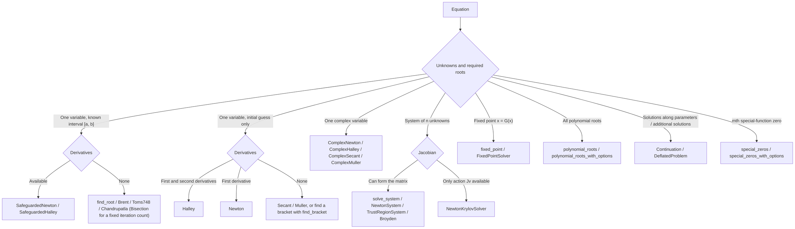

Choose root-finding methods by the number of unknowns, whether a bracket is known, derivative availability, required root count, and parameters.
An unsuitable method can converge slowly, approach another root, or leave the domain.
Use the flowchart to select types, then compare convergence rates, evaluation counts, and bracketing properties in the tables.

## Selection flow

## Methods in one variable

A known bracket $[a, b]$ ($f(a) f(b) < 0$) contains a root provided $f$ is continuous; bracketing methods shrink the interval while preserving this property.
Without a bracket, use open derivative- or interpolation-based methods, or expand from an initial point with `find_bracket` ([Finding and revalidating a bracket](../algorithms/bracket-search/)).
For just a root using Brent defaults, the one-call `find_root(f, a, b)` returns a root only on success.
The table's “local convergence” denotes order near a simple root; convergence order and efficiency are defined in [Methods for finding roots of equations](oxref:rootfind-convergence-order).

| Method | Input | Local convergence | Evaluations per iteration | Preserves bracket | Suitable cases |
|---|---|---|---|---|---|
| `Bisection` | Interval | Linear (width halves each time) | One function evaluation | Yes | Predetermined iteration counts or nonsmooth functions |
| `RegulaFalsi` | Interval | Linear (one endpoint persists) | One function evaluation | Yes | Teaching; use methods such as `Illinois` in practice |
| `Illinois` | Interval | Approximately order 1.442 | One function evaluation | Yes | Avoiding stagnation while retaining the false-position approach |
| `Ridder` | Interval | Quadratic (approximately 1.414 per evaluation) | Two function evaluations | Yes | Smooth functions; if candidates stay on one side of the root, only midpoint evaluations reduce interval width |
| `Brent`, `Brenth`, `Chandrupatla` | Interval | Superlinear (approximately order 1.84 with consecutive inverse quadratic interpolation) | One function evaluation | Yes | First candidates for general problems using function values alone |
| `Toms748` | Interval | Superlinear (interval width also shrinks superlinearly) | One initially, then two to three | Yes | Theoretical support for superlinear bracket-width reduction (slightly more evaluations than Brent with default criteria) |
| `SafeguardedNewton`, `SafeguardedHalley` | Interval and initial guess | Quadratic, cubic | Function and derivatives | Yes | Derivatives available, with steps required to stay inside a bracket |
| `Newton` | Initial guess | Quadratic | Function and first derivative | No | Good initial guesses |
| `Halley` | Initial guess | Cubic | Function and first/second derivatives | No | Inexpensive second derivatives |
| `Secant` | Two points | Approximately order 1.618 | One function evaluation | No | Open problems without derivatives |
| `Muller` | Three points | Approximately order 1.84 | One function evaluation | No | Parabolic interpolation; needing a complex point stops with `ComplexStepRequired`, so use `ComplexMuller` |

Convergence order is local to simple roots; even Newton becomes linear at repeated roots ([Newton, secant, and Muller methods](../algorithms/open-scalar-methods/)).
Compare speed per evaluation using $p^{1/w}$ from order $p$ and evaluations per iteration $w$.
When derivative evaluations cost the same as function evaluations, the secant method (approximately 1.618) is faster per evaluation than Newton (approximately 1.414).
`Newton` and `SafeguardedNewton` select derivative sources (analytic, automatic differentiation, or finite differences) with scioxide-differentiate's `DerivativeStrategy`; `default()` uses `AnalyticOrForward`, falling back to forward differences without analytic derivatives.
`Halley` and `SafeguardedHalley` require analytic first and second derivatives.
Use `ScalarRootMethod` and `ScalarRootMethod::solve` to switch methods at runtime.
Complex methods solve only equations explicitly supplied as complex functions.
They never implicitly extend real functions to complex arguments.

## Systems of equations

| Method | Jacobian treatment | Globalization | Suitable cases |
|---|---|---|---|
| `NewtonSystem` | Evaluate each iteration (analytic, AD, or differences). Solve $J\,\Delta \mathbf{x} = -\mathbf{F}$ using LU or a supplied iterative solver | `with_line_search` enables `BacktrackingLineSearch` (Armijo); when enabled, rank-deficient Jacobians switch to perturbed model $(J^\top J + \mu I)\Delta \mathbf{x} = -J^\top \mathbf{F}$ | Initial guesses near solutions; small to medium systems |
| `TrustRegionSystem` | Evaluate initially and after two consecutive trials with actual-to-predicted reduction below 0.1; otherwise update models with rank-one Broyden. Uses QR without column pivoting, replacing zero diagonals of $R$ by $\varepsilon$ times the column's largest magnitude | Powell hybrid method (dogleg trust region) | Distant initial guesses or fewer Jacobian evaluations |
| `Broyden` | Evaluate initially, then rank-one model updates. `BroydenUpdate::First` retains forward matrices and checked inverses; `Second` retains QR factors | `BroydenOptions::with_line_search` enables line search; when a stale model exhausts the search, reevaluate the Jacobian. Without it, apply updates directly | Expensive Jacobian evaluations |
| `NewtonKrylovSolver` | Only action $J\mathbf{v}$ (analytic/AD directional derivatives or one forward difference). Inner linear systems use restarted GMRES | Nonmonotone Armijo backtracking (Zhang–Hager) and Eisenstat–Walker inner tolerances | Large systems without forming matrices |

If defaults suffice, one-call `solve_system(f, x0)` solves a residual closure with `TrustRegionSystem`, returning a solution only on success.
In systems, differently scaled component units can make one component dominate the residual norm.
Scale equations and variables consistently before solving ([Nonlinear systems and globalization](../algorithms/nonlinear-systems/)).

## Polynomials, fixed points, and special-function zeros

| Problem | Entry points | Selection |
|---|---|---|
| All polynomial roots | `polynomial_roots`, `polynomial_roots_with_options` (default `PolynomialRootMethod::Auto`) | For monomial coefficients through degree 2, use stable formulas. Otherwise, through degree 64 use Aberth–Ehrlich initialized from companion-matrix eigenvalues (colleague matrices for orthogonal bases); above that, use only Aberth–Ehrlich initialized from a Newton polygon, without switching to eigenvalues. Explicit `Laguerre` and `DurandKerner` are available only for monomial coefficients |
| Fixed points $x = G(x)$ | `fixed_point`, `FixedPointSolver` | Use `Picard` as a baseline for contractions; compare acceleration such as `Anderson` when contraction factors approach 1 ([Fixed-point iteration and acceleration](../algorithms/fixed-point-acceleration/)) |
| Indexed special-function zeros | `special_zeros`, `special_zeros_with_options` | When indices are required, such as the $m$th zero of $J_\nu$ ([Circular-membrane eigenfrequencies and Bessel zeros](../examples/circular-membrane/)) |

Polynomial roots are unverified candidates unless the status is `Complete`.
Even with `Complete`, ill-conditioned root positions are determined only to order condition number times backward error ([Computing all roots of real polynomials](../algorithms/polynomial-root-pipeline/)).
For `ApproxPolynomial` represented in orthogonal polynomial bases, `polynomial_roots_with_options` solves without monomial conversion.

## Parameterized equations and multiple solutions

To track solutions while varying parameter $\lambda$, use continuation, with the previous solution as the next initial guess.
Natural continuation changing only $\lambda$ (`ContinuationPath::Parameters`) stops at folds; use pseudo-arclength continuation (`ContinuationPath::PseudoArclength`) when folds are possible.
Without a good initial guess, use `LinearHomotopy` from an equation with a known solution, continuing $\lambda$ from 0 to 1 ([Homotopy, continuation restart, and bifurcation diagnostics](../algorithms/continuation-homotopy-and-checkpoints/)).
After finding one solution, search for another by adding it to `DeflationSet` and solving `DeflatedProblem`.
Deflation does not guarantee finding all remaining solutions ([Finding additional solutions with deflation](../algorithms/deflation/)).

## Complex roots, iteration maps, and zero sequences

When finding complex roots, supply the function as a complex function too.
`ComplexNewton` and `ComplexHalley` use analytic derivatives, while `ComplexSecant` and `ComplexMuller` use interpolation.
Rewrite nonholomorphic problems with independent real and imaginary parts as systems in two real variables.
See [Complex roots and basins of attraction](../algorithms/complex-roots/) for root selection by initial guess.

If an iteration map already exists, consider [Fixed-point iteration and acceleration](../algorithms/fixed-point-acceleration/).
First check the sign convention of residual $G(x) - x$ and whether the map is contractive, then compare history-based methods against Picard iteration.
Longer histories increase storage and least-squares work, so inspect iteration and evaluation counts separately.

When a specific indexed special-function zero is needed, specify the index sequence with `special_zeros_with_options` rather than repeating general root solves with varied initial guesses.
Family, branch, and index conventions appear in [Indexed zeros of special functions](../algorithms/special-function-zeros/).
As with all polynomial roots, use the result report to check whether the required set is complete.

## Selection from required accuracy

| Required information | Basis for assessment | Next page |
|---|---|---|
| Coordinate accuracy of one root | Interval width and derivative-based conversion from residual to error | [Kepler's equation and eccentricity](../examples/kepler-equation/) |
| Accuracy of transformed physical quantities | Coordinate-transformation sensitivity and residuals in original units | [Colebrook's equation and pipe friction factors](../examples/colebrook-friction-factor/) |
| Root counts and ordering | Root-count theory, interval partitions, and all-root checks | [Bound states of a finite square well](../examples/finite-square-well/) |
| Accuracy of nested root solves | Both inner conditioning and outer residuals | [A van der Waals gas and Maxwell's equal-area rule](../examples/van-der-waals-maxwell/) |
| Proofs of existence, uniqueness, or root counts | Outward rounding and verified algorithms | [scioxide-validated: interval arithmetic with guaranteed containment](../../scioxide-validated/) |

Simply reducing `Tolerance` values does not reduce discretization or measurement errors.
Separate equation-approximation error, floating-point evaluation error, and iteration truncation.
Successful termination means the configured criterion was met; it does not guarantee total error in the physical quantity.

## Checks before using results

1. Termination reason: `RootTermination` succeeds for `ResidualTolerance`, `StepTolerance`, `BracketTolerance`, `Complete`, and `NoZeros`; `IterationLimit`, `Stagnation`, `ComplexStepRequired`, limits, and cancellation are unconverged.
   Systems, Newton–Krylov, polynomials, continuation, and special-function zeros also use their own termination reasons.
2. Residual and position: repeated or flat roots can have large position errors despite small residuals.
   For simple roots, estimate position error with $\lvert f \rvert / \lvert f' \rvert$.
3. Check the original equation: substitute solutions of transformed or deflated equations into the original equation and inspect residuals.
   `DeflatedProblem::solve` and polynomial reports include original-equation checks.
4. Scale: residual tolerances use function units; specify scales explicitly with methods such as `with_residual_scale`.
   For one-variable bracketing methods, `with_residual_scale` adds acceptance by relative residual $\sqrt{\varepsilon}$ to interval-width acceptance.

## Summary

In one variable with a bracket, choose `Brent` or `Toms748`; with derivatives, choose bracket-preserving `SafeguardedNewton`; with only an initial guess, choose `Newton` or `Halley`; without derivatives, use `Secant`.
Compare speed using both convergence order and evaluations per iteration.
For systems, choose `NewtonSystem`, `TrustRegionSystem`, or `Broyden` if a Jacobian can be formed, or `NewtonKrylovSolver` if only its action is available; use line search or trust regions for distant initial guesses.
Use `polynomial_roots_with_options` for all polynomial roots, continuation for parameterized problems, deflation for additional solutions, and `special_zeros_with_options` for indexed special-function zeros; use one-call functions when only answers with defaults are needed.
For every method, determine success from termination reasons and check original-equation residuals.

## Further reading

- [Methods for finding roots of equations](../algorithms/): examine definitions of the table's convergence orders, residual and position errors, and default stopping criteria.
- [Bracketing root-finding methods](../algorithms/bracketing-methods/): examine differences between the table's bracketing methods through derivations and experiments.
- [Root finding API guide](../api/): examine contracts for the selected method's types, inputs, errors, and workspaces.
