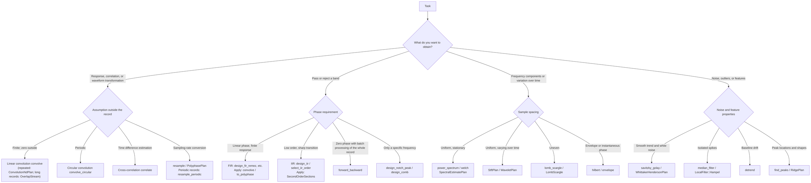

Before choosing a signal processing method by name, decide three things.
Decide what to assume outside the finite record, how to relate frequency and time units, and who owns the workspace for repeated execution.
This page shows how to select `scioxide-signal` operations by task type and compares the properties of each option in tables.
Follow the table links to the pages in [Mathematics and algorithms](../algorithms/) for each method's derivation and errors.

## Selecting an operation from a task

The following diagram selects an API operation from the type of task.

| Task | Main APIs | Explanation | Examples |
|---|---|---|---|
| Combining system responses, applying FIR filters | `convolve`, `ConvolutionNdPlan`, `OverlapStream` | [Convolution and correlation](../algorithms/convolution-and-correlation/) | [Convolution of acoustic reflections](../examples/echo-convolution/) |
| Estimating time differences | `correlate` | [Convolution and correlation](../algorithms/convolution-and-correlation/) | [Seismic arrival-time differences](../examples/seismic-delay-correlation/) |
| Converting sampling rates | `resample`, `PolyphasePlan`, `resample_periodic` | [Resampling](../algorithms/resampling/) | [Conversion between 44.1 kHz and 48 kHz](../examples/audio-sample-rate-conversion/) |
| Linear-phase filters | `design_fir_*`, `minimum_phase` | [FIR filter design and minimum phase](../algorithms/fir-design-and-minimum-phase/) | - |
| Low-order filters, notches | `design_iir`, `select_iir_order`, `design_notch_peak` | [IIR filter design](../algorithms/iir-design/), [IIR filtering and zero phase](../algorithms/iir-filtering-and-zero-phase/) | [ECG noise removal](../examples/ecg-baseline-and-mains/), [Group delay and zero phase](../examples/iir-group-delay-zero-phase/) |
| Spectra of stationary signals | `power_spectrum`, `welch`, `SpectralEstimatePlan` | [Window functions and DPSS](../algorithms/windows-and-dpss/), [Spectral estimation](../algorithms/spectral-estimation/) | - |
| Frequencies that vary over time | `StftPlan`, `WaveletPlan` | [STFT and reconstruction](../algorithms/stft/), [Discrete wavelet transforms](../algorithms/wavelets/) | [Chirp spectrograms](../examples/chirp-spectrogram-uncertainty/), [Wavelet denoising](../examples/wavelet-denoising/) |
| Periods in unevenly sampled data | `lomb_scargle`, `LombScargle` | [Spectral estimation](../algorithms/spectral-estimation/) | [Estimating a variable star's period](../examples/variable-star-period/) |
| Envelopes, instantaneous phase, local image orientation | `hilbert`, `envelope`, `monogenic_nd` | [Analytic signals, Riesz transforms, and vector strength](../algorithms/analytic-riesz-monogenic/) | [Envelope recovery](../examples/hilbert-envelope/) |
| Smoothing and differentiation, detrending | `savitzky_golay`, `WhittakerHendersonPlan`, `detrend` | [Smoothing and detrending](../algorithms/smoothing-and-detrending/) | [Checking smoothing, peaks, and outliers](../examples/smoothing-peaks-and-outliers/) |
| Removing spikes, detecting peaks | `median_filter`, `LocalFilterPlan`, `find_peaks` | [Local filters and peak detection](../algorithms/local-filters-and-features/) | [Checking smoothing, peaks, and outliers](../examples/smoothing-peaks-and-outliers/) |
| Continuous-time and discrete-time system models | `StateSpace` | [State-space models and LTI systems](../algorithms/lti-systems/) | [An LTI model of an RLC circuit](../examples/rlc-circuit-lti/) |

## Boundaries and output lengths of time-domain operations

For convolution and correlation of a length-$N$ signal $a$ and length-$M$ kernel $b$, the assumption outside the record determines the output's length and meaning.

| Operation | API | Assumption outside the interval | Output length | Main uses |
|---|---|---|---|---|
| Linear convolution | `convolve`, `ConvolutionNdPlan` (`ConvolutionExtent::Full`) | Zero outside the interval | $N + M - 1$ | FIR filters, acoustic propagation, combining reflected waves |
| Convolution with the center extracted | `ConvolutionNdPlan` (`Same`) | Selected by `SignalBoundary` | $N$ | Smoothing with the same length as the input |
| Convolution only where the kernel fits | `ConvolutionNdPlan` (`Valid`) | No assumption needed | $N - M + 1$ | Output unaffected by the endpoints |
| Circular convolution | `convolve_circular`, `ConvolutionNdPlan` (`Circular` and `Periodic`) | Repeats with period $N$ (requires $N = M$) | $N$ | Periodic signals, the same operation as multiplication in the frequency domain |
| Two-dimensional convolution | `convolve2d`, `SeparableFir2dPlan` | Zero outside the grid (selectable in a plan) | $(N_y + M_y - 1) \times (N_x + M_x - 1)$ | Image smoothing and differentiation |
| Cross-correlation | `correlate` | Zero outside the interval | $N + M - 1$ | Propagation-delay estimation, reflection detection |

Passing inputs of different lengths to `convolve_circular` returns `DimensionMismatch` without wrapping or truncation.
`correlate(a, b)` arranges $c[\ell] = \sum_k a[k]\, \overline{b[k - \ell]}$ in increasing order of lag $\ell = -(M-1), \dots, N-1$, so array index $j$ corresponds to the lag through $\ell = j - (M-1)$ ([correlation lag order](oxref:signal-correlation-lags)).
Values are sums of inner-product terms; if a correlation coefficient in $[-1, 1]$ is needed, the caller subtracts the means and divides by the norms.

## Comparing window functions

Taking the DFT of a finite record directly is equivalent to applying a rectangular window, whose high peak sidelobe of $-13.3$ dB lets leakage from strong components obscure weak components.
The following table's values are measured from the DFT of length-$N = 1024$ periodic window samples zero-padded to 32 times their length.
The 3 dB width is the full main-lobe width, and ENBW is the equivalent noise bandwidth; both are measured in DFT bins.

| Window | `WindowKind` | 3 dB width [bins] | Peak sidelobe | ENBW [bins] | Main uses |
|---|---|---|---|---|---|
| Rectangular | `Boxcar` | $0.89$ | $-13.3$ dB | $1.00$ | Periodic signals with an integer number of periods in the record, transient responses |
| Hann | `Hann` | $1.44$ | $-31.5$ dB | $1.50$ | General spectral analysis, STFT |
| Hamming | `Hamming` | $1.30$ | $-42.7$ dB | $1.36$ | Separating nearby components of similar magnitude |
| Blackman–Harris (4 terms) | `BlackmanHarris` | $1.90$ | $-92.0$ dB | $2.00$ | Harmonic analysis with a wide dynamic range |
| Flat-top (5 terms) | `FlatTop` | $3.72$ | $-93.0$ dB | $3.77$ | Sine-wave amplitude calibration (amplitude error between bins of about 0.01 dB) |
| Kaiser | `Kaiser { beta }` | Depends on $\beta$ | Depends on $\beta$ | Depends on $\beta$ | Window-method FIR design with specified stopband attenuation |
| DPSS | `DpssTapers` | Depends on the time–bandwidth product $NW$ | Minimizes out-of-band leakage | Depends on $NW$ | Multitaper spectral estimation |

Windows trade leakage suppression for frequency resolution.
A wider main lobe makes it harder to separate two nearby frequencies, and a larger ENBW increases the noise power entering a single bin.
Use symmetric windows (`WindowSymmetry::Symmetric`) for linear-phase FIR coefficients and periodic windows (`Periodic`) for DFT analysis and STFT ([symmetric and periodic windows](oxref:signal-window-symmetry)).
Use `window_metrics` to check the gain and ENBW of the actual samples ([coherent gain and equivalent noise bandwidth](oxref:signal-window-metrics)).

## Comparing filter design methods

| Method | API | Approximation criterion | Phase | Main uses |
|---|---|---|---|---|
| FIR window method | `design_fir_window` | Truncates the ideal response with a window | Linear | Quick design with loose specifications |
| FIR frequency sampling | `design_fir_frequency_sampling` | Passes through target magnitudes at grid points | Linear | Arbitrarily shaped magnitude responses |
| FIR weighted least squares | `design_fir_least_squares` | Integral of squared error over the bands | Linear | Reducing error energy |
| FIR Remez exchange method | `design_fir_remez` | Maximum weighted error (equiripple) | Linear | Minimizing maximum error for a given length |
| Classical IIR prototypes | `design_iir`, `select_iir_order` | Butterworth, Chebyshev, elliptic, and Bessel magnitude shapes | Nonlinear (Bessel group delay is nearly flat at low frequencies) | Sharp transitions with low order |
| Notch, peak, and comb | `design_notch_peak`, `design_comb` | Sets center frequency and Q in closed form | Nonlinear | Removing mains noise and periodic interference |
| Conversion to minimum phase | `minimum_phase` | Preserves magnitude and reduces delay | Minimum phase | When linear-phase delay is unacceptable |

FIR filters are always stable and can have linear phase, but sharp transitions require many coefficients.
IIR filters produce sharp transitions with low order but have nonlinear phase and can become unstable through coefficient rounding, so apply them as second-order sections (SOS).
For analysis with the entire record available, forward–backward filtering with `forward_backward` cancels IIR phase but squares the magnitude ([forward–backward zero-phase filtering](oxref:signal-iir-zero-phase)).

## Spectral and time–frequency estimation

| Purpose | API | Assumptions and output |
|---|---|---|
| Discrete spectrum of one record | `power_spectrum`, `cross_spectrum` | $\lvert X[k] \rvert^2 / N$. Not a density; does not include the sampling rate |
| Density of stationary noise | `welch`, `SpectralEstimatePlan` | Averaging segments reduces variance. Density units are squared signal units per frequency |
| Linear relationship between two signals | `csd` and `coherence` of `SpectralEstimatePlan` | Coherence is always 1 with a single segment |
| Periods in unevenly sampled data | `lomb_scargle`, `LombScargle` | Frequencies are angular frequencies. Normalized power is the fraction of variance explained |
| Frequencies that vary over time | `StftPlan` | Window length trades time resolution for frequency resolution. Reconstruction is possible with a dual window |
| Local changes at each scale | `WaveletPlan`, `Wavelet2dPlan` | Coarser scales give higher frequency resolution and lower time resolution |

Frequency units differ by API ([frequency units](oxref:signal-frequency-units)).
`welch` and STFT return values in cycles per unit time, the Lomb–Scargle method uses angular frequency, and `power_spectrum` uses DFT bin indices.

## Choosing smoothing and local filters

| Noise and signal properties | API | Behavior |
|---|---|---|
| White noise on a smooth signal | `savitzky_golay`, `SavitzkyGolayPlan` | Fits a local polynomial within the window. Preserves polynomials up to the chosen degree and can also compute derivatives |
| Smooth signal with missing values or unequal weights | `WhittakerHendersonPlan` | Least squares with a difference penalty. Treats zero weights as missing values |
| Smooth interpolation through the samples | `SplineFilter` | Computes B-spline interpolation coefficients with a recursive filter (does not smooth) |
| Polynomial or piecewise-linear baseline | `detrend`, `detrend_into` | Subtracts a least-squares trend |
| Isolated spikes | `median_filter`, `LocalFilter::Hampel` | Replaces samples with the median, or replaces only samples whose deviation from the median exceeds an MAD threshold |
| Locally stationary Gaussian noise | `LocalFilter::Wiener`, `estimate_wiener_noise` | Preserves regions where local variance exceeds noise variance and draws flat regions toward the mean |

Local filters use a radius-$k$ window of $2k + 1$ samples, extending endpoints by repeating their values.
Stronger smoothing reduces noise but also removes peaks and steps, so choose a strength that preserves the desired features.

## Call forms and streaming

Choose from the following forms for managing computational resources (see [call forms in the API guide](oxref:signal-api-call-forms) for the list).

- One-shot functions: `convolve`, `correlate`, `resample`, `power_spectrum`, `welch`, `lomb_scargle`, `envelope`, `median_filter`, `find_peaks`, `savitzky_golay`, `detrend`, and others allocate a plan, workspace, and output on the spot and return the result as a `Vec`.
  These suit exploratory analysis and one-off computations.
  Conventional settings (such as the periodic Hann window and half overlap in `welch`, or centered alignment in `resample`) are fixed for each function.
- Forms with options: `find_peaks_with_options`, `minimum_phase_with_options`, `design_fir_remez_with_options`, and others accept settings (such as `PeakOptions`) as the final argument.
  Options-based forms of iterative design return the final result and termination status without treating failure to reach the target as an error.
- Plans and method objects: plans such as `ConvolutionNdPlan`, `SpectralEstimatePlan`, `StftPlan`, and `LocalFilterPlan` check and retain shapes and transforms during preparation.
  `IirFilter`, `SymmetricFilter`, `SplineFilter`, and `LombScargle` are method objects that retain only validated coefficients or settings and use the same call form as plans.
  The output-destination API `*_into` writes to caller-owned output and workspace without allocating during execution.
  Query requirements with `workspace_requirements(request)` and prepare them with `workspace(request)` or `try_reserve` ([workspace and execution contexts](oxref:signal-workspaces)).
  Use the same plan's `*_axis_into` to process along one array axis.
- Streaming: `LocalFilterStream`, `OverlapStream`, `PolyphaseStream`, `StftAnalysisStream`, and `StftSynthesisStream` own state, accept chunks of arbitrary length, and return output at delayed positions.
  Passing `StreamChunk::Final` with the final chunk flushes the remaining output and closes that stream until `reset` ([streaming conventions](oxref:signal-streams)).
  Process an IIR filter in chunks by passing caller-owned `IirState` to `IirFilter::filter_into`.
- Scoped APIs: `design_iir_scoped`, `design_fir_remez_scoped`, and others accept the outer solver's execution context or `SolveContext`, counting iterations against that scope's limits and cancellation.

## Summary

Classifying the task as response transformation, band selection, frequency estimation, or treatment of noise and features determines the API operation.
Assuming zero extension or periodicity changes convolution output lengths and values; subtract $M - 1$ from a `correlate` index to obtain its lag.
Windows trade leakage suppression for resolution; the table's 3 dB widths and ENBW determine resolution and noise power.
Choose FIR for linear phase and IIR for a sharp transition with low order; batch processing can cancel phase through forward–backward filtering.
Begin one-off computations with one-shot functions, then move to plans or method objects and workspace when repeating the computation.
See [Mathematics and algorithms](../algorithms/) for the selected method's derivation and the [API guide](../api/) for the specifications of all items.
