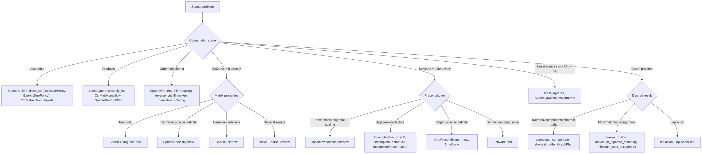

Sparse computation requires different operations at each stage: assembly, products, factorization, iterative solution, and graph analysis.
Finite-element and graph assembly do not fix nonzero positions in advance and repeatedly add to the same coordinates.
Iterative methods repeatedly multiply a fixed nonzero pattern, while factorization and incomplete factorization depend on fill and pivoting for memory use and accuracy.
This page uses a decision flow and tables to select `scioxide-sparse` types and functions at each stage.
Each diagram node names the function, type, or setting for that case.

## Choosing a storage format

| Purpose | Recommended type | Reason |
|---|---|---|
| Finite-element/finite-volume assembly | `SparseBuilder` | Add triplets $(i, j, v)$ in any order; `DuplicatePolicy::Sum` sums values at identical coordinates exactly and rounds once |
| Existing triplet arrays | `CsrMatrix::from_triplets` | Build CSR directly using `(Sum, Preserve)` policies |
| Row traversal; factorization, preconditioner, and graph input | `CsrMatrix` | Most factorization analyses and preconditioners accept CSR structure (`structural_pattern()` borrows without allocation) |
| Column traversal | `CscMatrix` | Each column occupies contiguous intervals in `row_indices()` and `values()`; conversion to CSR costs `to_csr` |
| Transpose products $\mathbf{A}^{\mathsf{T}}\mathbf{x}$ and adjoint products $\mathbf{A}^{\mathsf{H}}\mathbf{x}$ | Either `CsrMatrix` or `CscMatrix` | Both retain reverse-traversal indices; forms accepting workspace compute in $O(m + n + \mathrm{nnz})$ without allocation |
| Multiple degrees of freedom per node | `BsrMatrix` | Blocks containing stored entries are dense $r \times c$ blocks, including zeros inside them as stored values |
| Uniform-grid difference stencils | `DiaMatrix` | Only diagonal offsets are indexed; value storage includes padding outside the matrix |
| Format-independent computation | `SparseView` | Borrow allocation-free from any format for products, numerical factorization, conversion, pruning, block construction, and graphs; symbolic analysis accepts `CsrMatrix::structural_pattern()` structure |

### From assembly to computation formats

Triplets assembled with `SparseBuilder` are finalized as canonical matrices using `finish_coo`, `finish_csr`, or `finish_csc` with duplicate policy `DuplicatePolicy` and zero policy `ExplicitZeroPolicy`.

- `DuplicatePolicy::Sum` sums equal-coordinate values by order-independent exact accumulation and rounds once (the standard choice for finite-element assembly).
- `DuplicatePolicy::Reject` rejects duplicate coordinates with `InvalidInput`.
- `ExplicitZeroPolicy::Drop` removes entries whose combined value is exactly zero, reducing memory use and operation count.
- `ExplicitZeroPolicy::Preserve` retains positions structurally even when values are zero.
  Use it to fix structure when only coefficients change or to retain zero-weight graph edges.

With `Drop`, changing values can change structure and prevent symbolic-analysis reuse.

## Choosing a calling form

Choose among the following forms of the same computation according to required control (definitions are in [shared specifications and organization of sparse algorithms](oxref:sparse-execution-forms)).

| Purpose | Form | Example |
|---|---|---|
| Compute one answer | One-shot function | `solve(&a, &b)`, `least_squares(&a, &b)`, `shortest_paths(a.view(), source)` |
| Repeated solves with one matrix | All-in-one setup constructor and standard form | Build factors with `SparseLu::new(&a)` and repeat `lu.solve(&b)` |
| Select precision, zero policy, or iteration limit | Options form | `a.add_with_options(&b, options)`, `maximum_bipartite_matching_with_options(pattern, options)` |
| Factorize under a memory limit | Symbolic analysis and limit types | `SparseLuSymbolic::analyze(pattern, ordering, SparseLuLimits::new(…))` followed by `SparseLu::factor` |
| Avoid allocation inside iteration, use parallelism or cancellation, or share iteration limits with an enclosing solver | Output-buffer and scoped APIs | `lu.solve_into(…, &mut ws, scope)`, `lu.refactor(…, &mut ws, scope)`, `SparseLu::factor_scoped(…, scope)` |

## Choosing a direct solver

| Type | Domain | Pivoting and result | Cautions |
|---|---|---|---|
| `SparseTriangular` | Triangular matrices | Construction checks diagonals and entries outside the selected triangle | Entries outside the triangle give `InvalidInput`; missing or zero explicit diagonals give `Singular` |
| `SparseCholesky` | Hermitian positive definite | Symmetric ordering only; fill determined structurally | Nonpositive pivots give `NumericalInstability` (`Breakdown`) |
| `SparseLdl` | Hermitian indefinite | Bounded-rook $1 \times 1$/$2 \times 2$ blocks; inertia counting | Pivoting may increase fill; limit `max_active_entries` also bounds nonzeros during elimination |
| `SparseLu`, `solve` | General square matrices | Partial pivoting without thresholds (row exchanges) | Actual fill varies with values |
| `SparseQr`, `SparseQrMinimumNormPlan`, `least_squares` | Rectangular, least-squares, rank-deficient problems | Householder elimination in symbolic column order without column pivoting; minimum-norm Plans determine numerical rank by threshold | Rank estimates depend on column order; residuals refer to the original matrix |

For repeated solves with the same structure, retain symbolic analysis (`*Symbolic`) and workspace and repeat only numerical factorization with `refactor`.

## Choosing orderings and colorings

Orderings and colorings depend on structure alone, not values.
Structural fill reduction (symbolic analysis) and value-based pivot selection (numerical factorization) are separate stages; LU and LDL pivots can further change the symbolic ordering.

| Purpose | Setting/function | Result and cautions |
|---|---|---|
| Reduce direct-factorization fill | Symbolic `SparseOrdering::FillReducing` (default) | Apply AMD to each factorization's graph (symmetric structure of the read triangle for Cholesky/LDL, $\mathbf{A} + \mathbf{A}^{\mathsf{T}}$ for LU, $\mathbf{A}^{\mathsf{T}}\mathbf{A}$ for QR); heuristic, without a minimum-fill guarantee |
| Factorize in original index order | `SparseOrdering::Natural` | For already banded structures or ordering comparisons |
| Reduce bandwidth and envelope | Pass the `reverse_cuthill_mckee` permutation through `SparseOrdering::Supplied` | Suits banded solvers; more fill than AMD when bandwidth cannot be reduced, as in two-dimensional grids |
| Improve product memory locality | Relabel with the `reverse_cuthill_mckee` permutation and reassemble using `SparseBuilder` | No function permutes the matrix itself |
| Group nonadjacent vertices by color (such as multicolor Gauss–Seidel) | `distance_one_coloring` | Greedy coloring on the $\mathbf{A} + \mathbf{A}^{\mathsf{T}}$ graph, with at most maximum degree + 1 colors |
| Compute sparse Jacobians with fewer directional derivatives | `derivative_coloring` | Rectangular structures allowed; color count is at least the maximum row nonzero count and independent of dimension for banded matrices |

## Choosing product precision

Select product precision with scioxide-core's `Accuracy`.
Use default `Standard` for ordinary computation and `Exact` for once-rounded results independent of summation order.
Specify it with `matrix.view().with_accuracy(..)` for operator application, `SparseArithmeticOptions` for allocating entrywise arithmetic, and `SparseProductOptions::with_accuracy` for prepared and sparse–dense products.
Specify factorization, substitution, and preconditioner arithmetic with `SparseSolveOptions::with_accuracy` (QR uses scaled arithmetic independently of this setting).
Higher precision does not necessarily reduce forward error in ill-conditioned equations.

## Choosing a preconditioner

Balance construction and per-application complexity against iteration reduction.
All of the following implement `Preconditioner` from `scioxide-core` and can be passed to scioxide-linalg iterative solvers.

| Preconditioner | Domain | Construction | One application | Selection criteria |
|---|---|---|---|---|
| `JacobiPreconditioner` | Square matrices with nonzero diagonals | $O(n + \sum_i \log \mathrm{nnz}_i)$ | $O(n)$ | Strongly varying diagonal scales; missing or zero diagonals give `Singular` |
| `IncompleteFactor` (`Ic0`, `Ict`) | Hermitian positive definite | Depends on factor entries and dropping | Two triangular substitutions | Pair with CG; repaired pivots change the preconditioner |
| `IncompleteFactor` (`Ilu { level }`, `Ilut`) | General square matrices | As above | Two triangular substitutions | Pair with nonsymmetric solvers such as GMRES or BiCGSTAB |
| `AmgPreconditioner`, `AmgCycle` | Elliptic Hermitian positive definite (diffusion, elasticity) | Smoothed-aggregation hierarchy and coarse Cholesky | One V or W cycle | Supply near-nullspace vectors; positive definiteness is assumed, not checked |
| `SchwarzPlan` | Domain decomposition with available local inverse operators | Map and weight validation | Sum of local solutions (additive/restricted additive) or sequential updates (multiplicative) | Caller supplies local solvers; one-level method without coarse correction |

CG also requires Hermitian positive definite preconditioning, so use GMRES or similar methods for ILU and Schwarz (none of its three combinations is generally Hermitian).
For weakly diagonally dominant matrices, such as advection-dominated problems, small incomplete-factorization pivots can make the preconditioner ill-conditioned and prevent convergence.
In that case, inspect repaired-pivot counts from `IncompletePivotPolicy::Repair` using `IncompleteDiagnostics`, or raise the ILU($k$) level.

## Choosing a graph algorithm

For sparse-structure graph analysis, select methods according to edge-weight signs and output form.
Building `GraphPlan` costs $O(V + E \log E)$ for $V$ vertices and $E$ stored entries; the table below gives subsequent method costs.
One-shot functions `shortest_paths`, `connected_components`, and `laplacian` build a Plan on every call.
Shortest paths through `GraphPlan` do not switch methods automatically; specify one with `GraphPathMethod`.
Only the one-shot `shortest_paths` selects Dijkstra for nonnegative weights and Bellman–Ford when negative weights occur.

| Purpose | Conditions | Type/method | Complexity |
|---|---|---|---|
| Single-source shortest paths | All weights nonnegative | `GraphPathMethod::Dijkstra` (indexed binary heap) | $O((V + E) \log V)$ |
| Single-source shortest paths | Negative weights present | `GraphPathMethod::BellmanFord` (detects and returns negative cycles) | $O(V E)$ |
| All-pairs shortest paths | Sparse graph; negative weights allowed | `GraphPathMethod::Johnson` (Bellman–Ford potentials and Dijkstra per source) | $O(VE + V(V + E) \log V)$ |
| All-pairs shortest paths | Small dense graph | `GraphPathMethod::FloydWarshall` | $O(V^3)$, output $O(V^2)$ |
| Reachability and search trees | Weights unused | `GraphPlan::breadth_first`, `depth_first` | $O(V + E)$ |
| Connected components | Weak/strong connectivity | `weak_components`/`strong_components` (Kosaraju) | $O(V + E)$ (one-shot `connected_components` costs $O(V + E \log E)$ including Plan construction) |
| Minimum spanning forests | Undirected graph | `minimum_spanning_forest` (Kruskal) | $O(E \log E)$ |
| Maximum flow and minimum cut | Integer capacities (`u64`) | `maximum_flow`, `MaxFlowPlan` (Dinic) | $O(V^2 E)$ |
| Maximum bipartite matching | Rectangular structure | `maximum_bipartite_matching` (Hopcroft–Karp, without a Plan) | $O((V + E)\sqrt{V})$ |
| Weighted complete assignment | Real costs; minimize or maximize | `minimum_cost_assignment`, `AssignmentPlan` (shortest augmenting paths) | $O(kE\log(l+1)+k+l)$; $k$ and $l$ are smaller- and larger-side vertex counts |
| Spectral analysis | Nonnegative weights | `laplacian` (returns CSR), `GraphPlan::laplacian` (returns `LaplacianPlan` with CSR and degrees) | Application costs $O(V + E)$ |

## Summary

Assemble with `SparseBuilder`, explicitly specifying duplicate and zero treatment with arguments such as `finish_csr`, then finalize once into CSR or CSC.
Choose `solve` or `least_squares` for one solve, constructors such as `SparseLu::new` for repeated solves of one matrix, and output-buffer/scoped APIs to avoid allocation.
Choose Cholesky, LDL, LU, or QR from matrix properties; retain symbolic analysis and repeat `refactor` when structure matches.
Use default `FillReducing` for direct-factorization ordering; for a banded layout, pass the `reverse_cuthill_mckee` permutation through `Supplied`.
Select Jacobi, incomplete factorization, AMG, or Schwarz by construction/application cost versus iterations, pairing CG only with Hermitian positive definite preconditioners.
For graphs, choose by weight sign and output form, specifying `GraphPathMethod` for shortest paths through `GraphPlan`.

## Further reading

- [Shared specifications and organization of sparse algorithms](../algorithms/): examine calling forms, structure/value separation, limits/workspaces, and output behavior on failure.
- [Sparse storage formats and assembly](../algorithms/storage-and-assembly/): examine the selected format's arrays and duplicate/zero assembly policies.
- [Sparse matrix API guide](../api/): look up every method's specification and error kinds for the selected type.
