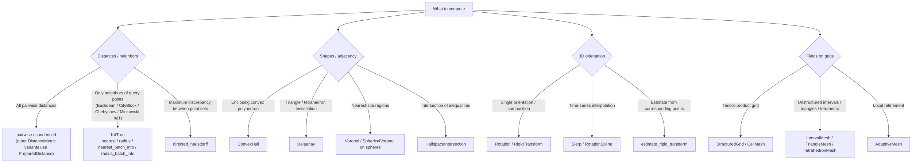

The choice depends on the desired quantity (distances, nearby points, adjacency, or orientation) and input properties (dimension, point count, degeneracy, and query count).
The diagram shows the initial choices.

## Distances and neighbor search

| Goal | API | Preparation / cost per query | Reasons and cautions |
|---|---|---|---|
| All distances between two point sets | `pairwise`, `pairwise`/`pairwise_into` of `PreparedDistance` | None / $O(mnd)$ ($O(mnd^2)$ for Mahalanobis) | Function `pairwise` uses Euclidean distance. All 17 `DistanceMetric` variants, standardized Euclidean, and Mahalanobis are available through `PreparedDistance`. Output is $m \times n$ |
| All distances within one point set | `condensed`, `condensed`/`condensed_into` of `PreparedDistance` | None / $O(N^2 d)$ | Only the $N(N-1)/2$ upper-triangle entries, approximately half a square matrix's storage |
| $k$ neighbors or points within a radius of a query | `nearest`, `radius`, `nearest_into`, `radius_into` of `KdTree` | $O(d\,n \log n)$ / few leaves in low dimensions, approaching all points in high dimensions | For many queries against the same point set. Limited to the four `TreeMetric` distances |
| Batch processing many query points | `nearest_batch`, `nearest_batch_into`, `radius_batch_into` of `KdTree` | Tree construction / as above per query | Exposes concatenated results in query order; batch radius queries also return per-row counts. Up to 32 workers |
| Discrepancy between two shapes | `directed_hausdorff` | None / worst-case $O(mnd)$ | Early termination in a fixed-seed shuffled order often reduces comparisons. Symmetric distance is the maximum over both directions |

As dimension increases, KD-tree lower-bound pruning becomes less effective and points visited per query approach exhaustive search.
Results remain correct; this concerns cost rather than correctness.
The relevant dimension threshold depends strongly on point distribution; compare query time against exhaustive `pairwise` to choose.
If approximation is acceptable, `SearchOptions::with_epsilon` accepts neighbors within distance ratio $1 + \varepsilon$ to reduce visits.
For distances unsupported by trees, such as Mahalanobis, prepare `PreparedDistance::mahalanobis` and evaluate exhaustively.
See [Distances and dissimilarities](../algorithms/distances/) for distance domains, [Distance matrices and condensed representations](../algorithms/distance-matrices/) for storage, and [Neighbor search with KD trees](../algorithms/spatial-trees-and-distance/) for pruning and approximation.

## Geometric predicates and triangulations

| Goal | API | Output | Cautions |
|---|---|---|---|
| Orientation and circle/sphere inclusion | `orient2d`, `orient3d`, `incircle`, `insphere`, `SimplexPredicateWorkspace` | Exact sign `PredicateSign` | Exact for represented inputs; no measurement-error treatment |
| Convex hull | `ConvexHull` | Boundary simplex facets and adjacency | Coplanar faces are triangulated, with groups indicated by `coplanar_faces` |
| Delaunay tessellation and point location | `Delaunay`, `find_simplex`, `barycentric` | Simplices, adjacency, and barycentric coordinates | Cospherical ties are resolved deterministically by symbolic perturbation in sorted site order (`Strict` gives an error) |
| Nearest-site regions | `Voronoi` | Vertices (circumcenters), ridges, and unbounded rays | Internally retains a Delaunay tessellation. Vertex coordinates are approximate constructions |
| Nearest-site regions on a sphere | `SphericalVoronoi` | Regions in adjacency order and solid-angle areas | Checks points lie on the sphere within tolerance |
| Intersection of inequalities | `HalfspaceIntersection` | Vertices, active inequalities, and boundedness | Supply an interior point. Returns no vertices when unbounded |
| Reconstruction after adding points | `new` / `with_options` / `build` of `ConvexHull::new` and others | Immutable topology from the entire point cloud | No incremental builder. Reconstruct using the full updated point cloud |

For degenerate inputs (grid points or cocircular points), default `GeometryDegeneracy::Deterministic` merges duplicate sites and resolves ties through symbolic perturbation in sorted site order.
To assume general-position inputs, select `Strict` to detect duplicate sites and nonunique tessellations as errors (`InvalidInput`).
Neither adds random jitter to coordinates.
Tessellations return canonical indices of sorted sites; map to input rows with `input_mapping` and `representatives` of `ConvexHull` and `Delaunay` (`Voronoi` uses `delaunay()`).
See [Exact geometric predicates](../algorithms/exact-predicates/) for signs, and [Convex hulls, Delaunay tessellations, and Voronoi diagrams](../algorithms/delaunay-voronoi-and-hulls/) and [Halfspace intersections and dual convex hulls](../algorithms/halfspace-intersection/) for construction.

## Rotations and rigid transformations

| Representation or operation | API | Advantages | Cautions |
|---|---|---|---|
| Unit quaternions | `Rotation` | No singularities; renormalized at each composition | $q$ and $-q$ represent the same rotation; signs are canonicalized |
| Euler angles | `EulerSequence`, `as_euler`, `from_euler` | Readable inputs and outputs | `gimbal_lock` becomes true when the middle angle approaches a singularity |
| Interpolation between adjacent times | `Slerp` | Follows shortest arcs at constant angular velocity on each interval | With three or more times, angular velocity jumps at knots |
| Smooth time-series interpolation | `RotationSpline` | Continuous angular velocity and acceleration | No spline is exposed if preparation ends with `IterationLimit` |
| Registration from corresponding points | `estimate_rigid_transform` | Weighted Kabsch method for $\det R = 1$ | Correspondence must be known. Fewer than three or collinear points leave rotation nonunique, yielding `InvalidInput` |
| Applying to many points | `apply_batch`, `apply_batch_into` of `RigidTransform` and `Rotation` | `apply_batch_into` allocates nothing after reservation | For `apply_batch_into`, reserve `TransformWorkspace` using `TransformWorkspaceRequest::apply` before passing it |

## Grids, meshes, and fields

| Input | API | Reasons to choose |
|---|---|---|
| Cartesian products of per-axis coordinates (including nonuniform and periodic axes) | `CoordinateAxis`, `StructuredGrid`, `CellMesh` | Computes connectivity from indices without adjacency tables |
| Unstructured intervals, triangles, or tetrahedra | `IntervalMesh`, `TriangleMesh`, `TetrahedronMesh` | Signed connectivity and boundary tags. Triangles/tetrahedra can be converted from Delaunay tessellations |
| Local refinement/coarsening | `AdaptiveMesh`, `AdaptationRequest` | Returns candidates checked for 2:1 balance and correspondence across generations |
| Partitioning and repartitioning | `MeshPartition`, `RepartitionMap` | Owners, ghosts, interfaces, and field reordering |

Fields are stored in `Field` with location types (such as `Vertex` and `Cell`), combined only when `MeshToken` refers to the same revision.
Sibling revisions refined separately from the same parent cannot be combined even at equal generations.
For interpolation or conservative transfer, use [Scattered-data interpolation](../../scioxide-interp/algorithms/scattered-tessellations/) or methods in the PDE chapter.
See [Foundations of points, bounds, grids, and meshes](../algorithms/geometry-grids-and-meshes/) for representations, [Adaptive mesh refinement and topology maps](../algorithms/adaptive-mesh-and-shared-tessellation/) for refinement, and [Adaptive mesh partitioning and repartitioning](../algorithms/mesh-partition/) for partitioning.

## Summary

Choose `pairwise` or `condensed` for all pairwise distances (the same-named `PreparedDistance` methods for non-Euclidean distances), and `KdTree` for many neighbor queries on the same point set.
Use exact predicates for topology decisions, treating circumcenters and barycentric coordinates as rounded constructions.
Degenerate inputs are tessellated deterministically through symbolic perturbation by default, or detected as errors with `Strict`.
Use `RotationSpline` when orientation interpolation requires continuous angular velocity, and check for termination `Converged`.
Examine the chosen method's assumptions and errors in pages starting with [Mathematics and shared conventions](../algorithms/), and all item contracts in the [API guide](../api/).
