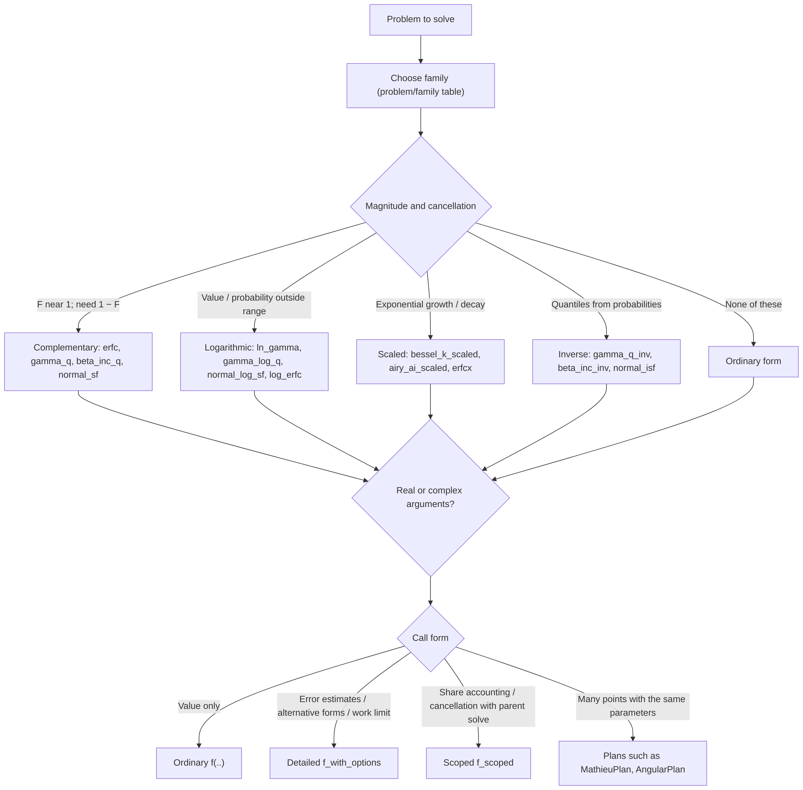

Even when special functions match the mathematical formula, floating-point values can exceed range or lose significant digits through subtraction.
For example, computing a normal upper probability with `1.0 - normal_cdf(x)` gives zero at $x = 9$ because $\Phi(9)$ rounds to 1.
Complementary `normal_sf(9.0)` evaluates the tail directly, returning approximately $1.13 \times 10^{-19}$.

This page collects decisions for making four choices in order.
First select a family from the problem, then a representation from magnitude and cancellation, check real versus complex argument types, and finally choose a call form.



## Choosing a family from the problem

The following table maps common problems to families and relevant representations, then to mathematical pages.
Functions listed are representative; each mathematical page's tables include the entire family.

| Problem | Family and representative functions | Representations and cautions | Mathematical page |
|---|---|---|---|
| Complex arguments, values on cuts, and probability-tail representations | `Parameter`, `SpecialFunctionResult`, `log_erfc` | Signed zero of the imaginary part selects the cut's bank | [Entry points, branches, and value representations](../algorithms/branches-tails-and-extended-families/) |
| Likelihood and partition-function normalization constants | `gamma`, `ln_gamma`, `digamma`, `polygamma`, `pochhammer` | Logarithmic forms for large arguments | [Gamma functions, polygamma functions, and Pochhammer symbols](../algorithms/gamma-family/) |
| Gamma/Poisson cumulative probabilities and quantiles | `gamma_p`, `gamma_q`, `gamma_log_q`, `gamma_p_inv` | Complementary upper tails; logarithmic tails below range | [Incomplete Gamma functions](../algorithms/incomplete-gamma/) |
| Counting and binomial coefficients | `factorial`, `double_factorial`, `binomial`, `ln_binomial` | Logarithmic forms for large $n$ | [Factorials and binomial coefficients](../algorithms/combinatorial-numbers/) |
| Set partitions and series coefficients | `stirling_first_kind`, `stirling_second_kind`, `bernoulli`, `euler` | `checked_bernoulli` and `checked_euler` for exact rationals/integers | [Stirling, Bernoulli, and Euler numbers](../algorithms/stirling-bernoulli-euler-numbers/) |
| Beta/binomial cumulative probabilities | `beta_inc`, `beta_inc_q`, `beta_inc_inv`, `ln_beta` | `beta_inc_q` for tails with $x$ near 1 | [Beta and regularized incomplete Beta functions](../algorithms/beta-and-error-functions/) |
| Diffusion error functions | `erf`, `erfc`, `erfcx`, `erfinv`, `dawson` | `erfc` or `erfcx` for large $x$ | [Error functions, Dawson's integral, and inverse error functions](../algorithms/error-functions/) |
| Normal p-values and quantiles, bivariate normals | `normal_sf`, `normal_log_sf`, `normal_isf`, `owens_t` | Invert tail probabilities directly | [Normal tails and Owen's T function](../algorithms/normal-tails-and-faddeeva/) |
| Voigt spectral lines and complex error functions | `voigt_profile`, `voigt_complex`, `faddeeva` | `voigt_profile` for real profiles, `voigt_complex` for complex values | [Faddeeva functions and Voigt profiles](../algorithms/faddeeva-and-voigt/) |
| Radiation attenuation/absorption and neutron shielding | `expint_e1`, `expint_en`, `expint_ei`, `logarithmic_integral` | Scaled forms such as `expint_e1_scaled` for large arguments | [Exponential and logarithmic integrals](../algorithms/exponential-and-trigonometric-integrals/) |
| Fresnel diffraction integrals and antenna radiation | `si`, `ci`, `fresnel_c`, `fresnel_s` | `shi_scaled` and `chi_scaled` for large-argument hyperbolic integrals | [Trigonometric, hyperbolic, and Fresnel integrals](../algorithms/trigonometric-integrals-and-fresnel/) |
| Solutions in confluent/Gauss hypergeometric functions | `hyp1f1`, `hyp2f1`, `hyperu`, `hyp_pfq` | `HypergeometricFunction` for many points with the same parameters | [Hypergeometric functions](../algorithms/hypergeometric-and-zeta/) |
| Zeta sums and blackbody integrals | `riemann_zeta`, `hurwitz_zeta`, `dirichlet_eta` | `hurwitz_zeta_log` for underflowing Hurwitz zeta | [Riemann and Hurwitz zeta functions and Dirichlet eta](../algorithms/zeta-functions/) |
| Turning points of linear potentials | `airy_ai`, `airy_bi`, `airy_ai_scaled` | Remove exponential factors with scaled forms | [Airy functions and turning points](../algorithms/airy-functions/) |
| Cylindrical waves and heat conduction | `bessel_j`, `bessel_y`, `bessel_k`, `hankel_1` | Select solutions by boundary conditions (next section); remove exponentials with scaled forms | [Cylindrical Bessel and Hankel functions](../algorithms/airy-bessel-and-hankel/) |
| Spherical scattering | `spherical_jn`, `spherical_hankel_1`, `riccati_jn` | Stable order-recurrence direction differs by function | [Spherical Bessel, spherical Hankel, and Riccati–Bessel functions](../algorithms/spherical-bessel-kelvin-and-riccati/) |
| Skin effect in conductors | `ber`, `bei`, `ker`, `kelvin` | Only order zero provided; general orders use complex-argument `bessel_j` and `bessel_k` | [Kelvin functions and the skin effect](../algorithms/kelvin-functions/) |
| Inhomogeneous Bessel equations and piston radiation | `struve`, `modstruve`, `bessel_j0_integral` | ULP targets only over $-5 \le \nu \le 10$ and $10^{-3} \le x \le 100$ ranges | [Struve functions and Bessel/Struve integrals](../algorithms/struve-parabolic-and-bessel-integrals/) |
| Quadratic potentials | `parabolic_d`, `parabolic_v`, `parabolic_w` | Check order conventions (below) | [Parabolic cylinder functions](../algorithms/parabolic-cylinder-functions/) |
| Coulomb scattering and bound states | `coulomb_wave`, `coulomb_wave_sequence`, `hydrogenic_radial` | Use sequence functions for consecutive orders | [Coulomb waves and hydrogen-like radial states](../algorithms/coulomb-and-hydrogenic/) |
| Pendulum periods and ellipse perimeters | `elliptic_k`, `elliptic_e` | Pass parameter $m = k^2$ (below) | [Elliptic integral definitions and complete integrals K and E](../algorithms/elliptic-and-legendre/) |
| Elliptical arc lengths and incomplete elliptic integrals | `elliptic_f`, `elliptic_e_inc`, `carlson_rf`, `carlson_rd` | When $m$ is near 1, pass $1 - m$ directly to Carlson forms | [Carlson symmetric forms and incomplete elliptic integrals](../algorithms/carlson-symmetric-integrals/) |
| Nonlinear oscillation trajectories | `jacobi_sn`, `jacobi_cn`, `jacobi_dn`, `jacobi_amplitude` | Pass parameter $m = k^2$ | [Jacobi elliptic functions](../algorithms/jacobi-elliptic-functions/) |
| Electrostatic/gravitational multipole expansions | `legendre_p`, `legendre_q`, `legendre_p_assoc` | Associated functions include Condon–Shortley phase $(-1)^m$ | [Legendre functions](../algorithms/legendre-functions-and-spherical-harmonics/) |
| Field expansions on spheres | `spherical_harmonic`, `spherical_harmonic_real` | Unit-sphere normalization with Condon–Shortley phase | [Spherical harmonics](../algorithms/spherical-harmonics/) |
| Angular-momentum coupling and selection rules | `wigner_3j`, `clebsch_gordan`, `AngularPlan` | Reuse plans and workspaces for many coefficients | [Angular-momentum coupling coefficients and Wigner symbols](../algorithms/angular-momentum-coupling/) |
| Elliptic cylinders and Paul traps | `mathieu_a`, `mathieu_ce`, `MathieuPlan` | Prepare characteristic values and expansion coefficients as plans | [Mathieu functions and spectral methods](../algorithms/mathieu-and-spheroidal/) |
| Spheroidal scattering | `spheroidal_angular`, `spheroidal_radial`, `SpheroidalPlan` | Prepare characteristic values and expansion coefficients as plans | [Spheroidal wave functions](../algorithms/spheroidal-wave-functions/) |
| Triaxial ellipsoid potentials | `EllipsoidalHarmonicPlan`, `ellipsoidal_harmonic` | Supply quadrature tolerances through options | [Ellipsoidal harmonics and Lamé functions](../algorithms/ellipsoidal-harmonics/) |
| Loop integrals and Clausen sums | `dilog`, `spence`, `clausen` | Real `dilog` returns the real part for $x > 1$ on the cut | [Dilogarithms, Spence functions, and Clausen functions](../algorithms/polylog-lerch-and-clausen/) |
| Bose-gas integrals and lattice sums | `polylog`, `lerch_phi` | Real $z > 1$ is on the cut; many orders require complex types | [General-order polylogarithms and Lerch's transcendent](../algorithms/polylog-and-lerch/) |
| Transcendental equations of form $w e^w = y$ (Wien's law, diodes) | `lambert_w0`, `lambert_wm1`, `wright_omega` | Distinguish the two real branches | [Lambert W and Wright ω functions](../algorithms/lambert-w-and-wright-omega/) |
| Lattice heat capacity, resistivity, and synchrotron radiation | `debye_3`, `transport_5`, `synchrotron_1` | Debye functions use normalization $D_n(0) = 1$ | [Debye functions, transport integrals, and synchrotron functions](../algorithms/thermal-and-radiation-integrals/) |
| Electron gases and semiconductor carrier densities | `fermi_dirac_half`, `fermi_dirac_mhalf`, `fermi_dirac_int` | Normalized by $1/\Gamma(j+1)$ | [Fermi–Dirac integrals](../algorithms/fermi-dirac-integrals/) |

## Choosing a representation

After selecting a family, choose a representation from magnitude and cancellation.
Ask whether the desired quantity itself is representable in floating point and, if so, whether it can be formed without cancellation.

### Complementary forms and cancellation in subtraction

When cumulative probability $F$ is near 1, forming upper probability $Q = 1 - F$ by subtraction loses significant digits.
Binary64 spacing immediately below 1 is $\varepsilon/2 = 2^{-53}$; rounding $F$ alone therefore introduces an absolute error of order $\varepsilon/4$ in $Q$.
The subtraction's relative error is thus roughly $\varepsilon/(4Q)$ or larger, losing approximately $k$ digits when $Q = 10^{-k}$.
When $Q$ falls below $\varepsilon/4 \approx 5.6 \times 10^{-17}$, $F$ rounds to 1 and subtraction returns zero.
Complementary `gamma_q`, `beta_inc_q`, `erfc`, and `normal_sf` evaluate the smaller tail directly, avoiding this loss.

The following cell measures relative errors of subtraction $1 - F$ and complementary forms over arguments for two distributions with integer parameters.
Gamma distributions (shape 3) have finite-sum closed form $Q(3, x) = e^{-x}(1 + x + x^2/2)$; the upper tail of Beta distribution $I_x(2, 5)$ is $1 - I_x(2, 5) = (1-x)^5(1 + 5x)$.
References compute these closed forms with f64 inherent methods; both methods' relative errors are plotted on logarithmic axes.
The dashed line indicates $\varepsilon/(4Q)$.

```rust
//| id: special-choosing-complement-cancellation
//| ref: special-choosing-complement-cancellation
//| title: "Compare relative errors of 1 − F and complementary forms across tail depths"
//| run: reactive
//| crates: [scioxide-special]
//| inputs:
//|   law: {"type":"select","label":"Distribution","options":["Gamma distribution (shape 3)","Beta distribution I_x(2, 5)"],"value":"Gamma distribution (shape 3)"}
//| cases:
//|   - {"id":"beta","label":"Beta distribution","description":"As x → 1, upper probability decreases as (1 − x)⁵.","inputs":{"law":"Beta distribution I_x(2, 5)"}}
//| tests:
//|   - case: default
//|     expect:
//|       - {"artifact":"summary","path":"/rows/0/2","range":{"max":1e-14}}
//|       - {"artifact":"summary","path":"/rows/2/2","range":{"min":1e-6,"max":1e-3}}
//|       - {"artifact":"summary","path":"/rows/2/3","range":{"max":1e-14}}
//|       - {"artifact":"summary","path":"/rows/3/2","equals":1}
//|       - {"artifact":"summary","path":"/rows/3/3","range":{"max":1e-14}}
//|   - case: beta
//|     expect:
//|       - {"artifact":"summary","path":"/rows/2/2","range":{"min":1e-6,"max":1e-2}}
//|       - {"artifact":"summary","path":"/rows/2/3","range":{"max":1e-13}}
//|       - {"artifact":"summary","path":"/rows/3/2","equals":1}
//|       - {"artifact":"summary","path":"/rows/3/3","range":{"max":1e-13}}
use scioxide_special::{beta_inc, beta_inc_q, gamma_p, gamma_q};

let gamma_law = law.starts_with("Gamma");
// Argument → (1 − F, complementary form, closed-form reference). References use f64 inherent methods.
let evaluate = |x: f64| -> Result<(f64, f64, f64), String> {
    if gamma_law {
        let lower = gamma_p(3.0, x).map_err(|e| e.to_string())?;
        let upper = gamma_q(3.0, x).map_err(|e| e.to_string())?;
        Ok((1.0 - lower, upper, (-x).exp() * (1.0 + x + 0.5 * x * x)))
    } else {
        let lower = beta_inc(2.0, 5.0, x).map_err(|e| e.to_string())?;
        let upper = beta_inc_q(2.0, 5.0, x).map_err(|e| e.to_string())?;
        Ok((1.0 - lower, upper, (1.0 - x).powi(5) * (1.0 + 5.0 * x)))
    }
};
// Sample Gamma x ∈ [1, 60] and Beta 1 − x ∈ [10⁻⁵, 0.5] at logarithmically spaced points.
let grid: Vec<f64> = (0..=120)
    .map(|i| {
        let s = i as f64 / 120.0;
        if gamma_law {
            1.0 + 59.0 * s
        } else {
            1.0 - 0.5 * 10f64.powf(-4.7 * s)
        }
    })
    .collect();
let mut subtracted = Vec::new();
let mut direct = Vec::new();
let mut guide = Vec::new();
// Omit zero-error points that cannot be plotted logarithmically and count them for (subtraction, complementary form).
let mut exact_points = (0, 0);
for &x in &grid {
    let (by_subtraction, complement, reference) = evaluate(x)?;
    let errors = [by_subtraction, complement].map(|v| ((v - reference) / reference).abs());
    match errors[0] > 0.0 {
        true => subtracted.push([reference, errors[0]]),
        false => exact_points.0 += 1,
    }
    match errors[1] > 0.0 {
        true => direct.push([reference, errors[1]]),
        false => exact_points.1 += 1,
    }
    guide.push([reference, f64::EPSILON / (4.0 * reference)]);
}
let dashed = serde_json::json!({ "lineType": "dashed", "showSymbol": false });
emit_line_chart!(
    &vec![
        serde_json::json!({ "name": "Subtraction 1 − F", "points": subtracted }),
        serde_json::json!({ "name": "Complementary form", "points": direct }),
        serde_json::json!({ "name": "Indicator ε/(4Q)", "points": guide, "style": dashed }),
    ],
    options = &serde_json::json!({
        "xLabel": "Upper probability Q [-]",
        "yLabel": "Relative error [-]",
        "xType": "log",
        "yType": "log",
        "yMin": 1e-17,
        "yMax": 10.0
    })
);
emit_text!(format!(
    "Points matching the reference omitted from the plot ({} total): subtraction {}, complementary form {}",
    grid.len(),
    exact_points.0,
    exact_points.1
));

// Representative points: upper probabilities approximately 1, 10⁻⁶, 10⁻¹², and below ε/4 (subtraction becomes zero).
let probes = if gamma_law {
    [1.5, 18.0, 33.0, 45.0]
} else {
    [0.2, 0.92, 0.9965, 0.9998]
};
let mut rows = Vec::new();
for x in probes {
    let (by_subtraction, complement, reference) = evaluate(x)?;
    let relative = |v: f64| ((v - reference) / reference).abs();
    rows.push((x, reference, relative(by_subtraction), relative(complement)));
}
let sci3 = serde_json::json!({ "notation": "scientific", "significantDigits": 3 });
let sci2 = serde_json::json!({ "notation": "scientific", "significantDigits": 2 });
let columns = serde_json::json!([
    { "key": "0", "label": "x [-]", "type": "number" },
    { "key": "1", "label": "Reference Q [-]", "type": "number", "format": sci3 },
    { "key": "2", "label": "Subtraction relative error [-]", "type": "number", "format": sci2 },
    { "key": "3", "label": "Complementary relative error [-]", "type": "number", "format": sci2 }
]);
emit_table_with_columns!(
    columns,
    rows,
    metadata = serde_json::json!({ "id": "summary" })
);
```

For default Gamma, subtraction relative error grows along the dashed indicator: $1.4 \times 10^{-11}$ at $Q \approx 2.8 \times 10^{-6}$ ($x = 18$), and $4.4 \times 10^{-6}$ at $Q \approx 2.7 \times 10^{-12}$ ($x = 33$).
At $x = 45$, $Q \approx 3.0 \times 10^{-17}$ falls below $\varepsilon/4$, and subtraction returns zero with relative error 1.
Complementary `gamma_q` matches the reference bit-for-bit at 117 of 121 points; those 117 are omitted.
For integer shapes, however, the implementation uses the same finite sum, so agreement is not an independent check.
Switching to Beta $I_x(2, 5)$ gives subtraction errors following the same indicator; at $1 - x = 2 \times 10^{-4}$, $Q \approx 1.9 \times 10^{-18}$ and zero is returned.
The relative error of `beta_inc_q` remains below $5 \times 10^{-16}$ throughout.
For integer shapes ($a + b \le 33$), `beta_inc_q` also forms the upper tail directly with a finite binomial sum; this likewise compares the same closed-form polynomial summed in another order, rather than checking independently.
This cell checks digits lost by subtraction $1 - F$, not the accuracy of complementary forms themselves.

The decision to read from the chart is how large upper probability $Q$ must be for subtraction to suffice.
With required relative accuracy $\delta$, subtraction is adequate only approximately in range $Q > \varepsilon/(4\delta)$.
For example, if relative accuracy $10^{-6}$ is required, switch to complementary form before $Q$ drops below $10^{-10}$.
Below the normal range ($Q < 2.2 \times 10^{-308}$ for binary64), complementary values lose digits as subnormals and become zero at $Q < 4.9 \times 10^{-324}$; use logarithmic forms next.

### Logarithmic forms, scaled forms, and inverses

Choose logarithmic forms when probabilities or values themselves exceed scalar range.
`normal_sf` returns zero for $x > 38.5$ in binary64, while `normal_log_sf` continues to return finite logarithms beyond that point.
Large factorials and Gamma functions have `ln_factorial`, `ln_binomial`, and `ln_gamma`.
`ln_gamma` returns only $\ln|\Gamma|$, discarding sign; read negative noninteger signs from the detailed `gamma_with_options` logarithmic form.

For exponentially growing or decaying solutions, choose scaled forms with the exponential factor removed.
`erfcx(x)` returns $e^{x^2}\operatorname{erfc}(x)$, retaining a finite value near $1/(x\sqrt\pi)$ for large positive $x$.
On the negative side it grows as $2e^{x^2}$; in binary64, arguments below $x \approx -26.63$, where $2e^{x^2}$ exceeds the maximum, yield `NumericalInstability` (`Overflow`).

Use inverse functions for quantiles from probabilities rather than constructing general root solves.
Use `gamma_p_inv`, `beta_inc_inv`, `normal_quantile`, and `erfinv` for lower probabilities, and `gamma_q_inv`, `beta_inc_q_inv`, `normal_isf`, and `erfcinv` for upper probabilities, without reconstructing probabilities by subtraction.
For logarithmic probabilities, invert directly in logarithmic form with `gamma_p_inv_log`, `beta_inc_inv_log`, `normal_inv_log_cdf`, and `normal_inv_log_sf`.
`normal_quantile`, `normal_isf`, and inverse error functions use noniterative rational approximations; Gamma/Beta inverses use bracket-safeguarded Halley iteration.
`normal_inv_log_sf` and `normal_inv_log_cdf` use Newton iteration for logarithmic probabilities below $-36$.

## Boundary conditions for wave and diffusion equations

Separating Helmholtz equation $\nabla^2 \psi + k^2 \psi = 0$ in cylindrical coordinates $(r, \theta, z)$ gives Bessel's differential equation radially.
As a second-order equation it has two independent solutions; boundary conditions at origin $r = 0$ and far field $r \to \infty$ select them.

| Boundary condition | Solution | Functions | Properties |
|---|---|---|---|
| Includes the origin, finite there | $J_\nu(kr)$ | `bessel_j` | $J_0(0) = 1$; $J_\nu(0) = 0$ for $\nu > 0$ |
| Annular domain excluding the origin | Linear combination of $J_\nu$ and $Y_\nu$ | `bessel_y` | $Y_\nu$ diverges logarithmically or algebraically at $r \to 0$ |
| Outgoing radiation (time factor $e^{-\mathrm{i}\omega t}$) | $H_\nu^{(1)}(kr) = J_\nu + \mathrm{i}Y_\nu$ | `hankel_1` | Behaves as $e^{\mathrm{i}kr}$ for large $kr$, returning complex values even for real inputs |
| Decays at infinity (modified Helmholtz $\nabla^2\psi - \lambda^2\psi = 0$) | $K_\nu(\lambda r)$ | `bessel_k` | Decays as $e^{-\lambda r}$ at infinity; at $x = 0$ returns limit $+\infty$ successfully |
| Modified Helmholtz including the origin, finite there | $I_\nu(\lambda r)$ | `bessel_i` | Grows as $e^{\lambda r}$ at infinity |

For radial spherical coordinates, select spherical Bessel `spherical_jn`, `spherical_yn`, `spherical_hankel_1`, `spherical_in`, and `spherical_kn` by the same rules.

Large arguments cause overflow or rounding to zero; choose scaled forms removing exponentials.
`bessel_i_scaled` returns $e^{-|\operatorname{Re} z|}I_\nu(z)$, `bessel_k_scaled` returns $e^{z}K_\nu(z)$, `bessel_j_scaled` and `bessel_y_scaled` multiply by $e^{-|\operatorname{Im} z|}$, and `hankel_1_scaled` returns $e^{-\mathrm{i}z}H_\nu^{(1)}(z)$.
Scaled forms represent different quantities, so do not plot them on the same axis as original values.
For ratios or logarithms alone, $K_\nu$ also has real logarithmic form `bessel_k_log`.

## Differences in conventions

References can use different conventions for the same symbols; check them when forming arguments from physical formulas.

| Quantity | `scioxide-special` convention | Easily confused convention |
|---|---|---|
| Second argument of elliptic integrals and Jacobi elliptic functions | Parameter $m = k^2$ (`elliptic_k(m)`, `jacobi_sn(u, m)`) | Modulus $k$, modular angle $\alpha$ ($m = \sin^2\alpha$) |
| Incomplete Gamma/Beta functions | Regularized $P(a, x) = \gamma(a, x)/\Gamma(a)$, $I_x(a, b)$ | Unregularized $\gamma(a, x)$ (returned by `gamma_lower`) |
| Fermi–Dirac integrals | $F_j(x) = \frac{1}{\Gamma(j+1)}\int_0^\infty \frac{t^j}{e^{t-x}+1}\,dt$ | Definition without dividing by $\Gamma(j+1)$ |
| Spherical harmonics | Includes Condon–Shortley phase $(-1)^m$ and unit-sphere normalization | Definitions without the phase |
| Bernoulli numbers | $B_1 = -1/2$ | $B_1 = +1/2$ |
| Parabolic cylinder functions | $D_\nu(x) = U(-\nu - 1/2, x)$ of order $\nu$ (only `parabolic_w` takes $a$ with $W(a, x)$) | $a$ in Weber's $U(a, x)$ |

When a physical formula gives modulus $k = \sin(\theta_0/2)$, as for a pendulum's period, square it and pass $m = k^2$.
Real $m > 1$ gives `DomainError` (`OutsideDomain`) for `elliptic_k`, while $K(1) = +\infty$ returns a successful limit.

## Real and complex entry points

Many functions take type parameter `NumericScalar`, accepting `f32`, `f64`, `Complex<f32>`, and `Complex<f64>` under one function; argument type determines result type.
For complex arguments, orders and shapes may remain real (`Parameter`).
Real entry points accept only real domains; passing a negative real argument to noninteger-order `bessel_j` yields `DomainError`.
For values on cuts, switch to complex entry points, selecting upper/lower banks with imaginary $+0$ and $-0$.
Detailed conventions appear in [Entry points, branches, and value representations](../algorithms/branches-tails-and-extended-families/).

## Choosing a call form

Use ordinary `f(..)` when only a value is needed.
Use detailed `f_with_options(.., options)` for error estimates, derivatives, scaled/logarithmic forms, or nondefault work limits.
At a work limit with a useful estimate, detailed forms return it with status `IterationLimit`, while ordinary forms return `ConvergenceFailure`.
When evaluating special functions inside another solve and sharing its accounting, cancellation, and deadlines, pass the parent's `&mut SolveContext` to scoped `f_scoped(.., options, scope)`.
Functions whose work is independent of arguments (such as `gamma`, `erfinv`, `normal_cdf`) have no scoped forms.

For many points with the same parameters, construct a plan once and reuse it.
`MathieuPlan`, `SpheroidalPlan`, and `EllipsoidalHarmonicPlan` solve truncated eigenproblems and retain coefficients; `AngularPlan` retains a prime table for factoring factorials in Racah's formula.
One-call functions such as `mathieu_a`, `spheroidal_angular`, `ellipsoidal_harmonic`, and `wigner_3j` internally construct a plan and evaluate once.
`HypergeometricFunction` validates and retains parameters of ${}_pF_q$ and $U$, also returning regularized values and derivatives.

Scalar functions accept no batch-array form; evaluate many points with `iter().map(..)`.
Only Coulomb wave sequence functions (such as `coulomb_wave_sequence`) compute consecutive orders together by sharing order recurrences.

## Summary and further reading

Use the problem table to find a family, then inspect its complete function list and accuracy ranges on the mathematical page.
When upper probability is $10^{-k}$, subtraction $1 - F$ loses approximately $k$ digits; choose complementary form, switching to logarithmic form if probability falls below scalar range.
Choose scaled forms for exponentially varying solutions, remembering they are different quantities.
Pass parameter $m = k^2$ to elliptic integrals, and check Fermi–Dirac or spherical-harmonic normalization against references before use.
Choose detailed forms for error estimates or work-limit handling; examine their interpretation in [Entry points, branches, and value representations](../algorithms/branches-tails-and-extended-families/).
