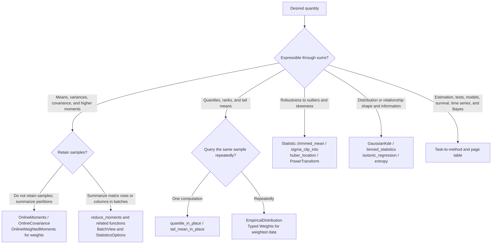

Two questions largely determine how to compute a statistic.
Can the full sample be retained, and is the desired quantity expressible through sums (mean, variance, covariance) or dependent on order (quantiles, ranks, tail means)?
For estimation, testing, and model fitting, also choose by task and data structure: censoring, temporal dependence, multiple variables, or priors.
This page collects a task-to-method and page table, a decision flow for summary types and functions, functions for one calculation with defaults, and comparisons for choosing quantile definitions, weight meanings, and shape estimators.
Find each method's mathematics through [Statistical mathematics and shared conventions](../algorithms/), and type/function contracts through the [API guide](../api/).

## Decision flow

## Choose methods and pages by task

For each task, the table lists methods, initial types/functions, a page explaining derivations and assumptions, and checks before using results.
Many functions have a one-shot form for one calculation with defaults and a detailed form accepting settings ([Calling forms](oxref:stats-execution-forms)).

| Task | Method | Initial types and functions | Explanatory page | Checks |
|---|---|---|---|---|
| Summary: means, variances, higher moments, covariance | Welford recurrence and merging partial summaries | `OnlineMoments`, `OnlineCovariance`, `reduce_moments` | [Mathematics of streaming means, variances, higher moments, and covariance](../algorithms/online-moments-and-covariance/) | Retained order and merge order |
| Summary: weighted means and variances | Estimators and effective sample sizes for each weight meaning | `OnlineWeightedMoments`, `Weights` | [Mathematics of weighted estimation, standard errors, and confidence intervals](../algorithms/weighted-estimation-and-confidence/) | Whether weights mean frequency, reliability, or inverse variance |
| Summary: quantiles, ranks, empirical distribution functions | Sorting and selection; nine Hyndman–Fan definitions | `EmpiricalDistribution`, `quantile_in_place`, `rank_slice`, `cdf` | [Mathematics of empirical distributions, sample quantiles, and interpolation conventions](../algorithms/empirical-quantiles/) | Quantile type number and tie handling |
| Summary: tail means | Weighted inverse empirical distribution function and fractional boundary mass | `tail_mean_in_place`, `EmpiricalDistribution::tail_mean` | [Mathematics of weighted empirical distributions and tail means](../algorithms/tail-means-and-weighted-empirical/) | Tail side and observations contributing to the tail |
| Summary: location and spread robust to outliers | Trimmed mean, Huber M-estimator, sigma clipping | `Statistic::trimmed_mean`, `huber_location`, `sigma_clip_into` | [Order statistics, extrema, and robust location estimators](../algorithms/order-statistics-and-robust-estimation/) | Breakdown point and iteration termination |
| Summary: axis-wise statistics, standardization, power transformations | Statistic selectors, z scores, Box–Cox and Yeo–Johnson transformations | `statistics`, `standardize`, `PowerTransform`, `probplot` | [Mathematics of descriptive statistics, standardization, and power transformations](../algorithms/descriptive-statistics-and-transforms/) | Whether a probability plot supports normality after transformation |
| Summary: distribution shape | Histograms, Gaussian kernel density estimation, isotonic regression | `binned_statistics`, `GaussianKde`, `isotonic_regression` | [Mathematics of isotonic regression, binning, and kernel density estimation](../algorithms/isotonic-bins-and-kde/) | Counting out-of-range observations and bandwidth |
| Summary: angles, information, distribution distances | Mean resultant vector, entropy, Wasserstein distance | `Statistic::circular`, `entropy`, `differential_entropy`, `distribution_distance` | [Mathematics of circular statistics, information, and distribution distances](../algorithms/circular-information-and-distances/) | Angular period and differential-entropy bias |
| Estimation: confidence intervals for means | Student t interval | `mean_confidence_interval`, `MomentsSnapshot::confidence_interval_of_mean`, `MeanIntervalPlan` | [Mathematics of weighted estimation, standard errors, and confidence intervals](../algorithms/weighted-estimation-and-confidence/) | Recorded method and assumptions: independence and normality |
| Estimation: distribution parameters | Maximum likelihood, method of moments, quantile matching | `PreparedFit`, `fit`, and injected `FitSolver` | [Distribution fitting and observed information matrices](../algorithms/distribution-fitting-and-confidence-limits/) | `StatsTermination`, identifiability, and observed information |
| Estimation: exact confidence limits for proportions, rates, variances, noncentrality | Test inversion and parameter inversion through tail probabilities | `binomial_confidence_limits`, `poisson_rate_confidence_limits`, `invert_parameter` | [Parameter inversion through tail probabilities and exact confidence limits](../algorithms/parameter-inversion-and-confidence-limits/) | Discrete-distribution coverage may exceed the nominal level |
| Estimation: intervals for arbitrary statistics | Bootstrap (percentile, basic, BCa), jackknife | `bootstrap`, `jackknife`, `ResamplingPlan` | [Intervals and tests by resampling](../algorithms/resampling/) | Sampling design: blocks, pairs, strata; Monte Carlo error |
| Testing: location, ranks, correlation | t tests, Mann–Whitney, Wilcoxon, Brunner–Munzel, correlation tests | `t_test_independent`, `mann_whitney_test`, `wilcoxon_test`, `spearman_test` | [Mathematics of classical hypothesis and rank tests](../algorithms/classical-tests/) | Calibration actually used, `ClassicalMethod`, and effect-size intervals |
| Testing: distribution fit, normality, equal variances | KS, Cramér–von Mises, Anderson–Darling, Shapiro–Wilk, Levene | `ks_one_sample_test`, `shapiro_wilk_test`, `goodness_of_fit_test_into`, `levene_test` | [Distribution goodness-of-fit and variance-homogeneity tests](../algorithms/distribution-and-variance-tests/) | Whether parameters were estimated (`NullParameters`) |
| Testing: contingency tables | Chi-squared test; Fisher, Barnard, Boschloo exact tests | `chi2_contingency_test`, `fisher_exact_test`, `barnard_exact_test` | [Contingency-table tests, multiple comparisons, and p-value combination](../algorithms/contingency-and-multiple-testing/) | Expected counts and whether margins are fixed |
| Testing: many hypotheses | FWER/FDR adjustment and p-value combination | `adjust_pvalues`, `combine_pvalues` | [Contingency-table tests, multiple comparisons, and p-value combination](../algorithms/contingency-and-multiple-testing/) | Error rate controlled and assumptions on test dependence |
| Testing: permutation, Monte Carlo, MGC | Permutation tests, Monte Carlo tests, multiscale graph correlation | `permutation_test`, `monte_carlo_test`, `MgcPlan` | [Intervals and tests by resampling](../algorithms/resampling/) | Exchangeability, replicate count, and Monte Carlo p-value error |
| Testing: power and sample size | Noncentral-t power and simulation | `power`, `sample_size`, `simulated_power` | [Power and sample-size design](../algorithms/power-and-sample-size/) | Assumed effect size and significance level; simulation Wilson interval |
| Models: linear regression and ANOVA | Least squares, HC3 covariance, F tests, group comparisons | `ordinary_least_squares`, `linear_regression`, `PreparedRegression`, `PreparedGroups` | [Regression, ANOVA, and GLMs](../algorithms/regression-anova-and-glm/) | Contrast estimability and design-matrix rank |
| Models: generalized linear models | Iteratively reweighted least squares | `glm_fit`, `PreparedGlm` | [Regression, ANOVA, and GLMs](../algorithms/regression-anova-and-glm/) | Termination reason: separation or nonconvergence |
| Models: robust and orthogonal distance regression | Huber regression, Theil–Sen/Siegel slopes, ODR | `PreparedHuber`, `robust_slope`, `linear_odr` | [Regression, ANOVA, and GLMs](../algorithms/regression-anova-and-glm/) | Outlier fraction and treatment of predictor errors |
| Survival | Kaplan–Meier, Nelson–Aalen, log-rank, Cox regression | `kaplan_meier`, `nelson_aalen`, `logrank_test`, `cox_fit` | [Survival analysis](../algorithms/survival-analysis/) | Independent censoring and proportional hazards |
| Time series | Autocorrelation, partial autocorrelation, periodograms, ARIMA | `time_series_summary`, `periodogram_diagnostics_into`, `PreparedArimaFit` | [Time-series analysis](../algorithms/time-series/) | Stationarity, invertibility, and residual whiteness |
| Multivariate | Sample covariance and shrinkage, PCA, canonical correlation | `sample_covariance`, `ledoit_wolf_covariance`, `PreparedPca`, `PreparedCca` | [Multivariate statistics and covariance shrinkage](../algorithms/multivariate-statistics/) | Sample size $n$ relative to dimension $p$ and shrinkage intensity |
| Sensitivity | Pick-freeze Sobol estimation and randomized quasi-Monte Carlo | `sobol_indices_monte_carlo`, `sobol_indices_qmc`, `sobol_bootstrap` | [Global sensitivity analysis and Sobol indices](../algorithms/global-sensitivity-analysis/) | Independent inputs, sample count, and interval width |
| Bayes: conjugate updates and credible intervals | Beta–binomial, Gamma–Poisson, normal–inverse-gamma | `BetaBinomialPrior`, `GammaPoissonPrior`, `NormalInverseGammaPrior`, `credible_interval` | [Conjugate priors and Bayesian updating](../algorithms/bayesian-conjugate-updates/) | Proper prior and interpretation versus confidence intervals |
| Bayes: MCMC sample diagnostics | Split rank-normalized R̂ and effective sample size | `posterior_summary` | [MCMC convergence diagnostics and posterior summaries](../algorithms/mcmc-diagnostics/) | R̂/effective-sample-size guidelines and Monte Carlo standard error |

scioxide-stats provides no MCMC samplers such as Metropolis–Hastings or Gibbs sampling.
Callers construct chains using scioxide-random generators and distributions and pass a matrix view of chains to `posterior_summary`.

## When one-shot functions suffice

If samples are available as a slice and one calculation with defaults suffices (unweighted, variance divisor $n-1$, type 7 quantiles, two-sided tests, 95% intervals, rejection of missing/non-finite values), use one-shot functions accepting only the problem data.
Pass nondefault settings last through the detailed form with `_with_options` appended to the same name.
[Calling forms](oxref:stats-execution-forms) lists the forms and all choices fixed by one-shot functions.

| Task | One-shot function | To change settings |
|---|---|---|
| Mean, variance, median, quantile, minimum, maximum | `mean`, `sample_variance`, `sample_standard_deviation`, `median`, `quantile`, `minimum`, `maximum` | `statistic` and `Statistic`; `Weights` for weights |
| Confidence interval for a mean | `mean_confidence_interval` | `MomentsSnapshot::confidence_interval_of_mean_with_options` |
| Array-axis and moving-window summaries | `statistics`, `rolling_statistics` | `statistics_with_options`, `rolling_statistics_with_options` |
| Location, rank, correlation, and distribution tests | `t_test_independent`, `mann_whitney_test`, `wilcoxon_test`, `spearman_test`, `ks_two_sample_test`, `shapiro_wilk_test`, `levene_test`, and others | Each test's `_with_options` and `ClassicalOptions` |
| Contingency tables and multiplicity | `chi2_contingency_test`, `fisher_exact_test`, `adjust_pvalues` | `power_divergence_contingency_test`, `fisher_exact_test_with_options`, `adjust_pvalues_with_options` |
| Regression | `linear_regression` (line), `ordinary_least_squares`, `glm_fit`, `robust_slope` | `PreparedRegression`, `PreparedGlm`, `robust_slope_with_options` |
| Resampling | `bootstrap`, `jackknife`, `permutation_test`, `monte_carlo_test` | `ResamplingPlan` |
| Survival | `kaplan_meier`, `nelson_aalen`, `logrank_test`, `cox_fit` | Each function's `_with_options` and `SurvivalOptions` |
| Shape estimation and multivariate analysis | `histogram`, `GaussianKde::new`, `isotonic_regression`, `sample_covariance`, `PreparedPca::new` | `BinPlan`, `GaussianKde::with_options`, `isotonic_regression_with_options`, `MultivariateOptions` |
| Time series, sensitivity, power | `time_series_summary`, `sobol_indices_monte_carlo`, `simulated_power` | `time_series_summary_with_options`, `_scoped`, `simulated_power_into` |

One-shot functions using randomness also accept a caller-supplied generator.
Iterative one-shot functions (Huber, GLMs, Cox, fitting with injected solvers, and resampling) return `Err` without an estimate if convergence or completion is not reached.

## Streaming summaries and retaining the full sample

| Situation | Types and functions | Quantities obtained | Caution |
|---|---|---|---|
| Summarize measurements without retaining them; accumulate partitions and merge | `OnlineMoments::new(MomentOrder::Second)`, `merge` | Count, mean, extrema, variance, standard error | Sample variance is `None` for at most one point |
| Also track skewness and kurtosis | `OnlineMoments::new(MomentOrder::Fourth)` | Third/fourth central moments, skewness, kurtosis | Order is fixed at construction; different orders cannot be merged |
| Bivariate covariance and correlation | `OnlineCovariance` | Pair of means, covariance, Pearson correlation | Correlation is `None` for a constant coordinate |
| Weighted observations | `OnlineWeightedMoments`, `OnlineWeightedCovariance` | Weighted mean, effective sample size, variance for each meaning | Specify weight meaning by type: `Frequency`, `Reliability`, or `Analytic` |
| Matrix-axis summaries with missing-value masks | `reduce_moments`, `reduce_covariance`, `reduce_trimmed_moments` | Summaries per row, column, or whole matrix | Defaults reject missing and non-finite values |
| Quantiles or tail means once | `quantile_in_place`, `tail_mean_in_place` | Values carrying conventions | Changes scratch-array ordering |
| Repeated queries on the same sample | `EmpiricalDistribution` | Quantiles ($O(1)$), tail means, empirical distribution functions | Construction costs $O(n \log n)$ and a copy |

## Choosing order statistics, robust estimators, and transformations

| Task | Methods, types, and functions | Features | Conditions and cautions |
|---|---|---|---|
| Value at a specified order: minimum, maximum, kth | `minimum`, `maximum`, `quantile_in_place` | $O(n)$ extraction by selection | `quantile_in_place` changes scratch-array ordering |
| Location of a sample with outliers | Trimmed mean (`Statistic::trimmed_mean`, `TrimLimits`), `huber_location` | Bounds outlier influence | Choice of trimming proportion and Huber tuning constant (default $c = 1.345$) |
| Multivariate scatter robust to outliers | `PreparedHuberScatter` | Huber-weight estimation assuming an elliptical distribution | Sample size $n$ sufficiently larger than dimension $p$ |
| Iterative removal of outlying observations | `sigma_clip_into` and `SigmaClipOptions` | Repeatedly removes observations beyond a multiple of population standard deviation from the mean until no more are removed | Check whether the result reached the pass limit |
| Transform a skewed distribution toward normality | `PowerTransform::BoxCox` (positive values), `PowerTransform::YeoJohnson` (all real values), `power_transform_normmax` | Maximum-likelihood estimation of transformation parameter $\lambda$ | Check transformed normality through a probability plot (`probplot`) |

## Choosing a quantile definition

Choose among the nine definitions in `QuantileMethod` by the software used for comparison and whether data are discrete or continuous.
Definition formulas appear in [Mathematics of empirical distributions, sample quantiles, and interpolation conventions](oxref:stats-quantile-hyndman-fan-definitions).

| Purpose | Definition | Reason |
|---|---|---|
| Interpolate sample quantiles linearly | Type 7 `Linear` | Places extreme observations at probabilities 0 and 1 |
| Return only observed values: integer counts or discrete measurements | Type 1 `NearestRank` | Inverse empirical distribution function without interpolation |
| Approximately median-unbiased estimation regardless of distribution shape | Type 8 `MedianUnbiased` | Recommended by Hyndman and Fan |
| Positions close to expected normal-population order statistics | Type 9 `NormalUnbiased` | Corresponds to normal probability-plot positions |
| Relative mass weights | Weighted inverse empirical distribution function (`QuantileRule::inverse_ecdf()`) | Only the definition corresponding to type 1 is determined |
| Integer replication weights | `quantile_in_place` | All nine definitions without expanding data |

Include the type number in reports.
For small samples, different definitions can shift quartiles by amounts comparable to observation spacing.

## Tail-mean side and boundary

| Side | Use | Meaning |
|---|---|---|
| `TailSide::Upper` | Loss, latency, load, concentration, or other quantities where larger values are adverse | Mean of mass $1-p$ above probability $p$ |
| `TailSide::Lower` | Strength, remaining quantity, margin, or other quantities where smaller values are adverse | Mean of mass $p$ up to probability $p$ |

`TailMeanConvention::FractionalInverseEcdf` includes only fractional boundary mass, matching tail mass exactly to $1-p$ (or $p$).
At levels where the tail mass represents only a few observations, a small number of observations determines the estimate.

## Choosing weight meaning

| What weights represent | Weight type | Degrees of freedom | Effect of multiplying weights by a constant |
|---|---|---|---|
| Counts of identical observations: frequency tables | `Frequency` | $N - 1$ ($N = \sum w_i$) | Treats the sample as larger and changes standard error |
| Sample representativeness, inverse sampling probabilities, relative mass | `Reliability` | $W^2/Q - 1$ (approximate) | Unchanged |
| Relative measurement precision: proportional to inverse variance | `Analytic` | $n - 1$ | Unchanged |

Select weight meaning by type; the result's `WeightSemantics` reports the meaning used.
Reliability-weighted t intervals approximate through effective sample size and carry no guarantee of an exact t distribution for independent normal observations.
See [Mathematics of weighted estimation, standard errors, and confidence intervals](../algorithms/weighted-estimation-and-confidence/) for derivations.

## Choosing shape estimation, information, and distances

| Method | Types and functions | Features | Caution |
|---|---|---|---|
| Histograms and per-bin statistics | `BinPlan`, `binned_statistics` | Cartesian-grid counts, mass, relative frequencies, densities, means, medians | Relative frequencies normalize over all observations including out-of-range values; density normalizes within range |
| Gaussian kernel density estimation | `GaussianKde` | Scott/Silverman bandwidths, full or diagonal covariance, truncation to support | Bandwidth rules are guidelines for approximately normal populations |
| Isotonic regression | `isotonic_regression` | Weighted optimum through PAVA, $O(n)$ | Use only when monotonicity is a valid assumption |
| Discrete and continuous entropy | `entropy`, `differential_entropy` | Shannon entropy and spacing-based differential-entropy estimation | Differential entropy can be negative |
| Distribution distances and optimal transport | `distribution_distance`, `TransportProblem` | Wasserstein distance, energy distance, transport plans | Supply a solver (`TransportSolver`) for multidimensional transport |

## Summary

Once the task is clear, select the method and explanatory page in the task table and read the checks required before using results.
Use one-shot functions for a single calculation with defaults; move to detailed `_with_options` forms to change settings.
Use streaming accumulation and merge partition summaries for quantities expressible through sums; retain samples for order-dependent quantities, using selection functions for one query and a sorted empirical distribution for repeated queries.
Quantile definitions, tail sides, and weight meanings change result values, so state them explicitly for the purpose and record them in reports.
Interpret estimates and test results after checking recorded calibration, assumptions, and termination reasons.

## Further reading

- [Statistical mathematics and shared conventions](../algorithms/): check notation, missing-value handling, and calling forms before reading your method's assumptions and derivation.
- [Statistical analysis API guide](../api/): check arguments, errors, and allocation behavior of the listed types and functions.
- [Examples of statistical reductions and empirical distributions](../examples/): apply your method to concrete subjects and compare with independent checks.
