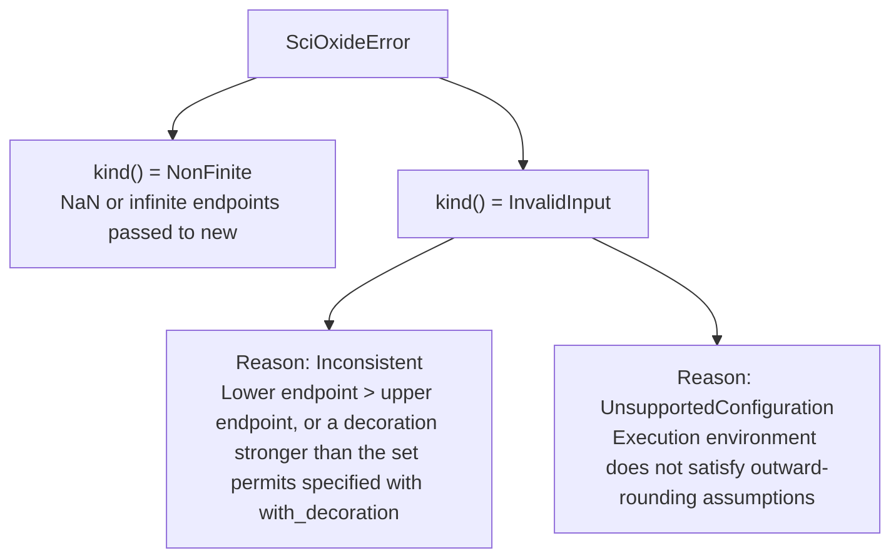

Interval arithmetic encloses images when its execution-environment and input assumptions hold, but the choice of operations affects the width.
Choose operations after examining variable correlations, domain exclusions, and the distinction between set and arithmetic operations.

## Choosing operators: independence and algebraic correlation

When evaluating an expression with interval arithmetic, distinguish operations on independent variables from expressions with repeated occurrences of the same variable.

| Purpose | Operation | True image set | How to avoid overestimation |
|---|---|---|---|
| Product of two independent sets | `mul` | $\{xy \mid x \in X, y \in Y\}$ | Compute an enclosure by outward rounding the minimum and maximum of the four corner products |
| Square of the same variable | `square` | $\{x^2 \mid x \in X\}$ | Square the endpoints of $\lvert X \rvert$; the lower endpoint is 0 if $0 \in X$ |
| Sum of two independent sets | `add` | $\{x+y \mid x \in X, y \in Y\}$ | Round the lower endpoint downward and the upper endpoint upward (at most 1 ulp from the nearest value) |
| Cancellation of the same variable | — | $x - x = 0$ | Interval subtraction `sub` assumes independence and doubles the width; cancel algebraically first |
| Division containing a singularity | `div` | $\{x/y \mid x \in X, y \in Y, y \neq 0\}$ | Exclude zero denominators and compute the convex hull over the defined part (downgrade to `Trv`) |
| Square root on a nonnegative domain | `sqrt` | $\{\sqrt{x} \mid x \in X, x \ge 0\}$ | Exclude the negative part; return the empty set if the entire input is negative |
| Constraint by intersection | `intersection`, `restrict` | $X \cap Y$ | Set intersection introduces no rounding, but the decoration is `Trv` |
| Enclosing convex hull | `hull` | $\operatorname{conv}(X \cup Y)$ | Fill the gap between disconnected sets to obtain a single interval |

For example, the product of two independently varying variables in $X = [-1, 1]$ has range $[-1,1]$.
This describes a set and does not specify how frequently values occur.
The square of the same variable has range $[0,1]$, so `x.square()` gives a narrower enclosure than `x.mul(&x)`.

Similarly, `x.sub(&x)` returns $[-1,1]-[-1,1]=[-2,2]$, overestimating the true image $\{0\}$ by a width of 4.
Algebraically simplifying the expression to reduce variable occurrences avoids this overestimation.
For correlations that reformulation cannot eliminate, use [affine arithmetic](../algorithms/affine-arithmetic/) with shared noise symbols.

## Division by zero, domain exclusions, and decoration downgrading

Another issue in interval arithmetic is handling function singularities (division by zero and square roots of negative numbers).
In point floating-point computation, $1/0$ becomes infinity and the square root of a negative number becomes NaN, making subsequent values meaningless.
`scioxide-validated` returns the convex hull of the defined real-valued image and records the exclusion in [`Decoration`](https://docs.rs/scioxide-validated/0.1.0/scioxide_validated/enum.Decoration.html).

The next cell encloses the quotients of numerator $[1, 2]$ divided by denominator $[0, 4]$, with zero at an endpoint, and denominator $[-1, 4]$, with zero in its interior, and the square roots of $[-1, 4]$ and $[0, 4]$.
For comparison, it also lists minima and maxima of f64 samples on grids dividing each interval into 100 parts, excluding zero denominators and square roots of negative numbers.
The sample ranges are uncertified references; refining the grid makes the quotients near zero larger still.
The sample columns appear in every environment, but enclosure columns are populated only in native environments and display “Not executed” in wasm32.

```rust
//| id: validated-domain-restriction
//| ref: validated-domain-restriction
//| title: "Interval division with a denominator containing zero"
//| run: button
//| crates: [scioxide-validated, scioxide-core]
//| tests:
//|   - case: default
//|     expect:
//|       - {"artifact":"table-0","path":"/rows/0/0","equals":"[1, 2] / [0, 4]"}
//|       - {"artifact":"table-0","path":"/rows/0/1","approx":{"value":0.25,"atol":1e-15}}
//|       - {"artifact":"table-0","path":"/rows/0/2","approx":{"value":50,"atol":1e-12}}
//|       - {"artifact":"table-0","path":"/rows/1/1","approx":{"value":-40,"atol":1e-12}}
//|       - {"artifact":"table-0","path":"/rows/1/2","approx":{"value":40,"atol":1e-12}}
//|       - {"artifact":"table-0","path":"/rows/2/1","approx":{"value":0,"atol":1e-15}}
//|       - {"artifact":"table-0","path":"/rows/2/2","approx":{"value":2,"atol":1e-15}}
//|       - {"artifact":"table-0","path":"/rows/3/1","approx":{"value":0,"atol":1e-15}}
//|       - {"artifact":"table-0","path":"/rows/3/2","approx":{"value":2,"atol":1e-15}}
use scioxide_core::{SciOxideError, SciOxideErrorView, InvalidInputReason};
use scioxide_validated::DecoratedInterval as D;

// 1. Independent reference: f64 samples on a grid dividing the endpoints into 100 parts (uncertified values).
//    Exclude zero denominators and negative square-root inputs, collecting only defined values.
let grid = |lo: f64, hi: f64| -> Vec<f64> {
    (0..=100)
        .map(|k| lo + (hi - lo) * f64::from(k) / 100.0)
        .collect()
};
let quotients = |denominators: &[f64]| -> Vec<f64> {
    grid(1.0, 2.0)
        .iter()
        .flat_map(|&x| {
            denominators
                .iter()
                .filter(|&&y| y != 0.0)
                .map(move |&y| x / y)
        })
        .collect()
};
let roots = |values: &[f64]| -> Vec<f64> {
    values
        .iter()
        .filter(|&&x| x >= 0.0)
        .map(|&x| x.sqrt())
        .collect()
};
let range = |values: Vec<f64>| {
    let lo = values.iter().copied().fold(f64::INFINITY, f64::min);
    let hi = values.iter().copied().fold(f64::NEG_INFINITY, f64::max);
    (lo, hi)
};
let samples = [
    ("[1, 2] / [0, 4]", range(quotients(&grid(0.0, 4.0)))),
    ("[1, 2] / [-1, 4]", range(quotients(&grid(-1.0, 4.0)))),
    ("sqrt([-1, 4])", range(roots(&grid(-1.0, 4.0)))),
    ("sqrt([0, 4])", range(roots(&grid(0.0, 4.0)))),
];
// 2. Outward-rounded enclosure: division returns the convex hull of quotients excluding zero denominators; square root returns the image of the nonnegative part
let calculation = || -> Result<_, SciOxideError> {
    let num = D::new(1.0_f64, 2.0)?;
    let edge = D::new(0.0, 4.0)?;
    let inner = D::new(-1.0, 4.0)?;
    Ok([
        num.div(&edge)?,
        num.div(&inner)?,
        inner.sqrt()?,
        edge.sqrt()?,
    ])
};
let unsupported = |error: &SciOxideError| {
    matches!(
        error.view(),
        SciOxideErrorView::InvalidInput {
            argument,
            reason: InvalidInputReason::UnsupportedConfiguration,
            ..
        } if argument == scioxide_core::argument!("rounding_environment")
    )
};
let enclosures = match calculation() {
    Ok(results) => Some(results),
    Err(error) if unsupported(&error) => None,
    Err(error) => return Err(error.to_string()),
};
use serde_json::json;
let rows: Vec<_> = samples
    .iter()
    .enumerate()
    .map(|(i, &(name, (lo, hi)))| {
        let y = enclosures.as_ref().map(|v| v[i]);
        let bounds = y.and_then(|v| v.set().bounds());
        (
            name,
            lo,
            hi,
            bounds.and_then(|b| b.0),
            bounds.and_then(|b| b.1),
            y.map(|v| format!("{:?}", v.decoration())),
        )
    })
    .collect();
let fmt = json!({"significantDigits":8});
let missing = if enclosures.is_none() {
    "Not executed"
} else {
    "Unbounded"
};
emit_table_with_columns!(
    json!([
        {"key":"0","label":"Expression"},
        {"key":"1","label":"Sample minimum (uncertified)","type":"number","format":fmt},
        {"key":"2","label":"Sample maximum (uncertified)","type":"number","format":fmt},
        {"key":"3","label":"Lower endpoint","type":"number","format":fmt,"nullText":missing},
        {"key":"4","label":"Upper endpoint","type":"number","format":fmt,"nullText":missing},
        {"key":"5","label":"Decoration","nullText":"Not executed"}
    ]),
    rows,
    metadata = json!({"id":"table-0"})
);
emit_outcome!(if enclosures.is_some() {
    Outcome::satisfied("Computed image enclosures")
} else {
    Outcome::unavailable("Proof computation not executed in this environment")
});
```

In a native environment (x86_64), the four expressions in the table return $[0.25, +\infty)$, $(-\infty, +\infty)$, $[0, 2]$, and $[0, 2]$, respectively; only the last, `sqrt([0, 4])`, has decoration `Com`, while the others have `Trv` (a zero lower endpoint is displayed as `-0` under the signed-zero convention).
The sample ranges are $[0.25, 50]$, $[-40, 40]$, $[0, 2]$, and $[0, 2]$, all contained in the enclosures.
The sampled quotient maximum is finite because the grid avoids zero; denominators arbitrarily close to zero give arbitrarily large quotients.

For denominator $[0, 4]$, zero is an endpoint, so the quotient is $[0.25, +\infty)$ for $(0, 4]$.
When a denominator contains $0$ in its interior (for example, $[-1, 4]$), the true quotient set comprises the two disconnected half-infinite intervals $(-\infty, -1] \cup [0.25, +\infty)$.
Since `DecoratedInterval` holds only one interval, it returns their convex hull, all real numbers $(-\infty, +\infty)$.
In both cases, excluding the zero denominator downgrades the decoration to `Trv` (Trivial: asserting only inclusion, not definition or continuity over the entire input).
Use `powi(-1)` when the two reciprocal branches must remain separate.
Negative odd powers return `ElementaryEnclosure` with separate negative and positive branches ([Elementary-function range enclosures](../algorithms/elementary-enclosures/)).

The square-root operation [`sqrt()`](https://docs.rs/scioxide-validated/0.1.0/scioxide_validated/struct.DecoratedInterval.html#method.sqrt) follows the same convention.
The square root of interval $[-1, 4]$ discards the negative part $[-1, 0)$, where no real square root is defined, and returns $[0, 2]$, the image of the nonnegative part $[0, 4]$.
This domain truncation likewise gives decoration `Trv`.

In contrast, the square root on interval $[0, 4]$ is defined and continuous throughout $[0, 4]$, although its derivative diverges at endpoint 0.
Thus, if the input has decoration `Com` (defined and continuous with bounded input and result), the output retains `Com`.
A singularity of differentiability and continuity of the function are different properties.

## Choosing set operations: intersection, restriction, and convex hull

Besides algebraic operations, set operations narrow intervals using external physical constraints or invariants.

1. Intersection (`intersection`, `restrict`): Compute the real set shared by two intervals.
   For example, if rounding or overestimation widens the enclosure of a positive-only variable to $[-10^{-16}, 2.0]$, intersecting it with the positive region $[0, +\infty)$ through `restrict` removes the negative part.
   This set operation introduces no rounding, but conservatively assigns decoration `Trv` because it applies an external constraint.
2. Convex hull (`hull`): Return the smallest closed interval $\operatorname{conv}(X \cup Y) = [\min(a, c), \max(b, d)]$ containing both intervals $X, Y$.
   Use it at a merge point where two conditional branches yield different intervals, to enclose both possibilities.
   It includes any gap between the sets, widening the interval, and gives decoration `Trv`.

Set operations use no outward rounding and also run in wasm32.

## Choosing how to invoke proofs

Proofs for linear systems, roots, and integrals offer one-shot functions with default settings and verifiers with configurable settings, proposals, and workspaces.

| Problem | One-shot function | Verifier or Plan | When a one-shot function is insufficient |
|---|---|---|---|
| Square linear system $Ax = b$ | `solve(a, b)` | `LinearVerifier` | Interval coefficients, sparse matrices, multiple right-hand sides, or verification of your own approximation |
| Real roots in an interval | `roots(f, df, lower, upper)` | `ScalarRootVerifier` | Verification of individual claims (existence, uniqueness, or absence), or specification of subdivision thresholds and node counts |
| Roots of nonlinear systems | Not provided | `SystemRootVerifier` | Always use the verifier |
| Polynomial root counts | `polynomial_roots(coefficients, approximations)` | `PolynomialRootPlan` | Verification of proposed disks and counts, or specification of initial disk radii |
| Definite integrals | `integrate(f, d2f, lower, upper)` | `QuadratureVerifier` | Infinite intervals, singularities, higher-order remainders, specified tolerances, or multicomponent integrals |

One-shot functions return `Ok` only when the proof succeeds, and turn computation limits, capacity limits, and inconclusive decisions into errors such as `ConvergenceFailure`.
Verifiers and Plans return these same results in `Ok` as report statuses (such as `Verified`, `Proved`, or `Inconclusive`), and allow selection of computation limits, byte limits, and execution policies through `ValidatedOptions`, and reuse of workspaces.
Both use outward rounding, so wasm32 returns an error of `InvalidInput` (`UnsupportedConfiguration`).
See the [API guide](oxref:validated-api-index-entry-points) for invocation patterns and interpretation of statuses.

## Diagnosing errors and unsupported environments

Interval construction and operation failures return `SciOxideError`.
Read the classification with `kind()` and the reason with `view()`.



`DecoratedInterval::new(lower, upper)` and `DecoratedInterval::point(value)` accept only finite endpoints; passing NaN or infinity produces an error of `NonFinite` at construction.
Construct unbounded intervals with `DecoratedInterval::from` from `ExtendedInterval::new(Some(a), None)` whose endpoints are `None`, or use `entire()`, instead of `f64::INFINITY`.

`UnsupportedConfiguration` returned by an operation indicates an execution-environment problem, rather than an operation-input problem.
On x86 (SSE2) and x86_64, the MXCSR and x87 control word are read; on AArch64, FPCR is read, to check round-to-nearest, ties-to-even, gradual underflow (Flush-to-Zero and Denormals-are-Zero disabled), and disabled exception traps.
Other architectures, including wasm32, always return this error.
No enclosure is produced when the assumptions cannot be checked.

## Summary and further reading

Use `mul` for products of two independent intervals and `square` for the square of the same variable, and reduce repeated occurrences through reformulation.
Denominators containing zero and negative square-root inputs return the image of the defined part with decoration `Trv`, rather than an error.
`intersection`, `restrict`, and `hull` are set operations without rounding and give decoration `Trv`.
Choose one-shot functions to prove a linear system, root, or integral once with default settings, and verifiers when interval coefficients, proposal verification, or workspace reuse are needed.
Construction failures can be distinguished as `NonFinite` or `InvalidInput` (`Inconsistent`), and environment rejection as `InvalidInput` (`UnsupportedConfiguration`).

- [Mathematics of outward rounding and inclusion](../algorithms/): examine endpoint rounding and decoration propagation rules.
- [Elementary-function range enclosures and branches at poles](../algorithms/elementary-enclosures/): examine how to interpret enclosures with two branches.
- [API guide](../api/): examine one-shot function and verifier contracts, all public items, and interpretation of verification statuses.
