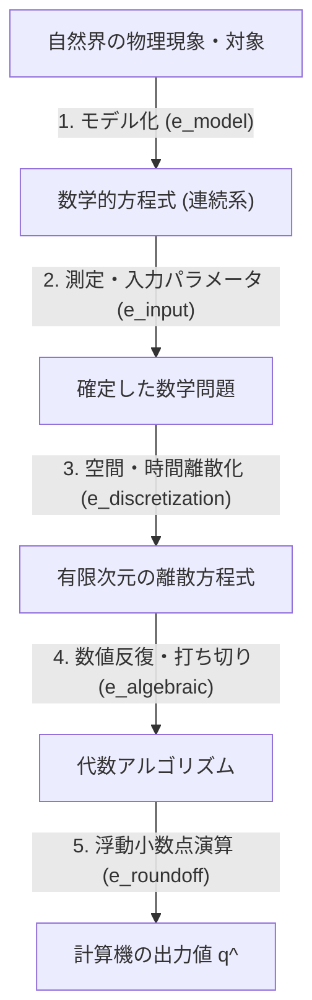

計算がエラーなく終わっても、得られた値が目的に十分な精度とは限らない。
共通概念では誤差の原因と結果の読み方を整理する。
個別の解法を選ぶ前に、入力の不確かさと計算中の誤差を分けて考える。

---

## 誤差の階層構造：数値を支える 5 つの要因

科学技術シミュレーションによって得られた計算値 $\hat{q}$ と、現実世界で生起している真の物理量 $q_{\mathrm{real}}$ との間の総合誤差は、概念的に以下の 5つの寄与へと分解される。

$$
\hat{q} - q_{\mathrm{real}} = e_{\mathrm{input}} + e_{\mathrm{model}} + e_{\mathrm{discretization}} + e_{\mathrm{algebraic}} + e_{\mathrm{roundoff}}.
$$

| 誤差の分類 | 発生機構 | 主な検証手法と低減策 |
|---|---|---|
| **入力誤差 ($e_{\mathrm{input}}$)** | センサ測定の不確かさ、物性定数のばらつき、初期条件の不確定性 | モンテカルロ法、準乱数サンプリング、感度解析 |
| **モデル化誤差 ($e_{\mathrm{model}}$)** | 粘性の無視、線形化近似、乱流の平均化など、物理法則の簡略化 | 実験データとの比較照合、上位理論モデルへの拡張 |
| **離散化誤差 ($e_{\mathrm{discretization}}$)** | 微分を差分で近似、定積分を台形則で近似、空間格子幅 $\Delta x$ や時間刻み $\Delta t$ の有限性 | 格子幅 $\Delta x \to 0$ における漸近収束率（Richardson 補外）の検証 |
| **代数反復誤差 ($e_{\mathrm{algebraic}}$)** | Newton 法や Krylov 部分空間法などの反復計算を有限回で停止することによる残差 | 残差許容誤差 $\tau$ の縮小、反復回数の上限の引き上げ |
| **丸め誤差 ($e_{\mathrm{roundoff}}$)** | 実数を IEEE 754 形式（64 ビット／32 ビット）の有限桁数で表現・演算することによる誤差 | 倍精度（`f64`）の採用、数値的に安定な同値変形式の適用 |

この分解は、各段階の出力差を同じ最終量に換算して表したものである。
各誤差が独立な確率変数であるという仮定ではない。
反復回数を増やしても、入力誤差や離散化誤差が自動的に減るわけではないため、まず支配的な寄与を調べる。

---

## 数値計算における 4 つの典型的な誤解と数学的反例

数値計算の現場において陥りやすい直感的な誤認を、数学的反例とともに整理する。

### 誤解 1：「残差がゼロに近ければ、得られた解は正確である」

**数学的反例**: 悪条件な方程式系や重根を持つ代数方程式では、残差の小ささと解の正確さは乖離する。
例えば、近特異な対称行列

$$
\mathbf{A} =
\begin{bmatrix}
1 & 1 \\
1 & 1 + 10^{-4}
\end{bmatrix},
\qquad
\mathbf{b} =
\begin{bmatrix} 2 \\ 2 + 10^{-4} \end{bmatrix}
$$

を考える。
真の解は $\mathbf{x}^* = (1, 1)^\mathsf{T}$ である。
ここで、右辺にわずか $10^{-7}$ の測定誤差が混入した $\tilde{\mathbf{b}} = (2, 2 + 10^{-4} + 10^{-7})^\mathsf{T}$ を解くと、得られる解は $\tilde{\mathbf{x}} = (0.999, 1.001)^\mathsf{T}$ となり、解の前進誤差は $10^{-3}$ に達する。
しかし、この解を測定された方程式へ代入した残差ノルムは機械精度水準（$\approx 10^{-16}$）に留まる。
残差の評価には、問題の条件数 $\kappa(\mathbf{A})$ を乗じた感度解析を併用しなければならない。

### 誤解 2：「高次のアルゴリズムを用いれば、常に高精度な結果が得られる」

**数学的反例**: 高次の選点多項式補間や高次ルンゲクッタ法は、対象関数が全域で必要な次数まで滑らかであることなどを精度評価の前提とする。
滑らかさだけで高次補間の収束が決まるわけではない。
Runge の関数 $f(x) = 1 / (1 + 25x^2)$ を等間隔節点で高次多項式補間すると、次数を高めるほど区間端部で振動の振幅が指数関数的に発散する（ルンゲ現象）。
不連続点や急峻な勾配を持つ問題では、高次解法よりも低次で形状保存性のあるスプラインや全変動抑制（TVD）解法の方が優れた近似を与える。

### 誤解 3：「Result が Ok を返した以上、アルゴリズムは収束した」

**数学的反例**: 最適化ソルバーや非線形方程式求根器は、設定された最大反復回数に到達した場合や、ステップ幅が機械精度限界まで縮小して改善が停滞した場合でも、その API が保持する受理済みの近似解を保持して `Ok` の構造体として返却する。
このとき、構造体内部の終了理由は `IterationLimit` や `Stagnation` を指している。
呼び出し側は単に `is_ok()` を確認するだけでなく、`result.termination()` を検査して許容誤差を真に達成したかを確認しなければならない。

### 誤解 4：「並列計算において計算結果の末尾桁が変動するのはバグである」

**数学的反例**: 有限桁の浮動小数点加算は、結合法則を満たさない（すなわち $(a + b) + c \neq a + (b + c)$ である）。
一般の並列処理系ではスレッドの完了順序に依存して加算順序が変わり末尾ビットが変動することがあるが、SciOxide のエグゼキューターは完了順ではなく<strong>Plan で定めた分割の順序で決定論的に結合（`ExecutionPlan::reduce`）</strong>するため、同じ入力・分割・処理・演算環境では完了順に依存しない。
ワーカー数が変わると加算順序が変わりうる。
その場合でも、`scioxide-core` の厳密累積（`RangeAccumulator`）は和を 1 回だけ丸めるので、項の順序とワーカー数によらず同じビット列になる。

---

## 共通概念セクションの論理的連関

本セクションでは、個別の数値クレートへ進む前に把握しておくべき共通仕様と数理的基礎を、以下の順序（サイドバーの順序と一致）で体系的に解説する。

1. [**浮動小数点数と条件数**](floating-point-and-conditioning/): IEEE 754 規格の内部構造、機械イプシロンと単位丸め誤差、桁落ちの機構、特殊値・空の恒等元、および Wilkinson の後退誤差解析を詳述する。
2. [**スカラー型とトレイトの仕様**](scalars-and-traits/): `RealScalar`、`NumericScalar`、`AffineValue` による型の抽象化、`f32` / `f64` の選択基準、および問題トレイトによるモデルと解法の分離を整理する。
3. [**許容誤差と残差の尺度化理論**](tolerances-and-residuals/): 絶対許容誤差 $\tau_{\mathrm{abs}}$ と相対許容誤差 $\tau_{\mathrm{rel}}$ の役割分担、交点スケール、無次元化、ノルム選定、および停止条件の多面的設計を扱う。
4. [**型安全エラー仕様と部分結果の救出**](errors-and-partial-results/): 内部構造を公開しない型 `SciOxideError` の 20 種類の分類、求解プロセスのトランザクション性、反復上限到達時における部分結果の救出、および `PartialResultTrust` を論じる。
5. [**作業領域・実行方針・再現性**](workspaces-and-reproducibility/): メモリ確保の局所化（実行形式と容量手順）、`ExecutionPolicy`、および浮動小数点の非結合性と再現性の 3 段階を解説する。
6. [**クレート間の接続と合成**](composition/): 複数クレートを連結した多段パイプラインにおいて、前段の数値誤差が一次感度解析を介して後段へどのように伝播するか、誤差の下限と許容誤差配分の原則を追跡する。

---

## 共通概念（concepts）と基盤クレート（scioxide-core）の役割分担

本書では、概念の重複と論点の分散を避けるため、数学的・計算機数学的な一般理論を本「共通概念」で扱い、SciOxide 固有の具体的な API 仕様や実装アルゴリズムを [`scioxide-core`](../scioxide-core/) で解説するという明確な分担を行っている。

| 主題 | 共通概念（理論・計算機数学の一般原則） | scioxide-core（API 仕様と実装アルゴリズム） |
|---|---|---|
| **浮動小数点** | IEEE 754 内部構造、$\varepsilon_{\mathrm{mach}}$ と $u$、桁落ち、条件数、後退誤差、特殊値・空の恒等元 | 初等関数振り分け（4 ULP）、安定変換（16 ULP）、`FloatDecomposition`、引数還元の仕様 |
| **スカラー型** | 体と順序構造（`PartialOrd`）、`f32` と `f64` の選択基準、問題トレイトによる分離 | `RealScalar`、`NumericScalar`、`AffineValue` の仕様、UFCS メソッド、複素除算 |
| **許容誤差** | 絶対許容誤差と相対許容誤差の役割、交点スケール、ノルム選定（RMS/最大ノルム）、停止判定 | `Tolerance` 系の型の仕様、`is_satisfied`、残差の尺度化 |
| **エラーと結果** | `Err` と未収束などの結果を含む `Ok` の設計思想、トランザクションの 6 相、部分結果の信頼区分（`PartialResultTrust`） | `SciOxideErrorView`、識別子、求解の回数集計（`SolveScope`、`SolveCounts`）、`AttemptRecord` |
| **作業領域と再現性** | 実行形式（所有値を返す API・出力先を指定する API・プラン）、容量手順、浮動小数点の非結合性と再現性の 3 段階 | `ExecutionPlan` の解決式、分割と線形併合、`Capacity`、`ThreadExecutor` |
| **合成** | 多段パイプラインの感度解析、誤差の下限、許容誤差の最適配分 | 入れ子の計算回数の上限の配分（`SolveScope`）、多段解法の統合仕様 |

## まとめと次に読むページ

誤差を減らすには、まず入力・モデル・離散化・反復・丸めのどこが効いているかを調べる。
残差や終了理由は、その判断に使う情報の一部である。
次の[浮動小数点数と条件数](floating-point-and-conditioning/)から順に読み、具体的な操作方法は各クレートの章で確認する。
