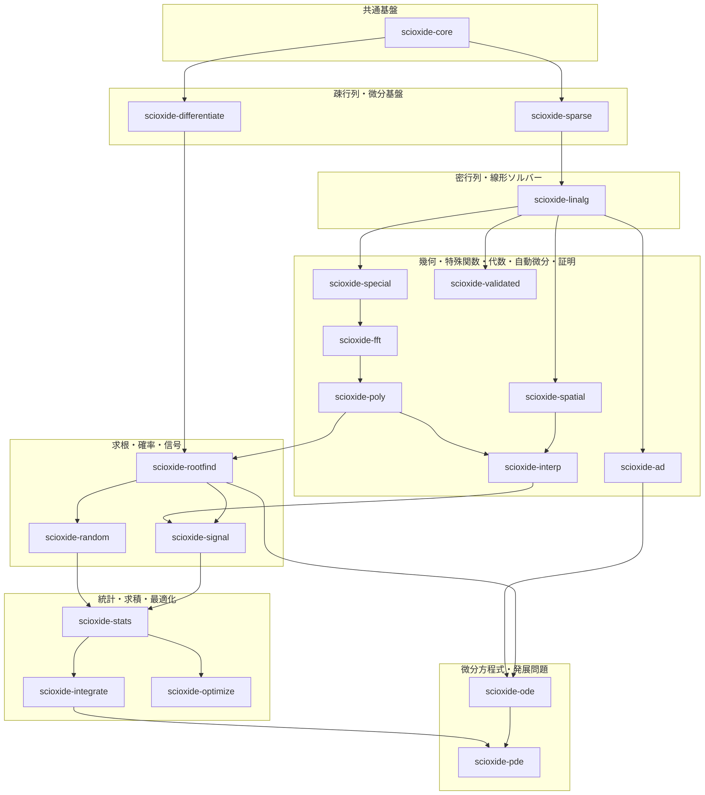

SciOxide は数値計算の分野ごとに分かれた19のクレートからなる。
求めたい量とデータの形から必要なクレートを選べる。

すべてのクレートは、共通基盤である `scioxide-core` の仕様（`RealScalar`, `Tolerance`, `ExecutionPolicy`, `SciOxideError`）に準拠し、公開クレートの通常依存とビルド依存は SciOxide のクレートに限られる。
分野ごとの役割を確認しながら組み合わせて利用できる。

---

## 1. クレートの依存関係階層

SciOxide のクレート群は、Cargo の通常依存関係に基づく明確なトポロジカル順序を形成している。
矢印は依存先から利用側へ向かう。
図を読みやすくするため、別の経路でたどれる矢印は省略している。
直接の通常依存は次の表にすべて示す。
図の枠は読みやすくするための分野別のまとまりである。
小さい画面では、次の表でクレートごとの依存先を確認できる。

---

## 2. 全 19 クレート一覧表

| クレート名 | 扱う数学的対象 | 主なアルゴリズムと機能仕様 | 依存する主要クレート |
|---|---|---|---|
| [**`scioxide-core`**](../scioxide-core/) | 共通数値計算仕様 | `RealScalar`、`Tolerance`、範囲安全算術・厳密累積（`RangeAccumulator`）、実行方針、求解の回数集計 | （なし） |
| [**`scioxide-sparse`**](../scioxide-sparse/) | 疎行列データ構造・分解 | CSR/CSC/COO 表現、並べ替え（AMD/RCM）、不完全分解・直接法（Krylov 法は linalg が担当） | `core` |
| [**`scioxide-linalg`**](../scioxide-linalg/) | 密行列・反復ソルバー | LU, Cholesky, QR, SVD, 固有値分解, Krylov 部分空間法（CG, GMRES 等）, 後退誤差診断 | `core`, `sparse` |
| [**`scioxide-spatial`**](../scioxide-spatial/) | 空間幾何・計算幾何 | k-d 木最近傍探索, Delaunay 三角分割, Voronoi 図, 凸包, SO(3) 空間回転 | `core`, `linalg`, `sparse` |
| [**`scioxide-differentiate`**](../scioxide-differentiate/algorithms/) | 数値微分 | 固定刻みの前進・中心差分, Ridders・Richardson の適応外挿と推定誤差, 任意の節点の差分, 彩色による疎ヤコビ行列, 複素ステップ法, 勾配・ヤコビ行列・ヘッセ行列・方向微分 | `core` |
| [**`scioxide-ad`**](../scioxide-ad/) | 自動微分 | 前進モード（二重数 `Dual`・`MultiDual`）, 逆モード（呼び出し側が所有するテープ `Tape`）, Taylor ジェット `Jet`, 多数の項目の一括評価 `BatchPlan`（打ち切り誤差なし） | `core`, `linalg`, `sparse` |
| [**`scioxide-special`**](../scioxide-special/) | 特殊関数 | Bessel, Airy, 誤差関数, ガンマ・ベータ関数, 楕円積分, 超幾何関数（参照値との照合で検定した精度、詳細結果に誤差推定） | `core`, `linalg` |
| [**`scioxide-fft`**](../scioxide-fft/) | 高速フーリエ変換 | 1 次元・N 次元の複素 FFT（2 次元は N 次元 API で扱う）, 実数 FFT, 離散コサイン変換 (DCT), 離散サイン変換 (DST), chirp-z 変換, 非一様 FFT (NUFFT), Hankel 変換・FFTLog | `core`, `linalg`, `special` |
| [**`scioxide-poly`**](../scioxide-poly/) | 多項式・直交基底 | 厳密・近似多項式の算術, 直交多項式（Chebyshev/Legendre/Hermite/Laguerre）, 根の条件数・包含半径の診断, 終結式・判別式（全根の計算は rootfind） | `core`, `fft`, `linalg`, `special` |
| [**`scioxide-interp`**](../scioxide-interp/) | 数値補間 | 3 次スプライン, PCHIP, Akima, B-スプライン, 2D 双三次補間, 散乱データ RBF 補間 | `core`, `linalg`, `poly`, `sparse`, `spatial` |
| [**`scioxide-rootfind`**](../scioxide-rootfind/) | 非線形方程式の求根 | 区間縮小法（Brent, Toms748）, Newton–Raphson, 割線法, 非線形連立系（Broyden, Newton–Krylov） | `core`, `differentiate`, `linalg`, `poly`, `sparse`, `special` |
| [**`scioxide-signal`**](../scioxide-signal/) | デジタル信号処理 | IIR/FIR フィルタ設計（Butterworth, Chebyshev, Bessel）, 窓関数, 畳み込み・相互相関, スペクトル解析 | `core`, `fft`, `interp`, `linalg`, `rootfind`, `sparse`, `special` |
| [**`scioxide-random`**](../scioxide-random/) | 乱数・サンプリング | PRNG（PCG, Philox）, 連続・離散確率分布サンプリング, 準乱数（Sobol, Halton 列） | `core`, `differentiate`, `linalg`, `rootfind`, `sparse`, `special` |
| [**`scioxide-stats`**](../scioxide-stats/) | 記述統計・推定・検定 | オンラインモーメント（逐次更新）, 共分散行列, カーネル密度推定 (KDE), 仮説検定, 等調回帰 | `core`, `linalg`, `random`, `rootfind`, `signal`, `special` |
| [**`scioxide-integrate`**](../scioxide-integrate/) | 数値求積法 | Gauss–Legendre/Kronrod 求積, 二重指数関数型 (DE) 公式, 適応求積 (QAG), モンテカルロ求積 | `core`, `linalg`, `poly`, `random`, `sparse`, `spatial`, `stats` |
| [**`scioxide-optimize`**](../scioxide-optimize/) | 数理最適化 | 準 Newton（BFGS/L-BFGS）, Nelder–Mead, 制約付き最適化（SQP, 内点法, 拡張 Lagrange 法）, 線形計画（単体法）・混合整数計画, 大域探索 | `core`, `differentiate`, `interp`, `linalg`, `random`, `sparse`, `spatial`, `special`, `stats` |
| [**`scioxide-ode`**](../scioxide-ode/) | 常微分方程式系 | 初期値問題（明示的 RK DOP853, 陰的 Radau IIA, BDF）, 適応刻み, イベント検出, DAE/DDE/SDE/BVP | `ad`, `core`, `differentiate`, `linalg`, `rootfind`, `sparse` |
| [**`scioxide-pde`**](../scioxide-pde/) | 偏微分方程式 | 1 次元・多次元差分法 (FDM), 有限体積法 (FVM), 有限要素法 (FEM), 保存則, 線の方法 (MOL), 弾性・非圧縮流, 適応格子 (AMR) | `ad`, `core`, `differentiate`, `integrate`, `linalg`, `ode`, `poly`, `rootfind`, `sparse`, `spatial` |
| [**`scioxide-validated`**](../scioxide-validated/) | 精度保証付き区間演算 | 有向丸め区間演算, 解の包含定理, 区間 Newton 法による存在・一意性証明（x86/x86_64/AArch64） | `core`, `linalg`, `sparse` |

---

## 3. 「やりたいこと」からの逆引きインデックス

### 連立方程式を解きたい
- 小〜中規模の密な連立一次方程式 $\to$ [`scioxide-linalg`](../scioxide-linalg/)
- 大規模な疎行列の構造保持・並べ替え・直接分解 $\to$ [`scioxide-sparse`](../scioxide-sparse/)
- 疎行列や行列自由（Matrix-Free）な反復解法（CG, GMRES 等） $\to$ [`scioxide-linalg`](../scioxide-linalg/)
- 非線形方程式系 $\mathbf{F}(\mathbf{x}) = \mathbf{0}$ の零点探索 $\to$ [`scioxide-rootfind`](../scioxide-rootfind/)

### 導関数を求めたい・関数を近似したい
- ブラックボックス関数や離散点列の数値微分・勾配 $\to$ [`scioxide-differentiate`](../scioxide-differentiate/algorithms/)
- Rust で書かれた関数の厳密な勾配・ヤコビ行列（打ち切り誤差なし） $\to$ [`scioxide-ad`](../scioxide-ad/)
- 離散データ点を厳密に結ぶ滑らかな補間曲線 $\to$ [`scioxide-interp`](../scioxide-interp/)
- 直交多項式展開による関数近似 $\to$ [`scioxide-poly`](../scioxide-poly/)
- 物理・工学の特殊関数値 $\to$ [`scioxide-special`](../scioxide-special/)

### 時間や空間の発展現象をシミュレーションしたい
- 常微分方程式（ODE）、微分代数方程式（DAE）、遅延系（DDE）の時間発展 $\to$ [`scioxide-ode`](../scioxide-ode/)
- 熱伝導、波動、流体、弾性などの偏微分方程式（1次元・多次元 PDE） $\to$ [`scioxide-pde`](../scioxide-pde/)
- 空間点集合の幾何探索（最近傍、Delaunay 三角分割、Voronoi 図） $\to$ [`scioxide-spatial`](../scioxide-spatial/)

### データの周波数解析や統計・サンプリングを行いたい
- フーリエ変換・周波数スペクトル・DCT $\to$ [`scioxide-fft`](../scioxide-fft/)
- フィルタ設計（ローパス/ハイパス/バンドパス）、畳み込み・相関 $\to$ [`scioxide-signal`](../scioxide-signal/)
- 擬似乱数・各種確率分布サンプリング・準乱数列 $\to$ [`scioxide-random`](../scioxide-random/)
- 要約統計量、オンライン共分散、カーネル密度推定、仮説検定 $\to$ [`scioxide-stats`](../scioxide-stats/)

### 最小値・最適解を求めたい・厳密に解を含む区間を求めたい
- 目的関数の最小化、制約付き最適化、非線形最小二乗 $\to$ [`scioxide-optimize`](../scioxide-optimize/)
- 定積分や面積、期待値の数値求積 $\to$ [`scioxide-integrate`](../scioxide-integrate/)
- 浮動小数点丸め誤差を超えて真の解の存在と一意性を包含条件を満たす範囲で証明したい $\to$ [`scioxide-validated`](../scioxide-validated/)

---

## 4. 各クレート章の構成と読み方

各章は概要、選び方、アルゴリズム、例題、API ガイドからなる。

1. **章の概要 (`index.mdx`)**: その分野が扱う問題設定、最初の計算例、結果の読み方、および章のロードマップ。
2. **選び方 (`choosing.mdx`)**: 手法・オプションの選択判断フローと詳細な比較表。
3. **アルゴリズム (`algorithms/`)**: 手法の導出、適用条件、計算量、誤差と安定性。
4. **実践例題 (`examples/`)**: 物理・化学・工学・金融・数学の実課題を解く動くインタラクティブコードセル。
5. **API ガイド (`api/` または `api.mdx`)**: 公開 API の完全解説、仕様、最小動作コード、および用途別対応表。

## まとめと次に読むページ

クレートは、データの形と解きたい問題から選ぶ。
依存関係の図は実装上のつながりを示し、用途別の表は利用者が選ぶ機能を示す。
候補を絞ったら、各章の「選び方」で適用条件を比較し、「API ガイド」で型と戻り値を確認する。
