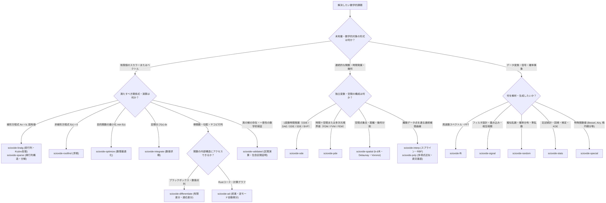

まず、「何を求めたいか」を方程式やデータの形で整理する。
線形方程式、微分方程式、統計推定などの区別ができれば、担当するクレートを絞り込める。

---

## 課題から導くクレート選定フロー

次の図は、課題を大きく分類して担当クレートを探すための API である。
図が読みにくい場合は、[クレート一覧の用途別の表](../../crates/)からも選べる。

---

## 混同しやすい数値計算手法の対比

似た問題を扱う手法でも、必要な入力と得られる結果は異なる。
次の比較で目的に合うものを選ぶ。

### 1. 数値微分（`scioxide-differentiate`）と自動微分（`scioxide-ad`）

| 項目 | 数値微分 (`scioxide-differentiate`) | 自動微分 (`scioxide-ad`) |
|---|---|---|
| **対象** | ブラックボックス関数、外部ライブラリ、離散呼び出し | 数値型 `R: Real` について汎用に書いた Rust の関数 |
| **原理** | 有限差分ステンシル（前進差分・中心差分。境界では内向きの片側差分）、Ridders 型の適応外挿、複素ステップ | 算術演算ごとの連鎖律（前進モードの `Dual`・`MultiDual`、逆モードはテープ `Tape` に記録する `Var`） |
| **誤差要因** | 実数の差分では打ち切り誤差 $\mathcal{O}(h^p)$ と丸め誤差の増幅が競合する。複素ステップは差の桁落ちを避けるが、正則な複素拡張を必要とする | 差分刻みによる打ち切り誤差はない。丸め誤差と、微分するモデル自体の近似誤差は残る |
| **計算コスト** | 中心差分の節点は $2n$ 個。基準点の評価を含むSciOxideの経路では $2n+1$ 回 | リバースモードなら関数評価数回分の定数倍で全勾配を算出 |

### 2. 一般の数値解法（`scioxide-rootfind` 等）と精度保証計算（`scioxide-validated`）

- **一般の数値解法**: 反復計算により、指定した残差許容誤差やステップ幅許容誤差を満たす近似解を算出する。
  悪条件系や特異点近傍では、丸め誤差の影響で真の解から乖離した偽の収束を起こす可能性がある。
- **精度保証計算 (`scioxide-validated`)**: 有向丸め区間演算と Krawczyk 作用素・区間 Newton 法を用い、包含条件が成立した場合に、指定した区間での解の存在や一意性を証明する。
  条件が成立せず、結論を出せない場合もある。
  証明計算はハードウェアの丸め制御検査を要するため、ネイティブ環境（x86/x86_64/AArch64）で実行される。

### 3. 補間（`scioxide-interp`, `scioxide-poly`）と平滑化・回帰（`scioxide-stats`, `scioxide-optimize`）

- 補間は、与えられた点 $(x_i,y_i)$ で $f(x_i)=y_i$ を満たす曲線を構成する。
  計算機上では丸め誤差を伴い、観測ノイズもそのまま通す。
  Runge 現象はノイズがなくても等間隔点での高次多項式補間に生じるため、ノイズの追従とは区別する。
- **平滑化・回帰**: データ点すべてを通過することは要求せず、残差平方和と曲線の滑らかさのバランス（平滑化スプライン）やモデルパラメータの適合度（非線形最小二乗、等調回帰）を最適化する。
  観測誤差の低減や物理法則の係数同定に適する。

### 4. 求根（`scioxide-rootfind`）と最適化（`scioxide-optimize`）

- **求根**: 等式 $f(x) = 0$ を満たす零点を探索する。
  符号変化を捉える区間縮小法や、ヤコビ行列を用いた Newton 法など、等式制約を直接解消する解法群を備える。
- **最適化**: スカラー目的関数 $f(x)$ の最小点（または最大点）を探索する。
  求根問題を安易に $\min \|f(x)\|^2$ の最適化問題へ変換して解くアプローチは、目的関数が平坦な領域で勾配が消失し、根が存在しない局所的極小点にトラップされる危険があるため、零点探索には求根ソルバーを優先する。

### 5. モンテカルロ法・準モンテカルロ法・疎格子の相違（`scioxide-random`, `scioxide-integrate`）

- **モンテカルロ法（MC）**: 独立な擬似乱数を用いた平均値推定。
  収束率は次元 $d$ に依存せず $\mathcal{O}(N^{-1/2})$ であり、有限分散などの仮定が必要になる。
  次元によらず同じ指数を持つが、誤差の係数は被積分関数に依存する。
- **準モンテカルロ法（QMC）**: Sobol 列や Halton 列などの低食い違い点列（Quasi-Random）を用いた決定論的求積。
  有界変動を持つ関数に対して $\mathcal{O}((\log N)^d / N)$ の漸近収束率を達成し、実効次元や滑らかさが合えばMCより小さい誤差を得られる。
  次元だけで優劣は決まらない。
- **疎格子（Sparse Grid）**: Smolyak アルゴリズムに基づく 1 次元直交求積則のテンソル積間引き。
  混合微分の滑らかさなどを利用して、完全なテンソル積より少ない点で計算する。
  収束率は求積則と関数の正則性に依存し、不連続な関数では利点が小さくなる。

---

## 複数クレートを結合する数理パイプライン設計

複数のクレートを使うときは、前段の出力が次の計算の入力条件を満たすかを確認する。

1. **物性値逆算パイプライン**: `scioxide-interp`（実験測定値から高次スプライン補間曲線を生成） $\to$ `scioxide-integrate`（エンタルピー積分を評価） $\to$ `scioxide-rootfind`（指定熱量に達する平衡温度を逆算）。
2. **非線形振動・スペクトル解析パイプライン**: `scioxide-ode`（DOP853 ソルバーで Duffing 振動方程式を積分） $\to$ `scioxide-signal`（等間隔に取り出した信号へ窓関数を適用） $\to$ `scioxide-fft`（周波数スペクトルを計算）。
3. **パラメータ同定・逆問題最適化パイプライン**: `scioxide-ad` または `scioxide-differentiate`（モデル残差のヤコビ行列を算出） $\to$ `scioxide-optimize`（Levenberg–Marquardt 法により実験データに適合する物理パラメータを決定）。
4. **不確実性伝播（UQ）パイプライン**: `scioxide-random`（Sobol 準乱数を用いて初期条件と物性値の標本を生成） $\to$ `scioxide-ode`（アンサンブル軌道を反復求解） $\to$ `scioxide-stats`（終端状態のカーネル密度推定と信頼区間を算出）。
   *注: アンサンブル軌道の並列計算には並列エグゼキューター（`ThreadExecutor`）が必要であり、ブラウザ Wasm 上では逐次計算として実行される。*

---

## 選んだ後に確認する条件

同じクレートに複数の解法がある場合は、次の条件で候補を絞る。
型や関数の名前だけで決めず、問題の性質と API の前提を対応させる。

| 確認すること | 選択への影響 |
|---|---|
| 入力の定義域と滑らかさ | 微分や高次近似を利用できるか |
| 行列の疎性・対称性・正定値性 | 格納方法や分解・反復法を選べるか |
| 解析的な導関数の有無 | 導関数を渡すか、数値微分を使うか |
| 誤差の推定か、証明が必要か | 通常の近似解法か、精度保証計算か |
| 同じ構造で繰り返すか | Plan・分解因子・作業領域を再利用できるか |

条件を満たさない場合の戻り値と、未収束の結果の扱いも確認する。

## まとめと次のステップ

求める量と方程式の形からクレートを選び、適用条件と戻り値の仕様を確認する。
似た手法でも、近似値を求めるのか、存在を証明するのかで役割が異なる。
複数クレートをつなぐ場合は、途中の値の単位・定義域・誤差も引き継ぐ。

- 各クレートの詳細な機能と依存関係: [クレート一覧](../../crates/)
- 浮動小数点演算と条件数の数理: [共通概念：浮動小数点と条件数](../../concepts/floating-point-and-conditioning/)
- 各クレートの個別解説: サイドバーの各大項目を参照
