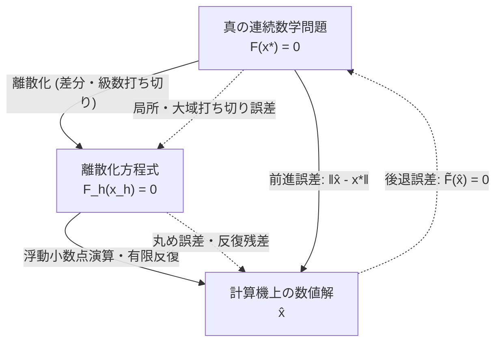

本書で使う記号と用語をまとめる。
数式の厳密解と計算機で求めた近似解、数学的な収束とソルバーの終了条件を区別する。

個々の API の定義域や終了条件は各クレートの API ガイドで確認する。

## 基本的な数学記号と表記規約

本書における数式表記は、特段の断りがない限り以下の標準規約に従う。

| 記号 | 意味と数学的用法 | 備考・計算機上の型表現 |
|---|---|---|
| $\mathbf{x}, \mathbf{y}, \mathbf{z}$ | 列ベクトル（$\mathbb{R}^n$ または $\mathbb{C}^n$ の元） | `scioxide_linalg::Vector<S>` |
| $\hat{\mathbf{x}}$ | 有限精度計算や反復法によって得られた数値近似解 | 離散化・丸め誤差を含む解ベクトル |
| $\mathbf{x}^*$ | 連続数学問題における真の厳密解 | 理論的な極限解 |
| $\mathbf{A}, \mathbf{B}$ | 行列（線形作用素）。成分表示は $A_{ij}$ または $(\mathbf{A})_{ij}$ | `Matrix<S>`, `CsrMatrix<S>` |
| $\mathbf{A}^\mathsf{T}$ | 実行列の転置行列 | 転置作用素 |
| $\mathbf{A}^\mathsf{H}$ | 複素行列のエルミート共役（随伴）行列：$(\mathbf{A}^\mathsf{H})_{ij} = \overline{A_{ji}}$ | `AdjointOperator` |
| $\Vert \mathbf{x}\Vert _2$ | ベクトルのユークリッドノルム（2ノルム）：$\Vert \mathbf{x}\Vert _2 = \sqrt{\sum_{i=1}^n \lvert x_i\rvert^2}$。複素成分にも同じ定義を使う | `VectorView::norm2` |
| $\Vert \mathbf{x}\Vert _\infty$ | 最大値ノルム（無限大ノルム）：$\Vert \mathbf{x}\Vert _\infty = \max_{i} \lvert x_i \rvert$ | 残差レポートでは `NormSelection::Infinity` |
| $\Vert \mathbf{A}\Vert _2$ | 行列の誘導2ノルム（最大特異値 $\sigma_{\max}(\mathbf{A})$） | `SvdValues::singular_values()` |
| $\mathbf{J}$ | 多変数写像 $\mathbf{f}: \mathbb{R}^n \to \mathbb{R}^m$ のヤコビ行列：$J_{ij} = \frac{\partial f_i}{\partial x_j}$ | `scioxide_ad::jacobian` |
| $\mathbf{H}$ | スカラー関数 $f: \mathbb{R}^n \to \mathbb{R}$ のヘッセ行列：$H_{ij} = \frac{\partial^2 f}{\partial x_i \partial x_j}$ | `scioxide_ad::hessian` |
| $\nabla f$ | スカラー関数の勾配ベクトル：$\nabla f = \left(\frac{\partial f}{\partial x_1}, \dots, \frac{\partial f}{\partial x_n}\right)^\mathsf{T}$ | `scioxide_ad::grad` |
| $\epsilon_{\mathrm{mach}}$ | 浮動小数点数の機械イプシロン（`f64::EPSILON` $\approx 2.22 \times 10^{-16}$） | 1 と、その次に大きい表現可能な数との差。最近接丸めの単位丸め誤差は $u=\epsilon_{\mathrm{mach}}/2$ |
| $\kappa(\mathbf{A})$ | 行列 $\mathbf{A}$ の条件数：$\kappa(\mathbf{A}) = \Vert \mathbf{A}\Vert  \Vert \mathbf{A}^{-1}\Vert $ | 入力摂動に対する解の最大増幅率 |
| $\mathcal{O}(h^p)$ | ランダウの記号。刻み幅 $h \to 0$ において誤差が定数 $C h^p$ 以下で減少すること | 収束次数 $p$ |

## 誤差の分類と数値解析の重要概念

誤差を減らす方法は、その原因によって異なる。
入力、離散化、反復、丸めの寄与を分けて調べる。

| 用語 | 英語 | 定義と数学的意味 |
|---|---|---|
| **前進誤差** | Forward Error | 計算された数値解 $\hat{\mathbf{x}}$ と真の数学的厳密解 $\mathbf{x}^*$ との差：$\Delta \mathbf{x} = \hat{\mathbf{x}} - \mathbf{x}^*$。多くの場合、真の解は未知であるため直接の測定は困難である。 |
| **残差** | Residual | 数値解を方程式へ代入したときの不一致量：連立一次系なら $\mathbf{r} = \mathbf{b} - \mathbf{A}\hat{\mathbf{x}}$、非線形系なら $\mathbf{r} = \mathbf{f}(\hat{\mathbf{x}})$。計算機上で直接評価可能な指標である。 |
| **後退誤差** | Backward Error | 計算された解 $\hat{\mathbf{x}}$ を「厳密解」として持つような、入力問題の最小摂動量 $\Delta \mathbf{A}, \Delta \mathbf{b}$。Wilkinson の後退誤差解析の基礎概念である。 |
| **打ち切り誤差** | Truncation Error | Taylor 級数の有限項打ち切りや、微分方程式の時間・空間離散化刻み幅（$\Delta t, \Delta x$）の有限性に起因する数学的近似誤差。 |
| **丸め誤差** | Round-off Error | 実数を固定ビット長（IEEE 754 倍精度など）で表現・演算する際に不可避的に生じる丸め、情報落ち、桁落ち。 |
| **問題の条件数** | Condition Number | 入力データの微小な相対変化が、真の解にどれだけ増幅されて伝播するかを表す問題固有の幾何学的性質。アルゴリズムの良し悪しとは独立である。 |
| **アルゴリズムの安定性** | Numerical Stability | 計算途中の誤差が結果に及ぼす影響についての性質。後退安定性では、計算結果を小さい入力摂動で説明できることを求める |
| **剛性** | Stiffness | 常微分方程式・偏微分方程式系において、陽解法の安定性の制約が、精度のために必要な刻み幅より厳しくなる性質。陰解法など、安定領域の広い解法を検討する |

## ソルバーの実行と終了診断規格

SciOxide の反復ソルバーは、解の候補となる数値に加えて、計算がどの理由で停止したかを示す終了理由（分野ごとの終了列挙型、例えば `RootTermination` や `LinearSolveTermination`）と、残差・反復回数などの診断情報を返す。

外側の制御ループや上位アプリケーションは、戻り値が `Ok` であることのみをもって正常収束とみなしてはならず、終了理由が目標とする許容基準を満たしているかを検証しなければならない。

- 残差による受理では、ソルバーが指定する尺度と許容幅を比較する。
  `Converged` という名前だけから判定式を推測せず、[線形解法](../scioxide-linalg/)や[求根法](../scioxide-rootfind/)の仕様を確認する。
- 区間幅による受理（`RootTermination::BracketTolerance`）は、保持した区間が位置の許容幅まで狭まったことを示す。
  符号変化から根の存在を導くには関数の連続性が必要であり、不連続関数の符号変化だけでは根を保証しない。
- 反復回数の上限による停止（`IterationLimit`）では、得られた部分結果と未達の条件を確認する。
- 停滞や小さなステップによる停止は、目標の残差を満たしたことを意味しない。
  例えば最適化の `StepSmall` は[最適化の終了条件](../scioxide-optimize/)に従って解釈する。
- 数値的な破綻は、更新に必要な演算を継続できない状態を表す。
  `Err` として返る失敗とレポートに残る終了理由の区別は、[エラーと部分結果](../concepts/errors-and-partial-results/)で説明する。

## ソフトウェアと数値計算の用語

英語由来の用語は、定着したカタカナ表記を使う。
カタカナ表記が定着していない用語や API の型名は英語で書き、初出で意味を説明する。

| 表記 | 意味 |
|---|---|
| シード | 乱数生成器の初期状態を決める値 |
| ネイティブ出力ワード／一様乱数ワード | 生成器本来の整数出力／全ビットが一様な整数乱数。両者の値域は異なることがある |
| コンテキスト | 実行機能や計算回数の管理情報を受け渡すオブジェクト |
| ワーカー／エグゼキューター | 分割された処理の実行単位／その実行を管理するオブジェクト |
| プロバイダー | BLAS などの演算や外部機能を提供する実装 |
| コンストラクター／アダプター | 値を生成する関数／インターフェースを接続する型 |
| アロケーター／バッファー | メモリを割り当てる仕組み／データを一時的に保持する領域 |
| ストライド／ステップ幅 | 配列要素間のメモリ上の間隔／反復で進む距離や更新量の尺度 |
| ライフタイム／ライフサイクル | Rust の参照が有効な期間／オブジェクトの生成から再利用・終了までの流れ |
| Plan | 前計算した係数や実行手順を保持し、繰り返し利用するオブジェクト |
| 手法オブジェクト | 手法の設定を保持し、メソッドで計算を実行する値 |
| ワンショット関数 | 準備と計算を一度の呼び出しで行う関数 |
| 出力への反映 | 計算結果を返り値や呼び出し側の出力領域から利用できる状態にすること |
| primal 値 | 自動微分で、導関数と区別した関数そのものの値。複素関数の主値とは異なる |
| decoration | 区間演算の結果に付随する、定義域や連続性などの情報 |
| luxury level | RANLUX で出力を間引く程度を指定する設定 |
| minimum image | 周期境界において距離が最小となる周期コピーを選ぶ規則 |
| 証明用データ／包含が保証された区間 | 数学的な主張を再検証するためのデータ／真値を含むことが保証された区間 |

## 関連リファレンス

- [**全 API 総合索引 & 逆引き表**](master-api-index/): 全 19 クレートの公開 API 一覧と、それらが使用されている具体例・解説節への相互リンク。
- [**参考文献案内**](bibliography/): 各章で解説されている理論・アルゴリズムの原著論文および数値解析の古典的名著一覧。

## まとめと次に読むページ

近似解、残差、前進誤差は異なる量である。
ノルムや許容誤差を読むときは、対象の単位と尺度を確認する。
終了理由はクレートごとの定義に従って読み、必要な項目は[総合索引](master-api-index/)から探す。
