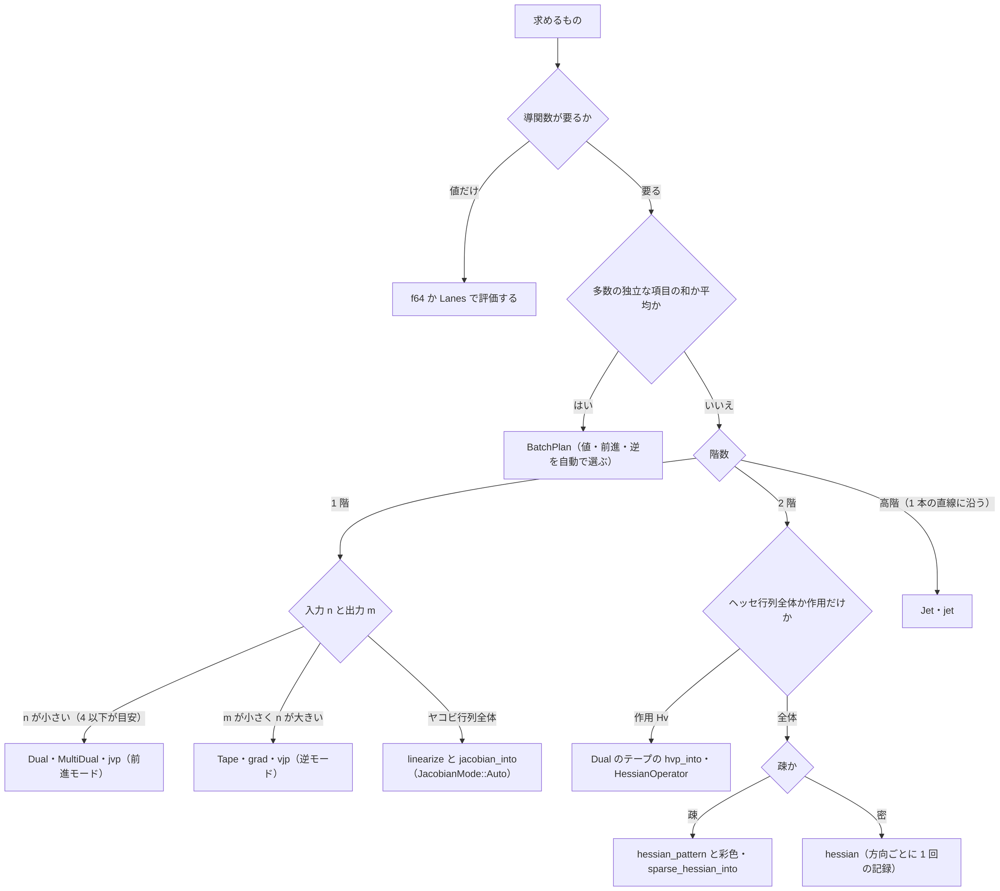

`scioxide-ad` では、関数を `R: Real` について一度だけ書けば、数値型と変換を選び直すだけで違う導関数が得られる。
このページは、求める導関数の形、入力の数 $n$ と出力の数 $m$、同じ関数を何点で微分するかから、数値型と変換を選ぶ手順をまとめる。
計算コストは「primal 値を 1 回評価する手間」を単位にして比べる。
アルゴリズムと計算コストの導出は[自動微分のアルゴリズム体系](../algorithms/)とその子ページにある。

## 選ぶ手順

最初に分けるのは、多数の独立な項目（Monte Carlo の経路、学習データの標本）の和か平均かである。
そうなら、項目を lane に詰めて評価する `BatchPlan` が、勾配の有無と微分対象の値の数から数値型を選ぶ。
そうでなければ、求める階数と入出力の次元で選ぶ。
1 つの関数を多くの点で微分するなら、どの経路でもテープと作業領域を再利用する形（[ワンショット呼び出しとテープの再利用](#ワンショット呼び出しとテープの再利用)）を選ぶ。

## 数値型の比較

| 数値型 | 保持するもの | 1 回の評価コスト | メモリ | 向いている場面 |
|---|---|---|---|---|
| `f32`、`f64` | 値 | 1 | なし | 普通の評価、単体の試験 |
| `Lanes<S, W>` | `W` 個の独立な値 | 約 1（SIMD で `W` 個を同時に） | なし | 多数の点・経路の値 |
| `Dual<V>` | 値と 1 方向の導関数 | 小さな定数倍 | なし | 1 方向の導関数、入力が 1 個 |
| `MultiDual<V, N>` | 値と `N` 方向の導関数 | 導関数の部分が約 `N` 倍 | なし | 入力が数個の勾配、ヤコビ行列の `N` 列 |
| `Jet<V, N>` | 正規化 Taylor 係数 `N` 個 | 非線形の演算が $O(N^2)$ | なし | 1 本の直線に沿う高階の係数、級数解 |
| `Var<'t, V>` | テープ上の値 | 記録と逆走査で小さな定数倍 | 文の数に比例 | 入力が多く出力が少ない勾配、VJP |

ラッパー型は入れ子にできる。
`Dual<Lanes<f64, 8>>` は 8 個の点の 1 方向の導関数、`Dual<Dual<f64>>` は 1 方向の 2 階微分、`Var<Dual<f64>>`（`Tape<Dual<f64>>` に記録）はヘッセ行列・ベクトル積、`Jet<Jet<f64, M>, N>` は 2 変数の混合 Taylor 係数を与える。
どの数値型でも値は同じビットになるので、数値型を替えて導関数を加えても、primal 値は変わらない。
`Lanes` の 8 つの初等関数（`exp` など）だけは、スカラーの関数と最後の数 ulp が違いうる。
詳細は[数値型・lane・汎用コード](../algorithms/number-types-and-lanes/)にある。

前進モードと逆モードの境目の目安は、入力が 4 個前後である。
`MultiDual` の導関数の部分は方向の数に比例して重くなるが、テープの記録と逆走査には入力の数によらない固定の手間がかかる。
`BatchPlan` の `DerivativeMode::Auto` も、パラメータと入力の合計が 4 以下なら前進モード、超えれば逆モードを選ぶ。
境目は関数の形とビルドで変わるので、性能が問題になるときは両方を試す。

## ヤコビ行列と走査の向き

写像 $F: \mathbb{R}^n \to \mathbb{R}^m$ のヤコビ行列 $J$ について、求める量ごとの計算コストは次のとおりである。

| 求める量 | 前進モード | 逆モード | scioxide-ad の API |
|---|---|---|---|
| $Jv$（1 方向） | 評価 1 回 | 記録 1 回と接ベクトルの走査 1 回 | `jvp`、`Dual`、`Linearization::jvp_into` |
| $J^\mathsf{T}w$（1 方向） | $n$ 回 | 記録 1 回と逆走査 1 回 | `vjp`、`Linearization::vjp_into` |
| 勾配（$m = 1$） | $n$ 回（`MultiDual` なら 1 回で $n$ 方向） | 記録 1 回と逆走査 1 回 | `grad`、`value_and_grad`、`Tape::gradient_into` |
| $J$ 全体 | $n$ 回 | $m$ 回 | `jacobian`、`Linearization::jacobian_into` |
| 疎な $J$ | 色の数の回数 | - | `sparse_jacobian`、または `jacobian_pattern`、`scioxide_sparse::derivative_coloring`、`sparse_jacobian_into` |

`Linearization::jacobian_into` は `JacobianMode::Auto`（既定）で、$m < n$ なら出力ごとの逆走査、そうでなければ入力ごとの接ベクトルの走査を選ぶ。
`TapeOptions::with_jacobian_mode` で `Forward` か `Reverse` に固定できる。
1 回の記録から何度でも積を取れるので、同じ点で $Jv$ と $J^\mathsf{T}w$ を両方使うときは `linearize` を 1 回呼び、`Linearization` の積を繰り返す。
ヤコビ行列を反復解法に渡すなら、`jacobian_operator` が行列を作らずに $Jv$ と $J^\mathsf{T}w$ を掛ける作用素を返す。

## 2 階以上の微分

| 求める量 | API | 計算コスト |
|---|---|---|
| $Hv$（1 方向） | `hvp`、`Tape<Dual<f64>>::hvp_into` | 勾配の小さな定数倍（記録 1 回と逆走査 1 回） |
| $Hv$ を何度も（反復解法） | `Tape<Dual<f64>>::hessian_operator` | 適用ごとに記録 1 回と逆走査 1 回、確保なし |
| 密な $H$ | `hessian` | 記録 $n$ 回 |
| 疎な $H$ | `sparse_hessian`、または `hessian_pattern`、`derivative_coloring`、`sparse_hessian_into` | 記録が色の数の回数 |
| 1 方向の 2 階微分 $v^\mathsf{T}Hv$ | `Dual<Dual<f64>>`、`jet`（$2c_2$） | 評価 1 回 |
| 1 本の直線に沿う $k$ 階の係数 | `Jet<f64, N>`、`jet` | 評価 1 回、非線形の演算が $O(N^2)$ |
| 混合偏微分 $\partial^{i+j}f/\partial s^i \partial t^j$ | `Jet<Jet<f64, M>, N>` | 評価 1 回、演算が $O(M^2N^2)$ |

ヘッセ行列全体を作るより、作用 $Hv$ だけで済む方法（共役勾配法による Newton 法など）を先に検討する。
ヘッセ行列が要るときは、変数どうしの相互作用が局所的（鎖や格子）なら彩色で記録の回数を色の数に減らせる。
彩色は貪欲法で、最小の色数を保証しない。
導出と計算コストは[二階微分とヘッセ行列の作用素](../algorithms/second-order-derivatives/)、[構造パターンと疎な微分の復元](../algorithms/sparse-derivatives/)、[Taylor ジェットと高階の係数](../algorithms/taylor-jets/)にある。

## ワンショット呼び出しとテープの再利用

`grad`、`value_and_grad`、`vjp`、`jacobian`、`hvp`、`hessian`、`sparse_jacobian`、`sparse_hessian`、`jvp`、`jet` はワンショット関数で、既定の方針を使い、呼ぶたびにテープと結果を確保する。
空のテープから始めるので、逆モードのワンショット呼び出しは関数を 2 回実行する（1 回目で文を数えてテープを広げ、2 回目で記録する）。
一度だけ微分するとき、試すときに使う。

同じ関数を多くの点で微分するときは、`Tape::default()` で 1 本作って `gradient_into` や `linearize` を繰り返す。
初回の記録でテープが必要な大きさに広がり、同じ関数を記録したテープの変換は確保しない（構造化演算のスクラッチを除く）。
出力の領域も呼び出し側が渡すので、最適化の反復のような繰り返しで確保が起こらない。
方針（非有限値、折れ点、ヤコビ行列の向き、バイトの上限）は `TapeOptions` で選ぶ。
テープは呼び出し側が所有し、スレッドごとに 1 本使う。
最適化や求根のように、`&self` を受け取る呼び出し口から導関数を返すときは、テープを `RefCell` に入れて同じように使い回す。
詳細は[テープのライフサイクルと再利用](../algorithms/tape-lifecycle/)にある。

## 多数の項目の和

$\sum_i f(\theta, a_i, d_i)$ やその平均（Monte Carlo の期待値、標本ごとの損失の平均）では、項目ごとに別々にテープを作るより `BatchPlan` が計算コストが小さい。
`BatchPlan` は `W` 個の項目を 1 つの `Lanes` に詰め、パラメータ $\theta$ に依存する共有の部分を `prepare` でブロックごとに 1 回だけ計算する。
表の行についての平均とパラメータの勾配だけが要るなら、`batch_mean` と `batch_mean_and_grad` が同じ評価を 1 回の呼び出しで行う。

| 求めるもの | `BatchPlan` のメソッド | 使う数値型 |
|---|---|---|
| 和か平均の値だけ | `evaluate_into`（勾配を求めない） | `Lanes<S, W>` |
| パラメータの勾配、項目ごとの入力の勾配 | `evaluate_into`（`BatchOutputs` で勾配を求める） | 微分対象の値が 4 以下なら `MultiDual<Lanes, N>`、超えれば `Var<Lanes>` |
| 方向微分 | `jvp_into` | `Dual<Lanes<S, W>>` |
| ヘッセ行列・ベクトル積 | `hvp_into` | 前進の上の前進か、逆の上の前進 |

値はどの方式でも同じビットになり、ブロックの結果はブロックの番号の順に決まった木で足すので、ワーカー数を変えても結果は変わらない。
`Mean` では標準誤差 $s/\sqrt{n}$ も返し、勾配の標準誤差はブロックごとの平均（batch means）から推定する。
詳細は[多数の項目の一括評価](../algorithms/batches/)にある。

## 自動微分を使えない場合

関数の一部が `Real` の演算で書けないとき（外部のライブラリ、反復解法、表引き）の選択肢は次のとおりである。

| 状況 | 方法 |
|---|---|
| スカラーの関数で、値と 1・2 階の導関数を計算できる | `Real::map_scalar`（すべての数値型で使える。総次数 2 まで正確） |
| ベクトル関数で、逆積（と接ベクトルの積）を書ける | `ExternalRule` と `Var::external`（テープだけ） |
| 線形系の解、方程式の解 | `solve_into`、`implicit_solution_into`（アルゴリズムの反復を微分しない） |
| 長いループでメモリが足りない | `checkpointed_loop` と `CheckpointSchedule` |
| 関数の値しか得られない | 差分による数値微分（[scioxide-differentiate](../../scioxide-differentiate/)） |

差分は刻み幅の選択と打ち切り誤差を伴い、誤差は単位丸め $u$ の $2/3$ 乗程度にとどまることが多い。
二つの方法の使い分けは[数値微分の選び方](../../scioxide-differentiate/choosing/)で扱う。

## まとめ

多数の独立な項目の和なら `BatchPlan`、そうでなければ求める階数と入出力の次元で数値型を選ぶ。
1 階の導関数は、入力が 4 個前後までなら `Dual`・`MultiDual` の前進モード、入力が多く出力が少なければテープの逆モードが安く、ヤコビ行列全体は `jacobian_into` の `JacobianMode::Auto` が向きを選ぶ。
2 階はまず作用 $Hv$ で済むかを考え、全体が要るなら疎構造の彩色を使う。
同じ関数を何度も微分するなら、ワンショット関数ではなく、テープと出力の領域を再利用する。
次は[自動微分のアルゴリズム体系](../algorithms/)で、ここで使った計算コストのモデルの導出を確かめる。
問題に近い例から入るなら[例題の一覧](../examples/)へ進む。
