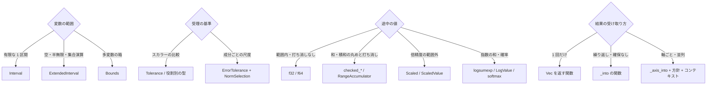

数値計算の関数を呼ぶ前に、呼び出し側は 5 つのことを決める。
変数がどの範囲を動くか、何をどの尺度で受理するか、反復や評価を何回まで許すか、途中の値をどう表すか、結果をどこに書くかである。
このページはそれぞれについて `scioxide-core` の型と関数を選ぶ基準を示す。
配列と作用素を渡す計算では、配置の作り方と作用素の実装の形も選ぶ。

## 判断の流れ

図は 4 つの問いを上から順に並べたもので、問いどうしは独立である。
計算リソースの上限は問題の性質では分岐しないので、図には入れず[計算リソースの上限](#計算リソースの上限)の表で選ぶ。



## 定義域の型

| 範囲 | 型 | 不変条件 | 主な用途 |
|---|---|---|---|
| 有限な閉区間 $[a, b]$ | `Interval<S>` | 端点は有限で $a \le b$。$a = b$ も可 | 1 変数の根の挟み込み、1 次元の積分区間 |
| 空集合や無限の端を含む閉集合 | `ExtendedInterval<S>` | 有限な端点は含まれ、無限は端点として保存しない | 許容範囲の共通部分、凸包 |
| 多変数の箱 | `Bounds<S>` | 変数ごとに `(Option<S>, Option<S>)`。`None` の側は制限なし。変数は 1 個以上 | 多変数の最適化、境界付きの差分 |

どの型も構築時に端点を検査し、NaN や無限大は `NonFinite`、逆順の端点は `InvalidInput` になる。
`Interval` の `width()` と `midpoint()` は正しく丸めた値を返す。
`midpoint()` は途中でオーバーフローしないように計算するので、$[-\mathrm{MAX}, \mathrm{MAX}]$ の中点は 0 になる（$\mathrm{MAX}$ は有限の最大値）。
結果が有限の範囲に収まらないときは `NumericalInstability` になり、同じ区間の幅がその例である。
`ExtendedInterval` の `intersection` と `hull` は端点を選ぶだけで算術を行わないので、丸めは起きない。
区間演算による包含区間（丸めの外向き制御）は行わない。
包含区間が必要な場合は [scioxide-validated](../../scioxide-validated/) を使う。

次のセルは選んだ範囲を `ExtendedInterval` で作り、同じ端点で `Interval::new` が成功するかを調べる。
入力は左端 $a$ と右端 $b$（$-10$ から 10 の整数）、範囲の種類（有限、半無限 2 種類、空集合）である。
表は操作ごとに、結果がどの種類の集合か、下端、上端、0 を含むかどうか、失敗したときの分類を示す。
後半の 2 行は $[0, 10]$ との共通部分と凸包である。
端のない側と空集合の端は「なし」と表示する。
端点を逆順にすると `Interval::new` は `InvalidInput` で拒否され、右端の列にその分類の名前が出る。

```rust
//| id: core-domain-types
//| ref: core-domain-types
//| title: 区間の型と集合演算
//| run: reactive
//| crates: [scioxide-core]
//| inputs:
//|   left: {"type":"range","label":"左端 a [-]","description":"区間の下端。","min":-10,"max":10,"step":1,"value":-2}
//|   right: {"type":"range","label":"右端 b [-]","description":"区間の上端。a より小さくすると逆順になる。","min":-10,"max":10,"step":1,"value":5}
//|   domain_mode: {"type":"select","label":"範囲の種類","description":"有限、半無限、空集合。","options":["[a, b]","[a, +∞)","(-∞, b]","空集合"],"value":"[a, b]"}
//| cases:
//|   - {"id":"half-line","label":"[a, +∞)","description":"上に端のない範囲。凸包も上に端がない。","inputs":{"domain_mode":"[a, +∞)"}}
//|   - {"id":"reversed","label":"逆順の端点","description":"a = 5、b = -2 では、どちらの型も InvalidInput で拒否する。","inputs":{"left":5,"right":-2}}
//|   - {"id":"empty","label":"空集合","description":"共通部分は空集合、凸包は [0, 10] になる。","inputs":{"domain_mode":"空集合"}}
//| tests:
//|   - case: default
//|     expect:
//|       - {"artifact":"sets","path":"/rows/0/1","equals":"有限な閉区間"}
//|       - {"artifact":"sets","path":"/rows/0/2","approx":{"value":-2,"atol":1e-12}}
//|       - {"artifact":"sets","path":"/rows/0/3","approx":{"value":5,"atol":1e-12}}
//|       - {"artifact":"sets","path":"/rows/2/2","approx":{"value":0,"atol":1e-12}}
//|       - {"artifact":"sets","path":"/rows/2/3","approx":{"value":5,"atol":1e-12}}
//|       - {"artifact":"sets","path":"/rows/3/2","approx":{"value":-2,"atol":1e-12}}
//|       - {"artifact":"sets","path":"/rows/3/3","approx":{"value":10,"atol":1e-12}}
//|       - {"artifact":"interval","path":"/rows/0/0","approx":{"value":7,"atol":1e-12}}
//|       - {"artifact":"interval","path":"/rows/0/1","approx":{"value":1.5,"atol":1e-12}}
//|   - case: half-line
//|     expect:
//|       - {"artifact":"sets","path":"/rows/1/1","equals":"上に端がない"}
//|       - {"artifact":"sets","path":"/rows/1/3","equals":null}
//|       - {"artifact":"sets","path":"/rows/2/3","approx":{"value":10,"atol":1e-12}}
//|       - {"artifact":"sets","path":"/rows/3/3","equals":null}
//|   - case: reversed
//|     expect:
//|       - {"artifact":"sets","path":"/rows/0/5","equals":"InvalidInput"}
//|       - {"artifact":"sets","path":"/rows/1/5","equals":"InvalidInput"}
//|       - {"artifact":"interval","path":"/rows/0/0","equals":null}
//|   - case: empty
//|     expect:
//|       - {"artifact":"sets","path":"/rows/1/1","equals":"空集合"}
//|       - {"artifact":"sets","path":"/rows/2/1","equals":"空集合"}
//|       - {"artifact":"sets","path":"/rows/3/3","approx":{"value":10,"atol":1e-12}}
use scioxide_core::{ExtendedInterval, SciOxideError, SciOxideErrorKind, Interval};

let (a, b) = (left, right);
// 行は (操作, 集合の種類, 下端, 上端, 0 を含むか, 失敗の分類)。
type Row = (
    &'static str,
    &'static str,
    Option<f64>,
    Option<f64>,
    &'static str,
    &'static str,
);
let rejected = |operation: &'static str, error: &SciOxideError| -> Row {
    let kind = match error.kind() {
        SciOxideErrorKind::InvalidInput => "InvalidInput",
        _ => "その他の分類",
    };
    (operation, "作れない", None, None, "-", kind)
};
let described = |operation: &'static str, set: &ExtendedInterval<f64>| -> Row {
    let contains_zero = if set.contains(0.0) {
        "含む"
    } else {
        "含まない"
    };
    match set.bounds() {
        None => (operation, "空集合", None, None, contains_zero, "-"),
        Some((lower, upper)) => {
            let shape = match (lower, upper) {
                (Some(_), Some(_)) => "有限な閉区間",
                (Some(_), None) => "上に端がない",
                (None, Some(_)) => "下に端がない",
                (None, None) => "実数全体",
            };
            (operation, shape, lower, upper, contains_zero, "-")
        }
    }
};

let interval = Interval::new(a, b);
let mut rows = vec![match &interval {
    Ok(interval) => described("Interval::new(a, b)", &ExtendedInterval::from(*interval)),
    Err(error) => rejected("Interval::new(a, b)", error),
}];
let set = match domain_mode.as_str() {
    "[a, b]" => ExtendedInterval::new(Some(a), Some(b)),
    "[a, +∞)" => ExtendedInterval::new(Some(a), None),
    "(-∞, b]" => ExtendedInterval::new(None, Some(b)),
    _ => Ok(ExtendedInterval::empty()),
};
match &set {
    Ok(set) => {
        let reference =
            ExtendedInterval::new(Some(0.0), Some(10.0)).map_err(|e| e.to_string())?;
        rows.push(described("ExtendedInterval", set));
        rows.push(described(
            "[0, 10] との共通部分",
            &set.intersection(&reference),
        ));
        rows.push(described("[0, 10] との凸包", &set.hull(&reference)));
    }
    Err(error) => rows.push(rejected("ExtendedInterval::new", error)),
}
let digits = serde_json::json!({ "significantDigits": 6 });
let set_columns = serde_json::json!([
    { "key": "0", "label": "操作" },
    { "key": "1", "label": "集合の種類" },
    { "key": "2", "label": "下端 [-]", "type": "number", "format": digits, "nullText": "なし" },
    { "key": "3", "label": "上端 [-]", "type": "number", "format": digits, "nullText": "なし" },
    { "key": "4", "label": "0 を含むか" },
    { "key": "5", "label": "失敗の分類 kind()" }
]);
emit_table_with_columns!(
    set_columns,
    rows,
    metadata = serde_json::json!({ "id": "sets" })
);

// Interval が作れたときだけ、幅と中点を出す。
let (width, midpoint) = match &interval {
    Ok(interval) => (
        Some(interval.width().map_err(|e| e.to_string())?),
        Some(interval.midpoint().map_err(|e| e.to_string())?),
    ),
    Err(_) => (None, None),
};
let interval_columns = serde_json::json!([
    { "key": "0", "label": "幅 width() [-]", "type": "number", "format": digits, "nullText": "作れない" },
    { "key": "1", "label": "中点 midpoint() [-]", "type": "number", "format": digits, "nullText": "作れない" }
]);
emit_table_with_columns!(
    interval_columns,
    vec![(width, midpoint)],
    metadata = serde_json::json!({ "id": "interval" })
);
```

既定値（$a = -2$、$b = 5$、有限な範囲）では、`Interval` と `ExtendedInterval` はどちらも $[-2, 5]$ で、幅は 7、中点は 1.5 である。
$[0, 10]$ との共通部分は $[0, 5]$、凸包は $[-2, 10]$ になる。
凸包は 2 つの集合を含む最小の閉区間で、和集合ではない。

$[a, +\infty)$ を選ぶと `ExtendedInterval` は上端を持たず、共通部分は $[0, 10]$、凸包は上に端のない $[-2, +\infty)$ になる。
`Interval::new(a, b)` は範囲の種類によらず有限な 2 つの端点から作るので、1 行目は $[-2, 5]$ のままである。
空集合を選ぶと、共通部分は空集合、凸包は相手の $[0, 10]$ そのものになる。
端点を逆順（$a = 5$、$b = -2$）にすると、`Interval::new` も `ExtendedInterval::new` も `InvalidInput` を返す。

共通部分と凸包で計算した端点が 0 になったときは、下端を $-0$、上端を $+0$ にそろえる（IEEE 1788 の慣例）。
このため結果は演算の左右を入れ替えても変わらず、値としては $-0$ も 0 と等しい。

失敗の分類 `kind()` は `SciOxideErrorKind` の列挙子で、引数の名前や理由をプログラムから読むには `view()` を使う。
分類の一覧と詳細の読み方は[エラーの分類と詳細ビュー](../algorithms/errors-and-diagnostic-views/)で扱う。

## 許容誤差の役割

しきい値は多くの型で $\tau(s) = \tau_{\mathrm{abs}} + \tau_{\mathrm{rel}}\, s$ である。
ここで $\tau_{\mathrm{abs}}$ は絶対許容誤差、$\tau_{\mathrm{rel}}$ は相対許容誤差、$s$ は判定する量と同じ単位の代表スケールである。
判定する量の単位と $s$ の選び方が、役割ごとに異なる。

| 判定する量 | 型 | 絶対項の単位 | 代表スケールの例 |
|---|---|---|---|
| 状態の変化量 | `StepTolerance` | 状態の単位 | 状態の大きさ |
| 方程式の残差 | `ResidualTolerance` | 残差の単位 | 残差を構成する項の大きさ |
| 目的関数の勾配 | `GradientTolerance` | 目的関数 / 状態の単位 | 目的関数の大きさ |
| 数値階数 | `RankThreshold` | 特異値の単位 | 最大特異値 |
| 制約の違反量 | `FeasibilityTolerance` | 制約の単位 | 制約の項の大きさ |
| 整数からの距離 | `IntegralityTolerance` | 無次元（$[0, 0.5)$） | なし |
| ベクトルの局所誤差 | `ErrorTolerance` | 成分ごと（`AbsoluteTolerance`） | 成分ごとの尺度、`NormSelection` で縮約 |
| 相対精度だけの収束 | `RelativeTolerance` | なし（相対項だけ） | 手法が決める |

役割別の型と `ErrorTolerance` の `Default` は、絶対項と相対項がともに $\sqrt{\varepsilon}$ である（$\varepsilon$ はスカラー型の機械イプシロン）。
`IntegralityTolerance` の `Default` は $\sqrt{\varepsilon}$、`RelativeTolerance` の `Default` は $\varepsilon$ である。
判定規則とノルムの違いは[許容誤差の役割と判定条件](../algorithms/error-and-tolerance-contracts/)で扱う。

## 計算リソースの上限

上限は許容誤差とは別に、正の整数 `Budget` を `SolveBudgets::with_limit(kind, budget)` で上限を管理する項目ごとに設定する。

| `BudgetKind` | 対象 | 入れ子の求解での扱い |
|---|---|---|
| `Iteration` | 反復 | 局所 |
| `Proposal` | 候補の提案（直線探索の試行点など） | 局所 |
| `Evaluation` | コールバックの呼び出し | 外側の求解と共有 |
| `Subdivision` | 適応分割 | 外側の求解と共有 |
| `Sample` | 確率的な標本 | 外側の求解と共有 |
| `Node` | 探索木の節点 | 外側の求解と共有 |

「局所」の項目はその求解自身の回数で上限を判定し、「外側の求解と共有」の項目は内側の求解で実行した分を外側の求解にも加算して上限を判定する。
上限に達したことは `Admission::Denied` や `Invocation::BudgetExhausted` として値で返り、数値的な破綻とは区別される。
評価コストが大きい問題では `Evaluation` の上限を、反復の遅れを早く見つけたい場合は `Iteration` の上限を設定する。

`Budget` は 0 を表せない。
値の出どころに合わせて、次の 3 つの作り方から選ぶ。

| 値の出どころ | 作り方 | 0 のとき |
|---|---|---|
| ソースに書いた定数 | `budget!(256)`、`budget!(64 * 1024)` | コンパイルエラー |
| 実行時に決まる `usize` | `Budget::try_from(n)?` | `InvalidInput`（`OutOfRange`） |
| 検査済みの `NonZeroUsize` | `Budget::from(n)` | 起こらない |

`budget!` の結果は定数なので、`const MAX_TERMS: Budget = budget!(256);` のように定数の定義にも使える。
最小の上限には `Budget::ONE` がある。

## 算術の経路

| 状況 | 使うもの | 精度の保証 |
|---|---|---|
| 値が範囲内で打ち消しも小さい | `f32` / `f64` と `RealScalar` のメソッド | 初等関数の ULP 仕様 |
| 大きさの異なる項の和、打ち消しを含む積和 | `checked_sum`、`checked_sum_of_products`、`RangeAccumulator`、`ProductSum` | 1 回の丸め、順序によらない |
| 積や商の途中が範囲外になる | `checked_float_product_factors`、`checked_product_quotient` | 因子 $k + 1$ 個の積は相対誤差 $\gamma_k$ 以内（結果が正規化数のとき）、積の商は 4 ULP 以内 |
| 結果そのものが倍精度の範囲外 | `Scaled`、`ScaledValue`、`ScaledAccumulator` | `i64` の指数、射影時に範囲を検査 |
| 指数の和、確率、尤度 | `logsumexp`、`weighted_logsumexp`、`LogValue`、`softmax_into` | 実数の対数和と非負の重みは 16 ULP、符号付きの重みは打ち消しの条件数に比例 |
| 0 の近くの打ち消し（$\cos x - 1$ など） | `cosm1`、`exprel`、`powm1`、`xlog1py` など | 実数の引数で 16 ULP |
| 配列の大きさや添字の計算 | `backend::checked_add`、`backend::checked_mul`、`backend::checked_product` | 桁あふれを `SizeOverflow` でレポート |

$\gamma_k = k u / (1 - k u)$ で、$u = \varepsilon / 2$ は単位丸めである。
限界の導出と適用条件は[範囲安全な算術](../algorithms/range-safe-arithmetic/)と[対数和・重み付き和・正規化](../algorithms/logarithmic-reductions/)で扱う。

## 配列と作用素の API

多次元の配列はメモリ領域のスライスに配置を結び付けたビューとして渡す。
作用素はトレイトを実装した型かクロージャで渡す。

| 渡すもの | API | 選ぶ条件 |
|---|---|---|
| パディングのない行優先の配列 | `NdView::row_major(data, &shape)`、`NdViewMut::row_major`、`StridedLayout::row_major(&shape)` | 階数が 8 以下。ストライドの配列を用意しない |
| 転置、パディングのある配列、階数 9 以上 | `StridedLayout::new(&extents, &strides)` と `NdView::new` / `NdViewMut::new` | 異なる座標が異なる位置に写ることを証明できる配置 |
| ブロードキャスト（読み取り専用） | `StridedLayout::new_broadcast` と `NdView::new` | ストライド 0 などで要素が位置を共有する。書き込みには使えない |
| 複数の右辺 | `BlockVectorView::new`、`BlockVectorViewMut::new` | 列優先で、長さがちょうど行数 × 右辺の数 |
| 状態を持つ作用素、作業領域を使う作用素 | `LinearOperator`、`AdjointOperator`、`Preconditioner` を実装した型 | 入れ子の作業を集計に含める、密行列カーネルを借りる |
| 式で書ける作用素 | `ClosureOperator::new(rows, cols, apply)` | $A x$ だけを使う解法 |
| 随伴も使う作用素 | `ClosureOperator::new(…).with_adjoint(adjoint)` | $A^{\mathsf{H}} x$ を使う解法や VJP |
| 式で書ける前処理 | `ClosurePreconditioner::new(dimension, apply)` | $M^{-1} x$ をクロージャで書ける |

クロージャの作用素と前処理は、結果を作業領域に作ってから出力に写すので、出力 1 本分のコピーと有限性の検査が加わる。
配置と作用素の規則は[借用レイアウトとアフィン値](../algorithms/borrowed-layouts-and-affine-values/)と[作用素プロトコルとクロージャ作用素](../algorithms/operator-protocols-and-structure/)で扱う。

## 結果の受け取り方

結果を受け取る関数の形は、名前の末尾で見分けられる。

| 形 | 例 | メモリ領域 | 実行 | 向く場面 |
|---|---|---|---|---|
| `Vec` を返す | `softmax`、`log_softmax` | 結果を 1 回だけ確保する | 逐次 | 1 回だけの計算、試作 |
| `_into` | `softmax_into`、`log_softmax_into`、`affine_combination_into` | 呼び出し側の出力と作業領域。確保しない | 逐次 | 反復の内側 |
| `_axis` | `softmax_axis`、`log_softmax_axis`、`logsumexp_axis`、`weighted_logsumexp_axis` | 結果と、必要な作業用のメモリ領域を確保する | 逐次 | 配列の軸ごとの計算を 1 回だけ |
| `_axis_into` | `softmax_axis_into`、`log_softmax_axis_into`、`logsumexp_axis_into`、`weighted_logsumexp_axis_into` | 呼び出し側の `NdViewMut` と作業領域 | `ExecutionPolicy` と `ExecutionContext` で指定 | 軸ごとの計算の繰り返し、並列実行 |

`_into` の関数はすべての入力を検査してから出力に書く。
失敗したときは出力を変えないが、作業領域の内容は変わることがある。
`_axis` と `_axis_into` は入力を `NdView` で受け取り、指定した軸に沿ったレーンごとに独立に計算する。
レーンごとの計算は方針によらず同じなので、結果は `ExecutionPolicy` に依存しない。

並列化は `ExecutionPolicy`（意図）と `ExecutionContext`（エグゼキューター・取り消し・クロック）で別々に指定する。
コンテキストの引数を持たない関数は `ExecutionContext::sequential_native()` で動き、処理装置のネイティブな機能を使うカーネルを選べる。
自分のエグゼキューターで同じカーネルを使うには `ExecutionContext::native(&executor)` を、ネイティブな機能を使わない逐次実行には `ExecutionContext::sequential()` を渡す。
分割の決め方と再現性は[実行方針・分割・実行コンテキスト](../algorithms/execution-and-partitions/)で扱う。

## まとめ

範囲は `Interval`、`ExtendedInterval`、`Bounds` から、端点の有限性と集合演算の必要性で選ぶ。
受理の基準は判定する量の役割に合わせて型を選び、反復や評価の上限は `Budget` と `SolveBudgets` で別に与える。
定数の上限は `budget!` で書けば、0 の誤りをコンパイル時に見つけられる。
途中の値は範囲と打ち消しの有無に応じて、浮動小数点のまま、厳密累積、拡張範囲値、対数表現のどれで扱うかを決める。
行優先の配列は `row_major`、式で書ける作用素と前処理は `ClosureOperator` と `ClosurePreconditioner` で渡し、繰り返し呼ぶ計算は `_into` か `_axis_into` の形で確保を反復の外に出す。
関数が失敗したときは、`kind()` で分類を確かめてから `view()` で引数や理由を読む。

## 次に読むページ

- [共通基盤の数理](../algorithms/)：精度の保証の種類と各アルゴリズムページの対象を確かめる。
- [最終値より先に中間値を守る](../examples/range-safe-arithmetic/)：算術の経路の違いを例題で確かめる。
- [エラーの分類と詳細ビュー](../algorithms/errors-and-diagnostic-views/)：`kind()` の 20 分類と `view()` の詳細を読み、失敗の原因を確かめる。
- [共通仕様の API ガイド](../api/)：型と関数の全項目を用途別に引く。
