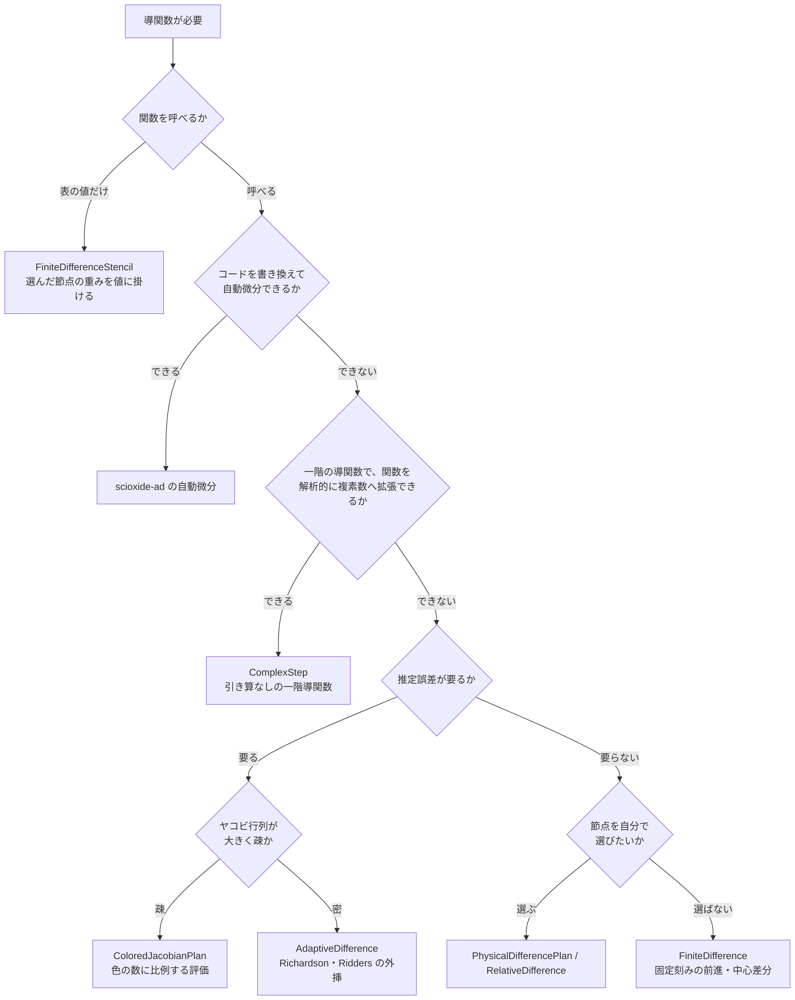

導関数の求め方は関数をどの形で持っているか、どの形の導関数が要るか、どれだけの精度と計算コストが許されるかで決まる。
このページでは方法を選ぶ判断の流れと、各方法の誤差、評価回数、標本点の範囲、推定誤差の比較を示し、実際の関数で評価回数と誤差を測る。
最後に、自動微分や解析的な導関数との使い分けと、導関数のプロバイダーを方針で切り替える `DerivativeStrategy` を説明する。
用語（ワンショット関数、手法オブジェクト、Plan、推定誤差）の定義は [呼び出しの形](oxref:differentiate-call-forms-terms) にある。

## 先に決めること

方法を選ぶ前に、次の五つを確かめる。

| 問い | 方法の選択への影響 |
|---|---|
| 関数をどの形で持っているか | scioxide-ad の `Real` トレイトについて汎用に書き直せる Rust のコードなら自動微分、複素数で評価できるなら複素ステップ法、中身の分からない関数なら差分、表の値しかなければ節点の重み `FiniteDifferenceStencil` |
| どの形の導関数が要るか | スカラーの一階・二階、勾配、ヤコビ行列、ヘッセ行列、方向微分、疎なヤコビ行列で、使う演算と評価回数が変わる |
| 評価点が定義域の境界に近いか | 近ければ区間 `Bounds` を渡す。標本点は区間の中に置かれ、境界までの距離が刻みより短ければ、内側へ向かう片側の差分になる。適応差分は最初の刻みが大きいので、区間か小さい刻みを与える |
| どれだけの精度と誤差の見積もりが要るか | 推定誤差が要るなら適応差分か彩色、丸めの大きさの精度が要るなら自動微分か、一階導関数なら複素ステップ法 |
| 評価コストと関数のノイズ | 評価が重ければ評価回数の少ない方法、ノイズがあれば刻みをノイズの大きさから決める |

## 方法を選ぶ流れ



既定の刻みの中心差分でよければ、ワンショット関数 `derivative`、`second_derivative`、`gradient`、`jacobian`、`hessian`、`jvp` が値だけを返す。
複素ステップ法のワンショット関数は `complex_step_derivative`、彩色は `sparse_jacobian`、節点の差分は `physical_difference_derivative` である。
区間、刻み、許容誤差、上限を変えるときと、終了理由や推定誤差を読むときは、図の手法オブジェクトと Plan を使う。

複素ステップ法が引き算なしで求めるのは一階の導関数である。
二階の導関数は複素ステップ法の一階導関数に実数の節点による差分を重ねて求める。
そのため節点の間隔を最適に選んでも誤差は $\varepsilon^{2/3}$ 程度で、実数の 3 点の二階差分の $\varepsilon^{1/2}$ 程度よりは小さいが、一階のような丸めの大きさには届かない（[複素ステップ法による二階導関数・ヘッセ行列・方向微分](oxref:differentiate-complex-second)）。
関数にノイズがあるときは解析的な拡張の前提が成り立たないので、差分を使い、刻みをノイズの大きさから決める（[丸め誤差・ノイズと最適な刻み幅](oxref:differentiate-noisy-functions)）。

## 方法の比較

倍精度で、関数値の相対誤差が丸めの単位の数倍のときの目安を示す。
$n$ は変数の数、$L_i$ は適応差分が座標 $i$ で実際に使った準位（刻みを 1 段縮めた差分）の数（既定の上限 16 のもとで多くは 3 から 16）、$c$ は色の数、$L_c$ は色 $c$ で使った準位の数である。
標本点の範囲は、座標 $x_i$ の標本点が評価点から離れる距離の目安である。

| 方法 | 打ち切り誤差の次数 | 達成できる誤差の目安 | 勾配の評価回数 | 標本点の範囲 | 推定誤差 |
|---|---|---|---|---|---|
| 前進差分 `FiniteDifference` | 1 | $\sqrt{\varepsilon} \approx 1.5 \times 10^{-8}$ | $n + 1$（`base` ありで $n$） | $\sqrt{\varepsilon} \max(1, \lvert x_i \rvert)$ | なし |
| 中心差分 `FiniteDifference` | 2 | $\varepsilon^{2/3} \approx 3.7 \times 10^{-11}$ | $2n + 1$（`base` ありで $2n$） | $\varepsilon^{1/3} \max(1, \lvert x_i \rvert)$ | なし |
| 適応差分 `AdaptiveDifference` | 準位とともに上がる | 推定誤差が既定の許容誤差 $\sqrt{\varepsilon}(1 + \lvert D \rvert)$ 以下 | $1 + 2 \sum_i L_i$（既定で $1 + 6n$ から $1 + 32n$） | 最初の準位で $0.5 \max(1, \lvert x_i \rvert)$ | あり |
| 彩色 `ColoredJacobianPlan`（ヤコビ行列） | 適応差分と同じ | 適応差分と同じ | $1 + 2 \sum_c L_c$（区間の有無によらない） | 適応差分と同じ | あり |
| 複素ステップ法 `ComplexStep` | 2（既定の $h = \varepsilon$ では無視できる） | 関数の評価の丸め誤差（保証はない） | $n + 1$ | 虚数方向に $\varepsilon$、実部は動かない | なし |
| 節点の差分 `PhysicalDifferencePlan` ほか | 節点の数で決まる | 節点とノイズで決まる | 座標ごとの節点の数の和 | 渡した節点 | なし |

滑らかで大きさが中程度の関数では、適応差分で実際に生じる誤差は既定の許容誤差よりずっと小さいことが多い（下の実測では $10^{-13}$ 以下）。
適応差分の最初の刻み $0.5 \max(1, \lvert x_i \rvert)$ は大きいので、$\ln x$ の $x = 0$ の近くのように定義域の端に近い点では、区間 `Bounds` か小さい刻み `with_step` を与える（[定義域の境界と片側差分](../algorithms/bounds-and-one-sided/)）。
固定刻みの差分と複素ステップ法の完了 `Completed` は精度を主張せず、推定誤差を返すのは適応差分と彩色だけである。
適応差分の推定誤差も上界ではなく、刻みや許容誤差が量の大きさに合わないと、誤った値でも小さな推定誤差や `Converged` を返すことがある（[Arrhenius 式の温度感度を複素ステップで求める](../examples/arrhenius-complex-step/)、[van der Waals 状態方程式の導関数と推定誤差](../examples/van-der-waals-adaptive/)）。

## 計算コストと精度の実測

この節と次の節のセルは、$f(\mathbf{x}) = \sum_i e^{x_i} \sin x_{i+1}$（添字は巡回）の勾配を点 $x_i = 0.3 + 0.2\,i$ で求める。
勾配の厳密値は $\partial f / \partial x_i = e^{x_i} \sin x_{i+1} + e^{x_{i-1}} \cos x_i$ である。
次のブロックは二つのセルが共有する定義である。
`cyclic` が $f$、`cyclic_complex` が複素ステップ法に渡す同じ式の複素数版、`cyclic_gradient` が f64 の固有メソッドで独立に計算した厳密な勾配、`cyclic_point` が評価点に対応する。
`summarize` は結果から評価回数、反復回数、厳密な勾配との最大誤差、最大の推定誤差、終了理由を取り出す。

```rust
//| id: differentiate-choosing-cyclic-model
//| kind: definitions
//| title: 巡回和の関数、その複素数版、厳密な勾配と結果の要約
//| crates: [scioxide-core, scioxide-differentiate]
use scioxide_core::{Complex, RealScalar};
use scioxide_differentiate::DifferentiationResult;

/// f(x) = Σᵢ e^{xᵢ} sin x_{i+1}（添字は巡回）。
pub(crate) fn cyclic(p: &[f64]) -> f64 {
    (0..p.len())
        .map(|i| RealScalar::exp(p[i]) * RealScalar::sin(p[(i + 1) % p.len()]))
        .sum()
}

/// 同じ式を複素数で評価する解析的拡張。
pub(crate) fn cyclic_complex(z: &[Complex<f64>]) -> Complex<f64> {
    (0..z.len()).fold(Complex::new(0.0, 0.0), |s, i| {
        s + z[i].exp() * z[(i + 1) % z.len()].sin()
    })
}

/// 参照値: ∂f/∂xᵢ = e^{xᵢ} sin x_{i+1} + e^{x_{i−1}} cos xᵢ（f64 の固有メソッドによる独立な計算）。
pub(crate) fn cyclic_gradient(x: &[f64]) -> Vec<f64> {
    let n = x.len();
    (0..n)
        .map(|i| x[i].exp() * x[(i + 1) % n].sin() + x[(i + n - 1) % n].exp() * x[i].cos())
        .collect()
}

/// 評価点 xᵢ = 0.3 + 0.2 i（i = 0, …, n − 1）。
pub(crate) fn cyclic_point(n: usize) -> Vec<f64> {
    (0..n).map(|i| 0.3 + 0.2 * i as f64).collect()
}

/// 1 つの方法の結果の要約。
pub(crate) struct Summary {
    pub(crate) evaluations: usize,
    pub(crate) iterations: usize,
    pub(crate) error: f64,
    pub(crate) estimate: Option<f64>,
    pub(crate) termination: String,
}

/// 厳密な勾配との最大誤差と、最大の推定誤差（推定誤差を返さない方法では None）。
pub(crate) fn summarize(
    result: &DifferentiationResult<f64>,
    exact: &[f64],
) -> Result<Summary, String> {
    let report = result.report();
    let values = result.values().ok_or("勾配が出力に反映されない")?;
    let error = values
        .iter()
        .zip(exact)
        .fold(0.0_f64, |m, (a, b)| m.max((a - b).abs()));
    let estimate = result
        .errors()
        .map(|e| e.iter().fold(0.0_f64, |m, v| m.max(*v)));
    Ok(Summary {
        evaluations: report.evaluations(),
        iterations: report.iterations(),
        error,
        estimate,
        termination: report.termination().to_string(),
    })
}
```

最初のセルは四つの方法の所有値を返す API で勾配を求め、評価回数と厳密な勾配との最大誤差を比べる。
入力は変数の数 $n$ である。
表の「評価回数の式」は前進差分で $n + 1$、中心差分で $2n + 1$、複素ステップ法で $n + 1$、適応差分で $1 + 2 \times (\text{反復回数})$ である（適応差分の反復回数は準位の数の和 $\sum_i L_i$）。
図は横軸に評価回数、縦軸に誤差をとった計算量と精度の関係を示す散布図である。

```rust
//| id: differentiate-cost-accuracy-map
//| ref: differentiate-cost-accuracy-map
//| title: 勾配の方法ごとの評価回数と誤差
//| run: reactive
//| uses: [differentiate-choosing-cyclic-model]
//| crates: [scioxide-core, scioxide-differentiate]
//| inputs:
//|   n: {"type":"range","label":"変数の数 n","description":"勾配を求める関数の変数の数。","min":1,"max":12,"step":1,"value":4}
//| cases:
//|   - {"id":"twelve-variables","label":"n = 12","description":"評価回数は式どおり n に比例して増える。座標が大きくなるので差分の誤差も増えるが、複素ステップ法の誤差は丸めの大きさのままである。","inputs":{"n":12}}
//| tests:
//|   - case: default
//|     expect:
//|       - {"artifact":"costs","path":"/rows/0/1","equals":5}
//|       - {"artifact":"costs","path":"/rows/0/3","range":{"min":1e-9,"max":1e-6}}
//|       - {"artifact":"costs","path":"/rows/1/1","equals":9}
//|       - {"artifact":"costs","path":"/rows/1/3","range":{"min":1e-12,"max":1e-9}}
//|       - {"artifact":"costs","path":"/rows/2/1","range":{"min":25,"max":129}}
//|       - {"artifact":"costs","path":"/rows/2/3","range":{"max":1e-12}}
//|       - {"artifact":"costs","path":"/rows/2/5","equals":"Converged"}
//|       - {"artifact":"costs","path":"/rows/3/1","equals":5}
//|       - {"artifact":"costs","path":"/rows/3/3","range":{"max":1e-14}}
//|   - case: twelve-variables
//|     expect:
//|       - {"artifact":"costs","path":"/rows/0/1","equals":13}
//|       - {"artifact":"costs","path":"/rows/1/1","equals":25}
//|       - {"artifact":"costs","path":"/rows/1/3","range":{"max":1e-9}}
//|       - {"artifact":"costs","path":"/rows/2/1","range":{"min":73,"max":385}}
//|       - {"artifact":"costs","path":"/rows/3/1","equals":13}
//|       - {"artifact":"costs","path":"/rows/3/3","range":{"max":1e-14}}
use scioxide_core::{Complex, SciOxideError};
use scioxide_differentiate::{
    AdaptiveDifference, ComplexStep, DifferenceScheme, FiniteDifference,
};

let n = n as usize;
let x = cyclic_point(n);
let exact = cyclic_gradient(&x);
let f = |p: &[f64], y: &mut [f64]| {
    y[0] = cyclic(p);
    Ok::<(), SciOxideError>(())
};
// 複素ステップ法には同じ式の複素数版を渡す。
let g = |z: &[Complex<f64>], y: &mut [Complex<f64>]| {
    y[0] = cyclic_complex(z);
    Ok::<(), SciOxideError>(())
};
let fixed = |scheme| {
    FiniteDifference::default()
        .with_scheme(scheme)
        .gradient(f, &x, None, None)
};
let results = [
    ("前進差分", fixed(DifferenceScheme::Forward), Some(n + 1)),
    (
        "中心差分",
        fixed(DifferenceScheme::Central),
        Some(2 * n + 1),
    ),
    (
        "適応差分",
        AdaptiveDifference::default().gradient(f, &x, None),
        None,
    ),
    (
        "複素ステップ法",
        ComplexStep::default().gradient(g, &x),
        Some(n + 1),
    ),
];
let (mut rows, mut series) = (Vec::new(), Vec::new());
for (name, result, formula) in results {
    let s = summarize(&result.map_err(|e| e.to_string())?, &exact)?;
    // 適応差分は f(x) を 1 回、各準位で座標ごとに 2 回評価する。
    let formula = formula.unwrap_or(1 + 2 * s.iterations);
    // 誤差がちょうど 0 の点は対数軸に描けないので、散布図から除く。
    if s.error > 0.0 {
        let point = [s.evaluations as f64, s.error];
        series.push(serde_json::json!({ "name": name, "points": [point] }));
    }
    rows.push((
        name,
        s.evaluations,
        formula,
        s.error,
        s.estimate,
        s.termination,
    ));
}
let sci3 = serde_json::json!({ "notation": "scientific", "significantDigits": 3 });
let columns = serde_json::json!([
    { "key": "0", "label": "方法" },
    { "key": "1", "label": "評価回数 [回]", "type": "integer" },
    { "key": "2", "label": "評価回数の式 [回]", "type": "integer" },
    { "key": "3", "label": "勾配の最大誤差 [-]", "type": "number", "format": sci3 },
    { "key": "4", "label": "最大の推定誤差 [-]", "type": "number", "format": sci3, "nullText": "なし" },
    { "key": "5", "label": "終了理由" }
]);
emit_table_with_columns!(
    columns,
    rows,
    metadata = serde_json::json!({ "id": "costs" })
);
emit_scatter_chart!(
    &series,
    options = &serde_json::json!({
        "xLabel": "評価回数 [回]",
        "yLabel": "勾配の最大誤差 [-]",
        "xType": "log",
        "yType": "log"
    })
);
```

既定の $n = 4$ では、前進差分は 5 回の評価で誤差 $5.5 \times 10^{-8}$、中心差分は 9 回で $4.6 \times 10^{-11}$ になる。
適応差分は 47 回の評価で誤差を $1.7 \times 10^{-14}$ まで下げ、実際の誤差より大きい推定誤差 $4.3 \times 10^{-10}$ を返して `Converged` で止まる。
複素ステップ法は 5 回の評価で誤差が $8.9 \times 10^{-16}$ になり、この関数では評価回数あたりの精度が最も高い。
どの行でも評価回数は式に一致する。
$n = 12$ にすると、評価回数は式どおり前進差分と複素ステップ法で 13 回、中心差分で 25 回、適応差分で 151 回に増え、散布図の点は右へ移る。
座標が $x_{11} = 2.5$ まで大きくなり、$e^{x_i}$ と $\max(1, \lvert x_i \rvert)$ に比例する刻みがともに大きくなるので、差分の誤差も増える（中心差分で $4.9 \times 10^{-10}$）。
複素ステップ法の誤差は $1.8 \times 10^{-15}$ で、丸めの大きさのままである。

## ノイズのある関数での比較

2 つ目のセルは同じ関数に $\sigma$ の大きさのノイズを加え、前進差分、中心差分、適応差分の勾配の誤差と、適応差分の終了理由を比べる（$n = 4$）。
ノイズは点のビット列から作る $[-1, 1)$ の擬似乱数 $\eta(\mathbf{x})$ に $\sigma$ を掛けたもので、同じ点では同じ値になる。
ノイズのある関数は解析的に複素数へ拡張できないので、複素ステップ法は比べない。

中心差分の誤差は打ち切り誤差 $h^2 \lvert f''' \rvert / 6$ とノイズの寄与 $\sigma / h$ の和で見積もれる。
これを $h$ について最小にすると $h^\ast = (3\sigma / \lvert f''' \rvert)^{1/3}$ になる。
このセルでは三階導関数の大きさを 1 とみなした $h^\ast = (3\sigma)^{1/3}$ を使い、$h^\ast$ が既定の刻み $\varepsilon^{1/3}$ より小さくなる $\sigma$（$\sigma = 0$ など）では既定の刻みを使う。
入力はノイズの大きさ $\sigma$ で、表は各方法の刻み、評価回数、勾配の最大誤差、最大の推定誤差、終了理由を示す。

```rust
//| id: differentiate-cost-accuracy-noise
//| ref: differentiate-cost-accuracy-noise
//| title: ノイズのある関数の勾配の方法ごとの誤差
//| run: reactive
//| uses: [differentiate-choosing-cyclic-model]
//| crates: [scioxide-core, scioxide-differentiate]
//| inputs:
//|   sigma: {"type":"select","label":"ノイズの大きさ σ","description":"関数の値に加えるノイズの振幅。","options":["0","1e-10","1e-6"],"value":"1e-6"}
//| cases:
//|   - {"id":"no-noise","label":"σ = 0","description":"ノイズがなければ既定の刻みが最適に近く、中心差分の誤差は 10^-11 の大きさに戻る。","inputs":{"sigma":"0"}}
//|   - {"id":"small-noise","label":"σ = 1e-10","description":"ノイズが小さいと適応差分は Converged で止まり、推定誤差は実際の誤差より大きい。","inputs":{"sigma":"1e-10"}}
//| tests:
//|   - case: default
//|     expect:
//|       - {"artifact":"noisy","path":"/rows/0/3","range":{"min":1}}
//|       - {"artifact":"noisy","path":"/rows/1/3","range":{"min":1e-3,"max":1}}
//|       - {"artifact":"noisy","path":"/rows/2/1","approx":{"value":0.014422495703074084,"rtol":1e-12}}
//|       - {"artifact":"noisy","path":"/rows/2/3","range":{"max":1e-4}}
//|       - {"artifact":"noisy","path":"/rows/3/5","equals":"RoundoffLimit"}
//|   - case: no-noise
//|     expect:
//|       - {"artifact":"noisy","path":"/rows/1/3","range":{"max":1e-9}}
//|       - {"artifact":"noisy","path":"/rows/3/3","range":{"max":1e-12}}
//|   - case: small-noise
//|     expect:
//|       - {"artifact":"noisy","path":"/rows/3/5","equals":"Converged"}
use scioxide_core::SciOxideError;
use scioxide_differentiate::{
    AdaptiveDifference, DifferenceScheme, DifferenceStep, FiniteDifference,
};

let sigma: f64 = sigma.parse().map_err(|_| "σ を読めない")?;
// ノイズのモデル: 点の各座標のビット列を splitmix64 で混ぜ、[-1, 1) の値にする。
let eta = |p: &[f64]| {
    let mut z = p.iter().fold(0x2545_F491_4F6C_DD1D_u64, |h, v| {
        h.rotate_left(17) ^ v.to_bits()
    });
    z = (z ^ (z >> 30)).wrapping_mul(0xBF58_476D_1CE4_E5B9);
    z = (z ^ (z >> 27)).wrapping_mul(0x94D0_49BB_1331_11EB);
    z ^= z >> 31;
    (z >> 11) as f64 / (1_u64 << 53) as f64 * 2.0 - 1.0
};
let x = cyclic_point(4);
// 参照値はノイズのない関数の厳密な勾配。
let exact = cyclic_gradient(&x);
let f = |p: &[f64], y: &mut [f64]| {
    y[0] = cyclic(p) + sigma * eta(p);
    Ok::<(), SciOxideError>(())
};
// 刻みの表示用の値: 0 < x_i < 1 なので既定の刻みは √ε と ε^(1/3)。
let h_star = (3.0 * sigma).cbrt().max(f64::EPSILON.cbrt());
let tuned = DifferenceStep::absolute(h_star).map_err(|e| e.to_string())?;
let forward = FiniteDifference::default().with_scheme(DifferenceScheme::Forward);
let results = [
    (
        "前進差分・既定の刻み",
        Some(f64::EPSILON.sqrt()),
        forward.gradient(f, &x, None, None),
    ),
    (
        "中心差分・既定の刻み",
        Some(f64::EPSILON.cbrt()),
        FiniteDifference::default().gradient(f, &x, None, None),
    ),
    (
        "中心差分・刻み h*",
        Some(h_star),
        FiniteDifference::default()
            .with_step(tuned)
            .gradient(f, &x, None, None),
    ),
    (
        "適応差分",
        None,
        AdaptiveDifference::default().gradient(f, &x, None),
    ),
];
let mut rows = Vec::new();
for (name, step, result) in results {
    let s = summarize(&result.map_err(|e| e.to_string())?, &exact)?;
    rows.push((
        name,
        step,
        s.evaluations,
        s.error,
        s.estimate,
        s.termination,
    ));
}
let sci3 = serde_json::json!({ "notation": "scientific", "significantDigits": 3 });
let columns = serde_json::json!([
    { "key": "0", "label": "方法" },
    { "key": "1", "label": "刻み h [-]", "type": "number", "format": sci3, "nullText": "準位ごと" },
    { "key": "2", "label": "評価回数 [回]", "type": "integer" },
    { "key": "3", "label": "勾配の最大誤差 [-]", "type": "number", "format": sci3 },
    { "key": "4", "label": "最大の推定誤差 [-]", "type": "number", "format": sci3, "nullText": "なし" },
    { "key": "5", "label": "終了理由" }
]);
emit_table_with_columns!(
    columns,
    rows,
    metadata = serde_json::json!({ "id": "noisy" })
);
```

既定の $\sigma = 10^{-6}$ では、既定の刻みの誤差はノイズの寄与 $\sigma / h$ の大きさに跳ね上がり、中心差分（$h = 6.1 \times 10^{-6}$）で $5.1 \times 10^{-2}$、前進差分（$h = 1.5 \times 10^{-8}$）では 48 に達する。
ノイズから決めた刻み $h^\ast = 1.4 \times 10^{-2}$ の中心差分は、同じ 9 回の評価で誤差を $1.4 \times 10^{-5}$ に抑える。
適応差分は 83 回の評価のあと、刻みを縮めても推定誤差が改善しなくなって `RoundoffLimit` で止まる。
その誤差 $1.8 \times 10^{-5}$ は $h^\ast$ の中心差分と同程度だが、推定誤差 $1.1 \times 10^{-6}$ は実際の誤差を 1 桁以上下回る。
`RoundoffLimit` でもすべての要素に推定があるので値は出力に反映されるが、`is_success()` は偽になる。

$\sigma = 10^{-10}$ では、適応差分は `Converged` で止まり、推定誤差 $3.4 \times 10^{-9}$ は実際の誤差 $9.0 \times 10^{-10}$ より大きい。
このとき $h^\ast = 6.7 \times 10^{-4}$ の中心差分の誤差は $1.8 \times 10^{-7}$ で、既定の刻みの $5.1 \times 10^{-6}$ より小さい。
$\sigma = 0$ では $h^\ast$ が既定の刻みに一致し、中心差分の誤差は前の表と同じ $4.6 \times 10^{-11}$ に戻る。

## 自動微分・解析的な導関数との使い分け

| 方法 | 必要なもの | 誤差 | 計算コスト |
|---|---|---|---|
| 解析的な導関数 | 導関数の式とその実装 | 関数と同程度の丸め誤差 | 式による |
| 自動微分（scioxide-ad） | `Real` トレイトについて汎用に書いた Rust のコード | 打ち切り誤差がなく、丸め誤差だけ | 前進モードは方向ごとに、逆モードは出力ごとに関数の数倍 |
| 複素ステップ法 | 複素数で評価でき、解析的に拡張できる関数 | 一階は関数の評価の丸め誤差（保証はない） | 複素数の評価で $n + 1$ 回 |
| 差分（このクレート） | 関数の値だけ | 打ち切り誤差と丸め誤差の釣り合い | 実数の評価で $n + 1$ から $1 + 2 \sum_i L_i$ 回 |

コードを書き換えられるなら自動微分が打ち切り誤差を持たず、勾配が要る多変数の関数では逆モードの計算コストが変数の数によらない。
差分は外部のプログラムや中身の分からない関数、ノイズのある関数、自動微分の結果の検算に使う。
複素ステップ法は関数を複素数で書ける場合の一階導関数の検算や参照値に向く。
自動微分の数値型と走査の向きの選び方は [自動微分の選び方](../../scioxide-ad/choosing/) にある。

## 導関数のプロバイダーの方針

ソルバーに導関数を渡すときは、[`DerivativeStrategy`](https://docs.rs/scioxide-differentiate/0.1.0/scioxide_differentiate/enum.DerivativeStrategy.html) でプロバイダーの優先順位を表す。
scioxide-rootfind、scioxide-optimize、scioxide-ode のソルバーはこの方針を受け取り、ヤコビ行列や勾配をどこから得るかを決める。
`select(provider)` は方針の順に候補 `DerivativeCandidate` を `provider` に尋ね、`Ok(Some(値))` を返した最初の候補とその値を返す。
`Ok(None)` のときだけ次の候補に進み、`provider` のエラーはその場で返し、候補が尽きると `InvalidInput`（`UnsupportedConfiguration`）を返す。
`select` 自身は関数を評価せず、評価回数も数えない。

| 方針 | 尋ねる候補の順 |
|---|---|
| `Analytic`、`Automatic`、`Forward`、`Central` | 解析的な導関数、自動微分、前進差分、中心差分のどれか一つだけ |
| `AnalyticOrForward`（既定） | 解析的な導関数、前進差分 |
| `AnalyticOrCentral` | 解析的な導関数、中心差分 |
| `AnalyticOrAutomaticOrForward` | 解析的な導関数、自動微分、前進差分 |

中心差分を使うのは `Central` と `AnalyticOrCentral` の方針だけで、複素ステップ法と適応差分は候補にない。
既定の方針はソルバーごとに違い、scioxide-optimize の直線探索を使う最小化法（BFGS、L-BFGS、最急降下法、非線形共役勾配法、Newton 法）は `AnalyticOrCentral`、scioxide-ode の陰的な解法は `AnalyticOrAutomaticOrForward`、scioxide-rootfind と scioxide-optimize のほかの解法は `AnalyticOrForward` である。
候補と方針の全体は [解析微分・自動微分・差分を方針で切り替える](../examples/derivative-strategy-planck/) で実際に確かめる。

## まとめ

表の値しかないなら `FiniteDifferenceStencil`、コードを書き換えられるなら自動微分、複素数で評価できる関数の一階導関数なら複素ステップ法、推定誤差が要るなら適応差分か、疎なヤコビ行列なら彩色を選ぶ。
固定刻みの中心差分は $2n + 1$ 回の評価で $10^{-11}$ 程度の誤差を与えるが、推定誤差は返さない。
適応差分は評価回数が数倍になる代わりに推定誤差を返すが、推定誤差は上界ではない。
適応差分の最初の刻みは大きいので、定義域の端では区間か小さい刻みを与える。
ノイズのある関数では既定の刻みは小さすぎるので、ノイズの大きさから刻みを決めるか、適応差分の `RoundoffLimit` と推定誤差を手がかりにする。
ソルバーに導関数を渡すときは `DerivativeStrategy` でプロバイダーの順を決める。

## 次に読むページ

- [数値微分のアルゴリズムの共通仕様と構成](../algorithms/)：選んだ方法の呼び出しの形、評価回数の数え方、エラーの規則を確かめる。
- [複素ステップ微分と解析的拡張](../algorithms/complex-step/)：複素ステップ法の前提と、前提を破る関数の振る舞いを確かめる。
- [丸め誤差・ノイズと最適な刻み幅](../algorithms/roundoff-and-noisy-functions/)：ノイズのある関数で刻みを選ぶ根拠を確かめる。
- [数値微分の例題](../examples/)：選んだ方法を具体的なモデルに使う例題を確かめる。
