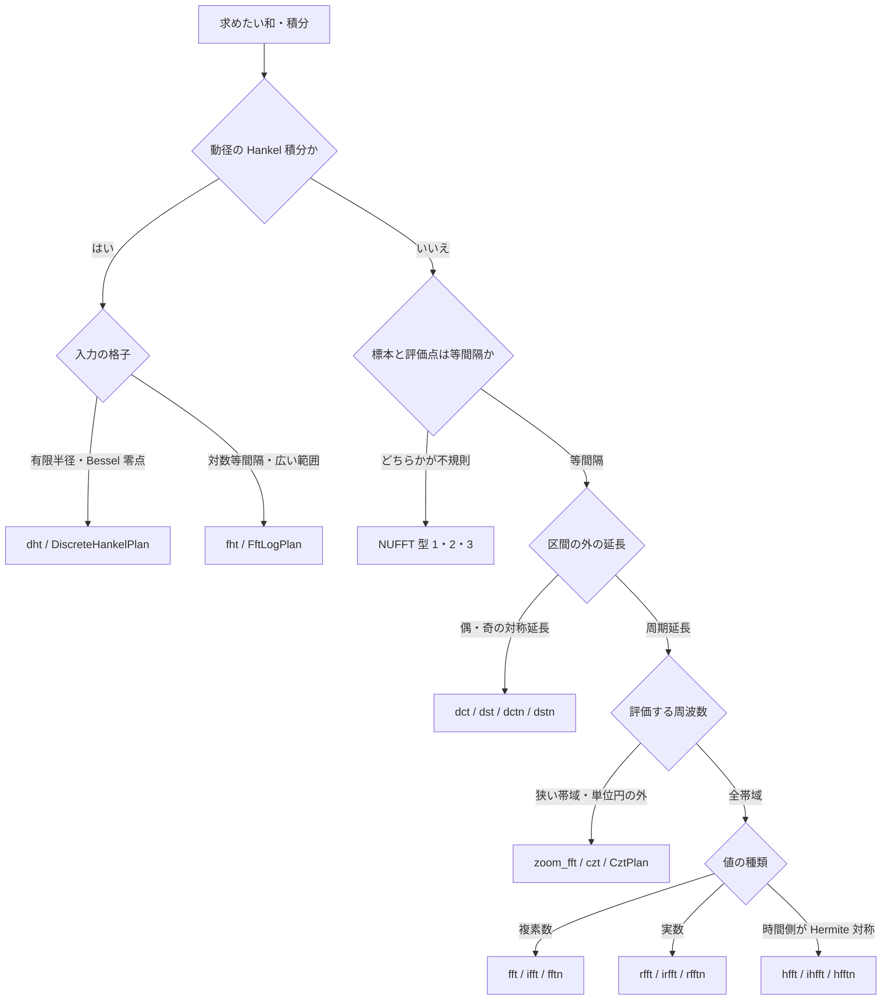

変換を選ぶときは、まず求めたい和や積分と、標本の配置を決める。
次に、値が実数か複素数か、どの軸を変換するか、区間の外をどう延長するか、どの周波数で評価するかを決める。
同じ計算を何度行うかによって、変換の種類とは別に、関数と Plan のどちらで呼ぶかを決める。
このページはその順に選択肢の計算コストと、それぞれが使えなくなる条件を比べる。

## 判断の流れ

図の分岐は計算する和の定義を選ぶためのものである。
DFT を選んでも、元の連続信号が周期的になるわけではない。
有限の列を周期延長したときの継ぎ目の段差が問題になるなら、窓関数か対称延長（DCT・DST）を考える。
どの分岐でも、次元が 2 以上なら多次元の関数や Plan を、同じ形の変換を繰り返すなら Plan を使う（[次元と変換軸](#次元と変換軸)、[一回の計算と繰り返し](#一回の計算と繰り返し)）。

## 長さとアルゴリズム

`scioxide-fft` の FFT は任意の長さ $n \ge 1$ を受け付け、Plan が長さの素因数からアルゴリズムを選ぶ。
どの長さでも演算量は $O(n\log n)$ だが、係数と作業領域はアルゴリズムで変わる。

| 長さ $n$ | 選ばれるアルゴリズム | 1 回の実行と作業領域 | 注意点 |
|---|---|---|---|
| 素因数が 2・3・5・7 だけ | 混合基数の Cooley–Tukey（基数 2、3、4、5、7） | $O(n\log n)$ の係数が最も小さい。作業領域は複素数 $2n$ 個 | `next_fast_len(n)` が $n$ 以上で最小のこの形の長さを返す |
| $2^{20}$ 以下の素数 $p$ で、$p-1$ の素因数が 7 以下 | Rader（長さ $p-1$ の巡回畳み込み）。計算コストの見積もりが Bluestein より大きければ Bluestein | 長さ $p-1$ の FFT 2 回と $O(p)$、作業領域は複素数 $p + 2(p-1)$ 個 | どちらを選んだかは `FftPlan::diagnostics` で分かる |
| それ以外 | Bluestein（長さ $L \ge 2n-1$ の 2・3・5・7 の積の長さの畳み込み） | 長さ $L$ の FFT 2 回と $O(L)$、作業領域は複素数 $n + 2L$ 個 | $L \ge 2n-1$ なので、近い長さの混合基数の FFT より演算と作業領域が多い |
| 1 | 恒等写像 | なし | |

作業領域の個数は複素数の配置の `FftPlan` が `workspace_requirements` で求める値で、先頭の $n$ 個は縮めた入力を写す領域である。

長さを変えると、計算する和そのものが変わる。
ゼロパディングで長さを `next_fast_len` に伸ばすと、ビンの周波数 $k/L$ が変わり、元の長さ $n$ の DFT の値ではなくなる。
ゼロパディングは畳み込みの循環を避けるとき（[畳み込みと相関](../algorithms/convolution-correlation-and-analytic-signals/)）や、離散時間 Fourier 変換を細かく標本化するときに、意味を理解したうえで行う。
DFT の値そのものが欲しいなら、遅い長さのまま変換する。
アルゴリズムの導出は [FFT のアルゴリズムと任意長変換](../algorithms/planner-and-arbitrary-lengths/) にある。

## 実数・複素数・Hermite の入力

実数列の DFT は $X_{n-k}=\overline{X_k}$（Hermite 対称性）を満たす。
`rfft` はこの対称性を使い、$\lfloor n/2\rfloor+1$ 個の複素ビンだけを返す。
偶数長では長さ $n/2$ の複素 FFT、奇数長では実数データの分解か長さ $n$ の複素 FFT を使うので、格納量は全スペクトルのおよそ半分になる。

| 入力と目的 | 関数 | 結果と使えなくなる条件 |
|---|---|---|
| 一般の複素標本の変換 | `fft`、`ifft`、`fftn` | 正と負の周波数を持つ全スペクトル。実数入力に使うと半分の計算が冗長になる |
| 実数標本の周波数成分 | `rfft`、`rfftn` | `HermitianSpectrum`（多次元は `HermitianSpectrumNd`）が論理長・形状を持つ |
| パックしたビンから実数標本へ | `irfft`、`irfftn` | 入力が丸め誤差の範囲で Hermite 対称でないと `InvalidInput` |
| 時間側が Hermite 対称な列から実数のスペクトルへ | `hfft`、`hfftn` | 逆向きは `ihfft`、`ihfftn`。検査は `irfft` と同じ |

ビンの数 $\lfloor n/2\rfloor+1$ だけでは、元の長さが偶数か奇数かを区別できない。
`HermitianSpectrum` は論理長を持ち、Plan に借用したビンを渡すときは `FftInput::hermitian(logical_len, bins)` などで論理長を指定する。
詳しくは [実数 FFT と Hermite 対称性](../algorithms/real-and-hermitian-transforms/) にある。

## 次元と変換軸

| データ | 関数・Plan | 計算コスト | 注意点 |
|---|---|---|---|
| 行優先にパックした多次元配列 | `fftn`、`rfftn`、`dctn`、`dstn` と各逆変換 | 要素数 $V$、選んだ軸の長さ $n_a$ に対し $O(V\sum_a\log n_a)$ | 選ばなかった軸は独立な列（バッチ）として残る |
| ストライド付きの配列、同じ形の繰り返し | `FftNdPlan`（`NdView` を渡す）、`RealTransformNdPlan` | 同上。準備は一度だけ | `execute_in_place` で入力の上に書ける |
| 多次元配列の一つの軸だけを CZT・NUFFT・Hankel・FFTLog で変換 | 各 Plan の `execute_axis_into` | 列ごとの計算コスト × 列の数 | 作業領域は `AxisWorkspaceRequest::Axis` で求める |

実数の多次元変換で詰められるのは、選んだ軸の最後の一つだけである。
`dctn` と `dstn` は軸ごとに型を選べ、DCT と DST を軸ごとに混ぜるときは `RealTransformNdPlanSpec` に `RealTransformKind` の列を渡す。
形状と詰め方は [実数配列の詰め方](oxref:fft-real-nd-layout) で確かめる。

## 非一様な標本と評価点

標本の位置か評価する周波数が等間隔でないときは、非一様 Fourier 変換（NUFFT）か直接和を使う。
補間で等間隔の格子に移してから FFT を使う方法は、補間モデルの誤差が和の値に加わる。
NUFFT も内部で格子への拡散と補間を使うが、その誤差は Kaiser–Bessel 核の幅で要求精度まで下げる。

| 型 | 入力 → 出力 | 関数 |
|---|---|---|
| 型 1 | 不規則な位置 $x_j$ の重み → 整数のモード | `nufft_type1` |
| 型 2 | 整数のモードの係数 → 不規則な位置での値 | `nufft_type2` |
| 型 3 | 不規則な位置の重み → 任意の周波数 $\omega_k$ | `nufft_type3` |

点の数を $M$、モードの数を $N$（$d$ 次元ではその積）、核の幅を $w$ とすると、計算コストは次のように比べられる。

| 方法 | 演算量 | 誤差 | 使えなくなる条件 |
|---|---|---|---|
| 直接和 | $O(MN)$ | 丸め誤差だけ | $MN$ が大きいと時間がかかる。独立な検算には向く |
| NUFFT 型 1・2 | $O(Mw^d + G\log G)$、$G$ は過標本の格子点数（既定の過標本率 2 では、各軸で $2N_a$ 以上の最小の 2 のべき） | 入力の $\ell^1$ ノルムに対する推定誤差が要求精度以下 | 丸め誤差の推定より小さい要求精度は `NumericalInstability`。出力が $\lVert c\rVert_1$ よりずっと小さいと相対誤差は大きい |
| NUFFT 型 3 | 同上。$G$ は点の広がりと周波数の広がりの積で決まる | 同上（拡散と補間の 2 段で推定が増える） | 点と周波数の両方が広いと格子が大きくなる |
| 補間 + FFT | $O(M + N\log N)$ | 補間モデルの誤差が加わり、要求精度で制御できない | 標本の間隔が大きく変わるデータ |

NUFFT は指数和を評価するだけで、不規則な観測から未知の係数を推定する逆問題は解かない。
型 2 は型 1 の逆変換ではなく、別の和である。
要求精度と推定誤差の関係は [NUFFT の核と要求精度](../algorithms/nufft-kernel-and-accuracy/) にある。

## 評価する周波数の範囲

等間隔の標本で、全帯域を等間隔に評価するなら FFT を使う。
一部の帯域だけを細かく評価したいときは、ゼロパディングした FFT、`zoom_fft`、`czt` のどれかを使う。
どの方法も同じ離散時間 Fourier 変換を細かく標本化するだけで、近い二つの周波数を分ける機能（分解能、およそ $1/T$、$T$ は観測時間）は上がらない。

| 方法 | 評価点 | 演算量（入力 $n$、出力 $m$） | 使えなくなる条件 |
|---|---|---|---|
| FFT | 全帯域の $n$ 点 | $O(n\log n)$ | 格子の間隔が $f_s/n$ に固定される |
| ゼロパディングした FFT | 全帯域の $P$ 点（間隔 $f_s/P$） | $O(P\log P)$ | 狭い帯域だけが要るとき、帯域外の $P-m$ 点も計算して捨てる |
| `zoom_fft` | 単位円上の帯域 $[f_0, f_1]$ の $m$ 点 | $L = $ `next_fast_len(n + m − 1)` の FFT 2 回と $O(n+m)$ | 誤差の上界は重み付きの入力の和 $B$ に対する絶対誤差で、$B$ よりずっと小さい出力は相対誤差が大きい |
| `czt`（単位円の外の螺旋） | $z_k = e^{\rho_0 + k\rho + 2\pi i(t_0 + kt)}$ | 上と同じ。$nm \le 4096$ か $\chi = \lvert\rho\rvert\max(n,m)^2 > 0.5$ なら直接和の $O(nm)$ | 誤差の上界に $e^{2\chi}$ が掛かる。半径が大きく変わる輪郭では直接和に切り替わり、遅くなる |

同じ帯域の点を $P$ 点のゼロパディング FFT で得るには $P = f_s/\Delta f$ が要るので、$m \ll P$ なら `zoom_fft` のほうが計算が少ない。
選ばれたアルゴリズムは `CztPlan::algorithm` で分かる。
導出と誤差の上界は [CZT のアルゴリズムの選択と誤差](../algorithms/czt-algorithms-and-accuracy/) にある。

## 境界条件と DCT・DST の型

DFT の周期は $N$ 標本で、最後の標本は最初の標本の一つ手前に位置する。
そのため、最初と最後の標本の値が違うことだけでは、周期延長に段差があるとは言えない。
段差が問題になるのは、$x_{N-1}$ から $x_0$ への変化が隣どうしの標本の変化よりずっと大きいときである。

DCT は偶対称、DST は奇対称の延長に対応するが、両端の対称の中心と偶奇は型ごとに違う。
「Neumann なら DCT、Dirichlet なら DST」とだけ覚えて型を取り替えると、格子の位置が合わない。
次の表で、入力 $x_0,\dots,x_{n-1}$ をどの点の周りでどう延長するかを確かめる（整数は標本の位置、半整数は標本の中間）。

| 型 | 左端の延長 | 右端の延長 | 対応する境界条件と格子 |
|---|---|---|---|
| DCT-I | $j = 0$ の周りで偶 | $j = n-1$ の周りで偶 | 両端 Neumann、端点を含む格子 |
| DCT-II | $j = -1/2$ の周りで偶 | $j = n-1/2$ の周りで偶 | 両端 Neumann、セル中心の格子 |
| DCT-III | $j = 0$ の周りで偶 | $j = n$ の周りで奇 | 左 Neumann・右 Dirichlet、端点を含む格子 |
| DCT-IV | $j = -1/2$ の周りで偶 | $j = n-1/2$ の周りで奇 | 左 Neumann・右 Dirichlet、セル中心の格子 |
| DST-I | $j = -1$ の周りで奇 | $j = n$ の周りで奇 | 両端 Dirichlet、内部の格子点だけを持つ格子 |
| DST-II | $j = -1/2$ の周りで奇 | $j = n-1/2$ の周りで奇 | 両端 Dirichlet、セル中心の格子 |
| DST-III | $j = -1$ の周りで奇 | $j = n-1$ の周りで偶 | 左 Dirichlet・右 Neumann、端点を含む格子 |
| DST-IV | $j = -1/2$ の周りで奇 | $j = n-1/2$ の周りで偶 | 左 Dirichlet・右 Neumann、セル中心の格子 |

逆変換には逆にしたい順変換の型を渡す。
`idct(…, DctType::II, …)` は DCT-III を実行し、I と IV は自分自身が双対である。
長さの下限は DCT-I が 2 で、他の型は 1 である。
延長と境界条件の導出は [DCT・DST と境界条件](../algorithms/dct-dst-and-boundaries/)、差分ラプラシアンの対角化は[差分ラプラシアンの対角化](../algorithms/laplacian-diagonalization/)にある。
変換で基底の係数を求めることと、微分方程式の右辺や境界条件を組み立てることは別の作業である。

## 動径の格子

軸対称な関数の Fourier 変換は、Hankel 変換 $\int_0^\infty f(r)J_\nu(kr)\,r\,dr$ になる。
`scioxide-fft` は二つの離散化を持ち、格子と計算コストが大きく違う。

| 観点 | 離散 Hankel 変換（`dht`、`DiscreteHankelPlan`） | FFTLog（`fht`、`FftLogPlan`） |
|---|---|---|
| 格子 | $r_m = R\,j_m/j_{n+1}$（$j_m$ は $J_\nu$ の正の零点） | $\ln r$ が等間隔の $n$ 点 |
| 適した関数 | 半径 $R$ の外で 0 とみなせる関数 | 何桁にもわたる範囲で、両端でべき的に減衰する関数 |
| 準備 | 利用者が渡す最初の $n+1$ 個の零点を検査し、$n(n+1)/2$ 個の Bessel 関数の値から $n\times n$ 行列を作る | $n$ 個の乗数を複素 log-gamma 関数で求める |
| 1 回の実行 | 行列とベクトルの積、$O(n^2)$ | 長さ $n$ の複素 FFT 2 回と $O(n)$ |
| 逆変換 | 別の求積で、厳密な逆ではない | 離散写像の厳密な逆（丸めを除く） |
| 使えなくなる条件 | 零点が連続した最初の零点でないと `InvalidInput`。$\nu \le -1/2$ も同じ。$n$ が大きいと $O(n^2)$ が重い | $\ln r$ の周期延長の継ぎ目でリンギングが出る。乗数が Γ 関数の極に当たると `Singular` |

離散 Hankel 変換の零点は呼び出し側が用意する（`scioxide-special` で求められる）。
FFTLog の誤差は連続積分の誤差を保証しないので、バイアス $q$ と `fftlog_low_ringing_offset` の選び方を含めて [FFTLog と対数格子](../algorithms/fftlog/) で確かめる。
離散 Hankel 変換の零点の検査と標本数の選び方は [動径方向の変換と離散 Hankel 変換](../algorithms/radial-transforms/) にある。

## 一回の計算と繰り返し

| 使い方 | API | 確保と再利用 |
|---|---|---|
| 一回の計算 | `fft`、`rfft`、`dct`、`czt`、`nufft_type1` など | 呼び出しごとに Plan を作って捨て、結果を新しい `Vec` などに入れて返す |
| 同じ仕様の繰り返し | `FftPlan`、`RealTransformPlan`、`CztPlan`、`NufftPlan` など | Plan と作業領域を一度だけ準備する。`execute_into` は十分な作業領域があればヒープを確保しない |
| 複数の長さの繰り返し | `FftPlanCache` | `FftPlan` の表を上限付きの LRU で保持する。方向と正規化だけが違う Plan は表を共有する |
| 外部の FFT 実装を使う | `FftPlanningContext` と `FftProvider` | 実装のリソースの上限（`FftProviderLimits`）を指定する。この Plan はキャッシュされない |

Plan は方向と正規化を準備のときに固定するので、逆方向には別の Plan を用意する。
一つの `FftWorkspace` を複数の Plan で使い回すときは、使う前にその Plan の要件で `check` か `try_reserve` を呼ぶ。
作業領域は最大の要件まで伸びて縮まず、前の Plan のために確保した容量も上限の判定に数えられる。

確保を避けられるのは、準備した Plan の `execute_into`（と `execute_axis_into`、`execute_in_place`）だけである。
Plan と作業領域の準備、関数の呼び出しは確保を伴い、外部実装の内部の確保はその実装の仕様に従う。
Plan のキャッシュは [FFT の Plan・作業領域・キャッシュ](../algorithms/plans-workspaces-and-providers/) に、外部実装の注入と CPU 命令セットの選択は [外部 FFT 実装と CPU 命令セット](../algorithms/providers-and-cpu-backends/) にある。

## 正規化の選択

`Normalization` は順変換と逆変換のどちらに係数を置くかを選ぶ。
長さ $N$ の Fourier 変換（多次元では選んだ軸の長さの積）では次のとおりである。

| `Normalization` | 順変換 | 逆変換 | 向いている用途 |
|---|---|---|---|
| `Inverse` | $1$ | $1/N$ | 振幅を $\lvert X_k\rvert/N$ で読む解析 |
| `Forward` | $1/N$ | $1$ | Fourier 係数 $\hat f_k$ をそのまま得たいスペクトル法 |
| `Orthonormal` | $1/\sqrt N$ | $1/\sqrt N$ | 二乗和を保ちたいとき、変換を直交行列として扱うとき |
| `Unscaled` | $1$ | $1$ | 畳み込みで係数を最後にまとめて掛けるとき。往復すると $N$ 倍になる |

DCT・DST、チャープ Z 変換、NUFFT は $N$ の数え方が違い、離散 Hankel 変換と FFTLog は `Normalization` を取らない（[正規化](oxref:fft-normalization)）。
Parseval の等式の導出は [正規化と Parseval の等式](oxref:fft-normalization-conventions) にある。

## 検算の選択

往復の差は順変換と逆変換が整合していることを示すが、両方に共通する誤り（周波数軸の取り違え、正規化の重複）を見落とす。
Parseval の等式、定義どおりの和、既知の変換対、既知の解から作った右辺など、別の関係でも確かめる。

周波数軸は `fftfreq` か `rfftfreq` で作り、標本の間隔の単位を明示する。
手でスペクトルを編集したときは、正規化と共役対称性も確かめる。
小さい往復誤差だけから、連続信号の復元や連続積分の精度を判断しない。

| 変換 | 独立な検算の例 |
|---|---|
| FFT、`rfft` | 小さい $n$ の定義どおりの和、Parseval の等式、純音の位置と振幅 |
| DCT・DST | 型の定義の和、差分ラプラシアンの固有ベクトル |
| `zoom_fft`、`czt` | 同じ周波数での直接和 |
| NUFFT | 一部の出力での直接和と、推定誤差との比較 |
| Hankel、FFTLog | Gauss 関数など解析的な変換対 |

## まとめ

長さはアルゴリズムと計算コストを変えるが、どの長さでも $O(n\log n)$ で計算でき、ゼロパディングは計算する和を変えるので目的があるときだけ行う。
実数入力には `rfft`、多次元配列には `fftn`・`rfftn`、不規則な位置には NUFFT、狭い帯域には `zoom_fft`、対称延長には型を延長の位置で選んだ DCT・DST を使う。
動径の積分は有限半径なら離散 Hankel 変換（$O(n^2)$）、広い対数範囲なら FFTLog（$O(n\log n)$）を選ぶ。
同じ形の変換を繰り返すなら Plan と作業領域を用意し、正規化は Plan とは別に用途から選ぶ。
結果は往復の差だけでなく、直接和や既知の変換対でも確かめる。

## 次に読むページ

- [高速フーリエ変換とスペクトル法](../algorithms/) では選んだ変換に共通する記法、正規化、入力の検査と失敗の扱いを確かめる。
- [標本化・折り返し・周波数軸](../algorithms/sampling-and-frequency-axis/) ではビンの番号と物理的な周波数の対応を確かめる。
- [API ガイド](../api/) では選んだ関数と Plan の引数、出力の型、作業領域の要件を調べる。
