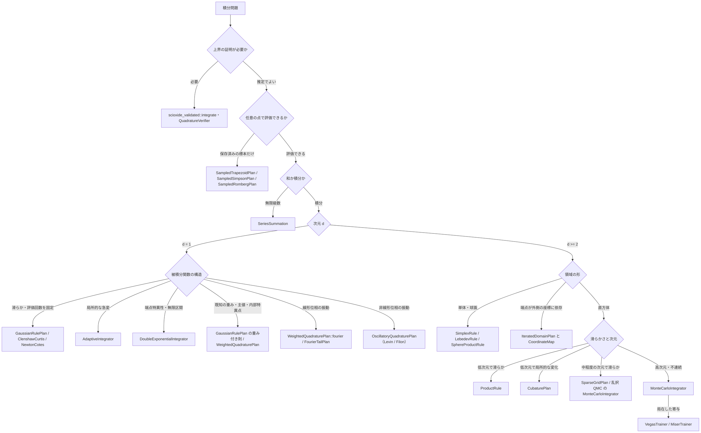

求積法は、被積分関数 $f$ の性質（滑らかさ、特異性、振動、局所的な急変）、領域の形（有界区間、無限区間、直方体、単体、球面、外側の座標に依存する領域）、次元 $d$、任意の点で $f$ を評価できるか、許される評価回数で選ぶ。
計算の前に被積分関数の振る舞いを解析的に調べておくと、不要な細分を避けられ、検算の方法も決めやすい。
既知の重み、特異点の位置、振動の位相は、被積分関数の中で計算せずに Plan の側に持たせると、精度と評価回数の両方で有利になる。

次の図は選択の大まかな順序を示す。
各分岐の詳細は図の後の表にある。

## ワンショット関数と設定した Plan

候補が決まったら、次に呼び方を選ぶ。
既定の設定で値だけが必要なら、ワンショット関数を使う。
ワンショット関数は既定の設定の Plan と作業領域をその場で作って逐次に実行し、成功したときだけ答えを返す。
表の上から 6 個（`integrate` から `integrate_iterated` まで）は値と誤差の推定を `Integral` で返す。
成功でない終了はエラーになり、上限による停止は `ConvergenceFailure` の `EvaluationLimit`・`IterationLimit`・`ResourceLimit`・`TruncationLimit`、停滞と発散は `Stagnation`・`Divergence`、表せる評価点がない場合は `NumericalInstability`（`Breakdown`）である。
誤差の推定は Plan のレポートの `error_estimate()` と同じ推定値で、上界ではない。
レポートに推定がない成功では、領域の測度が 0 なら 0、それ以外はスカラーの最大の有限値になる。

| 問題 | ワンショット関数 | 既定の手法 | 設定して使う型 |
|---|---|---|---|
| 有限区間 $[a,b]$（端点特異性を含む） | `integrate(f, a, b)` | 大域適応 G7K15 と Wynn の ε アルゴリズムによる外挿、二分 50 回 | `AdaptiveIntegrator` |
| 位置の分かった折れ目・跳び・特異点 | `integrate_piecewise(f, a, b, &points)` | 分割点を領域の境界に置いた適応 G7K15（外挿なし）、二分 50 回 | `WeightedQuadraturePlan::breakpoints` |
| 有限区間の $f(x)\cos\omega x$、$f(x)\sin\omega x$ | `integrate_fourier(f, a, b, omega, weight)` | 振動の強い区間では Chebyshev モーメント（16 段）を使う修正 Clenshaw–Curtis 則、他の区間では G7K15 の適応求積、二分 50 回 | `WeightedQuadraturePlan::fourier` |
| 半直線 $[a,\infty)$、$(-\infty,b]$、実軸 | `integrate_unbounded(f, domain)` | exp–sinh 変換（$(-\infty,b]$ は $x=-t$ で反転）、実軸は sinh–sinh 変換、15 段 | `DoubleExponentialIntegrator` |
| 直方体 | `integrate_box(f, &lower, &upper)` | $d=1$ は適応 G7K15、$d\ge2$ は Genz–Malik 則の適応 cubature、二分 50 回 | `CubaturePlan` |
| 端点が外側の座標に依存する領域 | `integrate_iterated(f, bounds, d)` | 各軸の適応 G7K15 の入れ子、二分は全軸を通して 50 回 | `IteratedDomainPlan` |
| 高次元の直方体のスカラー値の積分 | `integrate_monte_carlo(f, &lower, &upper, &rng)` | 乱数の系列 0 から一様標本 4096 個、95 % の Student-t 区間。幅 0 の軸は拒む | `MonteCarloIntegrator` |
| 保存した標本 | `trapezoid`、`simpson`、`cumulative_trapezoid` | 非一様格子の台形則と Simpson 則 | `SampledTrapezoidPlan`、`SampledSimpsonPlan` |
| 無限級数 | `sum_series(term, first)` | 次数 8 の Levin u 変換、項は 256 個まで | `SeriesSummation` |

許容誤差はどれも絶対・相対とも $\sqrt\varepsilon$（`f64` で約 $1.49\times10^{-8}$）である。
許容誤差や上限、手法を変える場合、終了理由と評価回数を読む場合、上限で止まった推定値も使う場合は、表の右の列の Plan や積分器を設定して使う。
同じ Plan で何度も積分する場合も、Plan と作業領域を作り置きして `integrate_into` を呼ぶ。
`integrate_monte_carlo` は統計 `MonteCarloStatistics`、`sum_series` は `SeriesResult` を返し、標本データの関数は誤差の推定を返さない。

## 1 次元の滑らかな関数と局所的な特徴

$f$ が区間 $[a,b]$ で滑らかなら、評価回数を固定した則で十分なことが多い。
固定則（`FixedRule` を実装する則）の終了理由は `FixedRuleCompleted` で、埋め込み対を持つ `GaussKronrod` 以外は誤差推定を返さない。
精度は点数や次数を変えた比較で確かめる。
導出は[Newton–Cotes 公式と複合則](../algorithms/newton-cotes-and-romberg/)、[Euler–Maclaurin 展開と Romberg 外挿](../algorithms/romberg-extrapolation/)、[Gauss 型求積と Clenshaw–Curtis 則](../algorithms/gaussian-and-clenshaw-curtis/)、[埋め込み対と大域適応求積](../algorithms/adaptive-quadrature/)にある。

| 関数の性質 | 第一の候補 | 理由と注意 | 関連する例題 |
|---|---|---|---|
| 滑らかで、評価回数を固定したい | `GaussianRulePlan::gauss_legendre(n)` | $n$ 点で次数 $2n-1$ までの多項式を厳密に積分する。$f$ が楕円 $E_\rho$ の内部で解析的なら誤差は $O(\rho^{-2n})$ | [二次元開口の透過量を求める](../examples/aperture-cubature/) |
| 端点を節点に含めたい | `ClenshawCurtis::new(n)`、`GaussianRulePlan` の `Lobatto` | Clenshaw–Curtis は $n+1$ 個の入れ子の Chebyshev 極値点を使う。Lobatto は両端を含み厳密次数 $2n-3$ | — |
| 等間隔の格子に限られる | `NewtonCotes::new(nodes, endpoints, panels)` | 台形・Simpson・Boole などの複合則。11 点を超える型は重みの符号が交互になるので提供しない | — |
| 1 回の固定則で誤差の目安も欲しい | `GaussKronrod::new(GaussKronrodRule::G7K15)` など | Gauss 則と Kronrod 拡大の差を誤差推定として返す。細分はしない | — |
| 解析的で、刻みの半減を重ねたい | `Romberg::new(LevelOptions)` | 台形則の誤差の偶数べき展開を外挿で消す。$f$ が滑らかでない点を持つと外挿の効果が落ちる | — |
| 狭いピーク・急変・境界層 | `AdaptiveIntegrator::new(AdaptiveRule::GaussKronrod, options)` | G7K15 の誤差推定が大きい区間を大域的に二分する。評価回数は $15+30s$（$s$ は二分の回数） | [幅の狭いピーク](../examples/narrow-peak/) |
| 端点を評価してよい区分的な関数 | `AdaptiveRule::Simpson` | 1 区間 9 点の入れ子の Boole 則を比べる。成功までに 15 回以上の二分と 130 回以上の評価を使う | — |
| 特徴の位置が分かっている | `integrate_piecewise`、`WeightedQuadraturePlan::breakpoints`、または区間を分けて呼ぶ | 分割点を評価せずに G7K15 の領域の境界に置く | [幅の狭いピーク](../examples/narrow-peak/) |

## 端点特異性と無限区間

被積分関数が端点で発散する場合や、区間が無限に伸びる場合は、変数変換か重み関数でその振る舞いを吸収する。
二重指数変換は[広義積分と端点特異性の二重指数変換](../algorithms/improper-singular-and-oscillatory/)、端点重みは[端点重み・主値・複素経路の重み付き求積](../algorithms/weighted-rules-and-sensitivities/)で扱う。

| 状況 | 第一の候補 | 理由と注意 | 関連する例題 |
|---|---|---|---|
| 端点の代数・対数特異性（指数が未知） | `DoubleExponentialIntegrator`（`DoubleExponentialDomain::Finite`） | tanh–sinh 変換で端点の寄与を二重指数的に減衰させる。収束したときの成功は `HeuristicToleranceReached` だけ（幅 0 の区間では `DegenerateDomain`） | [振り子の周期を特異な積分として求める](../examples/pendulum-singular-quadrature/) |
| 内部の特異点の位置が分かっている | `Finite { interval, singular_points }` | 特異点で区間を分け、各区間で tanh–sinh 変換を使う。コールバックの `DoubleExponentialPoint::nearest_endpoint` で端点までの距離を正確に得る | — |
| 半無限区間 $[a,\infty)$、実軸全体 | `DoubleExponentialDomain::HalfLine { lower }`、`RealLine` | exp–sinh、sinh–sinh 変換。尾部の打ち切りは観測した減衰による経験的な判断 | [黒体放射の Stefan–Boltzmann 定数と帯域率](../examples/blackbody-radiation/) |
| 端点の重み $(x-a)^\alpha(b-x)^\beta$ と対数（指数が既知） | `WeightedQuadraturePlan::endpoint`、`EndpointWeight::new(alpha, beta, left_log, right_log)` | 重みの修正モーメントを使って積分し、コールバックは滑らかな因子だけを返す。$\alpha,\beta>-1$ | — |
| 端点特異性を細分で解く | `integrate`、`AdaptiveIntegrator::with_extrapolation(true)` | 二分の列を Wynn の ε アルゴリズムで外挿する。ワンショット呼び出しの `integrate` はこの外挿を使う。発散の兆候は `ProbablyDivergent` | — |
| 古典重み $x^\alpha e^{-x}$、$e^{-x^2}$ を持つ | `GaussianRulePlan`（`GeneralizedLaguerre`、`HermiteH` など） | 下の古典重みの表を参照 | [量子調和振動子の期待値と Gauss–Hermite 求積の厳密次数](../examples/quantum-oscillator-expectations/) |

## 振動積分と複素経路

正負の寄与が打ち消し合う振動積分は、振動を節点で追うと評価回数が振動の回数に比例して増える。
位相が分かっていれば、振動因子を重みとして扱える。
線形位相と Fourier 尾部は[振動積分の相殺と Fourier 積分の尾部](../algorithms/fourier-integrals-and-tails/)、非線形位相は[非線形位相の振動積分（Levin・Filon）](../algorithms/phase-aware-oscillatory/)、複素経路は[端点重み・主値・複素経路の重み付き求積](../algorithms/weighted-rules-and-sensitivities/)で扱う。

| 状況 | 第一の候補 | 理由と注意 | 関連する例題 |
|---|---|---|---|
| 有限区間の $f(x)\cos(\omega x)$、$f(x)\sin(\omega x)$ | `WeightedQuadraturePlan::fourier(interval, points, omega, FourierWeight, options)` | 振動因子の Chebyshev モーメントを使う修正 Clenshaw–Curtis 則で積分する | [減衰する高周波信号を積分する](../examples/damped-oscillation/) |
| 半直線や実軸の Fourier 積分 | `FourierTailPlan::new(FourierDomain, omega, FourierWeight, options)` | 周期ごとの部分和を外挿する。成功は `HeuristicToleranceReached` で、`FourierDomain::RealLine` は $(-\infty,0]$ と $[0,\infty)$ の積分がそれぞれ収束する必要がある（対称な主値ではない） | [減衰する高周波信号を積分する](../examples/damped-oscillation/) |
| 非線形位相 $f(x)\cos(\omega g(x))$ | `OscillatoryQuadraturePlan::new(OscillatoryMethod::Levin, ...)` | Levin の選点法は $g$ と $g'$ だけを使う。領域ごとに $\lvert g'\rvert$ の下限を宣言する | [Fresnel 積分とコルニュ螺旋](../examples/fresnel-cornu-spiral/) |
| 位相の逆関数が分かる | `OscillatoryMethod::Filon` | 位相座標 $\varphi=g(x)$ で Filon–Clenshaw–Curtis 則を使う。逆関数の枝を与える | — |
| 複素平面の経路積分 | `ContourPlan::new(parameter_interval, breakpoints, options)` | 経路の写像 $z(t)$ と $z'(t)$ を与え、パラメータ $t$ で適応 G7K15 を使う。分枝は呼び出し側が選ぶ | — |

## 古典重み付き Gauss 求積

被積分関数が既知の重み関数 $w(x)$ を含む場合は、重みを $f$ の中で計算せず、その重みに対する直交多項式族の `GaussianRulePlan` を使う。

$$
\int f(x)\,w(x)\,dx \approx \sum_{i=1}^n w_i\,f(x_i).
$$

重みを則の側で扱うと、端点特異性や無限区間の減衰を節点と重みが表し、コールバックは滑らかな因子だけを返せばよい。
重み付きの族は `integrate_weighted` または `integrate_weighted_into` に `GaussianSupport` を渡して使う。
`FixedRule::integrate` は重みが恒等的に 1 の族（Legendre、`Jacobi { alpha: 0, beta: 0 }`、`Gegenbauer { lambda: 0.5 }`）だけを受け付ける。

| 族（`OrthogonalFamily`） | 標準の定義域 | 重み関数 $w(x)$ | `GaussianSupport` | 主な用途 |
|---|---|---|---|---|
| `Legendre` | $[-1,1]$ | $1$ | `Interval` | 有限区間の滑らかな積分 |
| `ChebyshevT` | $[-1,1]$ | $(1-x^2)^{-1/2}$ | `Interval`（$[a,b]$ では $1/\sqrt{(x-a)(b-x)}$） | 端点の逆平方根特異性 |
| `ChebyshevU` | $[-1,1]$ | $(1-x^2)^{1/2}$ | `Interval` | 端点で平方根的に 0 になる場 |
| `Jacobi { alpha, beta }` | $[-1,1]$ | $(1-x)^\alpha(1+x)^\beta$ | `Interval` | 非対称な端点の代数特異性、Beta 分布（$\alpha,\beta>-1$） |
| `Gegenbauer { lambda }` | $[-1,1]$ | $(1-x^2)^{\lambda-1/2}$ | `Interval` | 対称な端点の代数的振る舞い（$\lambda>-1/2$、$\lambda\ne0$） |
| `Laguerre` | $[0,\infty)$ | $e^{-x}$ | `HalfLine(c)` | 指数的に減衰する半無限区間 |
| `GeneralizedLaguerre { alpha }` | $[0,\infty)$ | $x^\alpha e^{-x}$ | `HalfLine(c)` | 原点の代数的振る舞いと指数減衰（$\alpha>-1$） |
| `HermiteH` | $(-\infty,\infty)$ | $e^{-x^2}$ | `RealLine` | 量子調和振動子、熱核 |
| `HermiteHe` | $(-\infty,\infty)$ | $e^{-x^2/2}$ | `RealLine` | 標準正規分布の期待値 |

コールバックに同じ重みを重ねて掛けない。
たとえば Gauss–Laguerre 則では、コールバックは $e^{-x}$ を除いた因子だけを返す。

端点を節点に含める変種は Legendre と Jacobi の族だけにある。
Gauss 則（`Gauss`）は厳密次数 $2n-1$、片端を含む Radau 則（`RadauLeft`・`RadauRight`）は $2n-2$、両端を含む Lobatto 則（`Lobatto`、$n\ge2$）は $2n-3$ である。

## 主値と標本データ

| 状況 | 第一の候補 | 理由と注意 |
|---|---|---|
| Cauchy の主値 $\mathrm{PV}\int_a^b f(x)/(x-c)\,dx$ | `WeightedQuadraturePlan::principal_value(interval, pole, options)` | 極を重みとして扱う。極が端点にあると拒否する |
| 非一様な座標の保存標本 | `SampledTrapezoidPlan::new(&coords)`、`SampledSimpsonPlan::new(&coords)` | 座標は狭義単調であればよい。累積積分 `cumulative_into` と配列の軸ごとの積分 `axis_into` もある |
| $2^k+1$ 個の等間隔の保存標本 | `SampledRombergPlan::new(samples, spacing)` | 入れ子の台形則を外挿する。等間隔だけを受け付ける |

標本データの Plan はレポートも誤差推定も返さない。
主値は[端点重み・主値・複素経路の重み付き求積](../algorithms/weighted-rules-and-sensitivities/)、標本データは[標本データの積分](../algorithms/sampled-data-integration/)で扱う。
精度は標本の間隔を変えた比較や、別の則との差で確かめる。

## 無限級数

| 級数の性質 | 第一の候補 | 理由と注意 |
|---|---|---|
| 交代級数、線形収束 | `SeriesSummation::new(SeriesMethod::LevinU, ...)` または `WynnEpsilon` | 部分和の列を加速する。収束は証明しない |
| 対数収束（$a_n \sim n^{-p}$） | `SeriesMethod::LevinU` | 剰余推定 $(n+1)a_n$ が対数収束に合う |
| 項が滑らかな関数の標本で、尾部の積分と導関数が分かる | `SeriesMethod::EulerMaclaurin` | 利用者が与えた解析的な情報のもとで剰余の上界を持つ |

既定の設定の Levin u で和だけが必要なら、ワンショット関数 `sum_series(term, first)` が項の関数から和を求め、成功したときだけ `SeriesResult` を返す（項数の上限なら `ConvergenceFailure` の `TruncationLimit`）。
`SeriesTermination::is_success()` は `BoundedTailReached`、`ExactEmpty`、`HeuristicToleranceReached` で真になる。
Levin u と Wynn ε の収束判定 `HeuristicToleranceReached` も成功に数えるが、連続する加速値の一致による停止で、収束を証明しない。
加速は[無限級数の加速（Levin u・Wynn ε）](../algorithms/series-acceleration/)、Euler–Maclaurin 和は[Euler–Maclaurin 和と条件付きの上界](../algorithms/euler-maclaurin-summation/)で扱う。

## 多次元の積分

次元 $d$ が増えると、1 次元の則の直積は $n^d$ 回の評価を要する。
これを次元の呪いと呼ぶ。
直積則と cubature は[テンソル積則と Genz–Malik 適応 cubature](../algorithms/multidimensional-and-monte-carlo/)、反復積分は[可変端点の反復積分と座標写像](../algorithms/domains-and-geometric-rules/)、単体と球面は[単体と球面の求積則](../algorithms/simplex-and-sphere-rules/)、疎格子と QMC は[疎格子と乱択準 Monte Carlo](../algorithms/sparse-grids-and-qmc/)で扱う。
Monte Carlo 法は[Monte Carlo 積分の推定量と統計](../algorithms/monte-carlo-integration/)、重点抽出は[重点標本化の提案分布と有効標本数](../algorithms/importance-sampling-proposals/)、VEGAS と MISER は[適応 Monte Carlo（VEGAS・MISER）](../algorithms/adaptive-monte-carlo/)で扱う。

| 状況 | 候補 | 評価回数と結果の性質 | 関連する例題 |
|---|---|---|---|
| 2〜3 次元の直方体で滑らか | `ProductRule::new(rule, options)` | 1 次元の固定則の $n^d$ 点の直積。則が埋め込み対を持つ場合だけ誤差推定がある | [二次元開口の透過量を求める](../examples/aperture-cubature/) |
| 低次元の直方体で局所的な変化 | `CubaturePlan::new(&bounds, options)` | $d\ge2$ では 1 領域あたり $2^d+2d(d-1)+4d+1$ 点の Genz–Malik 則で適応的に分割する。成功は `HeuristicToleranceReached` | [二次元開口の透過量を求める](../examples/aperture-cubature/) |
| 特徴の位置が分かっている | `CubaturePlan::with_breakpoints(axis, fractions)` | 初期の領域を軸ごとに分ける | — |
| 端点が外側の座標に依存する | `IteratedDomainPlan::new(dimension, options)` と `CoordinateMap` | 各軸で適応 G7K15 を入れ子に使う。写像のヤコビアンは符号付き | — |
| 三角形・四面体・単体 | `SimplexRule::positive(dim, min_degree, options)`、`SimplexRule::new(dim, s, options)` | `positive` は次元 1〜3、次数 0〜7 の正の重みの内部則。`new` は全次数 $2s+1$ の Grundmann–Möller 則で、負の重みを持ちうる | — |
| 球面 | `LebedevRule::new(degree, options)`、`SphereProductRule::new(polar, azimuth, options)` | 同じ球面調和次数なら Lebedev 則の点数は積則の約 2/3。Lebedev は次数 3〜131 | [ダイポールアンテナの放射電力と Lebedev 則](../examples/dipole-radiation-lebedev/) |
| 中程度の次元で滑らか、変数の重要度に差 | `SparseGridPlan::new(dimension, options)` | 入れ子の Clenshaw–Curtis 則による次元適応 Smolyak 則。誤差推定は経験的 | [Genz の試験関数で疎格子・QMC・MC を比べる](../examples/genz-high-dimensional-benchmark/) |
| 中程度の次元で滑らか、統計的な不確かさが欲しい | `MonteCarloIntegrator` に `scioxide_random::QmcReplicatePlan` を渡す | 乱択 Sobol 点列の独立な複製のばらつきから Student-t 区間を作る | [Genz の試験関数で疎格子・QMC・MC を比べる](../examples/genz-high-dimensional-benchmark/) |
| 高次元、不連続（指示関数）、複雑な境界 | `MonteCarloIntegrator::new(&bounds, options)` に `RandomStreams` を渡す | 標準誤差 $O(N^{-1/2})$ の減り方は次元によらない。希少事象では相対誤差が大きい | [高次元の信頼度を Monte Carlo 積分で求める](../examples/high-dimensional-reliability/) |
| 局在したピーク | `VegasTrainer`、`MiserTrainer` | 学習した重点写像や層別化で分散を下げる。学習の標本は推定に入らない | — |

## パラメータ感度と包含が保証された区間

| 目的 | 候補 | 結果の性質 | 関連する例題 |
|---|---|---|---|
| $\int_{a(p)}^{b(p)} f(x,p)\,dx$ の $p$ に関する方向微分（JVP）や勾配（VJP） | `QuadratureSensitivityPlan::adaptive`、`fixed`、`frozen` | 被積分関数の導関数の作用を `SensitivityIntegrand` で与える。動く端点は Leibniz の項で扱う。成功は `report.termination().is_success()` で読む | [動く積分端点の感度を検算する](../examples/moving-boundary-sensitivity/) |
| 積分値を確実に含む区間 | `scioxide-validated` の `scioxide_validated::integrate`、`QuadratureVerifier` | 利用者が値と導関数の区間拡張を与え、$C^2$ の仮定で台形則の剰余、`EightTimesContinuouslyDifferentiable` の仮定で 4 点 Gauss–Legendre 則の剰余を区間演算で囲む。`scioxide_validated::integrate` は有限区間の $C^2$ の仮定だけを扱う | — |

感度の計算方法は[パラメータ感度と積分の JVP・VJP](../algorithms/parameter-sensitivities/)で扱う。
`scioxide-integrate` の誤差推定はどの手法でも推定であって証明ではない。
上界が設計の根拠になる場合は、`scioxide-validated` の包含区間を使う。

## 許容誤差と上限の設計

適応法の許容誤差と上限は `SubdivisionOptions`（適応二分の手法）と `LevelOptions`（`Romberg` と `DoubleExponentialIntegrator`）で与える。
停止の判定は各成分の推定誤差 $E_i$ を $\varepsilon_{\mathrm{abs},i} + \varepsilon_{\mathrm{rel}}|Q_i|$ で割り、選んだノルムで束ねた値が 1 以下かどうかである。
実数値ならこれは $E \le \varepsilon_{\mathrm{abs}} + \varepsilon_{\mathrm{rel}}|Q|$ と同じである。

- 絶対許容誤差 $\varepsilon_{\mathrm{abs}}$ は積分値と同じ単位を持つ。
  積分値が 0 に近い問題（打ち消し合いの大きい振動積分など）では相対許容誤差が働かないので、絶対許容誤差が実際の停止基準になる。
- 相対許容誤差 $\varepsilon_{\mathrm{rel}}$ は積分値に対する有効桁数を決める。
- `SubdivisionOptions` の既定は、絶対・相対許容誤差がともに $\sqrt{\varepsilon}$（`f64` で約 $1.49\times10^{-8}$）、ノルムが最大値ノルム、二分は 50 回まで、評価回数の上限なし、逐次実行である。
  ベクトル値には成分ごとの絶対許容誤差を `ErrorTolerance::try_vector` で与えられる。
- `LevelOptions` の既定は同じ許容誤差と 15 段である。
  `Romberg` は 6〜30 段、`DoubleExponentialIntegrator` は 4〜15 段を受け付ける。
- 上限は、次の作業単位がそれを超えるなら始めない硬い上限である。
  たとえば適応 G7K15 の二分は子 2 個分の 30 回の評価をまとめて照合する。
- 丸め誤差の下限より小さい許容誤差を与えると、それを下回る推定は得られず `Stagnation` で止まる。

## 成功の判定

`IntegrationTermination::is_success()` は `FixedRuleCompleted`、`ToleranceReached`、`HeuristicToleranceReached`、`SampleBudgetCompleted`、`DegenerateDomain` で真になる。
`HeuristicToleranceReached` は経験的な推定（観測した尾部の減り方など）が許容誤差を満たしたことを表し、成功に数える。
二重指数変換、Fourier 尾部、2 次元以上の `CubaturePlan`、疎格子が収束したときはこの終了理由になる。
無限級数の `SeriesTermination::HeuristicToleranceReached` も成功に数える。
どちらの成功も真の誤差の上界を意味しない。
`BudgetLimit`、`RefinementLimit`、`Stagnation`、`ProbablyDivergent` などで止まった結果の値は推定値として読み、許容誤差を満たしたとはみなさない。

## まとめ

まず上界の証明が必要か、被積分関数を任意の点で評価できるか、和か積分か、次元と領域の形を確かめ、図と表で候補を絞る。
既知の重み、特異点、振動の位相は Plan の側に持たせ、コールバックには滑らかな因子だけを渡す。
誤差推定のない固定則は点数を変えて比べ、適応法と統計的手法は終了理由と誤差の種類（推定、経験的な推定、標準誤差）を読み分ける。
許容誤差は絶対・相対の両方を問題の尺度に合わせて決め、既定の $\sqrt{\varepsilon}$ と 50 回の二分で足りるかを評価回数と終了理由で確かめる。

## 次に読むページ

- [数値積分の数理とアルゴリズム体系](../algorithms/)：終了理由、誤差推定の成分、作業領域の仕様を確かめる。
- [埋め込み対と大域適応求積](../algorithms/adaptive-quadrature/)：最も汎用の `AdaptiveIntegrator` の誤差推定と停止の規則を確かめる。
- [数値積分の例題と応用](../examples/)：具体的な問題で、手法の選択と独立な検算を確かめる。
- [数値積分の API ガイド](../api/)：表に挙げた型の全公開項目と仕様を確かめる。
