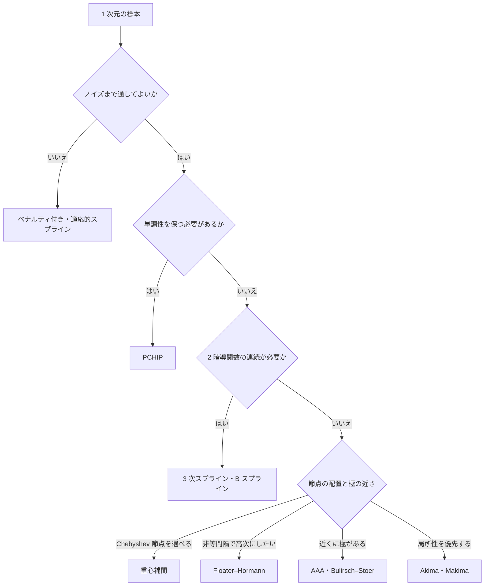

補間器の選び方でよくある誤りは、最も滑らかな手法を無条件に選ぶことである。
たとえば単調であるべき物性値や反応速度のデータに $C^2$ 級の 3 次スプラインを当てると、傾きが急に変わる付近で行き過ぎが起こり、逆向きの勾配や負の値が現れることがある。
補間器はデータの次元、標本点の配置（等間隔、非等間隔、直交格子、散在）、保つべき形の制約、評価の回数から選ぶ。

## 1 次元補間器の選び方

1 次元の標本 $(x_i, y_i)_{i=0}^n$ では、ノイズ、形の制約、滑らかさ、節点の自由度の順に問うと API が決まる。
次の図はその順序を示し、各手法の性質は後の表で比べる。



### 1 次元手法の性質

表の連続性は節点の上での接続を表し、局所性は一つの標本を変えたときに補間値が変わる範囲を表す。
誤差の列は十分に滑らかな $f$ を節点の間隔 $h$ で標本化した場合の補間誤差である。
$n + 1$ 点 $x_0, \dots, x_n$ を通る次数 $n$ 以下の多項式の誤差は、ある $\xi$ について次の剰余で表せる。

```text
f(x) − p(x) = f⁽ⁿ⁺¹⁾(ξ) / (n + 1)! · ∏ᵢ₌₀ⁿ (x − xᵢ)
```

ここで $\xi$ は節点と $x$ を含む最小の区間の中の点で、位置は分からない。
重心・Newton・Neville の補間器は同じ多項式を作るので、誤差はどれもこの式で決まり、違いは計算コストと丸め誤差に現れる。
Hermite 補間の剰余は各節点を 2 回数えた同じ形の式になる。

| 補間器 | 連続性 | 局所性 | 誤差（滑らかな $f$） | 長所と注意点 | 主な用途 |
| :--- | :--- | :--- | :--- | :--- | :--- |
| [`BarycentricInterpolator`](https://docs.rs/scioxide-interp/0.1.0/scioxide_interp/struct.BarycentricInterpolator.html) | $C^\infty$ | 大域的 | 上の剰余。Chebyshev 節点で解析的な $f$ なら $n$ について幾何級数的に減る | 第二種の重心公式で一点を $O(n)$ で評価する。重みの計算は $O(n^2)$、Chebyshev 節点と等間隔節点では閉形式で $O(n)$。精度は節点の Lebesgue 定数に左右される | Chebyshev 節点でのスペクトル近似 |
| [`NewtonInterpolator`](https://docs.rs/scioxide-interp/0.1.0/scioxide_interp/struct.NewtonInterpolator.html) | $C^\infty$ | 大域的 | 重心補間と同じ多項式なので同じ | 差分商の係数を $O(n^2)$ で作り、一点を $O(n)$ で評価する。`insert_point` は右端に節点を加えた新しい補間器を $O(n)$ で返し、既存の係数を保つ | 逐次に標本を加える計測 |
| [`HermiteInterpolator`](https://docs.rs/scioxide-interp/0.1.0/scioxide_interp/struct.HermiteInterpolator.html) | $C^\infty$ | 大域的 | 剰余は $f^{(2n+2)}(\xi)\prod_i (x - x_i)^2/(2n+2)!$ | 関数値と 1 階導関数の標本を同時に満たす次数 $2n + 1$ 以下の一つの多項式 | 位置と速度など、導関数が既知の標本 |
| [`NevilleInterpolator`](https://docs.rs/scioxide-interp/0.1.0/scioxide_interp/struct.NevilleInterpolator.html) | $C^\infty$ | 大域的 | 重心補間と同じ多項式なので同じ | 前計算がなく、一点の評価は $O(n^2)$。最後の補正量を誤差の推定として返すが、上界ではない | 少数の点からの一点評価 |
| [`BulirschStoerInterpolator`](https://docs.rs/scioxide-interp/0.1.0/scioxide_interp/struct.BulirschStoerInterpolator.html) | 極の外で $C^\infty$ | 大域的 | 次数で表す一般の式はない。極が実軸に近い関数では多項式より速く収束しうる | 分子と分母の次数の差が 1 以下の有理関数で、極や漸近線に近い挙動を表せる。一点の評価は $O(n^2)$。評価点が極に当たるか表の分母が消えると `NumericalInstability`（`Breakdown`） | 極に近い関数、刻み幅の外挿 |
| [`FloaterHormannInterpolator`](https://docs.rs/scioxide-interp/0.1.0/scioxide_interp/struct.FloaterHormannInterpolator.html) | $C^\infty$ | 大域的（局所多項式の混合） | 混合の次数 $d \ge 1$ で $O(h^{d+1})$（$f \in C^{d+2}$） | 実軸上に極を持たない有理補間で、次数 $d$ 以下の多項式を再現する。重みは $O(nd^2)$、一点の評価は $O(n)$ | 非等間隔の標本の高次補間 |
| [`PchipInterpolator`](https://docs.rs/scioxide-interp/0.1.0/scioxide_interp/struct.PchipInterpolator.html) | $C^1$ | 局所的 | 等間隔の節点で $f' \ne 0$ の範囲なら $O(h^3)$。隣り合う区間の幅の比が 1 から大きく離れる節点や、節点の傾きを 0 にする極値の近くでは次数が下がる | 単調なデータでは各区間で単調で、区間の内部に極値を作らない。単調性は値の成分ごとに保つ | 物性値の表（蒸気圧・エンタルピー）、累積分布 |
| [`AkimaInterpolator`](https://docs.rs/scioxide-interp/0.1.0/scioxide_interp/struct.AkimaInterpolator.html) | $C^1$ | 局所的 | 節点の傾きが割線から作る近似なので、3 次スプラインの $O(h^4)$ には届かない | Akima・Makima の傾きは節点の両側 2 本ずつの割線だけで決まり、急変の影響を局所にとどめる。単調性は保証しない | 急変や平坦部を持つ標本 |
| [`CubicSpline`](https://docs.rs/scioxide-interp/0.1.0/scioxide_interp/struct.CubicSpline.html) | $C^2$ | 標本全体に依存 | 固定端と not-a-knot で $O(h^4)$。自然端では、端の 2 階導関数が 0 でない関数で端の近くが $O(h^2)$ | 2 階導関数が連続。自然端の補間は曲げエネルギー $\int s''(x)^2\,dx$ を最小にする | 軌道生成、アニメーション曲線、工作機械の経路 |
| [`BSpline`](https://docs.rs/scioxide-interp/0.1.0/scioxide_interp/struct.BSpline.html) | $C^{p-k}$（$p$ は次数、$k$ はノットの多重度） | 局所的 | 次数 $p$ のスプライン空間での最良近似は $O(h^{p+1})$。実際の誤差は係数の決め方による | ノットの多重度で連続性を下げ、角や不連続を表せる。一点の評価は各軸 $p + 1$ 個の基底だけを使う | 幾何モデリング、等幾何解析 |

全域の多項式と有理関数の構築は[全域多項式・Hermite・Neville 補間](../algorithms/global-polynomial-and-rational/)、[有理近似と極の診断](../algorithms/rational-approximation/)、[Floater–Hormann 補間と Padé 近似](../algorithms/floater-hormann-and-pade/)、区分 3 次式は [PCHIP・三次スプライン・Akima](../algorithms/pchip-and-splines/) で扱う。

## PCHIP と 3 次スプラインの違い

よく比べられるのが PCHIP と 3 次スプラインである。
どちらも区分 3 次式で、節点での傾きの決め方だけが異なる。

| 性質 | PCHIP | 3 次スプライン |
|---|---|---|
| 接続 | 1 階導関数まで連続 | 2 階導関数まで連続 |
| 単調な標本 | 各区間の単調性を保つ | 行き過ぎが生じうる |
| 傾きの決め方 | 隣り合う割線の重み付き調和平均から節点ごとに決める | 内部の節点で 2 階導関数の連続を課し、三重対角系（周期端では巡回三重対角系）を全体で解く |
| 端での条件 | 片側の 3 点公式を符号と大きさで制限して決める | 境界条件を指定する |
| 誤差（滑らかな $f$） | $f' \ne 0$ の範囲で $O(h^3)$ | 固定端と not-a-knot で $O(h^4)$ |
| 計算コスト | 準備 $O(n)$、一点の評価 $O(\log n)$ | 準備 $O(n)$、一点の評価 $O(\log n)$ |

PCHIP を選ぶのは次のような場合である。

- 物性値（温度に対する密度・粘度、圧力に対する飽和蒸気圧）のように、物理法則から単調増加または単調減少が確定している場合。
  スプラインでは急な変化の近くにデータにない極値が生じ、物理的にありえない値になることがある。
- 累積分布関数（CDF）の表のように、値の減少が許されない場合。

3 次スプラインを選ぶのは、ロボットアームの軌道や車両の走行経路のように、速度だけでなく加速度の連続も必要な場合である。
3 次スプラインでも 3 階導関数は一般に不連続なので、躍度の連続は別に設計する。

## スプラインの境界条件

`CubicSpline::new(x, y)` は not-a-knot の端を使い、ほかの境界条件は `CubicSpline::with_boundary(x, y, boundary)` に [`SplineBoundary`](https://docs.rs/scioxide-interp/0.1.0/scioxide_interp/enum.SplineBoundary.html) で渡す。
$n$ 区間の 3 次式は $4n$ 個の係数を持ち、補間と内部の節点での $S'$、$S''$ の連続で $4n - 2$ 本の条件が決まるので、残りの 2 本を両端の条件で与える。

| 境界条件 | 条件 | 選ぶ場面 |
|---|---|---|
| `Natural` | $S''(x_0) = S''(x_n) = 0$ | 端が自由な梁。端の 2 階導関数が 0 でない関数では端の精度が落ちる |
| `Clamped(v0, vn)` | $S'(x_0) = v_0$、$S'(x_n) = v_n$ | 端の速度や勾配がわかっている場合 |
| `NotAKnot` | $x_1$、$x_{n-1}$ で 3 階導関数も連続 | 端の情報がない場合。`new` の既定。2 点では直線、3 点では補間放物線になる |
| `Periodic` | 両端で値、$S'$、$S''$ が一致 | 閉曲線や周期的な現象。値の各成分で両端の差が $\sqrt{\varepsilon}\max(\lvert y_0\rvert, \lvert y_n\rvert, 1)$ 以下である必要があり（$\varepsilon$ はマシンイプシロン）、最後の値は最初の値に置き換える |

どの境界条件も 2 点から使える。
係数の系は節点だけで決まる三重対角（周期端では巡回三重対角）で、一度 $O(n)$ で分解し、値の実数成分ごとに解く。
導出と誤差の次数は [3 次スプラインの三重対角方程式と境界条件](oxref:interp-cubic-spline-system)で扱う。

## 2 次元補間器の選び方

2 次元の補間では、データが直交格子（テンソル積の格子）に乗っているか、不規則な散在点かで手法が分かれる。

| 配置 | 方法 |
|---|---|
| 直交格子 | `BilinearInterpolator`、`BicubicInterpolator`、テンソル積の `BSpline`（`BSpline::interpolate`） |
| 散在点 | `RbfInterpolator`、Delaunay 分割に基づく補間（`interpolate_scattered`）、局所モデル |

- 直交格子 標本点が $x$ 軸と $y$ 軸の直積格子に並んでいる場合、セルの探索は各軸の二分探索で $O(\log N_x + \log N_y)$、セルの中の評価は $O(1)$ である。
  双線形補間は各セルで $x$ と $y$ のそれぞれに 1 次の式で、値は連続だが勾配はセルの境界で跳び、誤差は $O(h^2)$ である。
  `BicubicInterpolator` は、格子点の 1 階偏導関数と混合導関数を隣の格子点を通る 2 次式（3 点の差分）で推定する双 3 次 Hermite 補間である。
  勾配が連続（$C^1$）になり、3 点以上の軸では 2 次式を再現する。
  画像の拡大や構造格子の場の再構成には、一般に勾配が連続な双 3 次補間がよく使われる。
  単調な格子データには `BicubicInterpolator::monotone` がある。
  各セルで両軸の単調性を保って四隅の値を超えないが、2 次式は再現しない。
  双線形・双 3 次の標本は $N_y \times N_x$ の行優先（$x$ が最速）で並べ、テンソル積の B スプラインは最後の軸が最速の順に並べる。
- 散在点 気象観測所の観測値や LiDAR の標高点のように座標が不規則に散らばっている場合、点の配置に格子の構造はない。
  放射基底関数（RBF）はユークリッド距離 $r = \|\boldsymbol{x} - \boldsymbol{x}_i\|_2$ だけに依存する基底関数の線形結合で曲面を作る。
  `RbfInterpolator` は平面の点を扱い、多項式項を持たない。
  `RbfInterpolator::new(points, values, kernel)` は核の行列を Gauss 核と逆多重二次核では Cholesky、ほかの核では部分ピボット付き LU で分解し、分解が破綻するかランクと条件の検査に通らなければ SVD に切り替える（メモリ $O(n^2)$、準備 $O(n^3)$、一点の評価 $O(n)$）。
  外挿方針の領域は点の凸包ではなく、点を囲む長方形である。
  `RbfConditioning` には使った分解、SVD に切り替えたかどうか、数値ランク、ランクの判定基準、逆条件数とそのノルムが残る。
  逆条件数は LU・Cholesky の後では 1 ノルムの推定、SVD の後では $\sigma_{\min}/\sigma_{\max}$ である。
  SVD でも設定した基準でランクが不足するか、逆条件数が下限を下回ると `Singular` になる。
  `RbfRegularization::Diagonal(λ)` は対角に $\lambda > 0$ を加え、節点での一致を緩める代わりに条件を改善する。
  不規則な点配置には `scioxide-spatial` の Delaunay 分割を借りる補間器もある。
  `SimplexLinearInterpolator`（$D$ 次元の単体ごとの 1 次式、$C^0$）、`CloughTocherInterpolator`（平面の $C^1$ の 3 次三角形）、`NaturalNeighborInterpolator`（平面の Sibson 自然近傍、$C^0$）、`NearestNeighborInterpolator`（最近傍の値、区分的に一定）で、領域はどれも点の凸包である。
  一組の問い合わせだけなら、`interpolate_scattered(points, values, queries)` が分割を作って単体線形で評価する。
  点が多く、近傍だけで当てはめれば足りる場合は、局所モデル（`LocalModelPlan` と局所多項式・局所 RBF）を使う。

## 外挿方針の指定

定義域の外を問い合わせたときの扱いは、評価のたびに渡す [`ExtrapolationPolicy`](https://docs.rs/scioxide-interp/0.1.0/scioxide_interp/enum.ExtrapolationPolicy.html) で指定し、既定値はない。
方針を取らない 1 変数のスカラー形（`value_at`・`values_at`・`derivative_at`・`integrate`）は `Reject` と同じで、定義域の外を常に拒否する。

1. `ExtrapolationPolicy::Reject` 定義域の外を `DomainError` で拒否する。
2. `ExtrapolationPolicy::Clamp` 区間と箱では各境界で一定値に延長し、外側にある軸の導関数は 0 になり、積分には境界の値に外側の長さを掛けた量が加わる。
   凸包では Euclid 射影との合成を評価し、勾配もその合成を微分する。
   射影先の切り替わりで両側の合成勾配が丸め誤差の範囲で一致しない場合は `DomainError`（`Undefined`）になる。
3. `ExtrapolationPolicy::BoundedContinue { max_distance }` 各軸で境界から `max_distance` 以内（等号を含む）に限って、手法の表現をそのまま延長する。
   それより遠い点はエラーになる。
4. `ExtrapolationPolicy::MethodDefined` 大域多項式の式、スプラインの最も外側の区間の多項式、凸包に最も近い単体の式をそのまま延長する。
   離れるほど値が急に大きくなりうる。
   極や表せない値はエラーになる。

自然近傍補間は凸包の外で `Clamp` だけを受け付ける。
球面スプラインでは経度が折り返し、余緯度は $[0, \pi]$ の外へ延長しない。

どの方針でも外挿の精度は保証されないので、外挿した値は独立な情報で確かめる。

## 平滑化・球面・有理近似の選び方

| 要求 | API | 確認事項 |
|---|---|---|
| ノイズを平滑化して微分する | [ペナルティ付きと適応的なスプライン](../algorithms/smoothing-and-parametric-splines/) | 残差目標、粗さ、終了状態 |
| 空間の点列を通る曲線を当てはめる | [媒介変数スプライン](../algorithms/smoothing-and-parametric-splines/) | 弦長などの媒介変数、残差目標、終了状態 |
| 正の重みで円弧や曲面を表す | [NURBS](../algorithms/b-splines-tensor-and-nurbs/) | パラメータと弧長の違い |
| 球面の継ぎ目と両極を扱う | [球面スプライン](../algorithms/spherical-splines/) | 余緯度、経度、面積要素 |
| 標本から極を推定する | [AAA](../algorithms/rational-approximation/) | 標本外の誤差と二重項 |
| 実軸上に極のない補間を作る | [Floater–Hormann](../algorithms/floater-hormann-and-pade/) | 次数と節点の分離 |
| Taylor 係数から有理近似する | [Padé](oxref:interp-pade) | 分母のランクと係数の残差 |
| 一つの分割で補間を比較する | [散在点の補間](../algorithms/scattered-tessellations/) | 値の対応と凸包 |
| 共分散の仮定から不確かさを出す | [kriging](../algorithms/local-models-and-kriging/) | 既知平均・推定平均、ノイズ |

## まとめ

1 次元ではノイズを通すか、単調性が必要か、2 階導関数の連続が必要かを順に決め、単調性なら PCHIP、曲率の連続ならスプラインを選ぶ。
スプラインの境界条件は端の知識に合わせて選び、周期条件では両端の値をそろえる。
2 次元では格子なら双線形・双 3 次かテンソルスプライン、散在点なら RBF か Delaunay 分割に基づく補間を使い、RBF では条件のレポートを確かめる。
外挿は評価のたびに方針を明示し、その精度は別に確かめる。

## 次に読むページ

- [数値アルゴリズム](../algorithms/)：各手法の仮定、導出、誤差と計算量を確かめる。
- [例題](../examples/)：校正表、地形、温度場などの題材で、選んだ手法を独立な検算と併せて確かめる。
- [API ガイド](../api/)：選んだ手法の型、構築関数、エラー、作業領域の公開項目を確かめる。
