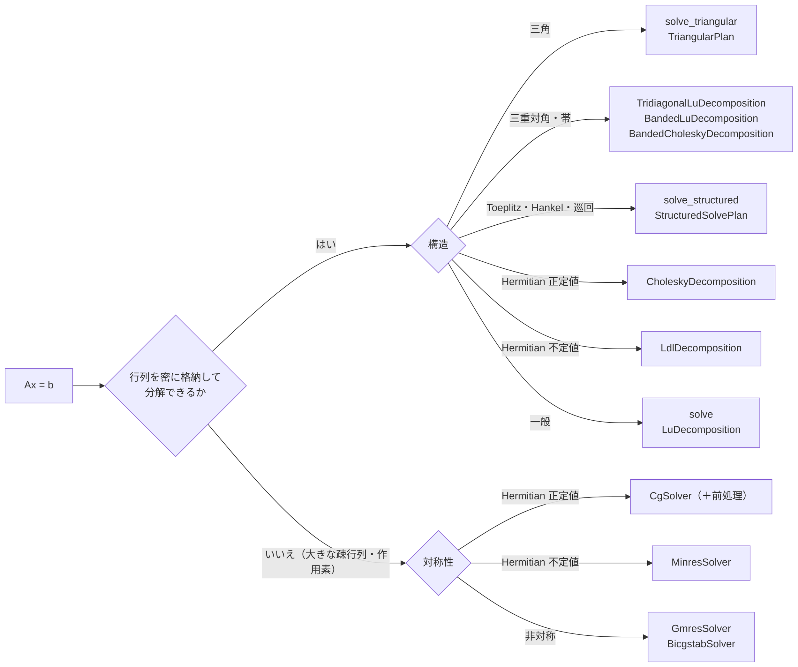

同じ方程式でも、行列の性質と大きさによって適した解法は大きく変わる。
対称正定値な行列に一般の LU 分解を使うと演算が 2 倍になり、帯行列を密行列として分解するとメモリと演算が桁違いに増える。
大きな疎行列は密行列として格納するとメモリに収まらず、疎行列のまま分解しても、分解で新たに生じる非零（フィル）が多ければメモリが足りなくなる。
このページでは問題の種類と行列の性質から `scioxide-linalg` の関数と型を選ぶ基準をまとめ、最後に同じ問題を三つの経路で解いて比べる。

連立一次方程式 $Ax = b$ の解法は、次の図のように「行列を密に格納して分解できるか」と「行列の構造・対称性」の二つの問いで決まる。
図の各節点には、レポートが要らないときの最短の呼び出しがあればそれを先に書いた。
最小二乗問題、固有値問題、行列関数は、図の後の表で選ぶ。



## 連立一次方程式

| 行列の性質 | 関数・型 | 演算量（$n$ 次） | 注意 |
|---|---|---|---|
| 一般の正方行列 | `solve`、`LuDecomposition` | $\tfrac23 n^3$ | 行と列を 2 の冪で尺度調整してから部分ピボットで分解する。実用上は後退安定だが、成長因子が大きくなる例外がある |
| Hermitian 正定値 | `CholeskyDecomposition` | $\tfrac13 n^3$ | 数値的に正定値でなければ `DomainError` で失敗する。成功しても正定値の証明にはならない。半正定値には `CholeskyPivoting::Diagonal` |
| Hermitian 不定値 | `LdlDecomposition` | $\tfrac13 n^3$ | 有界ルックピボット。特異でも分解は失敗せず、`inertia` で慣性（正・負・0 の固有値の数）が分かる |
| 三角 | `solve_triangular`、`TriangularPlan` | $n^2$ | 前進・後退代入。単位対角、帯・パック形式、転置の求解は `TriangularPlan` |
| 三重対角 | `TridiagonalLuDecomposition`、`CyclicTridiagonalPlan` | $O(n)$ | 周期境界は並べ替えて帯幅 2 の帯 LU で解く |
| 下帯幅 $k_l$、上帯幅 $k_u$ の帯行列 | `BandedLuDecomposition`、`BandedCholeskyDecomposition` | $O(n k_l (k_l + k_u))$、帯幅 $k$ の Cholesky は $O(nk^2)$ | 格納は $O(n(k_l + k_u))$ |
| Toeplitz・Hankel・巡回 | `solve_structured`、`StructuredSolvePlan` | 右辺ごとに $O(n^2)$ | Hermitian Toeplitz は Levinson–Durbin（正定値でなくてよい）、予測誤差が $\sqrt{\varepsilon}$ 以下になった列とほかの Toeplitz・Hankel はピボット付き GKO、巡回行列は DFT（FFT ではない直接の和）による対角化。Plan の作業領域を `with_dense_fallback` で事前確保すれば、許容誤差を満たさない列を密な LU で解き直す |
| 大きな疎行列・作用素 | `CgSolver`、`MinresSolver`、`GmresSolver`、`BicgstabSolver` | 反復ごとに積 1 回（BiCGSTAB は 2 回） | 前処理は scioxide-sparse の `JacobiPreconditioner`、`IncompleteFactor`、`AmgPreconditioner` |
| 低い精度の分解の流用 | `IterativeRefinement` | 補正ごとに $O(n^2)$ | $\kappa(A)\,u_f < 1$ が目安（$u_f$ は分解の精度の単位丸め） |

疎行列のまま分解できるなら、scioxide-sparse の疎直接法（`scioxide_sparse::solve`、`SparseLu`、`SparseCholesky`、`SparseLdl`）も候補になる。
分解は構造上の破綻（LU の厳密に 0 のピボット、正定値でない Cholesky の入力）と因子の成分のあふれだけを `Err` にし、解の受理は求解のときに決まる。
標準形式の `solve(&b)` は既定の `DirectSolveOptions`（`RankPolicy::Exact`。
条件数の下限も後退誤差の計算もない）で受理を判定し、ワンショット関数と同じく、受理しなければエラーを返す。
ランクの方針、逆条件数の下限、後退誤差の計算を指定するには、オプション付き形式の `solve_with_options(&b, &DirectSolveOptions)` を使う。
オプション付き形式で受理されなければ、結果は `Ok` のまま解が出力に反映されず、レポートの終了理由が理由を示す（[LU・Cholesky・LDL 分解と直接解の受理](../algorithms/direct-and-structured-solvers/)）。
同じ行列で多くの右辺を解く場合は、分解を一度だけ行って `solve` を繰り返す。
ワンショット関数は呼ぶたびに分解からやり直す。

## 最小二乗問題とランク

| 状況 | 関数・型 | 注意 |
|---|---|---|
| 列フルランクの過剰決定系 | `least_squares`、`HouseholderDecomposition` | 正規方程式 $A^{\mathsf T}A x = A^{\mathsf T}b$ は条件数を 2 乗するので避ける |
| ランク落ちの可能性 | `least_squares`、`HouseholderMinimumNormPlan`、`ThinSvdDecomposition` と `RankPolicy` | `least_squares` は列ピボット付き QR と `RankPolicy::DimensionScaledEpsilon` で数値ランクを決め、最小ノルム解を返す。しきい値はデータの誤差の水準で選ぶ |
| 悪条件で正則化が必要 | `ThinSvdDecomposition::solve`（切断と減衰）、`HouseholderDecomposition::solve_damped` | Tikhonov 正則化 $\min \lVert Ax - b \rVert_2^2 + \lambda \lVert x \rVert_2^2$（[特異値分解・数値ランク・正則化解](../algorithms/svd-and-rank/)） |
| 大きな疎行列 | `LsqrSolver`、`LsmrSolver` | 収束は $\kappa(A)$ に強く依存する |
| 行や列の追加・削除 | `QrUpdateDecomposition` | 分解をやり直さずに更新する |

## 固有値問題

| 問題 | 関数・型 |
|---|---|
| Hermitian 行列の全固有値・固有ベクトル | `HermitianEigenDecomposition`（固有値だけなら `HermitianEigenvaluesResult`、三重対角なら `tridiagonal`） |
| 一般の行列 | `GeneralEigenDecomposition`、`GeneralEigenvaluesResult`、不変部分空間は `SchurDecomposition` |
| $Ax = \lambda Bx$（$B$ が正定値の Hermitian 組） | `GeneralizedHermitianEigenDecomposition` |
| 一般の行列束 | `GeneralizedSchurDecomposition`（QZ 分解） |
| 大きな行列の一部の固有値 | `PartialSpectrumSolver`（Krylov–Schur、厚い再始動 Lanczos、シフト反転）、`LobpcgSolver` |
| 大きな行列の上位の特異値 | `PartialSvdSolver`、`RandomizedLowRank` |

Hermitian 行列では、摂動 $E$ による固有値の変化は $\lVert E \rVert_2$ 以下である（Weyl の定理）。
非正規な行列では、変化は固有ベクトルの行列の条件数の分だけ大きくなりうる（Bauer–Fike の定理、[固有値問題と Schur 分解](../algorithms/eigenproblems/)）。
部分スペクトルの型は設定だけを持つ[手法オブジェクト](oxref:linalg-execution-forms)で、次元を呼び出しごとに作用素から読むので、一つの値を大きさの違う作用素に使える。

## 行列関数と行列方程式

$f(A)$ そのものが必要なら、ワンショット関数 `matrix_function(&a, MatrixFunction::Exp)` を使い、同じ行列で何度も評価するなら `MatrixFunctionPlan` を使う。
`MatrixFunction` では指数、対数、平方根、べき乗、符号関数、三角関数、双曲線関数などを選べる。
ベクトルへの作用 $f(A)v$ だけが必要なら、行列 $f(A)$ を作らない手法オブジェクト `ExponentialAction`、`FunctionAction` を使う。
疎行列のべきと関数は、`SparsePowerPlan`、`SparseFunctionPlan` が疎行列として具体化し、格納する非零の数に `with_max_entries` で上限を設けられる（既定は上限なし）。
Sylvester・Lyapunov・代数 Riccati 方程式は、ワンショット関数 `solve_sylvester`、`solve_lyapunov`、`solve_riccati` で解ける。
同じ係数で右辺を変えて解くなら `SylvesterPlan`、`LyapunovPlan`、`RiccatiPlan` を使い、そのレポートで元の方程式の残差と後退誤差を読む。

## 呼び出しの形

同じ計算は目的に応じて次の形で呼び分ける（定義は[作業領域・実行コンテキスト・試行記録](oxref:linalg-execution-forms)）。

- 右辺が一つでレポートが要らないときは、ワンショット関数（`solve`、`least_squares`、`solve_triangular`、`solve_structured`、`matrix_function`、`solve_sylvester`、`solve_lyapunov`、`solve_riccati`）を使う。
- 分解を残して右辺を変えて解くときは標準形式（`factor`、`solve`）を、受理の条件や実行の設定を変えてレポートを読むときはオプション付き形式（`factor_with_options`、`solve_with_options`）を使う。
- 並列実行、取り消し、期限、外部 BLAS プロバイダーを使うときと、反復の内側で同じ大きさの計算を繰り返して確保をなくすときは、作業領域と実行コンテキストを渡す出力先を指定する API（`factor_into`、`solve_into`）とスコープ付き API（`norm2_scoped` など）を使う。

外部の CBLAS 互換ライブラリを使うときも、解法の選び方は変わらない。
`blas` 機能を有効にし、`BlasProvider` を実装したプロバイダーを `BlasDispatch` にまとめて `LinalgExecutionContext::with_blas` で出力先を指定する API のコンテキストに付けると、積、三角行列の求解、ベクトルの内積やノルムなどの BLAS の演算と、分解の内部の積がプロバイダーに渡りうる。
呼び出しごとに、積の精度とプロバイダーが提示した機能からプロバイダーを使えるかが決まり、使えない呼び出しは `BlasFallbackPolicy` に従って SciOxide の自前実装で計算するかエラーにする（[外部 BLAS プロバイダーの仕様](../algorithms/blas-provider/)）。

## 同じ問題を三つの経路で解く

単位正方形の $N \times N$ 個の内点で、5 点差分で離散化した Poisson 方程式を考える。
未知数は $n = N^2$ 個で、行列は対称正定値になる。
行の順に番号を付けると帯幅 $N$ の帯行列になり、1 行あたりの非零は 5 個以下である。
二階差分は二次式に対して厳密なので、右辺を $b_{ij} = 2h^2\bigl(x_i(1-x_i) + y_j(1-y_j)\bigr)$（$h = 1/(N+1)$）と選ぶと、離散方程式の厳密解は $u_{ij} = x_i(1-x_i)\,y_j(1-y_j)$ になる。

次のセルは同じ方程式を密行列の `CholeskyDecomposition`、帯行列の `BandedCholeskyDecomposition`、帯行列のビューを作用素として使う `CgSolver`（前処理なし、初期値 0）で解く。
直接法の二つは標準形式の `solve` で解き、受理されなければエラーになるので、表の終了理由の列には値を出さない。
CG はレポートを読むためにオプション付き形式の `solve_with_options` で解き、相対残差 $10^{-12}$ を許容誤差とする。
入力は一辺の内点の数 $N$（4〜20）と CG の反復の上限（5〜200 回）である。
表には終了理由、格納する数、演算量の目安、反復回数、厳密解との差の最大を並べる。
CG の格納する数には帯格納の行列に加えて長さ $n$ の作業ベクトル 4 本を数える。
演算量の目安は密行列の Cholesky を $n^3/3$、帯行列の Cholesky を $nN^2$、CG を 1 反復あたり帯の積 $2(2N+1)n$ とベクトル演算 $10n$ として数える。
最後の判定は CG の終了理由で、収束なら満たした、上限で止まれば途中の値を返したと示す。
テストは格納する数を式の値と、各経路の解を厳密解と比べる。

```rust
//| id: linalg-choosing-three-paths
//| ref: linalg-choosing-three-paths
//| title: 2 次元 Poisson 方程式を密・帯・反復の三つの経路で解く
//| run: reactive
//| crates: [scioxide-core, scioxide-linalg]
//| inputs:
//|   grid: {"type":"range","label":"一辺の内点の数 N","description":"未知数は N²。","min":4,"max":20,"step":4,"value":16}
//|   cg_limit: {"type":"range","label":"CG の反復の上限 [回]","description":"上限に達すると CG は IterationLimit で止まる。","min":5,"max":200,"step":5,"value":200}
//| cases:
//|   - {"id":"small-grid","label":"N = 4","description":"右辺の対称性で Krylov 部分空間が小さく、CG は 3 回で収束する。","inputs":{"grid":4}}
//|   - {"id":"large-grid","label":"N = 20","description":"密行列の演算量は N⁶ に比例して増え、CG は 40 回で収束する。","inputs":{"grid":20}}
//|   - {"id":"cg-limit","label":"CG の上限 10 回","description":"N = 16 で CG は収束前に IterationLimit で止まり、最良の反復を返す。","inputs":{"cg_limit":10}}
//| tests:
//|   - case: default
//|     expect:
//|       - {"artifact":"paths","path":"/rows/0/2","equals":65536}
//|       - {"artifact":"paths","path":"/rows/1/2","equals":4352}
//|       - {"artifact":"paths","path":"/rows/0/5","range":{"max":1e-14}}
//|       - {"artifact":"paths","path":"/rows/1/5","range":{"max":1e-14}}
//|       - {"artifact":"paths","path":"/rows/2/1","equals":"Converged"}
//|       - {"artifact":"paths","path":"/rows/2/5","range":{"max":1e-13}}
//|       - {"path":"/outputs/1/state","equals":"satisfied"}
//|   - case: small-grid
//|     expect:
//|       - {"artifact":"paths","path":"/rows/0/2","equals":256}
//|       - {"artifact":"paths","path":"/rows/2/4","equals":3}
//|       - {"artifact":"paths","path":"/rows/2/5","range":{"max":1e-14}}
//|       - {"path":"/outputs/1/state","equals":"satisfied"}
//|   - case: large-grid
//|     expect:
//|       - {"artifact":"paths","path":"/rows/0/2","equals":160000}
//|       - {"artifact":"paths","path":"/rows/1/5","range":{"max":1e-14}}
//|       - {"artifact":"paths","path":"/rows/2/4","equals":40}
//|       - {"artifact":"paths","path":"/rows/2/5","range":{"max":1e-13}}
//|       - {"path":"/outputs/1/state","equals":"satisfied"}
//|   - case: cg-limit
//|     expect:
//|       - {"artifact":"paths","path":"/rows/0/5","range":{"max":1e-14}}
//|       - {"artifact":"paths","path":"/rows/2/1","equals":"IterationLimit"}
//|       - {"artifact":"paths","path":"/rows/2/4","equals":10}
//|       - {"artifact":"paths","path":"/rows/2/5","range":{"min":1e-6,"max":1e-3}}
//|       - {"path":"/outputs/1/state","equals":"partial"}
use scioxide_core::{Budget, ResidualTolerance, Triangle};
use scioxide_linalg::{
    BandedCholeskyDecomposition, CgSolver, CholeskyDecomposition, CholeskyPivoting,
    HermitianBandMatrix, HermitianInput, LinearSolveTermination, Matrix, Preconditioning,
    StructuredOperation, Vector,
};

let side = grid as usize;
let n = side * side;
let h = 1.0 / (side + 1) as f64;
// 5 点差分（対角 4、上下左右 −1）の成分。
let entry = |i: usize, j: usize| -> f64 {
    let same_row = i / side == j / side;
    if i == j {
        4.0
    } else if (i.abs_diff(j) == 1 && same_row) || i.abs_diff(j) == side {
        -1.0
    } else {
        0.0
    }
};
// 厳密解 u = x(1 − x) y(1 − y) と、それを与える右辺 2h²(x(1 − x) + y(1 − y))。
let q = |k: usize| {
    let t = (k + 1) as f64 * h;
    t * (1.0 - t)
};
let exact: Vec<f64> = (0..n).map(|k| q(k / side) * q(k % side)).collect();
let rhs: Vec<f64> = (0..n)
    .map(|k| 2.0 * h * h * (q(k / side) + q(k % side)))
    .collect();
let b = Vector::from_vec(rhs);
let error = |x: &[f64]| {
    x.iter()
        .zip(&exact)
        .fold(0.0_f64, |m, (p, e)| m.max((p - e).abs()))
};

// 密行列の Cholesky（標準形式。受理されなければエラー）。
let dense_entries = (0..n * n).map(|k| entry(k / n, k % n)).collect();
let dense = Matrix::from_vec(n, n, dense_entries).map_err(|e| e.to_string())?;
let x_dense =
    CholeskyDecomposition::factor(&dense, HermitianInput::Exact, CholeskyPivoting::None)
        .and_then(|f| f.solve(&b))
        .map_err(|e| e.to_string())?;
// 下三角の帯格納（列 c の対角から下へ N + 1 個）。
let band_data = (0..n * (side + 1))
    .map(|k| {
        let (c, d) = (k / (side + 1), k % (side + 1));
        if c + d < n { entry(c + d, c) } else { 0.0 }
    })
    .collect();
let band =
    HermitianBandMatrix::new(n, side, Triangle::Lower, band_data).map_err(|e| e.to_string())?;
let x_band = BandedCholeskyDecomposition::factor(&band)
    .and_then(|f| f.solve(StructuredOperation::Normal, &b))
    .map_err(|e| e.to_string())?;
// 帯行列のビューを作用素として使う CG（オプション付き形式: 前処理なし、初期値 0、レポートを読む）。
let tolerance = ResidualTolerance::new(0.0, 1e-12).map_err(|e| e.to_string())?;
let limit = Budget::try_from(cg_limit as usize).map_err(|e| e.to_string())?;
let cg = CgSolver::new(tolerance, limit)
    .solve_with_options(&band.view(), &b, Preconditioning::None, None)
    .map_err(|e| e.to_string())?;
let report = cg.report();
let termination = report.termination();
let status = match termination {
    LinearSolveTermination::Converged => "Converged",
    LinearSolveTermination::LeastSquaresConverged => "LeastSquaresConverged",
    LinearSolveTermination::ConditionLimit => "ConditionLimit",
    LinearSolveTermination::IterationLimit => "IterationLimit",
    LinearSolveTermination::EvaluationLimit => "EvaluationLimit",
    LinearSolveTermination::Stagnation => "Stagnation",
    LinearSolveTermination::Breakdown(_) => "Breakdown",
    LinearSolveTermination::ExecutionStopped(_) => "ExecutionStopped",
};
let iterations = report.iterations();
let cg_error = error(cg.solution().as_slice());

let nf = n as f64;
let cg_work = iterations as f64 * nf * (2.0 * (2 * side + 1) as f64 + 10.0);
let dense_error = error(x_dense.as_slice());
let band_error = error(x_band.as_slice());
let band_len = n * (side + 1);
let (dense_work, band_work) = (nf.powi(3) / 3.0, nf * (side * side) as f64);
let rows: Vec<(&str, Option<&str>, usize, f64, Option<usize>, f64)> = vec![
    (
        "密行列の Cholesky",
        None,
        n * n,
        dense_work,
        None,
        dense_error,
    ),
    (
        "帯行列の Cholesky",
        None,
        band_len,
        band_work,
        None,
        band_error,
    ),
    (
        "CG（前処理なし）",
        Some(status),
        band_len + 4 * n,
        cg_work,
        Some(iterations),
        cg_error,
    ),
];
let sci2 = serde_json::json!({ "notation": "scientific", "significantDigits": 2 });
let columns = serde_json::json!([
    { "key": "0", "label": "経路" },
    { "key": "1", "label": "終了理由", "nullText": "標準形式（拒否はエラー）" },
    { "key": "2", "label": "格納する数", "type": "integer" },
    { "key": "3", "label": "演算量の目安 [回]", "type": "number", "format": sci2 },
    { "key": "4", "label": "反復回数", "type": "integer", "nullText": "—" },
    { "key": "5", "label": "厳密解との差の最大 [-]", "type": "number", "format": sci2 }
]);
emit_table_with_columns!(
    columns,
    rows,
    metadata = serde_json::json!({ "id": "paths" })
);

let outcome = if termination.is_success() {
    Outcome::satisfied("三つの経路がすべて許容誤差を満たす解を返した")
} else if matches!(termination, LinearSolveTermination::Breakdown(_)) {
    Outcome::failed("CG の漸化式が破綻した")
} else {
    Outcome::partial("CG が収束前に止まった")
        .explanation("CG の行は、真の残差を確かめた反復のうち最良のものを示す。")
};
let mut outcome = outcome
    .status(status)
    .diagnostic("CG の反復回数", iterations as f64, None)
    .diagnostic("CG の厳密解との差", cg_error, None);
if let Some(residual) = report.true_residual() {
    outcome = outcome.diagnostic("CG の相対残差", residual.scaled_norm(), None);
}
emit_outcome!(outcome);
```

既定の $N = 16$（$n = 256$）では、密行列と帯行列の Cholesky の解は厳密解と $1.6 \times 10^{-16}$ 以下の差で一致し、CG は 31 回の反復で `Converged` となって差は $5.7 \times 10^{-16}$ である。
格納する数は密行列の 65536 に対して帯行列は 4352 で、分解の演算量の目安は $5.6 \times 10^{6}$ 回と $6.6 \times 10^{4}$ 回と約 85 倍違う。
CG の演算量の目安 $6.0 \times 10^{5}$ 回は、帯行列の Cholesky より大きい。
帯格納の作用素は 1 行あたり $2N + 1$ 個の成分を掛けるが、そのうち非零は 5 個以下だからである。
非零だけを持つ scioxide-sparse の CSR 行列を作用素にすれば、1 回の積は $5n$ 回程度の乗算になり、CG の演算量は帯行列の Cholesky と同じ程度になる。

$N$ を増やすと、演算量は密行列で $N^6$、帯行列の Cholesky で $N^4$ に比例して増える。
CG の反復回数は $N = 4, 8, 12, 16, 20$ で 3、10、21、31、40 回である。
右辺は正方形の対称性（$x \leftrightarrow 1-x$、$y \leftrightarrow 1-y$、$x \leftrightarrow y$）を持つので、Krylov 部分空間は同じ対称性を持つ固有ベクトルの張る空間に収まる。
この空間に現れる相異なる固有値は、$m = N/2$ として $m(m+1)/2$ 個（3、10、21、36、55 個）で、正確な算術の CG は高々その回数の反復で厳密解に達する。
$N \le 12$ の反復回数はこの個数に等しく、$N = 16, 20$ ではその前に許容誤差を満たす。
許容誤差に達するまでの反復回数の上界は条件数 $\kappa_2(A)$ の平方根に比例し、5 点差分では $\kappa_2(A)$ が $N^2$ に比例するので、大きな $N$ では反復回数もおよそ $N$ に比例して増える。
CSR の作用素なら 1 反復の演算量は $n = N^2$ に比例するので、CG の演算量は $N^3$ で増え、大きな問題ほど反復法が有利になる。
ただし、条件の悪い問題では反復回数が増えるので、前処理が必要になる。

CG の反復の上限を 10 回にすると、終了理由は `IterationLimit` になり、判定は途中の値を返したことを示す。
オプション付き形式はそれまでに真の残差を確かめた反復のうち最良のものを `Ok` で返し、その厳密解との差は $6.8 \times 10^{-5}$、相対残差は $2.2 \times 10^{-2}$ である。
同じ上限で標準形式の `solve(a, b)` を呼ぶと、この結果は `ConvergenceFailure` のエラーになる。

## まとめ

連立方程式は、行列を密に格納して分解できるなら構造に合わせて Cholesky・LDL・LU・三角・三重対角・帯・Toeplitz の解法を選び、できないなら対称性に合わせて CG・MINRES・GMRES などの反復法を選ぶ。
最小二乗問題は正規方程式を避けて QR 分解で解き、ランク落ちや悪条件には SVD とランクの方針、減衰付きの求解で対処する。
固有値問題は、Hermitian か一般か、標準か一般化か、全部か一部かで型が分かれる。
右辺が一つでレポートが要らなければワンショット関数、分解を使い回すなら標準形式、受理の条件や終了理由を扱うならオプション付き形式、確保をなくしたり並列に実行したりするなら出力先を指定する API を選ぶ。
同じ問題でも経路によって格納と演算量が大きく変わり（既定の $N = 16$ で格納は約 15 倍、分解の演算量は約 85 倍）、帯構造を使う直接法と反復法の優劣は問題の大きさと条件数で入れ替わる。
外部の BLAS を使う場合も解法の選び方は変わらず、`blas` 機能で選べるのは積や三角行列の求解などのカーネルの実行先である。

## 次に読むページ

- [線形代数の数理と共通の規約](../algorithms/)：誤差の測り方と受理の規約を確かめ、各アルゴリズムページの対象を見る。
- [作業領域・実行コンテキスト・試行記録](../algorithms/workspaces-and-execution/)：呼び出しの形の定義と、作業領域を事前確保して出力先を指定する API で確保をなくす手順を確かめる。
- [三重対角・帯・Toeplitz 行列と構造行列の直接解法](../algorithms/structured-systems/)：構造を使う分解のアルゴリズムと、Levinson–Durbin からピボット付き GKO へ切り替える条件を確かめる。
- [クリロフ部分空間法と前処理](../algorithms/krylov-and-preconditioning/)：反復法の収束と、前処理で反復回数がどれだけ減るかを確かめる。
- [外部 BLAS プロバイダーの仕様](../algorithms/blas-provider/)：外部の BLAS を使うときに、どの呼び出しがプロバイダーへ渡り、どの場合に自前実装へ退避するかを確かめる。
