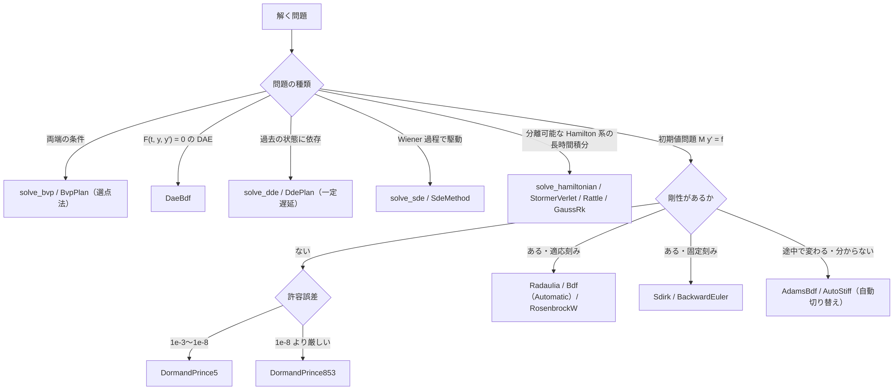

方式の選択は、まず問題の種類（初期値問題、DAE、DDE、SDE、Hamilton 系、境界値問題）で分かれる。
初期値問題では次に剛性の有無と、刻み幅の自動調整・連続出力・事象が要るかで決まる。
剛性のある系に陽解法を使うと、安定性のために刻み幅が極端に小さくなる。
剛性のない系に陰解法を使うと、ヤコビ行列と線形方程式の計算が無駄になる。

`scioxide-ode` の方式には誤差の推定で刻み幅を調整する適応型と、与えた刻み幅で進む固定刻み型がある。
指定した時刻での値（連続出力）と事象の検出は、連続出力を持つ方式でだけ使える。
この区別は方式の数学的な性質ではなく、実装が対応する範囲である。

既定の設定で終点の値だけが要るなら、ワンショット関数 `solve_ivp`（時刻の列での値なら `solve_ivp_at`）で足りる。
どちらも `DormandPrince5` と既定の許容誤差（$\varepsilon_\text{abs} = 10^{-6}$、$\varepsilon_\text{rel} = 10^{-3}$）を使う。
方式、許容誤差、出力、上限を選ぶときは、積分法オブジェクトと `OdeOptions` を使う。

## 選択の流れ

## 方式の性質

| 方式 | 族 | 次数 | 刻み | 連続出力・事象 | 質量行列 | 向く場合 | 解説 |
|---|---|:---:|---|---|:---:|---|---|
| `ForwardEuler`、`ExplicitMidpoint`、`Heun` | 陽的 RK | 1、2、2 | 固定 | なし | なし | 収束次数の確認、教材 | [陽的 RK 法](../algorithms/explicit-runge-kutta-and-control/) |
| `ClassicalRk4` | 陽的 RK | 4 | 固定 | なし | なし | 一定周期の制御、刻み半減による次数の確認 | [陽的 RK 法](../algorithms/explicit-runge-kutta-and-control/) |
| `Rkf45` | 陽的 RK | 5(4) | 適応 | 3 次 Hermite | なし | 既存の計算との比較 | [陽的 RK 法](../algorithms/explicit-runge-kutta-and-control/) |
| `DormandPrince5` | 陽的 RK | 5(4) | 適応 | 4 次 | なし | 剛性のない問題の第一候補 | [陽的 RK 法](../algorithms/explicit-runge-kutta-and-control/) |
| `Verner65` | 陽的 RK | 6(5) | 適応 | 3 次 Hermite | なし | DP5 と DOP853 の中間の精度 | [陽的 RK 法](../algorithms/explicit-runge-kutta-and-control/) |
| `DormandPrince853` | 陽的 RK | 8(5,3) | 適応 | 7 次 | なし | 滑らかな問題を厳しい許容誤差で長時間解く | [陽的 RK 法](../algorithms/explicit-runge-kutta-and-control/) |
| `RosenbrockW`（`Ros2`、`Ros34Pw2`） | 線形陰的 W 法 | 2、3 | 適応 | 3 次 Hermite | なし | 剛性があり、Newton 反復を避けたい問題 | [Rosenbrock-W 法](../algorithms/rosenbrock-and-stiffness-switching/) |
| `BackwardEuler` | 陰的 RK | 1 | 固定 | なし | あり | L 安定で強く減衰させたい場合 | [陰的 RK 法](../algorithms/implicit-runge-kutta-and-mass-matrices/) |
| `ImplicitTrapezoid` | 陰的 RK | 2 | 固定 | なし | あり | A 安定で、振動を減衰させたくない場合 | [陰的 RK 法](../algorithms/implicit-runge-kutta-and-mass-matrices/) |
| `Sdirk` | 対角陰的 RK | 3 | 固定 | なし | あり | L 安定。全段で一つの分解を共有できる | [陰的 RK 法](../algorithms/implicit-runge-kutta-and-mass-matrices/) |
| `RadauIia` | 陰的 RK（3 段） | 5(3) | 適応 | 選点多項式 | あり | L 安定で高次。強い剛性 | [陰的 RK 法](../algorithms/implicit-runge-kutta-and-mass-matrices/) |
| `GaussRk` | 陰的 RK（2 段） | 4 | 固定 | なし | あり | A 安定でシンプレクティック | [幾何積分](../algorithms/geometric-integrators/) |
| `AdamsBashforth`、`AdamsMoulton` | 可変刻み Adams | 1〜5 | 固定または自動 | 補間多項式 | なし | 右辺の評価が重い、剛性のない問題 | [多段法](../algorithms/multistep-methods/) |
| `Bdf`（BDF または NDF） | 可変刻み後退差分 | 1〜5 | 固定または自動 | 補間多項式 | あり | 剛性のある滑らかな長時間の問題 | [多段法](../algorithms/multistep-methods/) |
| `AutoStiff`、`AdamsBdf` | 自動切り替え | 動いている方式の次数 | 適応 | 両方の方式が持つとき | 剛性側の方式が対応するとき | 剛性が途中で現れる・消える問題 | [剛性の切り替え](../algorithms/rosenbrock-and-stiffness-switching/) |
| `StormerVerlet`、`Rattle` | 分割法 | 2 | 固定 | なし | 運動エネルギーの質量 | 分離可能な Hamilton 系、ホロノミック拘束 | [幾何積分](../algorithms/geometric-integrators/) |

「固定」の方式は `OdeOptions::with_initial_step` で与えた刻み幅（与えなければ推定した刻み幅）で進み、誤差の推定で刻みを変えない。
Adams 法と BDF は `new(order)` では次数と刻みを固定する（`MultistepOrder::Fixed`）。
`with_order_policy(MultistepOrder::Automatic(k))` で作ると、次数 1 から始めて次数と刻み幅を許容誤差に合わせて調整する。
`AdamsBdf` は可変次数の Adams 法と BDF を組にした `AutoStiff` である。
陰的な方式の線形方程式の解き方は `OdeStageBackend`（密 LU、疎 LU、行列を作らない GMRES）で選び、方式の間で自動的に変わることはない（[ヤコビ行列と線形段](../algorithms/jacobians-and-linear-stages/)）。

## 剛性の見分け方

線形化した系のヤコビ行列 $J = \partial f / \partial y$ の固有値の実部がすべて負で、その大きさが何桁も離れているとき、系は剛性を持つ。
剛性比

$$
S = \frac{\max_i |\operatorname{Re}\lambda_i|}{\min_i |\operatorname{Re}\lambda_i|}
$$

が大きい系に陽解法を使うと、最も速く減衰するモードの安定条件（前進 Euler 法なら $|1 + h\lambda_{\max}| \le 1$）が刻み幅を決める。
そのため、解が変化する時間尺度よりずっと小さい刻みが必要になる。

実際の計算では次の兆候で剛性に気づく。

- 許容誤差を緩めても刻み幅が増えず、評価回数がほとんど減らない。
- 棄却される刻みの割合が高い。
- 解が滑らかなのに、刻み幅が小さいまま上下する。

この場合は `Bdf`（`Automatic`）、`RosenbrockW`、`RadauIia` か、固定刻みの L 安定な陰的方式へ移る。

剛性が区間の一部にだけ現れる場合や、剛性があるか分からない場合は `AutoStiff`（Adams 法と BDF の組なら `AdamsBdf`）を使う。
切り替えの指標は $|h|\,\rho(J)$ で、$\rho(J)$ はヤコビ行列とベクトルの積 $Jv$ を使う冪乗法で推定する。
$Jv$ は、剛性側の方式が現在のヤコビ行列を持っていればそれを使い、なければ `OdeSystem::jacobian_product` か、右辺 1 回の前進差分で求める。
既定では、指標が 2 回続けて 1 を超えるか、陽解法の棄却が 3 回続くと剛性側へ移る。
剛性側で 8 回以上受理した後、指標が 6 回続けて 1/4 を下回ると戻る。
この閾値のずれ（ヒステリシス）は `StiffnessSwitchOptions` で変えられる。
冪乗法は励起されていない速いモードを見落とすことがあるので、切り替えの理由（`OdeSwitchReason`）は剛性の証明ではない（[剛性の切り替え](../algorithms/rosenbrock-and-stiffness-switching/)）。

## 許容誤差の与え方

適応型の方式は成分ごとの許容誤差の尺度

$$
\mathrm{scale}_i = \varepsilon_{\mathrm{abs}, i} + \varepsilon_{\mathrm{rel}} \max\bigl(|y_{i,n}|, |y_{i,n+1}|\bigr)
$$

で正規化した局所誤差のノルムが 1 以下になる刻みを受理する。
`OdeOptions::new()` の既定は $\varepsilon_{\mathrm{abs}} = 10^{-6}$、$\varepsilon_{\mathrm{rel}} = 10^{-3}$、二乗平均のノルムである。
`with_error_tolerance` に scioxide-core の `ErrorTolerance` を渡すと、成分ごとの絶対許容誤差も与えられる。

- 0 をまたぐ量（角度、速度）では、相対許容誤差だけだと 0 の近くで尺度が消える。
  その量の分解能に見合う絶対許容誤差を与える。
- 0 に近づく正の量（微量成分の濃度、個体数）では、絶対許容誤差が小さすぎると意味のない桁まで追って刻みが小さくなる。
  物理的に意味のある下限を絶対許容誤差にする（[Robertson 反応系](../examples/robertson-kinetics/)）。
- 単位の違う成分は成分ごとの絶対許容誤差でそろえる。

許容誤差は 1 刻みの局所誤差に対する目標で、大域誤差の上限ではない。
許容誤差を 1 桁ずつ変えた解を比べると、結果の信頼できる桁を見積もれる。

## 初期値問題以外の問題

| 問題 | ワンショット呼び出し | 設定して使う型 | 主な制約 | 解説 |
|---|---|---|---|---|
| 残差形式の指数 1 DAE | なし | `DaeSystem`、`DaeBdf` | 微分変数と代数変数を `DaePartition` で明示する。高指数の系は扱わない | [指数 1 の DAE](../algorithms/dae-index-one/) |
| 一定遅延の DDE | `solve_dde` | `DdePlan`、`DdeOptions` | 正の定数遅延と初期履歴。Dormand–Prince 5(4) 法と連続出力による段階法 | [遅延方程式](../algorithms/delay-equations/) |
| SDE | `solve_sde` | `SdeMethod`、`SdeProblem` | Itô（Euler–Maruyama）か Stratonovich（確率的 Heun）を明示し、Wiener 増分を呼び出し側が与える | [確率微分方程式](../algorithms/stochastic-equations/) |
| 分離可能な Hamilton 系 | `solve_hamiltonian` | `StormerVerlet`、`Rattle` | 固定刻み。`Rattle` は実数のホロノミック拘束 | [幾何積分](../algorithms/geometric-integrators/) |
| 2 点境界値問題 | `solve_bvp` | `BvpPlan` | 3 段の Lobatto IIIA 選点法と残差による節点の追加。未知パラメータと端点の特異項を扱える | [境界値問題](../algorithms/boundary-value-collocation/) |

## 解の微分の求め方

| 方法 | API | 計算コスト | 向く場合 | 解説 |
|---|---|---|---|---|
| 前進感度 | `ForwardSensitivitySystem` | 微分する方向 1 つごとに、状態と同じ大きさの方程式を加える | 方向（パラメータと初期値）が少なく、軌道全体の感度が欲しい場合 | [前進感度とアンサンブル](../algorithms/forward-sensitivities-and-ensembles/) |
| 随伴法 | `OdeAdjointSolver`、`DaeAdjointSolver` | 前進と逆向きの積分を 1 回ずつ行い、前進の軌道をメモリするか再計算する | パラメータが多く、スカラーの目的関数の勾配だけが欲しい場合 | [随伴法](../algorithms/adjoint-gradients/) |
| パラメータの掃引 | `solve_ensemble_into` | 独立な軌道ごとに 1 回の積分 | 勾配ではなく、応答の分布を見たい場合 | [前進感度とアンサンブル](../algorithms/forward-sensitivities-and-ensembles/) |

## まとめ

問題の種類で API を決め、初期値問題では剛性と、刻み幅の自動調整・連続出力・事象が要るかで方式を選ぶ。
剛性がなければ `DormandPrince5`、厳しい許容誤差では `DormandPrince853`、剛性があって適応刻みが要るなら `Bdf`（`Automatic`）、`RosenbrockW`、`RadauIia` が候補になる。
剛性の有無が分からないときは `AutoStiff` に任せ、レポートの切り替え回数と理由を確かめる。
陰的 Runge–Kutta 法のうち適応刻み・連続出力・事象に対応するのは `RadauIia` だけで、他は固定刻みである。
許容誤差は成分の尺度に合わせて与え、結果は許容誤差を変えた解と比べて確かめる。

方式の安定性と誤差の理論は[誤差・次数・安定性](../algorithms/error-order-and-stability/)で、具体的な問題での比較は[例題](../examples/)で確かめられる。
