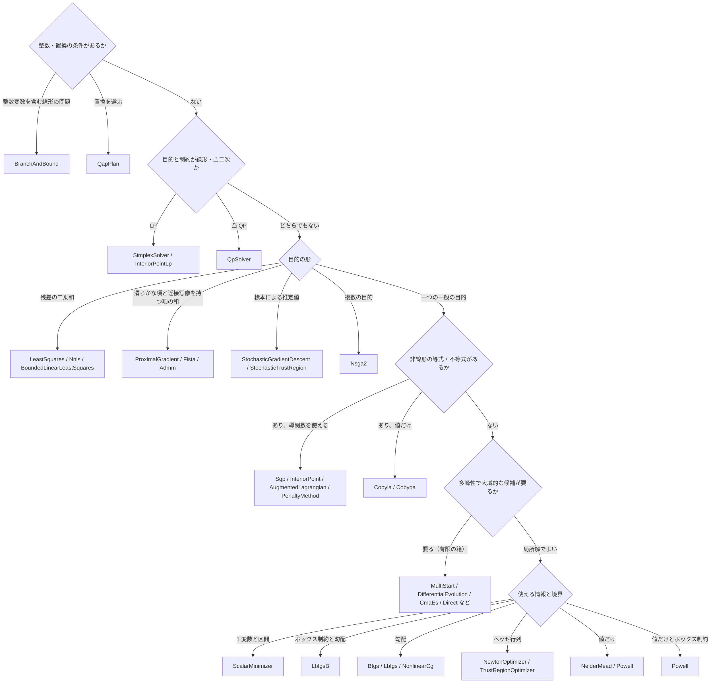

最適化手法を選ぶときは、問題が持つ構造（凸性、線形性、残差の二乗和、箱だけの制約、整数変数、多峰性）を、その構造を使う専用の型に写すことを最初に考える。
任意の問題を微分なしの黒箱最適化に渡すこともできるが、構造を使う方法では必要な微分や評価回数を減らせる場合がある。
結果の診断も勾配、KKT 残差、双対の証明用データなど、問題の構造に応じて変わる。
次の図は判断の流れの要約で、各分岐の理由は以下の節で説明する。
問題の型から解法と解説ページを引く一覧は、ページ末の[問題と解法の対応](#問題と解法の対応)にある。

## 問題の数理構造と専用型の対応

目的関数に特別な構造があるなら、一般の `ObjectiveFn` ではなく構造を表す型を使う。

| 問題の構造 | 型 | 代表的なソルバー | 構造を使う理由 |
| :--- | :--- | :--- | :--- |
| 残差の二乗和 | `LeastSquaresProblem` / `LeastSquaresFn` | `LeastSquares`（`LeastSquaresGlobalization::GaussNewton` または `LevenbergMarquardt`） | 勾配 $\mathbf{J}^\mathsf{T}\mathbf{r}$ とヘッセ行列の近似 $\mathbf{J}^\mathsf{T}\mathbf{J}$ をヤコビ行列から作れ、二階微分なしで小残差問題に速く収束する |
| 線形の最小二乗（非負・箱） | `LinearLeastSquaresProblem` | `Nnls`, `BoundedLinearLeastSquares` | 無制約解を切り詰めずに、境界上の成分を KKT 条件で扱う |
| 線形計画 | `LpProblem` | `SimplexSolver`, `InteriorPointLp` | 頂点または中心経路を使い、主・双対の証拠を `ProgrammingVerifier::verify` で独立に確かめられる |
| 凸二次計画 | `QpProblem` | `QpSolver` | $\mathbf{Q} \succeq 0$ と線形制約なら KKT 系が線形で、有効集合法や主双対内点法で解ける。明示したヘッセ行列が半正定値でなければ `InvalidInput` になる |
| 混合整数計画 | `MipProblem` | `BranchAndBound` | LP 緩和で下界を計算し、探索木を刈り込む。結果は数値的なギャップ付きで返る |
| 一般の非線形制約 | `ConstrainedProblem`（目的と `Constraints` の組） | `Sqp`, `InteriorPoint`, `AugmentedLagrangian` | 等式・不等式・境界を区別し、KKT 条件の 4 つの残差で終了を判定する |

境界の扱いは手法ごとに決まっている。
`LbfgsB` と `Powell` は目的と箱を組にした `BoundedObjective` を受け取り、箱の中で探索する。
`Bfgs`、`Lbfgs`、`NonlinearCg`、`GradientDescent`、`NewtonOptimizer`、`TrustRegionOptimizer`、`NelderMead` は境界を扱わず、境界を持つ目的を渡すとコールバックを呼ぶ前に `InvalidInput` を返す。
非線形制約法の境界は `Constraints::bounds` で登録し、大域探索は端点がすべて有限の箱を `BoundedObjective` で受け取る。
整数変数を扱うのは `BranchAndBound`（`MipProblem`）だけで、二次割当ての `QapPlan` は置換を探索する。

## 呼び出しの形の選び方

同じ方法は必要な制御の量に応じて次の形で呼び分ける（定義は [最適化問題と結果の読み方](oxref:optimize-call-forms)）。

| 目的 | 使う形 | 例 |
|---|---|---|
| 既定の設定で一度だけ解き、成功した結果だけを受け取る | ワンショット関数 | `minimize(f, &x0)`、`minimize_bounded(f, &x0, &bounds)`、`minimize_constrained(f, &x0, &constraints)`、`minimize_global(f, &[(lo, hi)], seed)`、`minimize_scalar(f, a, b)`、`least_squares(r, &x0, m)`、`curve_fit(model, &xdata, &ydata, &p0)`、`nnls(&a, &b)`、`bvls(&a, &b, &bounds)`、`quadratic_assignment(a, b, direction)`、`lp.solve()`、`qp.solve()`、`mip.solve()` |
| 導関数を渡す、許容誤差や上限を変える、部分結果を読む | 手法オブジェクトの標準形式 | `Bfgs::new(options).minimize(&f, &x0)`、`LeastSquares::new(options)?.solve(&problem, &x0)`、`SimplexSolver::default().with_tolerances(tolerances).solve(&lp)` |
| 実行時に局所法を選ぶ | `Optimizer` トレイト | `Box<dyn Optimizer<f64>>` の `minimize(&f, &x0)` |
| 二次割当てで同じ行列を何度も解く | Plan | `QapProblemView::new(a, b, &fixed)?.prepare()?` の後に `plan.solve(direction, None)` や `plan.solve_with_options(direction, None, &options)` |
| 反復の内側で確保をなくす、取り消しや上限を外側の解法と共有する | 出力先を指定する API | `solver.minimize_into(&f, &x0, &mut result, &mut workspace, context)` |

ワンショット関数は勾配を差分で近似する（`minimize` は中心差分、`minimize_bounded`、`minimize_constrained`、`least_squares`、`curve_fit` は前進差分）。
解析的な導関数や自動微分があるなら、`ObjectiveFn::with_gradient` などで付けて手法オブジェクトに渡す。
`minimize` は滑らかな目的を前提にするので、滑らかでない目的には `NelderMead` や `Powell` を使う。

## 無制約・ボックス制約の局所法

無制約の問題 $\min_{\mathbf{x}} f(\mathbf{x})$ では、使える情報（値だけ、勾配、ヘッセ行列）と変数の数 $n$ で選ぶ。
変数に上下限だけがある場合もここに含める。
変数が 1 個で区間 $[a, b]$ が決まっているなら、`minimize_scalar`（Brent 法）か `ScalarMinimizer`（黄金分割法か Brent 法）を使う。
Brent 法は放物線補間と黄金分割を組み合わせ、1 反復に新しい評価を高々 1 回しか使わない。

### 値だけを使う方法

目的が外部のシミュレーションの出力で微分が得られず、自動微分も使えない場合は、値だけを使う方法（導関数を使わない方法）を選ぶ。

- `NelderMead`（単体法）: $n+1$ 個の頂点の単体を反射・膨張・収縮・縮小で動かす。
  変数が少ない問題（目安は $n \lesssim 10$）に向く。
  ノイズがあると単体がノイズの幅まで縮んで止まりうる。
  境界を扱わないので、箱を持つ目的を渡すと `InvalidInput` になる。
- `Powell`（共役方向法）: 座標方向から始め、各方向の一次元最小化を繰り返して共役方向を作る。
  `BoundedObjective` で箱を指定でき、滑らかな谷では Nelder–Mead より少ない評価で進むことが多い。

どちらの `Converged` も値の広がりや移動量の検査であり、勾配の停留性の証明ではない。
非線形制約がある場合は後述の `Cobyla`・`Cobyqa` を使う。

### 勾配を使う方法

解析的な微分や自動微分（`scioxide-ad`）で勾配が得られる場合は、一階法か準 Newton 法を選ぶ。
勾配を与えない場合は、既定の `DerivativeStrategy::AnalyticOrCentral` が中心差分で勾配を近似する（`LbfgsB` の既定は前進差分の `AnalyticOrForward`）。

- `Bfgs`: 中規模（目安 $n \lesssim 1000$）の最初の選択肢である。
  位置差 $\mathbf{s}_k$ と勾配差 $\mathbf{y}_k$ から逆ヘッセ行列の近似を階数 2 で更新する。
  超一次収束の理論には、解の近くの正定値な曲率、ヘッセ行列の正則性、適切な直線探索などの仮定が要る。
  密な行列のメモリ使用量は $O(n^2)$ である。
- `Lbfgs`: 変数が多い場合の選択肢である。
  直近 $m$ 組（既定 10）の $(\mathbf{s}_k, \mathbf{y}_k)$ だけを保持し、メモリ使用量を $O(mn)$ に抑える。
- `LbfgsB`: 変数に上下限だけがある場合の L-BFGS である。
  射影勾配に逆 L-BFGS モデルを作用させ、実行可能な線分上で探索する。
  元の座標の射影勾配で停止を判定する。
  目的と箱は `BoundedObjective` で渡す。
- `NonlinearCg`: メモリ使用量を $O(n)$ に抑えたい場合に使う。
  Polak–Ribière+ 係数で、共役性が崩れると最急降下方向から再開始する。
- `GradientDescent`: 基準として、勾配の実装や直線探索を確かめるのに使う。
  条件数が大きいと遅い。

直線探索が受理できるステップ幅を見つけられなければ、どの方法も `LineSearchFailed` で止まり、成功とはみなさない。

### ヘッセ行列を使う方法

二階微分を計算できる場合は、Newton 法か信頼領域法を選ぶ。

- `NewtonOptimizer`: 初期値が極小点に近く、ヘッセ行列が正定値で局所 Lipschitz 連続なら、純 Newton 反復には二次収束の理論がある。
  ヘッセ行列を成分の最大絶対値で正規化して $\mathrm{LDL}^\mathsf{T}$ 分解し、降下方向が得られなければ対角シフトを $\sqrt{\varepsilon}$ から 10 倍ずつ最大 16 回加えて分解し直す。
  それでも降下方向が得られなければ `NumericalInstability` のエラーを返す。
- `TrustRegionOptimizer`: 曲率が不定な場所や初期値が遠い場合に向く。
  半径の中でモデルを最小にし、受理比が 0.15 を超えて目的が減った場合だけ受理する。
  部分問題の既定はドッグレッグ法である。
- `TrustRegionSubproblem::SteihaugCg`: `TrustRegionOptions::with_subproblem` で選ぶ切断共役勾配法の部分問題で、変数が多い場合に向く。
  目的がヘッセ行列とベクトルの積を提供すれば（クロージャなら `ObjectiveFn::with_hessian_vector_product`）、密なヘッセ行列を作らない。
  ただし二次の停止（`second_order_stopping: true`）を選ぶと、密なヘッセ行列を解析式か差分で作り、ヘッセ行列とベクトルの積は使わない。

## 制約付き最適化手法の使い分け

制約付きの問題では微分の有無、制約の数と非線形性、初期点の実行可能性で選ぶ。
目的と制約は `ConstrainedProblem` にまとめて渡す。

| ソルバー | 向く問題 | 注意点 |
| :--- | :--- | :--- |
| `Sqp`（逐次二次計画法） | 滑らかな等式・不等式・境界があり、精度の高い KKT 点が欲しい問題 | 既定では各反復で密な部分問題を解くので中規模向き。制約ヤコビ行列の従属や尺度の悪さに敏感 |
| `InteriorPoint`（主双対内点法） | 不等式や境界が多い問題。初期点は実行不能でもよい | 元の KKT 残差が許容誤差を満たすかで終了する。障壁係数だけでは成功を判断しない |
| `AugmentedLagrangian` | 等式制約が主で、ペナルティ係数を大きくしすぎずに実行可能性を詰めたい場合 | 外側反復ごとに内側の BFGS の求解が要る |
| `PenaltyMethod` | 試作や、おおまかな実行可能領域の探索 | ペナルティ係数を上げるとヘッセ行列が悪条件になり、違反は係数に反比例してしか減らない |
| `Cobyla` / `Cobyqa` | 目的と制約の微分が得られない場合 | モデルから求めた勾配は推定であり、`Converged` は停留性の証明ではない |

線形制約と線形・凸二次の目的なら、非線形ソルバーではなく `SimplexSolver`・`InteriorPointLp`・`QpSolver` を使うほうが速く、双対の証拠も得られる。

## 合成目的・標本化した目的・多目的

- 滑らかな項と凸な非平滑項の和（L1 正則化、区間への指示関数など）: `ProximalGradient` または加速版の `Fista` を使う。
  二つのブロックが線形制約 $A\mathbf{x} + B\mathbf{z} = \mathbf{c}$ で結ばれる問題には `Admm` を使う。
  近接写像（`ProximalMap`）とブロックの更新（`AdmmBlockUpdate`）は利用者が与える。
- 目的や勾配が標本からの推定（ミニバッチ損失、シミュレーションの平均）: 固定の標本数で進む `StochasticGradientDescent` か、反復観測の数を適応的に増やして一次のモデルを作る `StochasticTrustRegion` を使う。
  `EstimatedStationarity` は推定に基づく停止で、証明ではない。
- 複数の目的: `Nsga2` で非支配解の有限の近似を `ParetoArchive` に集める。
  前線全体を得たことは示さない。

## 多峰性と大域探索

多峰性の目的では、局所ソルバーの到達点が初期値によって変わる。
極小点への収束だけでなく、停滞や反復上限による停止も起こりうる。
大域的な候補が必要な場合は、次のように使い分ける。
どの方法も大域最適性の証明は返さず、計算回数の上限に達した終了（`SearchBudgetCompleted`）は成功ではない。

| 方法 | 向く場合 |
| :--- | :--- |
| `MultiStart` | 各谷の底が局所法で詰めやすい区分的に滑らかな関数。開始点の設計（一様、または利用者が用意した点）と箱付き Powell 法などの局所ソルバーを組み合わせる |
| `BasinHopping` / `DualAnnealing` | 局所解から局所解へ移りながら探したい場合。温度は目的値の単位を持つ |
| `DifferentialEvolution` | 不連続やノイズがあり、勾配が信頼できない黒箱関数 |
| `minimize_global`（ワンショット関数） | 箱とシードだけを渡し、既定の設定の差分進化を一度回したい場合 |
| `CmaEs` | 変数間の相関が強い連続な黒箱関数 |
| `Direct` | 低次元で、乱数を使わずに箱全体を系統的に分割したい場合 |
| `Shgo` | 標本の単体複体から局所最適化の開始点を選びたい場合。標本設計、局所ソルバーの生成器、シードを指定する |
| `SurrogateSearch` | 一回の評価コストが大きく、評価回数を数十から数百に抑えたい場合 |

得られた候補は `Bfgs` などで局所的に詰め、別のシードや別の方法で再現できるかを確かめる。

## 離散的な問題

整数変数を含む線形の問題は `BranchAndBound` で解き、`MipResult` のギャップと終了理由で結果を読む。
置換を選ぶ二次割当問題には `QapPlan`（FAQ 緩和と 2-opt）があり、検査済みの置換を返すが大域最適性は示さない。
非線形の整数計画と、整数変数を持つ大域探索は提供しない。
整数変数を含む非線形の問題は、線形化して `MipProblem` にするか、連続緩和を解いて丸めた候補を検算する。

## 問題と解法の対応

次の表は問題の型から解法と解説ページへ進むための対応で、右の列は結果を判断するときに読む量である。

| 問題 | 解法 | 解説 | 判断に使う情報 |
|---|---|---|---|
| 1 変数、区間あり | `ScalarMinimizer`, `minimize_scalar` | [一変数の最小化](../algorithms/scalar-minimization/) | 区間の幅と評価回数 |
| 無制約、勾配あり | `Bfgs`, `Lbfgs`, `NonlinearCg`, `GradientDescent` | [一階法・非線形共役勾配・準 Newton 法](../algorithms/first-order-and-quasi-newton/)、[条件数と収束の比較](../algorithms/first-order-convergence/)、[曲率更新の安全策と SR1](../algorithms/quasi-newton-updates/)、[座標スケーリング・降下方向・直線探索](../algorithms/line-search-and-scaling/)、[強 Wolfe 条件のブラケティングとzoom フェーズ](../algorithms/strong-wolfe-zoom/) | 勾配ノルムと直線探索の受理 |
| 無制約、ヘッセ行列あり | `NewtonOptimizer`, `TrustRegionOptimizer` | [Newton 法と信頼領域法](../algorithms/newton-and-trust-region/)、[切断共役勾配法と負曲率](../algorithms/truncated-cg-trust-region/)、[二次の停止と鞍点](../algorithms/second-order-stopping-saddle/) | ヘッセ行列の慣性、受理比、半径 |
| 値だけ（ボックス制約は `Powell` だけ） | `NelderMead`, `Powell` | [導関数を使わない局所最適化](../algorithms/derivative-free-local/)、[Powell の共役方向法](../algorithms/powell-conjugate-directions/) | 単体の大きさ、値の広がり、方向の階数 |
| ボックス制約、勾配あり | `LbfgsB` | [ボックス制約と射影 L-BFGS](../algorithms/bound-constrained-lbfgsb/)、[一般化 Cauchy 点と有効集合の特定](../algorithms/lbfgsb-cauchy-point-and-active-set/) | 射影勾配と有効な境界 |
| 等式・不等式、導関数あり | `Sqp`, `InteriorPoint`, `AugmentedLagrangian`, `PenaltyMethod` | [非線形制約と KKT 条件](../algorithms/nonlinear-constraints/)、[KKT 残差と乗数の感度](../algorithms/kkt-residuals-and-sensitivity/)、[ペナルティ法と拡張ラグランジュ法](../algorithms/penalty-and-augmented-lagrangian/)、[逐次二次計画法（SQP）](../algorithms/sqp-and-interior-point/)、[非線形内点法](../algorithms/nonlinear-interior-point/) | 主実行可能性、停留性、相補性 |
| 等式・不等式、値だけ | `Cobyla`, `Cobyqa` | [導関数を使わない制約付き最適化](../algorithms/derivative-free-constrained/) | 実行可能性とモデルの幾何 |
| 残差の二乗和 | `LeastSquares` | [非線形最小二乗法](../algorithms/nonlinear-least-squares/)、[ロバストな損失と観測の重み](../algorithms/robust-and-weighted-least-squares/)、[識別可能性と統計的な当てはめ](../algorithms/identifiability-and-fitting/)、[統計推定へのソルバーの受け渡し](../algorithms/statistical-fitting-solvers/) | 元の勾配、ヤコビ行列の特異値 |
| 線形残差と非負・ボックス制約 | `Nnls`, `BoundedLinearLeastSquares` | [非負・境界付き線形最小二乗](../algorithms/linear-least-squares/) | 階数と境界の状態 |
| 線形計画 | `SimplexSolver`, `InteriorPointLp` | [線形計画と双対性](../algorithms/linear-programming/)、[線形・二次計画の証明用データと検証](../algorithms/programming-certificates/)、[実行不能・非有界の証明用データと外部の結果の検証](../algorithms/infeasibility-certificates/) | 主双対残差と証明用データの検証 |
| 凸二次計画 | `QpSolver` | [凸二次計画と KKT 系](../algorithms/quadratic-programming/)、[ボックス制約の凸二次計画と射影勾配法](../algorithms/bound-constrained-qp/) | KKT 残差と凸性の検査 |
| 混合整数線形計画 | `BranchAndBound` | [混合整数計画と分枝切除法](../algorithms/mixed-integer-programming/)、[分枝切除法の探索状態と上限](../algorithms/branch-and-cut-search/) | 暫定解と下界のギャップ |
| 施設間の関係を持つ割当て | `QapPlan` | [二次割当てと置換の探索](../algorithms/quadratic-assignment/)、[二次割当てのヒューリスティック解法の評価](../algorithms/quadratic-assignment-evaluation/) | 順列と元の計算コスト |
| 非滑らかな合成目的 | `ProximalGradient`, `Fista`, `Admm` | [近接勾配法と FISTA](../algorithms/composite-and-splitting/)、[ADMM による変数分割](../algorithms/admm-splitting/) | 勾配写像、主と双対の残差 |
| 多峰性の目的（有限の箱） | `MultiStart`, `BasinHopping`, `DualAnnealing`, `DifferentialEvolution` | [大域探索の限界と吸引域の命中確率](../algorithms/global-search/)、[複数開始点法](../algorithms/multistart/)、[basin hopping と dual annealing](../algorithms/basin-hopping-and-annealing/)、[差分進化法](../algorithms/differential-evolution/) | 最良値のシードによる分布と評価回数 |
| 評価コストが大きい目的・決定論的な分割・分布による探索 | `Direct`, `Shgo`, `SurrogateSearch`, `CmaEs` | [DIRECT と SHGO による大域探索](../algorithms/deterministic-and-surrogate-global/)、[サロゲートモデルによる探索](../algorithms/surrogate-search/)、[CMA-ES](../algorithms/cma-es/) | 評価数と観測履歴 |
| 複数の目的・ノイズ付き評価 | `Nsga2`, `StochasticGradientDescent`, `StochasticTrustRegion` | [多目的最適化と NSGA-II](../algorithms/multiobjective-and-stochastic/)、[確率的勾配降下法と確率的信頼領域法](../algorithms/stochastic-gradient-and-trust-region/) | 支配、広がり、標準誤差 |

## まとめ

ソルバーは整数・置換の条件、線形・凸二次の構造、目的の形、非線形制約、峰の数、使える導関数の順に絞り込む。
既定の設定で一度だけ解くならワンショット関数を、導関数や設定を渡す、部分結果を読む、作業領域を再利用するなら手法オブジェクトを使う。
残差の二乗和、線形・凸二次の Plan、箱だけの制約のように専用の型がある場合は、対応するアルゴリズムの仮定と診断を利用できる。
境界を扱わない局所法に境界付きの目的を渡すと `InvalidInput` になるので、ボックス制約には `LbfgsB` か `Powell` を、一般の制約には `ConstrainedProblem` を受け取る解法を選ぶ。
非線形制約では `Sqp` と `InteriorPoint` が KKT 残差で終了を判定し、微分がなければ `Cobyla`・`Cobyqa` を使う。
大域探索と標本化した目的の方法は有限の探索や推定の結果を返し、証明は返さないので、局所最適化と再現で確かめる。

## 次に読むページ

- [最適化問題と結果の読み方](../algorithms/): 選んだ方法の仮定、成功条件、計算量、破綻の仕方を確かめる。
- [非線形制約と KKT 条件](../algorithms/nonlinear-constraints/): 制約付きの方法が終了判定に使う残差を、最適性条件と結び付けて確かめる。
- [最適化の実践例題と工学的応用](../examples/): 選んだ方法を具体的な問題で動かし、独立な検算と合わせて結果を読む。
- [最適化の API ガイド](../api/): 選んだ解法の設定、作業領域、結果と診断の型を確かめる。
