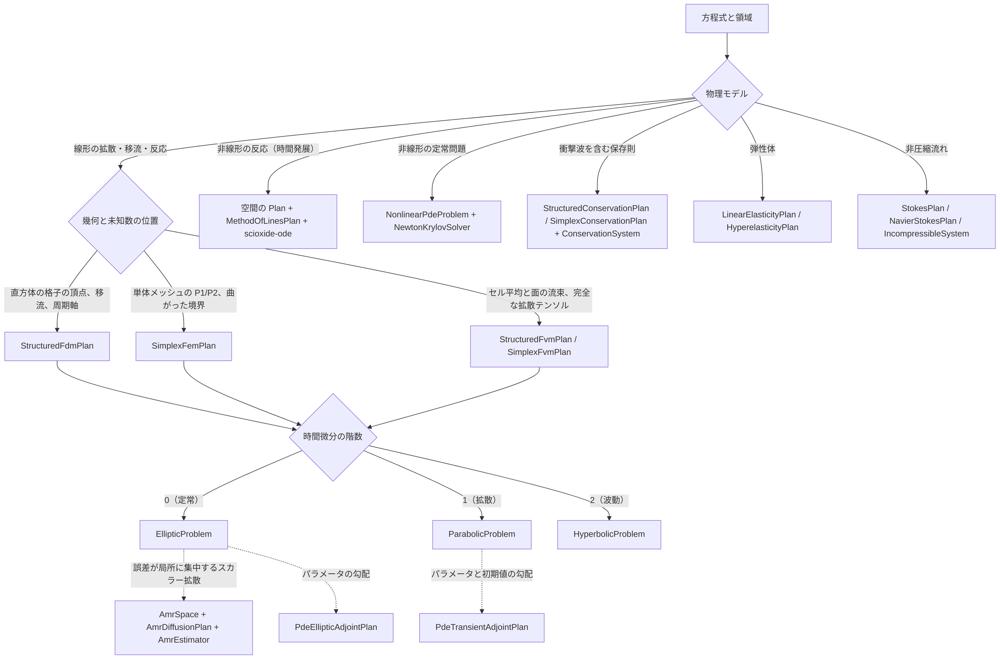

`scioxide-pde` では、空間の離散化（Plan）と求解が別の型に分かれている。
最初に物理モデルを決め、線形の拡散・移流・反応なら幾何と未知数の位置から空間の Plan を選び、時間微分の階数から求解の Plan を選ぶ。
弾性体、非圧縮流れ、衝撃波を含む保存則、非線形の反応はそれぞれ専用の Plan と `scioxide-ode`・`scioxide-rootfind`・`scioxide-linalg` の解法を組み合わせる。
適応細分化とパラメータの感度は、解き方を決めたあとに加える要求である。

---

## 方程式の型と求解の Plan

空間の Plan は作用素 $A$、集中質量 $M$、時刻 $t$ の荷重 $\mathbf{b}(t)$ を組み立て、求解の Plan がそれを解く。
三つの求解の Plan は `SpatialDiscretization` を実装するどの空間の Plan も受け取る（[空間離散化の共通の仕様](oxref:pde-spatial-discretization-contract)）。

| 問題 | 離散化した方程式 | 求解 | 既定の方法と替え方 | 解説 |
|---|---|---|---|---|
| 定常（楕円型） | $A\mathbf{u}=\mathbf{b}$ | `EllipticProblem` | 三重対角、巡回三重対角、疎 LU の直接法を行列の形から選ぶ。`EllipticWorkspace::with_linear_solver` で反復法を注入できる | [楕円型の連立一次方程式の解き方](../algorithms/elliptic-linear-solves/) |
| 拡散（放物型） | $M\mathbf{u}'=\mathbf{b}(t)-A\mathbf{u}$ | `ParabolicProblem` | 適応刻みの Radau IIA。`ParabolicScheme` で後退 Euler・Crank–Nicolson・陽的な Dormand–Prince 5(4)、`with_ode_method` で `scioxide-ode` の組み込みの方法 | [放物型方程式の時間積分](../algorithms/parabolic-time-integration/) |
| 波動（双曲型） | $M\mathbf{u}''=\mathbf{b}(t)-A\mathbf{u}$ | `HyperbolicProblem` | 変位と速度の一階系を適応刻みの Dormand–Prince 5(4) で進める。`with_ode_method` で替えられる | [波動方程式と CFL 条件](../algorithms/hyperbolic-waves-and-cfl/) |
| 非線形の時間発展 | $\mathbf{M}\dot{\mathbf{y}}=\mathbf{f}(t,\mathbf{y})$ | `MethodOfLinesPlan` と `scioxide-ode` の `OdeProblem` | 右辺は呼び出し側が書き、質量と場の尺度で正規化して任意の積分法に渡す | [線の方法と半離散系](../algorithms/method-of-lines-and-nonlinear/) |
| 非線形の定常問題 | $\mathbf{f}(t_\ast,\mathbf{u})=\mathbf{0}$ | `NonlinearPdeProblem` と `scioxide-rootfind` の `NewtonKrylovSolver` | ヤコビ行列を密・疎・作用素から `PdeJacobianMode` で選び、場ごとの前処理を加えられる | [非線形の定常問題](../algorithms/nonlinear-steady-problems/) |
| 衝撃波を含む保存則 | $\lvert K\rvert\,\dot{\bar u}_K=-\sum_f \hat F_f\lvert f\rvert$ | `ConservationSystem` と `scioxide-ode` の陽的な方法 | 刻みの上限を系が提示し、許容されない段の試行は棄却される | [保存則の CFL 条件と時間積分](../algorithms/conservation-time-integration/) |

時間発展の Plan は時刻に依存する源項と境界データ、全ての種類の境界条件を受け付ける。
途中の場は `PdeOutputSchedule` で選び、止まった計算は状態やチェックポイントから再開できる（[時間発展の出力・再開・終了理由](../algorithms/transient-outputs-and-restart/)）。
非線形の反応を持つ拡散系は、Plan の作用素と集中質量で右辺を書いて線の方法で積分する（[Turing パターンの 2 次元の形成](../examples/turing-pattern-formation/)、[二温度モデルの線の方法](../examples/two-temperature-method-of-lines/)）。

## 幾何と空間離散化

線形の拡散・移流・反応の方程式には三つの族の Plan があり、どれも $D=1,2,3$ を一つの型で扱う。
同じ問題を別の族で解き直すときは、境界条件と係数を同じ意味で与えられるが、未知数の位置が違う。

| 観点 | [`StructuredFdmPlan`](../algorithms/multidimensional-spatial-plans/) | [`SimplexFemPlan`](../algorithms/simplex-finite-elements/) | [`StructuredFvmPlan`・`SimplexFvmPlan`](../algorithms/multidimensional-finite-volumes/) |
|---|---|---|---|
| メッシュ | 構造格子（`SegmentMesh`・`QuadMesh`・`HexMesh`） | 区間・三角形・四面体（`IntervalMesh`・`TriangleMesh`・`TetrahedronMesh`） | 構造格子または単体メッシュ |
| 未知数の位置 | 頂点 | P1 は頂点、P2 は頂点と辺の中点 | セル |
| 場の数 | 連成した複数の成分 | 連成した複数の成分 | 一つだけ |
| 拡散 | 軸ごとの係数（対角の異方性まで） | 成分と方向の完全なテンソル | 完全なテンソル |
| 移流 | 中心の平均で近似する（風上化なし） | なし | なし |
| 反応 | 成分間の結合行列 | 成分間の結合行列 | スカラー |
| 周期軸 | 扱える | 扱わない | 扱わない |
| 境界条件の集合 | `StructuredBoundaries` | `TaggedBoundaries` | 構造格子は `StructuredBoundaries`、単体は `TaggedBoundaries` |
| 精度の目安 | 内部の打切り誤差は一様または滑らかに変わる格子で 2 次、任意の不等間隔の格子で 1 次 | 滑らかな解で P1 は 2 次、P2 は内部の点で 3 次。2 次の幾何（`SimplexFemGeometry::Quadratic`）で曲がった境界の幾何誤差を下げる | 滑らかな解でセルの値が 2 次。材料の界面がセルの中にあると 1 次 |
| 集中質量 | 頂点の支配体積 | 対角を全質量に合わせて拡大する HRZ 法 | セルの体積 |
| 向いている用途 | 直方体の領域、周期境界、移流を含む連成系 | 曲がった境界、成分の連成、高次の要素 | 面の流束の収支を直接読む問題（`face_fluxes`）、非直交のメッシュの異方性 |

一次元の三つの Plan の導出と収束次数は[楕円問題の FDM・FEM・FVM](../algorithms/elliptic-fdm-fem-fvm/)、未知数の位置の違いは[メッシュと場の配置](oxref:pde-mesh-field-locations)にある。
頂点の場とセルの場は `scioxide-spatial` の型で区別されるので、異なる族の結果は同じ評価点へ補間するか、流束や積分量で比べる。

連立一次方程式の解き方は行列の性質で決まる。
移流のない拡散と対称な反応なら、Dirichlet 条件を対称に消去した行列は対称なので、作業領域に CG を注入できる。
`StructuredFdmPlan` の移流は行列を非対称にし、格子 Péclet 数 $\lvert v\rvert h/k$ が 2 を超えると正の非対角要素が現れる。
FVM の非直交補正も隣のセルの値を含むので、行列は一般に非対称になる。
非対称な行列は既定の疎 LU に任せるか、GMRES などを注入する。

物性が不連続な界面は格子点（FVM ではセルの面）に合わせる。
係数を読む位置は FDM が面の中心、FVM がセル中心、FEM が求積点なので、界面が格子に合わないと見かけの界面がずれ、誤差は 1 次に下がる（[不連続な係数と材料界面](../algorithms/material-interfaces/)）。

## 境界条件と適合性

境界条件は全ての族で同じ語彙 `BoundaryCondition` で書き、外側の面と成分の組にちょうど一つの条件を与える。
Neumann のデータは外向きの余法線流束 $\mathbf{n}\cdot K\nabla u$、Robin のデータは $\mathbf{n}\cdot K\nabla u+\alpha u=g$ で、法線微分そのものではない（[境界条件と外向きの符号](../algorithms/boundary-conditions/)）。
周期性は境界条件ではなくメッシュのトポロジー `AxisTopology::Periodic` で指定し、継ぎ目の面には条件を与えない。
二次元以上の角のように一つの節点に異なる Dirichlet 値が重なると既定では拒否され、`BoundaryConditions::with_dirichlet_conflict_policy` で扱いを選ぶ。

| 境界の状況 | 解の一意性 | `EllipticProblem` での扱い |
|---|---|---|
| Dirichlet 条件を一か所でも含む | 一意 | そのまま解ける |
| $\alpha>0$ の Robin 条件を含み、残りが Neumann | 一意 | そのまま解ける |
| 全境界が Neumann か周期で、反応項がない（FDM では移流もない） | 定数の分だけ不定。荷重の総和が 0 でなければ解がない | `EllipticOptions::with_gauge` でゲージを選ばない限り拒否する。適合しない荷重は既定で `DomainError`、`CompatibilityPolicy::Project` を選ぶと射影した荷重を解く |
| 構造から分からない零空間がある | 不定 | 正規直交基底を `EllipticProblem::with_nullspace` で与え、`EllipticGauge::Orthogonal` で解く |

物理的な平均値を指定するなら `EllipticGauge::WeightedMean(c)` を使い、射影した荷重を解いたときは、荷重をどれだけ変えたかを診断で確かめる（[楕円問題の適合条件・ゲージ・保存的流束](../algorithms/compatibility-gauges-and-fluxes/)）。
非圧縮流れの圧力も定数の分だけ不定になるが、`IncompressibleOptions::new()` は閉じた連結成分に重み付き平均 0 のゲージを自動で置く（[圧力のゲージと流束の適合条件](oxref:pde-pressure-gauge)）。

## 拡散方程式の時間積分

拡散の半離散系は固有値が負の実軸に並ぶ硬い系で、最大の固有値は格子幅 $h$ に対して $O(h^{-2})$ で増える。
陽的な方法では Fourier 数 $r=\alpha\Delta t/h^2$（$\alpha$ は拡散率）が方法ごとの定数以下に制限され、刻みは $h^2$ に比例して小さくなるので、細かい格子では陰的な方法を選ぶ。

| `ParabolicScheme` | 次数 | 安定性 | 刻み | 選ぶ場面 |
|---|---|---|---|---|
| `RadauIia`（既定） | 5 の適応刻み | L 安定 | 許容誤差で決まる | 精度の要求があり、刻みを自動で選びたいとき |
| `BackwardEuler` | 1 | L 安定 | `with_step` で固定 | 高い波数を強く減衰させたいとき。時間精度は 1 次 |
| `CrankNicolson` | 2 | A 安定（L 安定ではない） | `with_step` で固定 | 滑らかな初期値で固定刻みの 2 次精度が欲しいとき。段差の初期値には Rannacher 起動を加える |
| `ExplicitDopri5` | 5(4) の適応刻み | 安定域は有界 | `CflPolicy::Automatic` が上限を与える | 格子が粗く、刻みの上限 $O(h^2)$ が問題にならないとき |

Crank–Nicolson 法は Fourier 数が大きいと短い波長の増幅率が $-1$ に近づき、段差の初期値から生じた格子規模の振動が符号を反転させながら残る。
`ParabolicOptions::with_rannacher_startup` は最初の数区間を後退 Euler 法の半刻み 2 回に置き換えてこの成分を減衰させ、組み込みの `CrankNicolson` とだけ組み合わせられる（[Crank–Nicolson 法の振動と Rannacher 起動](../algorithms/crank-nicolson-and-rannacher/)）。
要求した時刻の出力 `PdeOutputSchedule::Times` は連続補間出力を持つ積分法でだけ使え、後退 Euler 法と Crank–Nicolson 法には使えない。

## 波動方程式の刻みと格子点数

陽的な積分では、数値的な依存領域が物理的な依存領域を含む必要がある（Courant–Friedrichs–Lewy 条件、Courant 数 $\nu=c\Delta t/h\le1$）。
これは収束の必要条件にすぎず、既定の Dormand–Prince 5(4) 法では一様格子の 2 次中心差分に対して安定の条件 $\nu\le0.4986$ のほうが厳しい。
`HyperbolicProblem` は `HyperbolicOptions::with_initial_step` の刻み（省略すると推定した値）を初期刻みとし、局所誤差の制御と `CflPolicy::Automatic` の上限の小さいほうで進める。
`CflPolicy::MaximumStep` で上限を広げたり `Disabled` で外したりすると、終了理由が `Completed` のまま解が不安定になることがあるので、離散エネルギーの推移を別に確かめる（[CflPolicy と刻みの選択](oxref:pde-wave-cfl-policy-steps)）。

安定な刻みでも、空間の格子は短い波長ほど波を遅らせる（数値分散）。
2 次中心差分の位相速度の誤差は一波長あたりの格子点数 $P$ に対して約 $\pi^2/(6P^2)$ なので、1 % 以内に抑えるには対象の最短波長に $P\ge13$ 点を置く（[波動の数値分散](../algorithms/hyperbolic-numerical-dispersion/)）。
既定の Dormand–Prince 5(4) 法を安定な刻みで使えば時間積分の位相の誤差は空間の分散より小さいので、長時間の計算の精度は時間の許容誤差ではなく格子点数で上げる。

## 物理モデルの Plan

弾性体と非圧縮流れの Plan は二次元・三次元の単体メッシュ、保存則の Plan は構造格子と単体メッシュの上に、専用の弱形式や有限体積の更新を組み立てる。
求解の手段は Plan ごとに違う。

| 目的 | Plan | 要素と未知数 | 求解 | 解説 |
|---|---|---|---|---|
| 小ひずみの弾性 | `LinearElasticityPlan` | P1・P2 の変位、または混合 P2/P1（`ElasticityFormulation`）。平面ひずみ・平面応力・三次元（`ElasticityKinematics`） | `assemble_csr` と `rhs` の系を呼び出し側が解く。変位形は CG か Cholesky 分解、混合形は MINRES 法か LU 分解 | [弾性体の有限要素](../algorithms/elasticity/) |
| 有限ひずみの弾性 | `HyperelasticityPlan` | 圧縮性 neo-Hooke 材料の残差と整合接線 | 呼び出し側の Newton–Krylov 法で解き、境界の変位が大きければ荷重増分を使う。同じ状態の接線は `linearize` で一度だけ評価する | [超弾性と整合接線](../algorithms/hyperelasticity/) |
| 定常の遅い流れ | `StokesPlan` | Taylor–Hood（P2 の速度、P1 の圧力）と圧力のゲージ | Plan の `solve` 系がブロック前処理付きの GMRES で鞍点系を解く。反復法と前処理は作業領域に注入できる | [非圧縮流れの混合有限要素](../algorithms/incompressible-flow/)、[非圧縮流れの鞍点系の解法](../algorithms/incompressible-solvers/) |
| 定常の Navier–Stokes 流れ | `NavierStokesPlan` | `StokesPlan` と同じ | Plan の `solve` 系が保存形の残差と解析的な接線を Newton–Krylov 法で解き、凍結した Stokes の前処理を使う。高い Reynolds 数では継続法で初期値を用意する | [非圧縮流れの鞍点系の解法](../algorithms/incompressible-solvers/) |
| 非定常の非圧縮流れ | `IncompressibleSystem` | 速度だけの ODE（圧力は鞍点系から回復） | `scioxide-ode` の陽的な方法で進める。刻みの上限は粘性の制限（拘束の欠陥を戻す時定数と同じ値）と、Navier–Stokes 流れでは移流の制限で決まる | [非圧縮流れの時間発展](../algorithms/incompressible-time-stepping/) |
| 衝撃波を含む保存則 | `StructuredConservationPlan`・`SimplexConservationPlan` | セル平均、数値流束、再構成 | `ConservationSystem` を `scioxide-ode` の陽的な Runge–Kutta 法（SSP 法の `ForwardEuler`・`Heun` など）で進める | [保存則と数値流束](../algorithms/conservation-laws/) |

ポアソン比が 1/2 に近い材料では、変位形の要素は体積の拘束で過剰に硬くなる（体積ロッキング）ので、`ElasticityFormulation::MixedP2P1` を選ぶ。
P1 の変位は曲げでもせん断ロッキングで硬くなるので、曲げが主な問題では P2 か混合形を使う（[片持ち梁のたわみとロッキング](../examples/cantilever-beam/)）。

保存則の方程式、数値流束、再構成は次のように選ぶ。

| 選択 | 候補 | 選び方 |
|---|---|---|
| 方程式 | `LinearAdvection`、`Burgers`、`IdealGasEuler`、自作の `ConservationLaw` | 自作の方程式は波を包む信号速度と凸な許容集合を実装側が保証する |
| 数値流束 | `Godunov`（線形移流と Burgers の厳密な Riemann 解）、`Rusanov`（どの方程式にも使える）、`Hlle`・`Hllc`（`IdealGasEuler`） | 接触不連続を鋭く保つなら `Hllc`、真空に近い状態でロバスト性を優先するなら `Hlle`。`Rusanov` は最大の波速に比例する拡散を加える |
| 再構成 | `Constant`、構造格子の `Minmod`・`MonotonizedCentral`、単体メッシュの `BarthJespersen` | 2 次の再構成は滑らかな部分の誤差を下げる。不連続を含む解の $L^1$ 誤差は再構成によらず高々 1 次で減り、接触不連続のような線形の不連続では定数で $h^{1/2}$、2 次の再構成で $h^{2/3}$ 程度になる |

再構成と境界の外側の状態は[保存則の再構成と境界](../algorithms/conservation-reconstruction/)、刻みの上限と許容性の検査は[保存則の CFL 条件と時間積分](../algorithms/conservation-time-integration/)で説明する。

## 適応細分化と感度

誤差が角や界面の近くに集中する問題では、一様な細分化は自由度を無駄に使う。
パラメータについての勾配が要る問題では、パラメータごとに解き直す差分より離散随伴が計算コストが小さい。

| 要求 | Plan | 対象と制限 | 解説 |
|---|---|---|---|
| 誤差推定に基づく適応細分化 | `AmrSpace`、`AmrDiffusionPlan`、`AmrEstimator`、`AmrMarking` | 単体メッシュの P1・P2 と、格子のセルの Q1 の節点空間。組み立てる方程式はスカラーの拡散で、連立方程式は呼び出し側が CG などで解く。周期的な同一視と曲がった幾何は扱わない | [誤差推定に基づく適応細分化](../algorithms/adaptive-mesh-refinement/) |
| revision 間の場の転送 | `AmrCellTransfer`、`AmrNodalTransfer` | セル平均は総量を保って細分と粗化の両方で移せる。節点の場は細分だけなら補間、粗化を含むなら $L^2$ 射影 | [適応細分化の revision 間の場の転送](../algorithms/adaptive-field-transfer/) |
| 定常問題の感度 | `PdeEllipticAdjointPlan` | 四つの線形の Plan が係数・源項・境界データ・Robin 係数の微分を自分で組み立てる。メッシュの座標は微分しない | [離散随伴と定常問題の感度](../algorithms/adjoints-and-sensitivities/) |
| 一般の残差の感度 | `PdeDiscretizationDerivatives` | 非線形の残差や独自のパラメータ微分の作用素と線形解法を呼び出し側が与える | [一般の残差の随伴](oxref:pde-adjoint-general-residual) |
| 時間発展の感度 | `PdeTransientAdjointPlan` | 固定刻みの後退 Euler 法・Crank–Nicolson 法と Dormand–Prince 5(4) 法の離散写像を微分する。Rannacher 起動は微分しない | [時間発展問題の離散随伴](../algorithms/transient-adjoints/) |

推定子は誤差の上界ではないので、細分化を止める判断には有効性指数の大きさを見込む（[L 字領域の角特異性と適応細分化](../examples/l-shaped-amr/)）。
離散随伴が返すのは離散化した目的関数の勾配で、連続問題の勾配とは離散化誤差の分だけ違う。

## まとめ

線形の拡散・移流・反応は幾何と未知数の位置から FDM・FEM・FVM の Plan を選び、時間微分の階数から `EllipticProblem`・`ParabolicProblem`・`HyperbolicProblem` を選ぶ。
移流と周期軸は `StructuredFdmPlan`、曲がった境界と成分の連成は `SimplexFemPlan`、面の流束の収支と完全な拡散テンソルは FVM の Plan が受け持つ。
全境界が Neumann の楕円問題ではゲージを選んで荷重の適合性を確かめ、段差の初期値の Crank–Nicolson 法には Rannacher 起動を加える。
波動の長時間の計算は刻みの安定性に加えて一波長あたりの格子点数で精度を決める。
弾性体・非圧縮流れ・保存則・非線形の問題は専用の Plan と他のクレートの解法を組み合わせ、適応細分化と感度はその上に加える。

## 次に読むページ

- [空間を離散化して場を解く](../algorithms/)：選んだ Plan の導出を読む前に、記号、境界の符号、誤差の分け方を確かめる。
- [楕円問題の FDM・FEM・FVM](../algorithms/elliptic-fdm-fem-fvm/)：三つの族の離散化が一次元でどう違い、どの次数で収束するかを確かめる。
- [偏微分方程式の例題と応用](../examples/)：選んだ Plan を使う例題と、その独立な検算の方法を探す。
- [偏微分方程式の API ガイド](../api/)：選んだ Plan と求解の Plan の仕様、エラーの分類、作業領域を確かめる。
