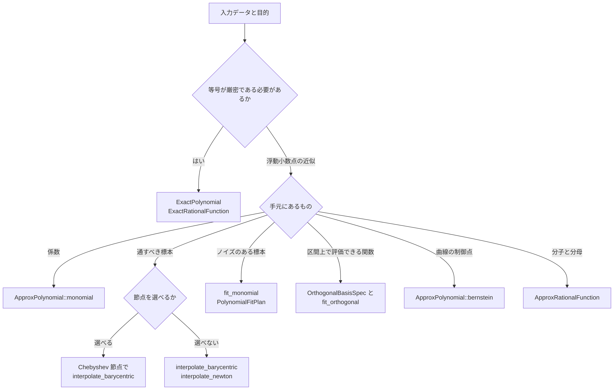

係数を操作する計算、標本を通す補間、ノイズのあるデータの近似では、適した表現が異なる。
最初に等号が厳密である必要があるかを決め、近似でよければ手元のデータの種類と欲しい結果を確かめる。
基底の名前だけで精度を判断せず、座標の尺度と入力誤差のモデルもあわせて確かめる。

## 入力と目的による選択

図の葉は最初に使う構築関数である。
節点を選べない等間隔の標本で次数が高いときは、補間をやめて低次の当てはめか区分的な補間を検討する。
近似の場合は、次の表で評価コスト・一時領域・失敗条件を比べる。

## 基底と評価の比較

| 表現 | 保存座標 | 一点の評価 | 注意する条件 | 数理 |
|---|---|---|---|---|
| 単項式 | 昇べき順の係数 | Horner 法、$O(n)$ | 原点から遠い区間でのべきの大きさと、係数の打ち消し | [表現と Horner 法](../algorithms/representation-and-horner/) |
| Newton | 差商と順序付きの節点 | 入れ子の積、$O(n)$ | 節点の順序と差商の感度 | [補間](../algorithms/interpolation-and-chebyshev/) |
| 重心 | 節点・節点での値・重み | 第二重心公式、$O(n)$（重みの準備は $O(n^2)$） | 節点配置の Lebesgue 定数 | [補間](../algorithms/interpolation-and-chebyshev/)、[重心公式の丸め誤差](../algorithms/barycentric-rounding-and-weights/) |
| 直交展開 | 指定した族の係数と、準備した漸化式 | Clenshaw 法、$O(n)$ | 重み・規格化・アフィン座標・基準区間の外での評価 | [直交基底の準備・評価・基底変換](../algorithms/orthogonal-bases-and-calculus/) |
| Bernstein | 区間と制御点 | de Casteljau 法、$O(n^2)$ | 区間の外では凸包性が成り立たない | [Bernstein 表現と de Casteljau 法](../algorithms/multivariate-and-bernstein/) |

一点の `evaluate` で一時ベクトルを確保するのは Bernstein 形式（制御点の数の長さ）だけで、ほかの基底は確保しない。
多くの点を確保なしで評価する `evaluate_batch_into` には一時領域を渡し、その長さは `workspace_requirements(m)`（$m$ は点の数）で問い合わせる。
構築と失敗の条件は次のとおりである。

| 表現 | 構築の API と計算コスト | 一点の評価の一時確保 | 構築時の主なエラー | 悪条件になる典型 |
|---|---|---|---|---|
| 単項式 | `monomial`、$O(n)$、係数を所有 | なし | 空・非有限の係数 | 原点から遠い区間、等間隔標本からの高次の展開 |
| Newton | `interpolate_newton`（実数のみ）、差商 $O(n^2)$ | なし | 空、長さの不一致、重複・非有限の節点、桁あふれ・アンダーフローする差商 | 近い節点の差での割り算、悪い節点の順序 |
| 重心 | `interpolate_barycentric`（実数・複素数）、重み $O(n^2)$ と $O(n)$ の一時確保 | なし | 空、長さの不一致、重複・非有限の節点、アンダーフローで 0 になる重み | Lebesgue 定数の大きい節点配置 |
| 直交展開 | `OrthogonalBasisSpec`（`classical`・`on_interval`・`new`）から `orthogonal`。Plan を再利用するときは `prepare` から `orthogonal_with_plan`。漸化式の準備は $O(n)$ | なし | 正でない尺度・範囲外の族の引数（`DomainError`）、準備した次数を超える係数 | 基準区間の外での評価 |
| Bernstein | `bernstein(制御点, a, b)`、$O(n)$ | 制御点の数 | 空・非有限の制御点、$a\ge b$ や非有限の端点 | 区間の外での評価 |

評価そのものは非有限の点と、表現できない値・導関数・包絡をエラーにする。
相対的な診断が有界でない場合（値が 0 で包絡が正のときなど）は、エラーにせず条件数の推定に正の無限大を返す。
`evaluate_with_derivative` の `condition()` は、基底ごとの包絡を $|p(x)|$ で割った量を条件数の推定にする。
包絡は単項式では $\sum_k|a_k||x|^k$、Newton 形式では $\sum_k|c_k|\prod_{j<k}|x-x_j|$、直交展開では $\sum_k|c_k||\phi_k(x)|$、Bernstein 形式では $\max_k|b_k|$（$t\in[0,1]$ のとき）である。
重心形式では標本値の項 $\sum_j|\ell_j(x)y_j|$ と $|p(x)|$ の比に、その点の Lebesgue 関数 $\Lambda(x)=\sum_j|\ell_j(x)|$ を加える。
どれも推定であり、基底どうしの精度の優劣を証明するものではない。

補間の節点上の値が一致しても、節点の間の近似誤差は大きいことがある。
等間隔の高次補間が振動する場合は、まず節点配置と次数を見直す。
ノイズがあるときはすべての標本を通す必要があるかを考え、[重み付き最小二乗](../algorithms/least-squares-and-vandermonde/)の残差とランクを確かめる。
基底の変換は明示的な操作で、すでに入力に含まれる丸め誤差を回復しない。

## 補間と当てはめの使い分け

| 状況 | 選ぶ方法 | 理由 |
|---|---|---|
| 関数を好きな点で評価できる | Chebyshev 節点での補間、または直交基底での当てはめ | Lebesgue 定数が次数の対数でしか増えず、解析的な関数では誤差が幾何級数的に減る |
| 標本が等間隔に固定され、ノイズが小さい | 低い次数の当てはめ、または区分的な補間 | 等間隔の高次補間は Lebesgue 定数が指数的に増える |
| 標本にノイズがある | `PolynomialFitPlan` で重み $w_i=1/\sigma_i^2$（$\sigma_i$ は標本の標準偏差） | 重みは残差の二乗に掛かる。ノイズを補間せず、ランクと残差で次数を判断できる |
| 同じ節点・重みで値だけが変わる | 準備済みの `PolynomialFitPlan` の `fit` を繰り返す | 標本行列と特異値分解の準備を一度で済ませる |
| 極や漸近線を持つ関数 | 有理関数（構成は scioxide-interp の AAA・Padé） | 多項式では極の近くの振る舞いを表せない |

区分的な補間とスプラインは [scioxide-interp](../../scioxide-interp/) が扱う。
Runge 現象の数値比較は[節点配置の例題](../examples/runge-nodes/)、係数の減衰による次数の判断は [Chebyshev 近似の例題](../examples/chebyshev-approximation/)で確かめられる。

## 直交族と座標

| 区間と重み | 族 | 適用上の注意 |
|---|---|---|
| $[-1,1]$、$1/\sqrt{1-x^2}$ | Chebyshev 第一種 | 関数の近似に使う。根節点と極値点（Lobatto 節点）を区別する |
| $[-1,1]$、$\sqrt{1-x^2}$ | Chebyshev 第二種 | 第一種の導関数と $T_n'=nU_{n-1}$ で結ばれる |
| $[-1,1]$、$1$ | Legendre | 連続の直交性と、離散標本での標本行列の直交性を区別する |
| $[-1,1]$、$(1-x)^\alpha(1+x)^\beta$ | Jacobi・Gegenbauer | パラメータの定義域（Jacobi では $\alpha,\beta>-1$、Gegenbauer では $\lambda>-1/2$ かつ $\lambda\ne0$）を確かめる。Gegenbauer の重みは $(1-x^2)^{\lambda-1/2}$ |
| $[0,\infty)$、$x^\alpha e^{-x}$ | Laguerre・一般化 Laguerre | 半無限区間の重み付き問題 |
| 実数全体、$e^{-x^2}$ または $e^{-x^2/2}$ | HermiteH・HermiteHe | 零点の尺度と最高次係数が異なる |

基準変数 $t$ と物理変数 $x$ は $t=(x-\mathrm{shift})/\mathrm{scale}$ で結ぶ。
`OrthogonalBasisSpec::on_interval(family, a, b)` は区間 $[a,b]$ から中心 $\mathrm{shift}=(a+b)/2$ と尺度 $\mathrm{scale}=(b-a)/2$ を求める。
`on_interval` を使えるのは $[-1,1]$ 上の族（Chebyshev・Legendre・Jacobi・Gegenbauer）だけで、Laguerre と Hermite には `classical` か `new` で中心と尺度を直接与える。
規格化は `BasisNormalization`（`Classical`・`Monic`・`Orthonormal`）で指定する。
単項式係数と同じ数の並びを渡しても、同じ関数にはならない。
族の初期値と漸化式は[直交多項式族](../algorithms/orthogonal-families/)で確かめる。

## 厳密な係数と近似の方針

`ExactCoefficient` と `ExactField` は、呼び出し側が用意する係数型が満たすトレイトである。
浮動小数点型はこれらを実装しないので、`ExactPolynomial<f64>` は作れない。
[部分積の木による厳密な多点評価の例](oxref:poly-exact-multipoint-evaluation)は有限体、[交点数の検算](oxref:poly-exact-sturm-count)は小規模な有理数を使う。
厳密な係数は等号を保つ代わりに、演算のたびに係数のビット長が増えうるので、計算の規模は別に見積もる。

近似多項式は `PolynomialApproximationPolicy` を保持し、二項演算では両方の方針が等しいことを要求する。
データだけを取る構築関数は既定の方針を使い、別の方針は `monomial_with_options` のような `_with_options` の形で渡す。
保存上の次数は末尾の厳密な零だけで決まり、許容誤差による有効次数の分類（`classify_coefficients`）は係数を削除しない。
許容誤差を緩めても、入力の物理的な不確かさは小さくならない。

## 簡約・消去・根の診断

| 問い | API | 読む診断 |
|---|---|---|
| 商と剰余が欲しい | `div_rem`（[多項式除算とデフレーション](../algorithms/division-gcd-and-rational/)） | 1 ノルムの再構成残差と感度 |
| 近い共通因子を除きたい | `approximate_gcd`、`ApproxRationalFunction::simplify`（[近似 GCD](../algorithms/approximate-gcd/)、[有理関数の約分](../algorithms/rational-functions/)） | 選んだ次数と、元の各入力の正規化剰余 |
| 分母の因子が既知 | `ApproxPartialFractionPlan`（[部分分数分解](../algorithms/partial-fractions/)） | 因子の積の誤差、分子の再構成誤差、分解の逆条件数 |
| 変数を消去したい | `approximate_resultant`、`SylvesterElimination`（[浮動小数点の終結式と数値ランク](../algorithms/approximate-elimination/)） | 値の尺度と、平衡化した行列のランク |
| 重根に近いか知りたい | `approximate_discriminant`、`SylvesterDiscriminant` | 判別式と定義行列の診断 |
| 根の候補を評価したい | `root_condition`、`polynomial_root_diagnostics`、`checked_basis_evaluation`（[根を固有値に持つ行列と根の感度](../algorithms/root-conditioning/)） | 根の条件数、根の候補としての後退誤差、円板とクラスタの状態 |

近似の約分は元の有理関数を変えうるので、係数だけでなく利用する区間での値も比べる。
分母の評価が 0 と区別できない点で返る `DomainError` と、近似因子の判定に使う許容誤差は別の条件である。
[有理飽和の例](../examples/rational-saturation/)で二つを区別する。

## 提供しない機能と他章への案内

| 欲しいもの | 本章の扱い | 使うクレートと API |
|---|---|---|
| 多項式のすべての根 | 根を固有値に持つ行列と根の候補の診断だけを提供し、ソルバーは提供しない | scioxide-rootfind の `polynomial_roots`（[実係数多項式の全根計算](../../scioxide-rootfind/algorithms/polynomial-root-pipeline/)） |
| 根の個数の証明 | 円板とクラスタは推定で、証明しない | scioxide-validated の `polynomial_roots`（[validated の選び方](../../scioxide-validated/choosing/)） |
| Gauss 求積の重みと求積則 | 直交多項式の零点（Golub–Welsch 法の節点）と Jacobi 行列までを提供し、重みは提供しない | scioxide-integrate の `GaussianRulePlan`（[Gauss 型求積と Clenshaw–Curtis 則](../../scioxide-integrate/algorithms/gaussian-and-clenshaw-curtis/)） |
| 標本からの有理近似（AAA） | 提供しない | scioxide-interp の `aaa`（[有理近似と極の診断](../../scioxide-interp/algorithms/rational-approximation/)） |
| Taylor 係数からの Padé 近似 | 提供しない | scioxide-interp の `PadeApproximant`（[Floater–Hormann 補間と Padé 近似](../../scioxide-interp/algorithms/floater-hormann-and-pade/)） |
| 一般の関数の最良多項式近似（Remez 法） | 提供しない | どのクレートも提供しない。Remez 交換法は scioxide-signal の `design_fir_remez`（Parks–McClellan 法）が FIR フィルタの等リップル設計に限って使う |
| 因数をすべて探す因数分解 | 提供しない | どのクレートも提供しない。厳密な `gcd` と、与えた因子による部分分数分解は使える |

最良近似の代わりに Chebyshev 節点での補間を使えば、その最大誤差は最良近似の誤差の $1+\Lambda_n$ 倍以下である。
$\Lambda_n$ は節点の Lebesgue 定数で、$n+1$ 個の Chebyshev 節点では $\Lambda_n\le\frac{2}{\pi}\log(n+1)+1$ を満たす（Trefethen, *Approximation Theory and Approximation Practice*, 第 15 章）。
したがって $n=100$ でも $\Lambda_n<4$ で、Chebyshev 補間の誤差は最良近似の誤差の 5 倍未満に収まる。

## まとめ

厳密な等号が要るかを先に決め、近似なら手元のデータ（係数・標本・関数・制御点・分子と分母）から構築関数を選ぶ。
基底ごとの評価コスト・一時領域・構築時のエラーは表で比べ、条件は節点配置と座標の尺度で決まることを確かめる。
関数を自由に評価できるなら Chebyshev 節点、ノイズがあるなら重み $w_i=1/\sigma_i^2$ の重み付き最小二乗を選ぶ。
全最上位の求解は scioxide-rootfind、Gauss 求積の重みは scioxide-integrate、AAA と Padé の構成は scioxide-interp に進み、最良近似の代わりには Chebyshev 補間を使う。
簡約や根の診断の推定を、厳密な等号や包含が保証された区間と混同しない。

## 次に読むページ

- [数値アルゴリズム](../algorithms/)：三種類の誤差の区別と記号を確かめ、各方法の導出に進む。
- [例題](../examples/)：同じ判断を具体的な題材で比べ、独立な検算で結果を確かめる。
- [API ガイド](../api/)：選んだ構築関数と型の仕様・エラーを引く。
