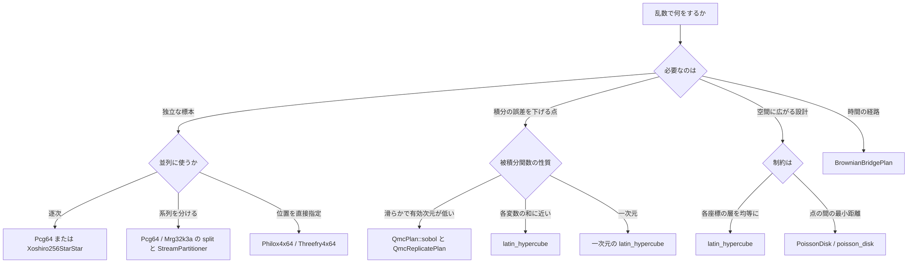

乱数を使う計算では、生成器、確率分布、標本の作り方、点の配置を別々に選ぶ。
生成器の速さや周期だけで選ぶと、並列の系列の重なりや、点の配置が被積分関数に合わないことによる誤差を見落とす。
このページは目的から型を選ぶ手順と、選んだ型の性質の比較をまとめる。
アルゴリズムの詳細は[乱数・分布・標本設計の数理](../algorithms/)の各ページにある。

## 選び方の流れ



## 生成器の比較

| 生成器 | 状態 | 周期 | 前進・分割 | 向く用途 |
|---|---|---|---|---|
| `Pcg64` | 128 ビット＋増分 | 系列ごとに $2^{128}$ | `skip_ahead`、`split(u64)` で $2^{64}$ 系列から選ぶ、`substream` で各系列を $2^{64}$ 遷移の区画に分ける | 汎用の逐次・並列の計算 |
| `Xoshiro256StarStar` | 256 ビット | $2^{256} - 1$ | `jump`（$2^{128}$）、`long_jump`（$2^{192}$） | 逐次の計算、ジャンプで分けた少数のワーカー |
| `Xoshiro128StarStar` | 128 ビット | $2^{128} - 1$ | `jump`（$2^{64}$）、`long_jump`（$2^{96}$） | 32 ビットのネイティブ出力ワードを使う計算 |
| `Mrg32k3a` | $2 \times 3$ ワード | 約 $2^{191}$ | `skip_ahead`、系列 $2^{127}$・部分系列 $2^{76}$ 遷移の間隔の分割 | RngStreams と同じ系列の構造が要る計算 |
| `Philox4x64`、`Threefry4x64` | 鍵とカウンター | 系列ごとに $2^{66}$ ワード | `seek`、`fork`、`split`、`jump` | 標本の番号から直接乱数を決める並列計算 |
| `SplitMix64` | 64 ビット | $2^{64}$ | `skip_ahead`（$O(1)$） | シードの展開、簡単な試験 |
| `Lcg64` | 64 ビット | $2^{64}$ | `skip_ahead` | 互換と教材。出力に格子構造があるので多次元の計算には使わない |
| `Mt19937`、`Ranlux` 系、`Taus2`、`Taus113`、`Gfsr4`、`Mrg`、`Cmrg` | 生成器ごと | 生成器ごと | なし（保存と復元のみ） | 既存の計算の数列を再現する |

どの生成器も `SerializableState` で状態を保存できる。
値域の限られたネイティブ出力ワードを持つ生成器（`Mrg`、`Ranlux` 系など）では、添字の抽出や整数の分布のように一様乱数ワードを使う経路は、ネイティブ出力ワードを正確な整数の棄却で全幅の一様乱数ワードにそろえてから使う。
浮動小数点の一様乱数はネイティブ出力ワード一つから作るので、その刻みはネイティブ出力ワードの幅で決まる（[一様乱数ワードと浮動小数点への変換](oxref:random-algorithms-uniform-conversion)）。
暗号用途（鍵、認証のトークン）には、どの生成器も使ってはならない。

## 確率分布の族の選び方

確率分布は対象とする量の台（値の取りうる範囲）、裾の重さ、歪み、極値として現れる量かどうかで選ぶ。
裾の重さは $x \to \infty$ での生存関数 $S(x) = \Pr(X > x)$ の減り方で分類する。
Gauss 型は $e^{-x^2/2}$、指数型は $e^{-x}$ の速さで減り、べき型は $x^{-\alpha}$ のように減るので次数 $\alpha$ 以上のモーメントを持たない。
表の「極値」の列はその分布をブロックの最大値の極限分布（一般化極値分布）として使うか、閾値を超えた量の極限分布（一般化 Pareto 分布）として使うかを示す。

| 台 | 裾の重さ | 歪み | 極値 | 代表的な分布 | 次に読むページ |
|---|---|---|---|---|---|
| 実数全体 | Gauss 型・指数型（`GeneralizedNormal` は $e^{-\lvert x \rvert^\beta}$） | 対称 | 該当なし | `Normal`、`Logistic`、`HyperbolicSecant`、`GeneralizedNormal` | [古典的な連続分布の族](../algorithms/continuous-law-families/) |
| 実数全体 | べき型（`StudentT` は自由度 $\nu$ 未満の次数のモーメントだけを持ち、`Cauchy` は平均を持たない） | 対称（`LevyStable` は $\beta$ で歪む） | 該当なし | `StudentT`、`Cauchy`、`LevyStable` | [極値分布と裾の重い分布](../algorithms/extreme-value-and-heavy-tails/) |
| 実数全体 | 分布による（双曲型は指数型に多項式を掛けた減り方） | 母数で左右に調整する | 該当なし | `SkewNormal`、`AsymmetricLaplace`、`JonesFaddySkewT`、`NormalInverseGaussian`、`GeneralizedHyperbolic`、`JohnsonSU` | [歪み・双曲型・変換分布](../algorithms/skew-hyperbolic-and-transformed-laws/) |
| 正の半直線 | 指数型（`WeibullMin` は $e^{-x^k}$、`Gompertz` は指数型より軽く、`LogNormal` は指数型より重いがすべてのモーメントを持つ） | 右に歪む | 該当なし | `Exponential`、`Gamma`、`WeibullMin`、`LogNormal`、`InverseGaussian`、`Gompertz`、`GeneralizedExponential` | [古典的な連続分布の族](../algorithms/continuous-law-families/) |
| 正の半直線（`GeneralizedPareto` は形状 $c < 0$ で $[0, -1/c]$ に有界） | べき型（`Pareto` は $x^{-b}$、`Burr12` は $x^{-cd}$、`GeneralizedPareto` は $c > 0$ で $x^{-1/c}$、$c = 0$ では指数型） | 右に歪む | 閾値超過量の極限（`GeneralizedPareto`） | `Pareto`、`Burr12`、`GeneralizedPareto` | [極値分布と裾の重い分布](../algorithms/extreme-value-and-heavy-tails/) |
| 形状母数 $c$ で決まる（$c < 0$ で下に有界、$c = 0$ で実数全体、$c > 0$ で上に有界） | 右の裾は $c < 0$ でべき型、$c = 0$ で指数型、$c > 0$ でなし | 母数による（`GumbelRight` は右に歪む） | ブロック最大値の極限 | `GeneralizedExtremeValue`、`GumbelRight` | [極値分布と裾の重い分布](../algorithms/extreme-value-and-heavy-tails/) |
| 有界区間 | 裾なし | 対称から強い歪みまで母数で調整する | 該当なし | `Uniform`、`Trapezoid`、`Cosine`、`Beta`、`Bradford`、`JohnsonSB`、`Argus`、`TruncatedPareto`（$[1, c]$） | [古典的な連続分布の族](../algorithms/continuous-law-families/) |
| 非負整数（`Binomial` は $0, \dots, n$、`Geometric` と `Zipf` は 1 以上） | 分布による（`Poisson` は階乗で、`Geometric` は幾何級数で、`Zipf` はべき型で減る） | 多くは右に歪む（`Binomial` は $p > 1/2$ で左に歪む） | 該当なし | `Binomial`、`Poisson`、`NegativeBinomial`、`Geometric`、`Zipf` | [離散分布と計数の分布](../algorithms/discrete-and-multivariate-distributions/) |
| 円周・球面 | 裾なし（台が有界） | 平均方向のまわりに対称 | 該当なし | `VonMises`、`WrappedCauchy`、`VonMisesFisher`、`UniformDirection` | [円周上の角度の確率分布](../algorithms/circular-and-directional-laws/)、[球面上の方向の確率分布](../algorithms/spherical-directional-laws/) |
| ベクトル・行列・群 | 分布による（`MultivariateNormal` は Gauss 型、`MultivariateStudentT` はべき型） | 分布による | 該当なし | `MultivariateNormal`、`MultivariateStudentT`、`Dirichlet`、`Multinomial`、`Wishart`、`OrthogonalGroup` | [多変量・行列・群の確率分布](../algorithms/multivariate-and-matrix-laws/) |
| 検定統計量の値 | 分布による | 分布による | 該当なし | `FisherF`、`NoncentralChiSquared`、`Kolmogorov`、`StudentizedRange` | [検定統計量の分布と有限標本の KS 分布](../algorithms/test-statistic-laws/)、[スチューデント化範囲と Tukey の多重比較](../algorithms/studentized-range-laws/)、[F 分布・非心分布と検出力](../algorithms/f-and-noncentral-laws/) |
| 上のどれでもない分布 | 利用者の分布による | 利用者の分布による | 該当なし | `Affine`、`Truncated`、`Mixture`、`AdaptiveRejectionSampler`、`TransformedDensitySampler`、`RatioUniformsSampler`、`InversionSampler` | [分布の機能・裾確率・数値逆算](../algorithms/laws-tails-and-multivariate-models/) |

形状だけを持つ分布（`Pareto`、`GeneralizedPareto`、`GeneralizedExtremeValue` など）には、`Affine` で位置と尺度を付ける。
無メモリ性 $\Pr(X > s + t \mid X > s) = \Pr(X > t)$ を持つのは、連続分布では指数分布だけ、離散分布では幾何分布だけである。
`Gompertz` と `GeneralizedExponential` は時間とともに増えるハザード（瞬間の故障率）を持ち、老化や摩耗の寿命に使う。
正規分布は独立な小さい寄与の和の極限（中心極限定理）として測定誤差に現れ、`Logistic` と `HyperbolicSecant` はそれより重い指数型の裾を持つ対称な代替になる。

利用者の密度から標本を作る汎用の標本化器は、要求する性質がそれぞれ異なる。
`AdaptiveRejectionSampler` は $\log f$ が凹、`TransformedDensitySampler` は $-1/\sqrt{f}$ が凹であることの保証を要求する。
`RatioUniformsSampler` は、密度のプロバイダーが `BoundedDensity::ratio_uniforms_bounds` で返す受理域を包む長方形（`RatioUniformsBounds`）を使い、`InversionSampler` は密度ではなく対数分布関数と対数生存関数を使う。

## 標本の形と失敗時の状態

一つの標本なら `sample`、一度だけ結果が欲しいなら `sample_n` を使う。
同じ大きさの一括生成を繰り返すなら、作業領域を一度確保して呼び出し側の出力に書く `sample_n_into` を使う。
所有値を返す API の `sample_n` は失敗したとき生成器を消費したワードの分だけ進めたまま残す。
失敗したときに生成器を戻したいなら `sample_n_into` に `SamplingPolicy::rollback` を、消費を残すなら `SamplingPolicy::advance_on_error` を渡す。

## 点の配置の選び方

| 方法 | 型・関数 | 誤差・性質 | 向く問題 |
|---|---|---|---|
| 独立な一様点 | `Rng::next_float` | RMSE $\sigma_f/\sqrt{N}$、次元によらない | 高い次元、滑らかでない関数 |
| 一次元の層化 | 1 次元の `latin_hypercube` | 層の間の分散が消える。滑らかなら RMSE $\propto N^{-3/2}$ | 一次元の積分 |
| ラテンハイパーキューブ | `latin_hypercube` | 各変数の主効果の分散を除く。相互作用の分散は残る | 各変数の和に近い関数、感度解析 |
| ランダム化した QMC | `QmcPlan::sobol`、`QmcReplicatePlan` | 滑らかで有効次元が低ければ MC より速く減る。誤差は反復で推定 | 中程度の次元の滑らかな積分 |
| Poisson 円板 | `PoissonDisk`、`poisson_disk` | 点の間の距離が $r$ 以上 | 空間に散らばる採取点、1〜6 次元 |

関数 $f$ を各変数の主効果 $f_j(x_j)$ と相互作用に分ける分解（ANOVA 分解）を使うと、方法の違いを説明できる。
ラテンハイパーキューブは各座標の $N$ 個の層に点を一つずつ置くので、主効果の和 $\sum_j f_j(x_j)$ の分散を層の中の揺らぎだけに減らすが、相互作用の分散は独立点と同じだけ残す。
ランダム化した Sobol 点列は滑らかな低次の項を速く積分するが、多くの変数が同時に効く項には効果が小さい。

次のセルは $d$ 次元で同じ点数 $N$ の三つの方法の RMSE を、独立な $R = 32$ 回の反復で比べる。
被積分関数は各変数の和 $f_{\mathrm{add}} = \sum_j 12 (x_j - \tfrac12)^2$ と、相互作用だけの $f_{\mathrm{int}} = \prod_j \sqrt{12}(x_j - \tfrac12)$ である。
$x \sim U(0, 1)$ では $\mathrm{E}[12(x - \tfrac12)^2] = 1$、$\mathrm{E}[144(x - \tfrac12)^4] = 144/80 = 1.8$ なので、$f_{\mathrm{add}}$ の積分は $d$、分散は $\sigma_f^2 = 0.8d$ である。
$f_{\mathrm{int}}$ の積分は 0、分散は $\prod_j \mathrm{E}[12(x_j - \tfrac12)^2] = 1$ になる。
これらの閉形式が独立な検算の基準になる。
入力は被積分関数、次元 $d$、点数の指数 $k$（$N = 2^k$）、ルート生成器 `Pcg64` のシード $s$ である。
反復 $r$ は根から `split` で選んだ系列 $3r$、$3r + 1$、$3r + 2$ を、独立点、ラテンハイパーキューブ、Sobol 点列のずらしに一つずつ使う。
`split` は派生元のシードから番号で系列を選ぶので、シードを 1 ずつずらす方法と違って、反復と方法の組ごとに別の系列を使う。
出力は各方法の RMSE と、独立点の理論 RMSE $\sigma_f/\sqrt{N}$ に対する比の表である。

```rust
//| id: random-choosing-point-sets
//| ref: random-choosing-point-sets
//| title: 被積分関数の構造で独立点・LHS・ランダム化 Sobol の誤差を比べる
//| run: button
//| crates: [scioxide-core, scioxide-random]
//| inputs:
//|   integrand: {"type":"select","label":"被積分関数","options":["和 Σ 12(xⱼ − 1/2)²","積 Π √12 (xⱼ − 1/2)"],"value":"和 Σ 12(xⱼ − 1/2)²"}
//|   dimension: {"type":"range","label":"次元 d","min":2,"max":10,"step":1,"value":5}
//|   exponent: {"type":"range","label":"点数の指数 k（N = 2ᵏ）","min":6,"max":11,"step":1,"value":8}
//|   seed: {"type":"range","label":"ルート生成器のシード s","min":1,"max":1000,"step":1,"value":3}
//| cases:
//|   - {"id":"product","label":"積の被積分関数","description":"主効果がないので、三つの方法の RMSE はどれも独立点の理論値の 1 倍前後になる。","inputs":{"integrand":"積 Π √12 (xⱼ − 1/2)"}}
//|   - {"id":"more-points","label":"和、N = 2048","description":"点数を 8 倍にすると、ラテンハイパーキューブと Sobol の比は独立点より大きく下がる。","inputs":{"exponent":11}}
//| tests:
//|   - case: default
//|     expect:
//|       - {"artifact":"rmse","path":"/rows/0/1","approx":{"value":0.125,"atol":1e-12}}
//|       - {"artifact":"rmse","path":"/rows/1/2","range":{"min":0.6,"max":1.5}}
//|       - {"artifact":"rmse","path":"/rows/2/2","range":{"min":0.002,"max":0.03}}
//|       - {"artifact":"rmse","path":"/rows/3/2","range":{"min":1e-5,"max":2e-3}}
//|   - case: product
//|     expect:
//|       - {"artifact":"rmse","path":"/rows/0/1","approx":{"value":0.0625,"atol":1e-12}}
//|       - {"artifact":"rmse","path":"/rows/1/2","range":{"min":0.6,"max":1.5}}
//|       - {"artifact":"rmse","path":"/rows/2/2","range":{"min":0.5,"max":1.5}}
//|       - {"artifact":"rmse","path":"/rows/3/2","range":{"min":0.5,"max":1.5}}
//|   - case: more-points
//|     expect:
//|       - {"artifact":"rmse","path":"/rows/1/2","range":{"min":0.6,"max":1.5}}
//|       - {"artifact":"rmse","path":"/rows/2/2","range":{"min":5e-4,"max":0.01}}
//|       - {"artifact":"rmse","path":"/rows/3/2","range":{"min":1e-7,"max":5e-4}}
use scioxide_core::RealScalar;
use scioxide_random::{
    BitGenerator, Pcg64, QmcPlan, QmcScramble, QuasiRng, Rng, SeedableRng, SplittableRng,
    latin_hypercube,
};

let d = dimension.round() as usize;
let n = 1_usize << exponent.round() as u32;
let replications = 32_usize;
let additive = integrand.starts_with("和");
// 被積分関数と、閉形式の積分値・分散（独立な検算の基準）。
let f = |x: &[f64]| {
    if additive {
        x.iter().map(|v| 12.0 * (v - 0.5) * (v - 0.5)).sum::<f64>()
    } else {
        x.iter()
            .map(|v| RealScalar::sqrt(12.0_f64) * (v - 0.5))
            .product::<f64>()
    }
};
let (exact, variance) = if additive {
    (d as f64, 0.8 * d as f64)
} else {
    (0.0, 1.0)
};
let mut squares = [0.0_f64; 3];
// ルート生成器から系列を選ぶ。反復 r は系列 3r、3r + 1、3r + 2 を三つの方法に別々に使う。
let root = Pcg64::from_seed(seed.round() as u64);
for r in 0..replications as u64 {
    // 独立な一様点。
    let mut rng = root.split(3 * r).map_err(|e| e.to_string())?;
    let mut point = vec![0.0; d];
    let mut sum = 0.0;
    for _ in 0..n {
        for v in &mut point {
            *v = rng.next_float().map_err(|e| e.to_string())?;
        }
        sum += f(&point);
    }
    let error = sum / n as f64 - exact;
    squares[0] += error * error;
    // ラテンハイパーキューブ。
    let design: Vec<f64> =
        latin_hypercube(n, d, &mut root.split(3 * r + 1).map_err(|e| e.to_string())?)
            .map_err(|e| e.to_string())?;
    let error = design.chunks_exact(d).map(&f).sum::<f64>() / n as f64 - exact;
    squares[1] += error * error;
    // DigitalShift でランダム化した Sobol 点列。ずらしのシードは系列 3r + 2 の1 ワード。
    let shift = root
        .split(3 * r + 2)
        .map_err(|e| e.to_string())?
        .next_u64()
        .map_err(|e| e.to_string())?;
    let plan = QmcPlan::sobol(d)
        .map_err(|e| e.to_string())?
        .with_scramble(QmcScramble::DigitalShift(shift))
        .map_err(|e| e.to_string())?;
    let points = plan
        .sequence::<f64>()
        .map_err(|e| e.to_string())?
        .points(n)
        .map_err(|e| e.to_string())?;
    let error = points.chunks_exact(d).map(&f).sum::<f64>() / n as f64 - exact;
    squares[2] += error * error;
}
// 独立点の RMSE の理論値 σ_f/√N。
let theory = RealScalar::sqrt(variance / n as f64);
let mut rows = vec![("独立点の理論値 σ_f/√N", theory, 1.0)];
let names = [
    "独立な一様点",
    "ラテンハイパーキューブ",
    "DigitalShift でランダム化した Sobol",
];
for (name, square) in names.into_iter().zip(squares) {
    let rmse = RealScalar::sqrt(square / replications as f64);
    rows.push((name, rmse, rmse / theory));
}
let sci3 = serde_json::json!({ "notation": "scientific", "significantDigits": 3 });
let columns = serde_json::json!([
    { "key": "0", "label": "方法" },
    { "key": "1", "label": "RMSE（R = 32）[-]", "type": "number", "format": sci3 },
    { "key": "2", "label": "理論値 σ_f/√N との比 [-]", "type": "number", "format": sci3 }
]);
emit_table_with_columns!(
    columns,
    rows,
    metadata = serde_json::json!({ "id": "rmse" })
);
```

既定の入力（和、$d = 5$、$N = 256$、シード 3）では、独立点の理論 RMSE は $\sigma_f/\sqrt{N} = 0.125$ である。
測った RMSE は、独立点が $1.27 \times 10^{-1}$（理論値の 1.02 倍）、ラテンハイパーキューブが $1.09 \times 10^{-3}$（0.0087 倍）、ランダム化した Sobol が $3.13 \times 10^{-5}$（0.00025 倍）だった。
$R = 32$ 回の反復から求めた RMSE は、誤差が正規分布に従うなら相対標準誤差 $1/\sqrt{2R} = 0.125$ を持つので、独立点の 1.02 倍は理論値と矛盾しない。
和の関数では各変数の主効果が分散のすべてなので、ラテンハイパーキューブはそれを除き、残りは層の中の揺らぎだけになる。

比は点数で変わる。
ラテンハイパーキューブの RMSE は $N^{-3/2}$ で減るので、独立点の理論値 $\propto N^{-1/2}$ との比はおよそ $N^{-1}$ で小さくなる。
$N = 64$ では比は独立点が 0.89 倍、ラテンハイパーキューブが 0.022 倍、Sobol が 0.0021 倍で、ラテンハイパーキューブは独立点の 1% 未満にならない。
$N = 2048$ にすると、比は独立点が 0.94 倍、ラテンハイパーキューブが 0.0011 倍、Sobol が $8.6 \times 10^{-6}$ 倍まで下がる。
ラテンハイパーキューブの RMSE は $N = 256$ から $2048$ で $1.09 \times 10^{-3}$ から $4.89 \times 10^{-5}$ へ 22.3 分の 1 になり、滑らかな主効果に対する一次元の層化の率 $N^{-3/2}$（$8^{3/2} \approx 22.6$）とほぼ同じ割合で減る。
積の被積分関数に切り替えると、RMSE は $5.86 \times 10^{-2}$、$6.32 \times 10^{-2}$、$6.96 \times 10^{-2}$ と三つとも理論値 $0.0625$ の 1 倍前後になる。
主効果を持たず、すべての変数が掛け合わさる関数では、ラテンハイパーキューブの層化も、この点数の Sobol 点列も誤差を下げない。

## 並列の系列の作り方

| 方法 | 使い方 | 保証 |
|---|---|---|
| 系列の選択 | `Pcg64::from_seed(s).split(i)`、`substream(i, j)` | 根からの絶対的な選択で、ワーカーの順序に依存しない |
| 実行 Plan に沿った分割 | `StreamPartitioner::from_plan(plan, domain).for_partition(&base, &partition, len)` | ルート生成器、分割の識別子、領域番号 `domain` で系列が決まり、長さを越える読み出しを拒否する |
| 範囲付きの区画 | `BoundedSubstream::for_chunk(&base, i, len)` | `base` の現在の位置 $p$ から数えた遷移 $[p + i \cdot len, p + (i+1) \cdot len)$ だけを読む |
| カウンター型 | `Philox4x64` の `seek`、`fork` | 標本の番号から位置を $O(1)$ で決める |
| シードの展開 | `seed_sequence(seed, n)` | 決定論的に $n$ 個のシードを作るが、系列の重なりは保証しない |

シードを `seed + i` のようにずらすだけの方法は、系列が重ならないことを保証しない。
系列が重ならないことは、各系列で消費するワード数を分割の間隔と比べて確かめる。
重ならない系列でも、それだけで統計的に独立であることは示されない。

## まとめ

生成器は並列に使うかどうか、位置を直接指定したいかどうかで、`Pcg64`、`Mrg32k3a`、カウンター型から選ぶ。
分布は量の台、裾の重さ、歪み、極値として使うかどうかで族を選び、形状だけの分布には `Affine` で位置と尺度を付ける。
点の配置は被積分関数の構造で選ぶ。
各変数の和に近い関数では ラテンハイパーキューブとランダム化した Sobol の RMSE が点数とともに独立点より速く減り（$d = 5$、$N = 256$ で独立点の 1% 未満）、すべての変数の積のような相互作用だけの関数ではどちらも独立点と同程度になる。
並列の系列は分割の識別子から作り、シードをずらすだけの方法には頼らない。

## 次に読むページ

- [系列のスキップ・ジャンプ・分割](../algorithms/advance-jump-split/)：生成器の前進と分割の仕組みを確かめる。
- [古典的な連続分布の族](../algorithms/continuous-law-families/)：上の表で選んだ族の密度、分布関数、母数の範囲を確かめる。
- [一様な添字・置換・層化抽出](../algorithms/sampling-and-stratification/)、[ラテンハイパーキューブ設計とディスクレパンシー](../algorithms/latin-hypercube-and-discrepancy/)：層化と ラテンハイパーキューブの分散を確かめる。
- [モンテカルロ法と Sobol 準モンテカルロ積分の比較](../examples/monte-carlo-vs-sobol/)：ランダム化した QMC の誤差の推定を確かめる。
