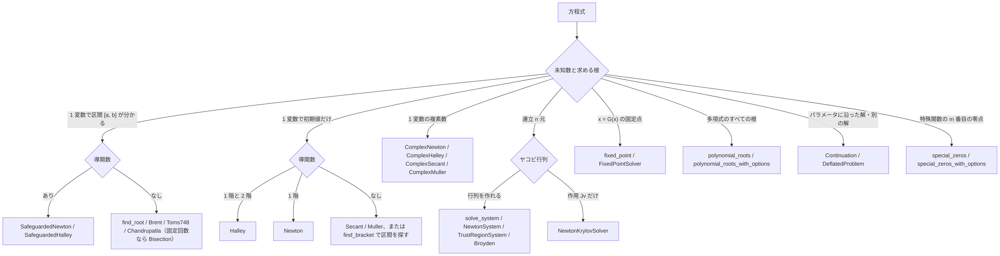

求根の方法は、未知数の数、根を挟む区間（bracket）が分かっているか、導関数が使えるか、根がいくつ必要か、パラメータを含むかで選ぶ。
条件に合わない方法を選ぶと、収束が遅いだけでなく、別の根や定義域の外へ進むことがある。
使う型を流れ図で決め、収束の速さ、評価回数、根を挟む性質の違いを後の表で比べる。

## 選択の流れ

## 1 変数の方法

根を挟む区間 $[a, b]$（$f(a) f(b) < 0$）が分かっていれば、$f$ が連続である限り区間の中に根があり、区間法はその性質を保ちながら区間を縮める。
区間がなければ、導関数や補間を使う開いた方法を使うか、`find_bracket` で初期点から区間を広げて探す（[根を挟む区間の探索と再検証](../algorithms/bracket-search/)）。
既定の設定の Brent 法で根だけが必要なら、ワンショット関数 `find_root(f, a, b)` が成功したときだけ根を返す。
次の表の「局所的な収束」は単純根の近くでの次数で、収束の次数と効率の定義は[方程式の根を求める方法](oxref:rootfind-convergence-order)にある。

| 方法 | 入力 | 局所的な収束 | 1 反復の評価 | 区間を保つ | 向く場合 |
|---|---|---|---|---|---|
| `Bisection` | 区間 | 1 次（幅が毎回 1/2） | 関数 1 回 | 保つ | 反復回数を事前に決めたい場合、関数が滑らかでない場合 |
| `RegulaFalsi` | 区間 | 1 次（片方の端点が残り続ける） | 関数 1 回 | 保つ | 教材。実用には `Illinois` などを使う |
| `Illinois` | 区間 | 約 1.442 次 | 関数 1 回 | 保つ | 偽位置法の考え方のまま停滞を避けたい場合 |
| `Ridder` | 区間 | 2 次（評価あたり約 1.414） | 関数 2 回 | 保つ | 滑らかな関数。候補が根の片側に続くと、区間の幅は中点の評価でしか縮まない |
| `Brent`、`Brenth`、`Chandrupatla` | 区間 | 超 1 次（逆 2 次補間が続けば約 1.84 次） | 関数 1 回 | 保つ | 関数値だけで解く一般の問題の第一候補 |
| `Toms748` | 区間 | 超 1 次（区間の幅も超 1 次で縮む） | 初回 1 回、以降 2〜3 回 | 保つ | 区間の幅の超 1 次の縮小に理論的な裏付けが欲しい場合（既定の判定では Brent より評価がやや多い） |
| `SafeguardedNewton`、`SafeguardedHalley` | 区間と初期値 | 2 次、3 次 | 関数と導関数 | 保つ | 導関数があり、区間の外に出したくない場合 |
| `Newton` | 初期値 | 2 次 | 関数と 1 階導関数 | 保たない | 良い初期値がある場合 |
| `Halley` | 初期値 | 3 次 | 関数と 1 階・2 階導関数 | 保たない | 2 階導関数の計算量が少ない場合 |
| `Secant` | 2 点 | 約 1.618 次 | 関数 1 回 | 保たない | 導関数がない開いた問題 |
| `Muller` | 3 点 | 約 1.84 次 | 関数 1 回 | 保たない | 放物線で補間したい場合。複素数の点が必要になると `ComplexStepRequired` で止まるので、`ComplexMuller` に任せる |

収束の次数は単純根の近くでの局所的な性質で、重根では Newton 法も 1 次に落ちる（[Newton・割線・Muller 法](../algorithms/open-scalar-methods/)）。
評価あたりの速さは次数 $p$ と 1 反復の評価回数 $w$ から $p^{1/w}$ を求めて比べる。
導関数の評価が関数と同じ計算コストなら、割線法（約 1.618）は Newton 法（約 1.414）より評価あたりで速い。
`Newton` と `SafeguardedNewton` は scioxide-differentiate の `DerivativeStrategy` で導関数の出所（解析的、自動微分、差分）を選び、`default()` は解析的な導関数がなければ前進差分を使う `AnalyticOrForward` である。
`Halley` と `SafeguardedHalley` は解析的な 1 階・2 階導関数を要求する。
実行時に方法を切り替える場合は `ScalarRootMethod` と `ScalarRootMethod::solve` を使う。
複素数の方法は、呼び出し側が複素数の関数として与えた方程式だけを解く。
実数の関数を暗黙に複素数へ広げることはない。

## 連立方程式

| 方法 | ヤコビ行列の扱い | 大域化 | 向く場合 |
|---|---|---|---|
| `NewtonSystem` | 毎反復で評価する（解析的・自動微分・差分）。LU か与えた反復法で $J\,\Delta \mathbf{x} = -\mathbf{F}$ を解く | `with_line_search` で `BacktrackingLineSearch`（Armijo 条件）を付けられる。付けると、ランク落ちのヤコビ行列では摂動したモデル $(J^\top J + \mu I)\Delta \mathbf{x} = -J^\top \mathbf{F}$ に切り替える | 解の近くの初期値、中小規模 |
| `TrustRegionSystem` | 最初と、実際の減少とモデルが予測した減少の比が 0.1 未満の試行が 2 回続いたときだけ評価し、その間は Broyden の階数 1 更新でモデルを直す。列ピボットなしの QR 分解を使い、$R$ の対角の 0 はその列の最大の大きさの $\varepsilon$ 倍で置き換える | Powell のハイブリッド法（ドッグレッグ信頼領域） | 初期値が遠い、ヤコビ行列の評価を減らしたい |
| `Broyden` | 最初に評価し、以後は階数 1 更新でモデルを直す。`BroydenUpdate::First` は順方向の行列と検査付きの逆行列を、`Second` は QR 分解を保持する | `BroydenOptions::with_line_search` で直線探索を付けられる。付けると、古いモデルで探索が尽きたときにヤコビ行列を評価し直す。付けなければ更新をそのまま採用する | ヤコビ行列の評価コストが大きい |
| `NewtonKrylovSolver` | 作用 $J\mathbf{v}$ だけ（解析的・自動微分の方向微分、または 1 回の前進差分）。内側の線形方程式は再始動付きの GMRES で解く | 非単調な Armijo 型のバックトラッキング（Zhang–Hager）と、Eisenstat–Walker の内側の許容誤差 | 大規模で行列を作りたくない |

既定の設定でよければ、ワンショット関数 `solve_system(f, x0)` が残差のクロージャを `TrustRegionSystem` で解き、成功したときだけ解を返す。
連立方程式では、成分ごとの単位が違うと残差のノルムが一つの成分に支配される。
方程式と変数の尺度をそろえてから解く（[非線形連立方程式と大域化](../algorithms/nonlinear-systems/)）。

## 多項式・固定点・特殊関数の零点

| 問題 | API | 選び方 |
|---|---|---|
| 多項式のすべての根 | `polynomial_roots`、`polynomial_roots_with_options`（既定は `PolynomialRootMethod::Auto`） | 単項式の係数では次数 2 までは安定な公式を使う。それ以外は、次数 64 までは伴行列（直交多項式の基底では colleague 行列）の固有値を初期値とする Aberth–Ehrlich 法、それより上は Newton 多角形から始める Aberth–Ehrlich 法だけを使い、固有値への切り替えはない。単項式の係数に限り `Laguerre` と `DurandKerner` も明示的に選べる |
| 固定点 $x = G(x)$ | `fixed_point`、`FixedPointSolver` | 縮小写像なら `Picard` を基準にし、縮小率が 1 に近いなら `Anderson` などの加速を比べる（[固定点反復と加速](../algorithms/fixed-point-acceleration/)） |
| 特殊関数の番号付きの零点 | `special_zeros`、`special_zeros_with_options` | $J_\nu$ の $m$ 番目の零点のように番号が必要な場合（[円形膜の固有振動数と Bessel 関数の零点](../examples/circular-membrane/)） |

多項式の結果は、状態が `Complete` でなければ根は未検証の候補である。
`Complete` でも、悪条件の根の位置は条件数と後退誤差の積の程度しか決まらない（[実係数多項式の全根計算](../algorithms/polynomial-root-pipeline/)）。
直交多項式の基底で表した `ApproxPolynomial` は、`polynomial_roots_with_options` が単項式へ変換せずに解く。

## パラメータを含む方程式と複数の解

パラメータ $\lambda$ を変えながら解を追う場合は、前の解を初期値にする継続法を使う。
$\lambda$ だけを動かす自然継続（`ContinuationPath::Parameters`）は折り返し点で止まるので、折り返しがありうるなら擬弧長継続（`ContinuationPath::PseudoArclength`）を使う。
良い初期値がない方程式は、解の分かる方程式からの `LinearHomotopy` で $\lambda$ を 0 から 1 まで継続する（[ホモトピー・継続の再開・分岐の診断](../algorithms/continuation-homotopy-and-checkpoints/)）。
一つ解を見つけた後で別の解を探すには、その解を `DeflationSet` に加えて `DeflatedProblem` を解く。
デフレーションは残りの解をすべて見つけることを保証しない（[デフレーションによる別の解の探索](../algorithms/deflation/)）。

## 複素数の根・反復写像・零点の列の扱い

複素数の根を探す場合は、関数も複素数の関数として与える。
`ComplexNewton` と `ComplexHalley` は解析的な導関数を使い、`ComplexSecant` と `ComplexMuller` は補間を使う。
実部と虚部が独立に現れる非正則な問題は、二つの実変数の連立方程式へ書き直す。
初期値による根の選択は[複素数の根と初期値の吸引域](../algorithms/complex-roots/)で確認する。

反復する写像が既にある場合は、[固定点反復と加速](../algorithms/fixed-point-acceleration/)を検討する。
まず残差 $G(x) - x$ の符号の約束と写像の縮小性を確かめ、Picard 反復を基準として履歴を使う方法と比較する。
履歴を長くするとメモリ使用量と最小二乗の計算量も増えるので、反復回数と評価回数を分けて読む。

特殊関数の第何番目かの零点が必要なら、初期値を変えた一般の求根を繰り返すより、`special_zeros_with_options` で番号の列を指定する。
族、分枝、添字の約束は[特殊関数の添字付き零点](../algorithms/special-function-zeros/)にある。
多項式の全根と同様に、必要な集合が完了したかを結果のレポートで確認する。

## 必要な精度からの選択

| 必要な情報 | 判断の根拠 | 次に確認するページ |
|---|---|---|
| 一つの根の座標の精度 | 区間の幅、導関数による残差から誤差への換算 | [Kepler 方程式と離心率](../examples/kepler-equation/) |
| 変換した物理量の精度 | 座標変換の感度と元の単位での残差 | [Colebrook 式と管摩擦係数](../examples/colebrook-friction-factor/) |
| 根の個数と順序 | 個数を与える理論、区間の分割、全根の検査 | [有限の井戸型ポテンシャルの束縛状態](../examples/finite-square-well/) |
| 入れ子の求根の精度 | 内側の条件数と外側の残差の両方 | [van der Waals 気体と Maxwell の等面積則](../examples/van-der-waals-maxwell/) |
| 存在・一意性・根の個数の証明 | 外向き丸めと検証付きのアルゴリズム | [包含を保証する区間演算](../../scioxide-validated/) |

`Tolerance` の数値を小さくするだけで、離散化誤差や測定誤差まで小さくなるわけではない。
解く方程式の近似誤差、浮動小数点での評価誤差、反復の打切りを分けて考える。
成功した終了理由は設定した判定を満たしたことを示し、求めた物理量の全誤差を保証するものではない。

## 結果を使う前の確認

1. 終了理由：`RootTermination` の成功は `ResidualTolerance`・`StepTolerance`・`BracketTolerance`・`Complete`・`NoZeros` で、`IterationLimit`、`Stagnation`、`ComplexStepRequired`、上限による停止や取り消しは未収束である。
   連立方程式・Newton–Krylov 法・多項式・継続法・特殊関数の零点も、それぞれの終了理由で判定する。
2. 残差と位置：重根や平坦な根では、残差が小さくても位置の誤差が大きい。
   単純根なら位置の誤差を $\lvert f \rvert / \lvert f' \rvert$ で見積もる。
3. 元の方程式での検算：変数を変換した方程式やデフレーションした方程式で得た解は、元の方程式に代入して残差を確かめる。
   `DeflatedProblem::solve` と多項式のレポートは元の方程式での検査を含む。
4. 尺度：残差の許容誤差は関数の単位で与えるので、`with_residual_scale` などで尺度を明示する。
   1 変数の区間法では `with_residual_scale` を与えると区間の幅に加えて相対 $\sqrt{\varepsilon}$ の残差でも受理するようになる。

## まとめ

1 変数で区間が分かれば `Brent` か `Toms748`、導関数もあれば区間を保つ `SafeguardedNewton` を選び、初期値だけなら `Newton` か `Halley`、導関数がなければ `Secant` を使う。
方法の速さは収束の次数と 1 反復の評価回数を合わせて比べる。
連立方程式はヤコビ行列を作れるなら `NewtonSystem`・`TrustRegionSystem`・`Broyden`、作用しか使えないなら `NewtonKrylovSolver` を選び、初期値が遠いなら直線探索か信頼領域を付ける。
多項式のすべての根は `polynomial_roots_with_options`、パラメータを含む問題は継続法、別の解はデフレーション、特殊関数の番号付きの零点は `special_zeros_with_options` で求め、既定の設定で答えだけが必要ならワンショット関数を使う。
どの方法でも、成否は終了理由で判定し、元の方程式の残差を確かめる。

## 次に読むページ

- [方程式の根を求める方法](../algorithms/)：表の収束の次数、残差と位置の誤差、既定の停止判定の定義を確かめる。
- [区間を保つ求根法](../algorithms/bracketing-methods/)：表の区間法の違いを導出と実験で確かめる。
- [求根の API ガイド](../api/)：選んだ方法の型、入力、エラー、作業領域の仕様を確かめる。
