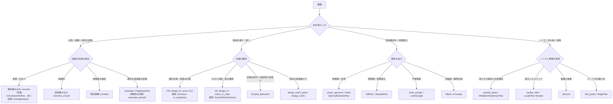

信号処理の手法を選ぶときは、手法の名前より先に三つのことを決める。
有限の記録の外側をどう仮定するか、周波数と時間の単位をどう対応させるか、繰り返す実行で作業領域を誰が持つかである。
このページは課題の種類から `scioxide-signal` の演算を選ぶ流れを示し、選択肢ごとの性質を表で比べる。
各手法の導出と誤差は、表から[数理とアルゴリズム](../algorithms/)の各ページへ進んで確かめる。

## 課題から演算を選ぶ

次の図は、課題の種類から API となる演算を選ぶ流れである。

| 課題 | 主な API | 解説 | 実例 |
|---|---|---|---|
| 系の応答の合成、FIR の適用 | `convolve`、`ConvolutionNdPlan`、`OverlapStream` | [畳み込みと相関](../algorithms/convolution-and-correlation/) | [音響反射の畳み込み](../examples/echo-convolution/) |
| 時間差の推定 | `correlate` | [畳み込みと相関](../algorithms/convolution-and-correlation/) | [地震波の到達時刻差](../examples/seismic-delay-correlation/) |
| 標本化周波数の変換 | `resample`、`PolyphasePlan`、`resample_periodic` | [リサンプリング](../algorithms/resampling/) | [44.1 kHz と 48 kHz の変換](../examples/audio-sample-rate-conversion/) |
| 線形位相のフィルタ | `design_fir_*`、`minimum_phase` | [FIR フィルタの設計と最小位相](../algorithms/fir-design-and-minimum-phase/) | - |
| 少ない次数のフィルタ、ノッチ | `design_iir`、`select_iir_order`、`design_notch_peak` | [IIR フィルタの設計](../algorithms/iir-design/)、[IIR フィルタの実行とゼロ位相](../algorithms/iir-filtering-and-zero-phase/) | [心電図のノイズ除去](../examples/ecg-baseline-and-mains/)、[群遅延とゼロ位相](../examples/iir-group-delay-zero-phase/) |
| 定常な信号のスペクトル | `power_spectrum`、`welch`、`SpectralEstimatePlan` | [窓関数と DPSS](../algorithms/windows-and-dpss/)、[スペクトル推定](../algorithms/spectral-estimation/) | - |
| 時間とともに変わる周波数 | `StftPlan`、`WaveletPlan` | [STFT と再構成](../algorithms/stft/)、[離散ウェーブレット変換](../algorithms/wavelets/) | [チャープのスペクトログラム](../examples/chirp-spectrogram-uncertainty/)、[ウェーブレットによるノイズ除去](../examples/wavelet-denoising/) |
| 不等間隔の標本の周期 | `lomb_scargle`、`LombScargle` | [スペクトル推定](../algorithms/spectral-estimation/) | [変光星の周期推定](../examples/variable-star-period/) |
| 包絡線、瞬時位相、画像の局所方向 | `hilbert`、`envelope`、`monogenic_nd` | [解析信号、Riesz 変換、ベクトル強度](../algorithms/analytic-riesz-monogenic/) | [包絡線の復元](../examples/hilbert-envelope/) |
| 平滑化と微分、トレンド除去 | `savitzky_golay`、`WhittakerHendersonPlan`、`detrend` | [平滑化とトレンド除去](../algorithms/smoothing-and-detrending/) | [平滑化・ピーク・外れ値の検算](../examples/smoothing-peaks-and-outliers/) |
| スパイクの除去、ピークの検出 | `median_filter`、`LocalFilterPlan`、`find_peaks` | [局所フィルタとピークの検出](../algorithms/local-filters-and-features/) | [平滑化・ピーク・外れ値の検算](../examples/smoothing-peaks-and-outliers/) |
| 連続系・離散系のモデル | `StateSpace` | [状態空間モデルと LTI 系](../algorithms/lti-systems/) | [RLC 回路の LTI モデル](../examples/rlc-circuit-lti/) |

## 時間領域の演算の境界と出力長

長さ $N$ の信号 $a$ と長さ $M$ の核 $b$ の畳み込みと相関では、記録の外側の仮定が出力の長さと意味を決める。

| 演算 | API | 区間外の仮定 | 出力長 | 主な用途 |
|---|---|---|---|---|
| 線形畳み込み | `convolve`、`ConvolutionNdPlan`（`ConvolutionExtent::Full`） | 区間外は 0 | $N + M - 1$ | FIR フィルタ、音響の伝搬、反射波の合成 |
| 中央を切り出した畳み込み | `ConvolutionNdPlan`（`Same`） | `SignalBoundary` で選ぶ | $N$ | 入力と同じ長さの平滑化 |
| 核が収まる部分だけの畳み込み | `ConvolutionNdPlan`（`Valid`） | 仮定を使わない | $N - M + 1$ | 端の影響を受けない出力 |
| 巡回畳み込み | `convolve_circular`、`ConvolutionNdPlan`（`Circular` と `Periodic`） | 周期 $N$ で繰り返す（$N = M$ が必要） | $N$ | 周期信号、周波数領域の積と同じ演算 |
| 2 次元の畳み込み | `convolve2d`、`SeparableFir2dPlan` | 格子の外は 0（Plan では選べる） | $(N_y + M_y - 1) \times (N_x + M_x - 1)$ | 画像の平滑化・微分 |
| 相互相関 | `correlate` | 区間外は 0 | $N + M - 1$ | 伝搬遅延の推定、反射の検出 |

長さが異なる入力を `convolve_circular` に渡すと、折り返しや切り詰めをせずに `DimensionMismatch` を返す。
`correlate(a, b)` は $c[\ell] = \sum_k a[k]\, \overline{b[k - \ell]}$ をラグ $\ell = -(M-1), \dots, N-1$ の昇順に並べるので、配列の添字 $j$ とラグは $\ell = j - (M-1)$ で対応する（[相関のラグの並び](oxref:signal-correlation-lags)）。
値は内積の和であり、$[-1, 1]$ の相関係数が必要なら平均を引いてノルムで割る処理を呼び出し側で行う。

## 窓関数の比較

有限長の記録をそのまま DFT すると矩形ウインドウを掛けたことになり、最大サイドローブが $-13.3$ dB と高いので、強い成分の漏れが弱い成分を覆う。
次の表の値は、長さ $N = 1024$ の周期ウインドウの標本を 32 倍に補零した DFT から測ったものである。
3 dB 幅は主ローブの全幅、ENBW は等価雑音帯域幅で、どちらも DFT のビンを単位とする。

| ウインドウ | `WindowKind` | 3 dB 幅 [ビン] | 最大サイドローブ | ENBW [ビン] | 主な用途 |
|---|---|---|---|---|---|
| 矩形 | `Boxcar` | $0.89$ | $-13.3$ dB | $1.00$ | 記録長に整数周期が入る周期信号、過渡応答 |
| Hann | `Hann` | $1.44$ | $-31.5$ dB | $1.50$ | 一般的なスペクトル解析、STFT |
| Hamming | `Hamming` | $1.30$ | $-42.7$ dB | $1.36$ | 近接した同程度の成分の分離 |
| Blackman–Harris（4 項） | `BlackmanHarris` | $1.90$ | $-92.0$ dB | $2.00$ | 大きなダイナミックレンジの高調波解析 |
| Flat-top（5 項） | `FlatTop` | $3.72$ | $-93.0$ dB | $3.77$ | 正弦波の振幅の校正（ビンの間での振幅誤差が約 0.01 dB） |
| Kaiser | `Kaiser { beta }` | $\beta$ に依存 | $\beta$ に依存 | $\beta$ に依存 | 阻止域の減衰量を指定する FIR の窓関数法設計 |
| DPSS | `DpssTapers` | 時間帯域積 $NW$ に依存 | 帯域外への漏れを最小化 | $NW$ に依存 | マルチテーパーによるスペクトル推定 |

ウインドウは漏れの抑制と周波数分解能を交換する。
主ローブが広いウインドウほど近い二つの周波数を分けにくく、ENBW が大きいウインドウほど一つのビンに入るノイズの電力が増える。
線形位相の FIR の係数には対称ウインドウ（`WindowSymmetry::Symmetric`）、DFT による解析と STFT には周期ウインドウ（`Periodic`）を使う（[対称ウインドウと周期ウインドウ](oxref:signal-window-symmetry)）。
実際の標本の利得と ENBW は `window_metrics` で確かめられる（[コヒーレント利得と等価雑音帯域幅](oxref:signal-window-metrics)）。

## フィルタの設計法の比較

| 方法 | API | 近似の基準 | 位相 | 主な用途 |
|---|---|---|---|---|
| FIR の窓関数法 | `design_fir_window` | 理想応答をウインドウで打ち切る | 線形 | 仕様が緩く、手早く設計したい |
| FIR の周波数標本化 | `design_fir_frequency_sampling` | 格子点で目標の振幅を通す | 線形 | 任意の形の振幅応答 |
| FIR の重み付き最小二乗 | `design_fir_least_squares` | 帯域の二乗誤差の積分 | 線形 | 誤差のエネルギーを小さくしたい |
| FIR の Remez 交換法 | `design_fir_remez` | 重み付き誤差の最大値（等リプル） | 線形 | 与えた長さで最大誤差を最小にしたい |
| IIR の古典的なプロトタイプ | `design_iir`、`select_iir_order` | Butterworth・Chebyshev・楕円・Bessel の振幅の形 | 非線形（Bessel は低域で群遅延が平坦に近い） | 少ない次数で急な遷移 |
| ノッチ・ピーク・櫛形 | `design_notch_peak`、`design_comb` | 中心周波数と Q を閉じた形で置く | 非線形 | 電源ノイズや周期的な干渉の除去 |
| 最小位相への変換 | `minimum_phase` | 振幅を保ち遅延を短くする | 最小位相 | 線形位相の遅延が許されないとき |

FIR は常に安定で線形位相を作れるが、急な遷移には多くの係数が要る。
IIR は少ない次数で急な遷移を作れる代わりに位相が非線形で、係数の丸めで不安定になりうるので、二次節（SOS）で適用する。
記録全体がそろっている解析では、前後方向の実行 `forward_backward` で IIR の位相を打ち消せるが、振幅は 2 乗になる（[前後方向のゼロ位相フィルタリング](oxref:signal-iir-zero-phase)）。

## スペクトルと時間周波数の推定

| 目的 | API | 仮定と出力 |
|---|---|---|
| 一つの記録の離散スペクトル | `power_spectrum`、`cross_spectrum` | $\lvert X[k] \rvert^2 / N$。密度ではなく、標本化周波数を含まない |
| 定常なノイズの密度 | `welch`、`SpectralEstimatePlan` | 区間の平均で分散を減らす。密度の単位は信号単位の二乗／周波数 |
| 二つの信号の線形な関係 | `SpectralEstimatePlan` の `csd`・`coherence` | 区間が一つではコヒーレンスが常に 1 になる |
| 不等間隔の標本の周期 | `lomb_scargle`、`LombScargle` | 周波数は角周波数。正規化パワーは説明できた分散の割合 |
| 時間とともに変わる周波数 | `StftPlan` | ウインドウ長で時間分解能と周波数分解能を交換する。双対ウインドウで再構成できる |
| 尺度ごとの局所的な変化 | `WaveletPlan`、`Wavelet2dPlan` | 尺度が粗いほど周波数の分解能が高く、時間の分解能が低い |

周波数の単位は API ごとに違う（[周波数の単位](oxref:signal-frequency-units)）。
`welch` と STFT は時間単位あたりの周期、Lomb–Scargle 法は角周波数、`power_spectrum` は DFT のビンの番号で値を返す。

## 平滑化と局所フィルタの選び方

| ノイズと信号の性質 | API | 振る舞い |
|---|---|---|
| 滑らかな信号に白色雑音 | `savitzky_golay`、`SavitzkyGolayPlan` | ウインドウの中の局所多項式を当てはめる。次数以下の多項式は変えず、導関数も求められる |
| 欠測や不等な重みを含む滑らかな信号 | `WhittakerHendersonPlan` | 差分のペナルティ付き最小二乗。0 の重みを欠測として扱う |
| 標本を通る滑らかな補間 | `SplineFilter` | B スプラインの補間係数を再帰フィルタで求める（平滑化はしない） |
| 多項式や区分的な直線の基線 | `detrend`、`detrend_into` | 最小二乗の傾向を引く |
| 孤立したスパイク | `median_filter`、`LocalFilter::Hampel` | 中央値か、中央値から MAD の閾値を超えた標本だけを置き換える |
| 局所的に定常なガウスノイズ | `LocalFilter::Wiener`、`estimate_wiener_noise` | 局所分散がノイズ分散より大きい所は残し、平坦な所は平均に近づける |

局所フィルタは半径 $k$ の $2k + 1$ 標本のウインドウを使い、端では端点の値を繰り返して延長する。
平滑化の強さを上げるとノイズは減るが、ピークや段差も削られるので、目的の特徴が残る範囲で強さを選ぶ。

## 呼び出しの形と逐次処理

計算リソースの扱いは次の形から選ぶ（一覧は [API ガイドの呼び出しの形](oxref:signal-api-call-forms)）。

- ワンショット関数: `convolve`、`correlate`、`resample`、`power_spectrum`、`welch`、`lomb_scargle`、`envelope`、`median_filter`、`find_peaks`、`savitzky_golay`、`detrend` などは、Plan・作業領域・出力をその場で確保し、結果を `Vec` で返す。
  探索的な解析や一度きりの計算に向く。
  慣例の設定（`welch` の周期 Hann ウインドウと半分の重なり、`resample` の中心をそろえた位置合わせなど）は関数ごとに固定されている。
- オプション付き形式: `find_peaks_with_options`、`minimum_phase_with_options`、`design_fir_remez_with_options` などは、最後に設定（`PeakOptions` など）を受け取る。
  反復する設計のオプション付き形式は、目標に届かない場合もエラーにせず、最後の結果と終了状態を返す。
- Plan と手法オブジェクト: `ConvolutionNdPlan`、`SpectralEstimatePlan`、`StftPlan`、`LocalFilterPlan` などの Plan は、形と変換を準備時に検査して保持する。
  `IirFilter`、`SymmetricFilter`、`SplineFilter`、`LombScargle` は検査した係数や設定だけを保持する手法オブジェクトで、Plan と同じ形で呼ぶ。
  出力先を指定する API `*_into` は呼び出し側の出力と作業領域に書き込み、実行中に確保しない。
  必要量は `workspace_requirements(request)` で問い合わせ、`workspace(request)` または `try_reserve` で準備する（[作業領域と実行コンテキスト](oxref:signal-workspaces)）。
  配列の一つの軸に沿った処理は、同じ Plan の `*_axis_into` で行う。
- 逐次処理: `LocalFilterStream`、`OverlapStream`、`PolyphaseStream`、`StftAnalysisStream`、`StftSynthesisStream` は状態を所有し、任意の長さのチャンクを受け取って遅延した位置の出力を返す。
  最後のチャンクで `StreamChunk::Final` を渡すと残りの出力を書き出し、そのストリームは `reset` するまで閉じる（[逐次処理の規約](oxref:signal-streams)）。
  IIR フィルタは `IirFilter::filter_into` に呼び出し側の `IirState` を渡してチャンクごとに処理する。
- スコープ付き API: `design_iir_scoped`、`design_fir_remez_scoped` などは外側の解法の実行コンテキストか `SolveContext` を受け取り、反復をそのスコープの上限と取り消しに数える。

## まとめ

課題を応答の変換、帯域の選択、周波数の推定、ノイズと特徴の扱いに分けると、API の演算が決まる。
区間外を 0 とみなすか周期とみなすかで畳み込みの出力長と値が変わり、`correlate` の添字からラグを得るには $M - 1$ を引く。
ウインドウは漏れの抑制と分解能の交換であり、表の 3 dB 幅と ENBW が分解能とノイズの電力を決める。
線形位相が必要なら FIR、少ない次数で急な遷移が必要なら IIR を選び、一括処理なら前後方向の実行で位相を打ち消せる。
一度きりの計算はワンショット関数で始め、繰り返すときに Plan や手法オブジェクトと作業領域へ移る。
選んだ手法の導出は[数理とアルゴリズム](../algorithms/)、全項目の仕様は [API ガイド](../api/) で確認する。
