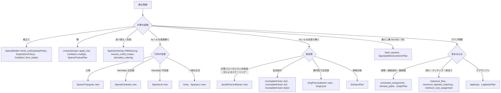

疎行列の計算は、組立て、積、分解、反復解法、グラフ解析の段階ごとに求められる操作が異なる。
有限要素やグラフの組立てでは非零の位置が事前に決まらず、同じ座標への加算が繰り返される。
反復解法では固定された非零パターンに対して積を何度も計算し、分解や不完全分解ではフィルの量とピボットの選び方がメモリ使用量と精度を左右する。
このページでは段階ごとに `scioxide-sparse` のどの型と関数を使うかを、判断の流れと表で示す。
図の各節点にはその場合に使う関数、型、指定の名前を書いた。

## 格納形式の選び方

| 目的 | 推奨される型 | 理由 |
|---|---|---|
| 有限要素・有限体積の組立て | `SparseBuilder` | 三つ組 $(i, j, v)$ を任意の順で追加でき、`DuplicatePolicy::Sum` で同じ座標の値を厳密に合算して一度だけ丸める |
| 三つ組の配列がそろっている場合 | `CsrMatrix::from_triplets` | `(Sum, Preserve)` の方針で一度に CSR を作る |
| 行ごとの走査、分解・前処理・グラフの入力 | `CsrMatrix` | 分解の解析と前処理の多くは CSR の構造（`structural_pattern()` は確保なしの借用）を受け取る |
| 列ごとの走査 | `CscMatrix` | 各列の成分が `row_indices()` と `values()` の連続した区間に並ぶ。CSR への変換は `to_csr` |
| 転置積 $\mathbf{A}^{\mathsf{T}}\mathbf{x}$、随伴積 $\mathbf{A}^{\mathsf{H}}\mathbf{x}$ | `CsrMatrix` でも `CscMatrix` でもよい | 両形式とも反対方向の走査の索引を保持するので、作業領域を渡す形は確保なしに $O(m + n + \mathrm{nnz})$ で計算する |
| 節点ごとに複数の自由度を持つ系 | `BsrMatrix` | 保存成分を含むブロックを $r \times c$ の密ブロックとして持つ。ブロックの中の 0 も値として保存される |
| 一様格子の差分ステンシル | `DiaMatrix` | 対角のずれだけを索引として持つ。行列の外のパディングも値のメモリ領域に含まれる |
| 形式によらない計算 | `SparseView` | どの形式からも確保なしに借用でき、積、数値分解、形式の変換、小さい要素の除去、ブロックの構成、グラフに渡せる。記号解析は `CsrMatrix::structural_pattern()` の構造を受け取る |

### 組立てから計算形式への移行

`SparseBuilder` で組み立てた三つ組は、重複の方針 `DuplicatePolicy` と零の方針 `ExplicitZeroPolicy` を引数に取る `finish_coo`・`finish_csr`・`finish_csc` で正準な行列に確定する。

- `DuplicatePolicy::Sum` は、同じ座標の値を順序によらない厳密な累積で合算し、一度だけ丸める（有限要素の組立ての標準的な選択）。
- `DuplicatePolicy::Reject` は、重複した座標を `InvalidInput` で拒む。
- `ExplicitZeroPolicy::Drop` は、合算後に値が厳密に 0 の要素を構造から取り除き、メモリ使用量と演算回数を減らす。
- `ExplicitZeroPolicy::Preserve` は、値が 0 でも位置を構造として残す。
  係数だけが変わる問題で構造を固定したい場合や、重み 0 の辺をグラフに残したい場合に使う。

`Drop` を選ぶと、値の変化によって構造が変わりうるので、分解の記号解析を再利用できなくなる場合がある。

## 呼び出しの形の選び方

同じ計算は必要な制御の量に応じて次の形で呼び分ける（定義は [疎行列アルゴリズムの共通仕様と構成](oxref:sparse-execution-forms)）。

| 目的 | 使う形 | 例 |
|---|---|---|
| 答えを一度だけ求める | ワンショット関数 | `solve(&a, &b)`、`least_squares(&a, &b)`、`shortest_paths(a.view(), source)` |
| 同じ行列で何度も解く | 準備を一括して行うコンストラクターと標準形式 | `SparseLu::new(&a)` で因子を作り、`lu.solve(&b)` を繰り返す |
| 精度、零の方針、反復回数の上限を選ぶ | オプション付き形式 | `a.add_with_options(&b, options)`、`maximum_bipartite_matching_with_options(pattern, options)` |
| メモリの上限を決めて分解する | 記号解析と上限の型 | `SparseLuSymbolic::analyze(pattern, ordering, SparseLuLimits::new(…))` の後に `SparseLu::factor` |
| 反復の内側で確保をなくす、並列実行や取り消しを使う、反復回数の上限を外側の解法と共有する | 出力先を指定する API とスコープ付き API | `lu.solve_into(…, &mut ws, scope)`、`lu.refactor(…, &mut ws, scope)`、`SparseLu::factor_scoped(…, scope)` |

## 直接解法の選び方

| 型 | 対象 | ピボットと結果 | 注意 |
|---|---|---|---|
| `SparseTriangular` | 三角行列 | 構築のときに、選んだ三角の外の成分と対角を検査する | 三角の外の成分は `InvalidInput`、明示する対角が欠けるか 0 なら `Singular` |
| `SparseCholesky` | Hermitian 正定値 | 対称な並べ替えだけで、フィルは構造で決まる | 正でないピボットは `NumericalInstability`（`Breakdown`） |
| `SparseLdl` | Hermitian 不定値 | 有界 rook ピボットの $1 \times 1$・$2 \times 2$ ブロック。慣性を数えられる | ピボットでフィルが増えうる。上限の `max_active_entries` も消去中の非零を制限する |
| `SparseLu`、`solve` | 一般の正方行列 | 閾値なしの部分ピボット（行の入れ替え） | 実際のフィルは値で変わる |
| `SparseQr`、`SparseQrMinimumNormPlan`、`least_squares` | 長方形、最小二乗、階数落ち | 列のピボットをせず、記号解析の列順のまま Householder 変換で消去する。最小ノルム Plan は閾値で数値階数を決める | 階数は列順に依存する推定。元の行列に対する残差を返す |

同じ構造の行列を何度も解くときは、記号解析（`*Symbolic`）と作業領域を保持し、`refactor` で数値分解だけを繰り返す。

## 並べ替えと彩色の選び方

並べ替えと彩色は値を見ずに構造だけから求める。
構造によるフィルの削減（記号解析）と、値によるピボットの選択（数値分解）は別の段階で、LU と LDL のピボットは記号解析の順序をさらに変えることがある。

| 目的 | 使う指定・関数 | 結果と注意 |
|---|---|---|
| 直接分解のフィルを減らす | 記号解析の `SparseOrdering::FillReducing`（既定） | 分解ごとのグラフ（Cholesky と LDL は読む三角の対称な構造、LU は $\mathbf{A} + \mathbf{A}^{\mathsf{T}}$、QR は $\mathbf{A}^{\mathsf{T}}\mathbf{A}$）に近似最小次数法（AMD）を適用する。発見的な方法で、最小のフィルは保証しない |
| 元の番号のまま分解する | `SparseOrdering::Natural` | 構造がすでに帯状のときや、順序の効果を比べるとき |
| 帯幅と包絡を縮める | `reverse_cuthill_mckee` の置換を `SparseOrdering::Supplied` で渡す | 帯行列の解法に向く。2 次元格子のように帯幅を小さくできない問題では AMD よりフィルが多い |
| 積のメモリの局所性を高める | `reverse_cuthill_mckee` の置換で番号を付け直し、`SparseBuilder` で組み立て直す | 行列そのものを並べ替える関数は提供しない |
| 隣接しない頂点を同じ色にまとめる（多色順序の Gauss–Seidel 法など） | `distance_one_coloring` | $\mathbf{A} + \mathbf{A}^{\mathsf{T}}$ のグラフの貪欲法で、色の数は最大次数 + 1 以下 |
| 疎なヤコビ行列を少ない方向微分で求める | `derivative_coloring` | 長方形の構造でもよい。色の数は 1 行の非零の数の最大以上で、帯行列では次元によらない |

## 積の精度の選び方

積の精度は scioxide-core の `Accuracy` で選ぶ。
通常の計算には既定の `Standard`、一度だけ丸めて和の順序によらない結果が必要なら `Exact` を使う。
作用素の適用は `matrix.view().with_accuracy(..)` で、確保を伴う成分ごとの算術は `SparseArithmeticOptions` で、準備した積と疎行列と密行列の積は `SparseProductOptions::with_accuracy` で指定する。
分解、代入、前処理の算術は `SparseSolveOptions::with_accuracy` で指定する（QR はこの設定によらず、尺度を調整した演算を使う）。
精度を上げても、悪条件な方程式の前進誤差が小さくなるとは限らない。

## 前処理の選び方

反復解法の前処理は構築と一回の適用の計算量と、反復回数の減り方の兼ね合いで選ぶ。
以下はどれも `scioxide-core` の `Preconditioner` を実装し、scioxide-linalg の反復解法に渡せる。

| 前処理 | 適用対象 | 構築 | 一回の適用 | 判断の基準 |
|---|---|---|---|---|
| `JacobiPreconditioner` | 対角が 0 でない正方行列 | $O(n + \sum_i \log \mathrm{nnz}_i)$ | $O(n)$ | 対角の尺度の差が大きい系。対角が欠けるか 0 なら `Singular` |
| `IncompleteFactor`（`Ic0`、`Ict`） | Hermitian 正定値 | 因子の要素数と捨て方に依存 | 二回の三角代入 | CG と組み合わせる。修復したピボットは前処理を変える |
| `IncompleteFactor`（`Ilu { level }`、`Ilut`） | 一般の正方行列 | 同上 | 二回の三角代入 | 非対称な系に使える GMRES、BiCGSTAB などと組み合わせる |
| `AmgPreconditioner`、`AmgCycle` | 楕円型の Hermitian 正定値（拡散、弾性） | 平滑化集約の階層と粗い Cholesky | V または W サイクル一回 | 近零空間のベクトルを与える。正定値性は前提で、検査されない |
| `SchwarzPlan` | 局所の逆作用素を用意できる領域分割 | 写像と重みの検査 | 局所解の合計（加法・制限付き加法）か逐次の更新（乗法） | 局所の解法は呼び出し側が用意する。粗い補正を持たない一段の方法 |

CG は前処理にも Hermitian 正定値性を要求するので、ILU 系と Schwarz 法（三つの組み合わせ方のどれも一般に Hermitian でない）とは組み合わせず、GMRES などを使う。
対角優位性の弱い行列（移流が支配的な問題など）では、不完全分解の途中で小さいピボットが現れて前処理が悪条件になり、反復が収束しないことがある。
その場合は、`IncompletePivotPolicy::Repair` で修復したピボットの数を `IncompleteDiagnostics` で確かめるか、ILU($k$) のレベルを上げる。

## グラフアルゴリズムの選び方

疎行列の構造をグラフとして解析する場合は、辺の重みの符号と出力の形に応じて手法を選ぶ。
`GraphPlan` を作る手間は頂点数 $V$、保存成分の数 $E$ に対して $O(V + E \log E)$ で、下の表の計算量はその後の各メソッドの手間である。
ワンショット関数 `shortest_paths`、`connected_components`、`laplacian` は、呼ぶたびに Plan を作る。
`GraphPlan` で最短路を求めるときは手法が自動では切り替わらないので、`GraphPathMethod` で明示する。
ワンショット呼び出しの `shortest_paths` だけは、負の重みがなければ Dijkstra 法、あれば Bellman–Ford 法を選ぶ。

| 目的 | 条件 | 型・手法 | 計算量 |
|---|---|---|---|
| 単一始点最短路 | 重みがすべて非負 | `GraphPathMethod::Dijkstra`（添字付き二分ヒープ） | $O((V + E) \log V)$ |
| 単一始点最短路 | 負の重みを含む | `GraphPathMethod::BellmanFord`（負の閉路を検出して返す） | $O(V E)$ |
| 全点対最短路 | 疎なグラフ、負の重みも可 | `GraphPathMethod::Johnson`（Bellman–Ford のポテンシャルと各始点の Dijkstra） | $O(VE + V(V + E) \log V)$ |
| 全点対最短路 | 小さく密なグラフ | `GraphPathMethod::FloydWarshall` | $O(V^3)$、出力は $O(V^2)$ |
| 到達可能性と探索木 | 重みを使わない | `GraphPlan::breadth_first`、`depth_first` | $O(V + E)$ |
| 連結成分 | 弱連結 / 強連結 | `weak_components` / `strong_components`（Kosaraju 法） | $O(V + E)$（ワンショット呼び出しの `connected_components` は Plan の作成を含めて $O(V + E \log E)$） |
| 最小全域森 | 無向グラフ | `minimum_spanning_forest`（Kruskal 法） | $O(E \log E)$ |
| 最大流と最小切断 | 整数容量（`u64`） | `maximum_flow`、`MaxFlowPlan`（Dinic 法） | $O(V^2 E)$ |
| 二部グラフの最大マッチング | 長方形の構造 | `maximum_bipartite_matching`（Hopcroft–Karp 法、Plan を持たない） | $O((V + E)\sqrt{V})$ |
| 重み付きの完全な割当て | 実数の計算コスト、最小化か最大化 | `minimum_cost_assignment`、`AssignmentPlan`（最短増加路法） | $O(kE\log(l+1)+k+l)$、$k$ と $l$ は小さい側と大きい側の頂点数 |
| スペクトル的な解析 | 非負の重み | `laplacian`（CSR を返す）、`GraphPlan::laplacian`（CSR と次数を持つ `LaplacianPlan` を返す） | 適用は $O(V + E)$ |

## まとめ

組立ては `SparseBuilder` で、重複と零の扱いを `finish_csr` などの引数で明示してから一度だけ CSR か CSC に確定する。
一回の求解なら `solve` や `least_squares`、同じ行列で何度も解くなら `SparseLu::new` などのコンストラクター、確保をなくすなら出力先を指定する API とスコープ付き API を選ぶ。
直接解法は行列の性質で Cholesky、LDL、LU、QR を選び、構造が同じなら記号解析を保持して `refactor` を繰り返す。
直接分解の並べ替えには既定の `FillReducing` を使い、帯状にしたいときは `reverse_cuthill_mckee` の置換を `Supplied` で渡す。
前処理は Jacobi、不完全分解、AMG、Schwarz から構築と適用の計算コストと反復回数の兼ね合いで選び、CG には Hermitian 正定値な前処理だけを組み合わせる。
グラフ問題は重みの符号と出力の形で手法を選び、`GraphPlan` で最短路を求めるときは `GraphPathMethod` で手法を指定する。

## 次に読むページ

- [疎行列アルゴリズムの共通仕様と構成](../algorithms/)：呼び出しの形、構造と値の分離、上限と作業領域、失敗したときの出力の扱いを確かめる。
- [疎行列の格納形式と組立て](../algorithms/storage-and-assembly/)：選んだ形式の配列と、組立ての重複・零の方針を確かめる。
- [疎行列の API ガイド](../api/)：選んだ型の全メソッドの仕様とエラーの種類を引く。
