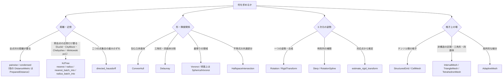

手法は知りたい量（距離そのもの、近い点、隣接関係、姿勢）と入力の性質（次元、点数、退化の有無、照会の回数）で決まる。
次の図は最初の分かれ道を示す。

## 距離と近傍探索

| 目的 | API | 準備 / 1 回の照会の計算コスト | 選ぶ理由と注意 |
|---|---|---|---|
| 二つの点集合の全距離 | `pairwise`、`PreparedDistance` の `pairwise`・`pairwise_into` | なし / $O(mnd)$（Mahalanobis は $O(mnd^2)$） | 関数 `pairwise` は Euclid 距離。17 種類の `DistanceMetric`、標準化 Euclid、Mahalanobis は `PreparedDistance` で使える。出力は $m \times n$ |
| 一つの点集合内の全距離 | `condensed`、`PreparedDistance` の `condensed`・`condensed_into` | なし / $O(N^2 d)$ | 上三角だけの $N(N-1)/2$ 個で、正方行列の約半分のメモリ領域 |
| 照会点の $k$ 近傍・半径内 | `KdTree` の `nearest`、`radius`、`nearest_into`、`radius_into` | $O(d\,n \log n)$ / 低次元で少数の葉、高次元では全点に近づく | 同じ点集合に多数の照会をする場合。距離は `TreeMetric` の 4 種類に限る |
| 多数の照会点の一括処理 | `KdTree` の `nearest_batch`、`nearest_batch_into`、`radius_batch_into` | 木の構築 / 照会ごとに上と同じ | 結果を照会の順につなげて出力に反映し、半径の一括は行ごとの件数も返す。ワーカーは最大 32 |
| 二つの形のずれ | `directed_hausdorff` | なし / 最悪 $O(mnd)$ | 固定のシードで並べ替えた順の早期打ち切りで、比較が減ることが多い。対称な距離は二方向の最大 |

KD 木は次元が上がると下界による枝刈りが効かなくなり、照会あたりの訪問点数が総当たりに近づく。
結果は正しいままなので、これは正しさではなく計算コストの問題である。
目安となる次元は点の分布で大きく変わるので、総当たりの `pairwise` と照会時間を比べて選ぶ。
近似を許せるなら `SearchOptions::with_epsilon` で距離比 $1 + \varepsilon$ までの近傍を受け入れ、訪問を減らせる。
Mahalanobis のように木で使えない距離は、`PreparedDistance::mahalanobis` で準備して総当たりで評価する。
距離の定義域は[距離と非類似度](../algorithms/distances/)に、距離行列の持ち方は[距離行列と圧縮表現](../algorithms/distance-matrices/)に、枝刈りと近似の意味は[KD 木による近傍探索](../algorithms/spatial-trees-and-distance/)にある。

## 幾何述語と三角形分割

| 目的 | API | 出力 | 注意 |
|---|---|---|---|
| 向き・円や球の内外の判定 | `orient2d`、`orient3d`、`incircle`、`insphere`、`SimplexPredicateWorkspace` | 正確な符号 `PredicateSign` | 表現された入力に対して正確。測定誤差は考慮しない |
| 凸包 | `ConvexHull` | 境界の単体ファセットと隣接 | 同一平面上の面は単体に分割し、`coplanar_faces` で組を示す |
| Delaunay 分割と点の位置の探索 | `Delaunay`、`find_simplex`、`barycentric` | 単体と隣接、重心座標 | 共球の同点は並べ替えた母点の順の記号摂動で決定論的に分割（`Strict` ならエラー） |
| 最寄りの領域 | `Voronoi` | 頂点（外心）、稜、非有界の半直線 | Delaunay 分割を内部に持つ。頂点座標は近似構成 |
| 球面上の最寄りの領域 | `SphericalVoronoi` | 隣接順の領域、立体角による面積 | 点が球面上にあることを許容誤差で検査する |
| 不等式の共通部分 | `HalfspaceIntersection` | 頂点と有効な不等式、有界か | 内点を与える。非有界なら頂点を返さない |
| 点を足した後の再構成 | `ConvexHull::new` などの `new` / `with_options` / `build` | 全点群から作る不変の位相 | 増分 builder は提供しない。更新した全点群で構築し直す |

退化した入力（格子点、共円の点）では、既定の `GeometryDegeneracy::Deterministic` が一致する母点をまとめ、同点を並べ替えた母点の順の記号摂動で決める。
入力が一般の位置にあることを前提にしたい場合は `Strict` を選び、一致する母点と、一意に決まらない分割をエラー（`InvalidInput`）として検出する。
どちらも座標に乱数の揺らぎを加えない。
分割が返す添字は並べ替えた母点の正準添字で、入力の行へは `ConvexHull` と `Delaunay` の `input_mapping` と `representatives` で戻す（`Voronoi` は `delaunay()` を通す）。
符号の決め方は[厳密な幾何述語](../algorithms/exact-predicates/)に、分割の作り方は[凸包・Delaunay 分割・Voronoi 図](../algorithms/delaunay-voronoi-and-hulls/)と[半空間の交差と双対凸包](../algorithms/halfspace-intersection/)にある。

## 回転と剛体変換

| 表現・操作 | API | 利点 | 注意 |
|---|---|---|---|
| 単位四元数 | `Rotation` | 特異点がなく、合成のたびに正規化し直す | $q$ と $-q$ は同じ回転で、符号は正準化される |
| Euler 角 | `EulerSequence`、`as_euler`、`from_euler` | 人が読みやすい入出力 | 中央の角が特異点に近いと `gimbal_lock` が真になる |
| 隣り合う時刻の間の補間 | `Slerp` | 各区間で最短弧を一定の角速度で回る | 3 時刻以上では節点で角速度が跳ぶ |
| 時系列の滑らかな補間 | `RotationSpline` | 角速度と角加速度が連続 | 準備が `IterationLimit` で終わるとスプラインは出力に反映されない |
| 対応点からの位置合わせ | `estimate_rigid_transform` | 重み付き Kabsch 法で $\det R = 1$ | 対応が既知であること。点が 3 個未満か一直線上なら回転が一意に決まらず `InvalidInput` |
| 多数の点への適用 | `RigidTransform` と `Rotation` の `apply_batch`、`apply_batch_into` | `apply_batch_into` は事前確保後に割り当てなし | `apply_batch_into` には `TransformWorkspace` を `TransformWorkspaceRequest::apply` で事前確保して渡す |

## 格子・メッシュ・場

| 入力 | API | 選ぶ理由 |
|---|---|---|
| 軸ごとの座標の直積（不等間隔・周期軸も可） | `CoordinateAxis`、`StructuredGrid`、`CellMesh` | 接続を添字で計算し、隣接表を持たない |
| 非構造の区間・三角形・四面体 | `IntervalMesh`、`TriangleMesh`、`TetrahedronMesh` | 符号付きの接続と境界タグ。三角形・四面体は Delaunay 分割から変換できる |
| 局所的な細分・粗化 | `AdaptiveMesh`、`AdaptationRequest` | 2:1 平衡と世代間の対応表を検証した候補を返す |
| 分割と再分割 | `MeshPartition`、`RepartitionMap` | 所有者・ゴースト・界面と、場の並べ替え |

場は `Field` に位置の型（`Vertex`、`Cell` など）を付けて保持し、`MeshToken` が同じ revision を指す場合だけ組み合わせる。
同じ親から別々に細分した兄弟の revision は、世代が等しくても組み合わせられない。
補間や保存的な転送が必要なら、[散在点補間](../../scioxide-interp/algorithms/scattered-tessellations/)や PDE の章の方法を使う。
格子とメッシュの表現は[点・範囲・格子・メッシュの基礎](../algorithms/geometry-grids-and-meshes/)に、細分は[適応メッシュの細分とトポロジーの対応](../algorithms/adaptive-mesh-and-shared-tessellation/)に、領域分割は[適応メッシュの領域分割と再分割](../algorithms/mesh-partition/)にある。

## まとめ

全点対の距離が必要なら `pairwise` か `condensed`（Euclid 以外の距離は `PreparedDistance` の同名のメソッド）、同じ点集合への多数の近傍照会なら `KdTree` を選ぶ。
位相を決める判定は厳密な述語で行い、外心や重心座標は丸めを含む構成値として扱う。
退化した入力は既定で記号摂動により決定論的に分割され、`Strict` を選べばエラーとして検出できる。
姿勢の補間で角速度の連続性が要るなら `RotationSpline` を使い、終了状態が `Converged` かを確かめる。
選んだ手法の仮定と誤差は[数理と共通の規約](../algorithms/)から始まる各ページで、全項目の仕様は[API ガイド](../api/)で確かめる。
