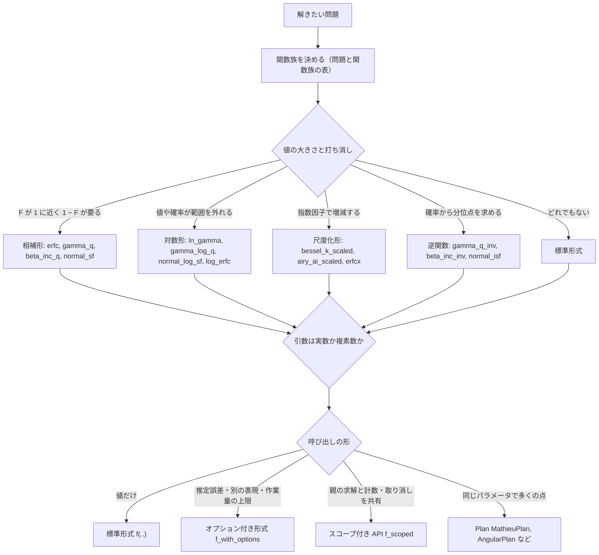

特殊関数は数式どおりに選んでも、浮動小数点では値が範囲を超えたり、引き算で有効数字を失ったりすることがある。
たとえば正規分布の上側確率を `1.0 - normal_cdf(x)` で求めると、$x = 9$ では $\Phi(9)$ が 1 に丸められて結果は 0 になる。
相補形の `normal_sf(9.0)` は裾を直接評価して約 $1.13 \times 10^{-19}$ を返す。

このページは、読者が四つのことを順に決めるための判断をまとめる。
最初に問題から関数族を決め、次に値の大きさと打ち消しから表現を決め、実数と複素数のどちらの型で呼ぶかを確かめ、最後に呼び出しの形を決める。



## 問題から関数族を選ぶ

次の表はよく現れる問題から関数族と注意すべき表現を引き、数理ページへ導く。
表の関数は代表例で、族のすべての関数は各数理ページの表にある。

| 問題 | 関数族と代表的な関数 | 表現と注意 | 数理ページ |
|---|---|---|---|
| 複素数の引数、切断の上の値、裾確率の表し方 | `Parameter`、`SpecialFunctionResult`、`log_erfc` | 切断の岸は虚部の符号付きゼロで選ぶ | [API・分枝・値の表現](../algorithms/branches-tails-and-extended-families/) |
| 尤度や分配関数の正規化定数 | `gamma`、`ln_gamma`、`digamma`、`polygamma`、`pochhammer` | 大きな引数は対数形 | [Gamma 関数・polygamma 関数・Pochhammer 記号](../algorithms/gamma-family/) |
| Gamma 分布・Poisson 分布の累積確率と分位点 | `gamma_p`、`gamma_q`、`gamma_log_q`、`gamma_p_inv` | 上側の裾は相補形、範囲を下回る裾は対数形 | [不完全 Gamma 関数](../algorithms/incomplete-gamma/) |
| 数え上げ、二項係数 | `factorial`、`double_factorial`、`binomial`、`ln_binomial` | 大きな $n$ は対数形 | [階乗と二項係数](../algorithms/combinatorial-numbers/) |
| 集合の分割、級数の係数 | `stirling_first_kind`、`stirling_second_kind`、`bernoulli`、`euler` | 正確な有理数・整数が要るときは `checked_bernoulli`、`checked_euler` | [Stirling 数・Bernoulli 数・Euler 数](../algorithms/stirling-bernoulli-euler-numbers/) |
| Beta 分布・二項分布の累積確率 | `beta_inc`、`beta_inc_q`、`beta_inc_inv`、`ln_beta` | $x$ が 1 に近い裾は `beta_inc_q` | [Beta 関数と正則化不完全 Beta 関数](../algorithms/beta-and-error-functions/) |
| 拡散の誤差関数 | `erf`、`erfc`、`erfcx`、`erfinv`、`dawson` | 大きな $x$ は `erfc` か `erfcx` | [誤差関数・Dawson 積分・逆誤差関数](../algorithms/error-functions/) |
| 正規分布の p 値と分位点、二変量正規分布 | `normal_sf`、`normal_log_sf`、`normal_isf`、`owens_t` | 裾の確率から直接逆算する | [正規分布の裾と Owen の T 関数](../algorithms/normal-tails-and-faddeeva/) |
| 分光線の Voigt 形、複素誤差関数 | `voigt_profile`、`voigt_complex`、`faddeeva` | 実数の線形は `voigt_profile`、複素数の値は `voigt_complex` | [Faddeeva 関数と Voigt プロファイル](../algorithms/faddeeva-and-voigt/) |
| 放射の減衰と吸収、中性子の遮蔽 | `expint_e1`、`expint_en`、`expint_ei`、`logarithmic_integral` | 大きな引数は `expint_e1_scaled` などの尺度化形 | [指数積分と対数積分](../algorithms/exponential-and-trigonometric-integrals/) |
| 回折の Fresnel 積分、アンテナの放射 | `si`、`ci`、`fresnel_c`、`fresnel_s` | 大きな引数の双曲線積分は `shi_scaled`、`chi_scaled` | [三角積分・双曲線積分・Fresnel 積分](../algorithms/trigonometric-integrals-and-fresnel/) |
| 合流型・Gauss の超幾何関数で書ける解 | `hyp1f1`、`hyp2f1`、`hyperu`、`hyp_pfq` | 同じパラメータで多くの点を評価するなら `HypergeometricFunction` | [超幾何関数](../algorithms/hypergeometric-and-zeta/) |
| ゼータ和、黒体放射の積分 | `riemann_zeta`、`hurwitz_zeta`、`dirichlet_eta` | 値がアンダーフローする Hurwitz ゼータは `hurwitz_zeta_log` | [Riemann・Hurwitz ゼータ関数と Dirichlet eta 関数](../algorithms/zeta-functions/) |
| 線形ポテンシャルの転回点 | `airy_ai`、`airy_bi`、`airy_ai_scaled` | 指数因子は尺度化形で除く | [Airy 関数と転回点](../algorithms/airy-functions/) |
| 円柱座標の波動・熱伝導 | `bessel_j`、`bessel_y`、`bessel_k`、`hankel_1` | 境界条件で解を選ぶ（次節）。指数因子は尺度化形で除く | [円柱 Bessel 関数と Hankel 関数](../algorithms/airy-bessel-and-hankel/) |
| 球座標の散乱 | `spherical_jn`、`spherical_hankel_1`、`riccati_jn` | 次数の漸化式は安定な向きが関数ごとに違う | [球 Bessel・球 Hankel・Riccati–Bessel 関数](../algorithms/spherical-bessel-kelvin-and-riccati/) |
| 導線の表皮効果 | `ber`、`bei`、`ker`、`kelvin` | 0 次だけを提供する。一般の次数は複素数の引数の `bessel_j`、`bessel_k` | [Kelvin 関数と表皮効果](../algorithms/kelvin-functions/) |
| 非斉次の Bessel 方程式、ピストンの音響放射 | `struve`、`modstruve`、`bessel_j0_integral` | ULP の目標は $-5 \le \nu \le 10$、$10^{-3} \le x \le 100$ の範囲だけ | [Struve 関数と Bessel・Struve 関数の積分](../algorithms/struve-parabolic-and-bessel-integrals/) |
| 二次のポテンシャル | `parabolic_d`、`parabolic_v`、`parabolic_w` | 次数の規約を確かめる（後述） | [放物柱関数](../algorithms/parabolic-cylinder-functions/) |
| Coulomb ポテンシャルの散乱と束縛状態 | `coulomb_wave`、`coulomb_wave_sequence`、`hydrogenic_radial` | 連続する次数は列の関数でまとめて求める | [Coulomb 波動関数と水素様動径状態](../algorithms/coulomb-and-hydrogenic/) |
| 振り子の周期、楕円の周長 | `elliptic_k`、`elliptic_e` | 母数 $m = k^2$ を渡す（後述） | [楕円積分の定義と完全楕円積分 K、E](../algorithms/elliptic-and-legendre/) |
| 楕円の弧長、不完全楕円積分 | `elliptic_f`、`elliptic_e_inc`、`carlson_rf`、`carlson_rd` | $m$ が 1 に近いときは $1 - m$ を Carlson 形に直接渡す | [Carlson 対称形と不完全楕円積分](../algorithms/carlson-symmetric-integrals/) |
| 非線形振動の軌道 | `jacobi_sn`、`jacobi_cn`、`jacobi_dn`、`jacobi_amplitude` | 母数 $m = k^2$ を渡す | [Jacobi 楕円関数](../algorithms/jacobi-elliptic-functions/) |
| 静電場・重力場の多重極展開 | `legendre_p`、`legendre_q`、`legendre_p_assoc` | 陪関数は Condon–Shortley の位相 $(-1)^m$ を含む | [Legendre 関数](../algorithms/legendre-functions-and-spherical-harmonics/) |
| 球面上の場の展開 | `spherical_harmonic`、`spherical_harmonic_real` | 単位球面上で正規化し、Condon–Shortley の位相を含む | [球面調和関数](../algorithms/spherical-harmonics/) |
| 角運動量の合成、選択則 | `wigner_3j`、`clebsch_gordan`、`AngularPlan` | 多くの係数は Plan と作業領域を使い回す | [角運動量結合係数と Wigner 記号](../algorithms/angular-momentum-coupling/) |
| 楕円柱、Paul トラップ | `mathieu_a`、`mathieu_ce`、`MathieuPlan` | 特性値と展開係数を Plan として準備する | [Mathieu 関数とスペクトル法](../algorithms/mathieu-and-spheroidal/) |
| 回転楕円体による散乱 | `spheroidal_angular`、`spheroidal_radial`、`SpheroidalPlan` | 特性値と展開係数を Plan として準備する | [回転楕円体波動関数](../algorithms/spheroidal-wave-functions/) |
| 三軸楕円体のポテンシャル | `EllipsoidalHarmonicPlan`、`ellipsoidal_harmonic` | 求積の許容誤差をオプションで与える | [楕円体調和関数と Lamé 関数](../algorithms/ellipsoidal-harmonics/) |
| ループ積分、Clausen 和 | `dilog`、`spence`、`clausen` | 実数の `dilog` は切断の上の $x > 1$ で実部を返す | [二重対数・Spence 関数・Clausen 関数](../algorithms/polylog-lerch-and-clausen/) |
| Bose 気体の積分、格子和 | `polylog`、`lerch_phi` | 実数の $z > 1$ は切断の上にあり、多くの位数で複素数の型が要る | [一般の位数の多重対数と Lerch の超越関数](../algorithms/polylog-and-lerch/) |
| $w e^w = y$ の形の超越方程式（Wien の変位則、ダイオード） | `lambert_w0`、`lambert_wm1`、`wright_omega` | 二つの実数の枝を区別する | [Lambert W 関数と Wright ω 関数](../algorithms/lambert-w-and-wright-omega/) |
| 格子比熱、電気抵抗、シンクロトロン放射 | `debye_3`、`transport_5`、`synchrotron_1` | Debye 関数は $D_n(0) = 1$ と規格化されている | [Debye 関数・輸送積分・シンクロトロン関数](../algorithms/thermal-and-radiation-integrals/) |
| 電子気体、半導体のキャリア密度 | `fermi_dirac_half`、`fermi_dirac_mhalf`、`fermi_dirac_int` | $1/\Gamma(j+1)$ で正規化されている | [Fermi–Dirac 積分](../algorithms/fermi-dirac-integrals/) |

## 表現を選ぶ

関数族が決まったら、値の大きさと打ち消しから表現を選ぶ。
判断の基準は、求めたい量そのものが浮動小数点で表せるか、表せるならそれを打ち消しなしに作れるか、の二つである。

### 相補形と引き算の打ち消し

累積確率 $F$ が 1 に近いとき、上側の確率 $Q = 1 - F$ を引き算で作ると有効数字を失う。
1 の直下の binary64 の間隔は $\varepsilon/2 = 2^{-53}$ なので、$F$ を丸めただけで $Q$ には $\varepsilon/4$ 程度の絶対誤差が入る。
したがって引き算の相対誤差はおよそ $\varepsilon/(4Q)$ 以上になり、$Q = 10^{-k}$ ならおよそ $k$ 桁を失う。
$Q$ が $\varepsilon/4 \approx 5.6 \times 10^{-17}$ を下回ると、$F$ は 1 に丸められて引き算は 0 を返す。
相補形 `gamma_q`、`beta_inc_q`、`erfc`、`normal_sf` は小さいほうの裾を直接評価するので、この損失がない。

次のセルは整数の母数を持つ二つの分布で、引き算 $1 - F$ と相補形の相対誤差を引数ごとに測る。
Gamma 分布（形状 3）は $Q(3, x) = e^{-x}(1 + x + x^2/2)$、Beta 分布 $I_x(2, 5)$ の上側は $1 - I_x(2, 5) = (1-x)^5(1 + 5x)$ という有限和の閉形式を持つ。
この閉形式を f64 の固有メソッドで計算した値を参照にし、二つの方法の相対誤差を対数軸に描く。
破線は目安の $\varepsilon/(4Q)$ である。

```rust
//| id: special-choosing-complement-cancellation
//| ref: special-choosing-complement-cancellation
//| title: 引き算 1 − F と相補形の相対誤差を裾の深さで比べる
//| run: reactive
//| crates: [scioxide-special]
//| inputs:
//|   law: {"type":"select","label":"分布","options":["Gamma 分布（形状 3）","Beta 分布 I_x(2, 5)"],"value":"Gamma 分布（形状 3）"}
//| cases:
//|   - {"id":"beta","label":"Beta 分布","description":"x → 1 で上側の確率が (1 − x)⁵ の速さで小さくなる。","inputs":{"law":"Beta 分布 I_x(2, 5)"}}
//| tests:
//|   - case: default
//|     expect:
//|       - {"artifact":"summary","path":"/rows/0/2","range":{"max":1e-14}}
//|       - {"artifact":"summary","path":"/rows/2/2","range":{"min":1e-6,"max":1e-3}}
//|       - {"artifact":"summary","path":"/rows/2/3","range":{"max":1e-14}}
//|       - {"artifact":"summary","path":"/rows/3/2","equals":1}
//|       - {"artifact":"summary","path":"/rows/3/3","range":{"max":1e-14}}
//|   - case: beta
//|     expect:
//|       - {"artifact":"summary","path":"/rows/2/2","range":{"min":1e-6,"max":1e-2}}
//|       - {"artifact":"summary","path":"/rows/2/3","range":{"max":1e-13}}
//|       - {"artifact":"summary","path":"/rows/3/2","equals":1}
//|       - {"artifact":"summary","path":"/rows/3/3","range":{"max":1e-13}}
use scioxide_special::{beta_inc, beta_inc_q, gamma_p, gamma_q};

let gamma_law = law.starts_with("Gamma");
// 引数 → (1 − F, 相補形, 閉形式の参照)。参照は f64 の固有メソッドで計算する。
let evaluate = |x: f64| -> Result<(f64, f64, f64), String> {
    if gamma_law {
        let lower = gamma_p(3.0, x).map_err(|e| e.to_string())?;
        let upper = gamma_q(3.0, x).map_err(|e| e.to_string())?;
        Ok((1.0 - lower, upper, (-x).exp() * (1.0 + x + 0.5 * x * x)))
    } else {
        let lower = beta_inc(2.0, 5.0, x).map_err(|e| e.to_string())?;
        let upper = beta_inc_q(2.0, 5.0, x).map_err(|e| e.to_string())?;
        Ok((1.0 - lower, upper, (1.0 - x).powi(5) * (1.0 + 5.0 * x)))
    }
};
// Gamma は x ∈ [1, 60]、Beta は 1 − x ∈ [10⁻⁵, 0.5] を対数等間隔に取る。
let grid: Vec<f64> = (0..=120)
    .map(|i| {
        let s = i as f64 / 120.0;
        if gamma_law {
            1.0 + 59.0 * s
        } else {
            1.0 - 0.5 * 10f64.powf(-4.7 * s)
        }
    })
    .collect();
let mut subtracted = Vec::new();
let mut direct = Vec::new();
let mut guide = Vec::new();
// 対数軸に描けない誤差 0 の点は除き、(引き算, 相補形) の数を数える。
let mut exact_points = (0, 0);
for &x in &grid {
    let (by_subtraction, complement, reference) = evaluate(x)?;
    let errors = [by_subtraction, complement].map(|v| ((v - reference) / reference).abs());
    match errors[0] > 0.0 {
        true => subtracted.push([reference, errors[0]]),
        false => exact_points.0 += 1,
    }
    match errors[1] > 0.0 {
        true => direct.push([reference, errors[1]]),
        false => exact_points.1 += 1,
    }
    guide.push([reference, f64::EPSILON / (4.0 * reference)]);
}
let dashed = serde_json::json!({ "lineType": "dashed", "showSymbol": false });
emit_line_chart!(
    &vec![
        serde_json::json!({ "name": "引き算 1 − F", "points": subtracted }),
        serde_json::json!({ "name": "相補形", "points": direct }),
        serde_json::json!({ "name": "目安 ε/(4Q)", "points": guide, "style": dashed }),
    ],
    options = &serde_json::json!({
        "xLabel": "上側の確率 Q [-]",
        "yLabel": "相対誤差 [-]",
        "xType": "log",
        "yType": "log",
        "yMin": 1e-17,
        "yMax": 10.0
    })
);
emit_text!(format!(
    "参照と一致して図から除いた点（全 {} 点）: 引き算 {}、相補形 {}",
    grid.len(),
    exact_points.0,
    exact_points.1
));

// 代表点: 上側の確率がおよそ 1、10⁻⁶、10⁻¹²、ε/4 未満（引き算が 0 になる）。
let probes = if gamma_law {
    [1.5, 18.0, 33.0, 45.0]
} else {
    [0.2, 0.92, 0.9965, 0.9998]
};
let mut rows = Vec::new();
for x in probes {
    let (by_subtraction, complement, reference) = evaluate(x)?;
    let relative = |v: f64| ((v - reference) / reference).abs();
    rows.push((x, reference, relative(by_subtraction), relative(complement)));
}
let sci3 = serde_json::json!({ "notation": "scientific", "significantDigits": 3 });
let sci2 = serde_json::json!({ "notation": "scientific", "significantDigits": 2 });
let columns = serde_json::json!([
    { "key": "0", "label": "x [-]", "type": "number" },
    { "key": "1", "label": "参照の Q [-]", "type": "number", "format": sci3 },
    { "key": "2", "label": "引き算の相対誤差 [-]", "type": "number", "format": sci2 },
    { "key": "3", "label": "相補形の相対誤差 [-]", "type": "number", "format": sci2 }
]);
emit_table_with_columns!(
    columns,
    rows,
    metadata = serde_json::json!({ "id": "summary" })
);
```

Gamma 分布の既定では、引き算の相対誤差は破線の目安に沿って増え、$Q \approx 2.8 \times 10^{-6}$（$x = 18$）で $1.4 \times 10^{-11}$、$Q \approx 2.7 \times 10^{-12}$（$x = 33$）で $4.4 \times 10^{-6}$ になる。
$x = 45$ では $Q \approx 3.0 \times 10^{-17}$ が $\varepsilon/4$ を下回り、引き算は 0 を返して相対誤差は 1 になる。
相補形 `gamma_q` は 121 点のうち 117 点で参照とビット単位で一致し、図から除いたのはその 117 点である。
ただし整数の形状では実装も同じ有限和を使うので、この一致は独立な検算ではない。
Beta 分布 $I_x(2, 5)$ に切り替えても、引き算の誤差は同じ目安に沿い、$1 - x = 2 \times 10^{-4}$ で $Q \approx 1.9 \times 10^{-18}$ となって 0 を返す。
`beta_inc_q` の相対誤差は全域で $5 \times 10^{-16}$ 未満にとどまる。
整数の形状（$a + b \le 33$）では `beta_inc_q` も二項の有限和で上側を直接作るので、これも閉形式と同じ多項式を別の順に足した値との比較で、独立な検算ではない。
このセルが確かめるのは、引き算 $1 - F$ が失う桁数であり、相補形そのものの精度ではない。

この図から読む判断は、上側の確率 $Q$ がどの程度なら引き算で足りるかである。
必要な相対精度を $\delta$ とすると、引き算で済むのはおよそ $Q > \varepsilon/(4\delta)$ の範囲に限られる。
たとえば相対精度 $10^{-6}$ が要るなら、$Q$ が $10^{-10}$ を下回る前に相補形へ移る。
相補形が正規化数の範囲を下回る深さ（binary64 で $Q < 2.2 \times 10^{-308}$）では非正規化数として桁が減り、$Q < 4.9 \times 10^{-324}$ では 0 になるので、次の対数形を使う。

### 対数形・尺度化形・逆関数

確率や値そのものがスカラーの範囲を外れるときは、対数形を選ぶ。
`normal_sf` は binary64 で $x > 38.5$ に対して 0 を返すが、`normal_log_sf` はその先でも有限の対数を返す。
大きな階乗と Gamma 関数には `ln_factorial`、`ln_binomial`、`ln_gamma` がある。
`ln_gamma` は $\ln|\Gamma|$ だけを返して符号を捨てるので、負の非整数での符号はオプション付き形式 `gamma_with_options` の対数形で読む。

指数因子で増減する解では指数因子を除いた尺度化形を選ぶ。
`erfcx(x)` は $e^{x^2}\operatorname{erfc}(x)$ を返し、大きな正の $x$ では $1/(x\sqrt\pi)$ に近い有限値を保つ。
負の側では $2e^{x^2}$ のように増え、binary64 では $2e^{x^2}$ が最大値を超える $x \approx -26.63$ より小さいと `NumericalInstability`（`Overflow`）になる。

確率から分位点を求めるときは、汎用の求根を組まずに逆関数を使う。
下側の確率からは `gamma_p_inv`、`beta_inc_inv`、`normal_quantile`、`erfinv` を、上側の確率からは `gamma_q_inv`、`beta_inc_q_inv`、`normal_isf`、`erfcinv` を使い、確率を引き算で作り直さない。
確率を対数で持っているなら、`gamma_p_inv_log`、`beta_inc_inv_log`、`normal_inv_log_cdf`、`normal_inv_log_sf` で対数のまま逆算する。
`normal_quantile`、`normal_isf` と逆誤差関数は反復のない有理近似で、Gamma・Beta の逆関数は区間で保護した Halley 法の反復である。
`normal_inv_log_sf` と `normal_inv_log_cdf` は、対数の確率が $-36$ より小さいと Newton 法で反復する。

## 波動・拡散方程式の境界条件

円柱座標 $(r, \theta, z)$ で Helmholtz 方程式 $\nabla^2 \psi + k^2 \psi = 0$ を変数分離すると、動径方向は Bessel の微分方程式になる。
二階の方程式なので独立な解が二つあり、どちらを使うかは原点 $r = 0$ と遠方 $r \to \infty$ の境界条件で決まる。

| 境界条件 | 解 | 関数 | 性質 |
|---|---|---|---|
| 原点を含み、そこで有限 | $J_\nu(kr)$ | `bessel_j` | $J_0(0) = 1$、$\nu > 0$ で $J_\nu(0) = 0$ |
| 原点を含まない環状の領域 | $J_\nu$ と $Y_\nu$ の一次結合 | `bessel_y` | $Y_\nu$ は $r \to 0$ で対数的か代数的に発散する |
| 外向きの放射波（時間因子 $e^{-\mathrm{i}\omega t}$） | $H_\nu^{(1)}(kr) = J_\nu + \mathrm{i}Y_\nu$ | `hankel_1` | 大きな $kr$ で $e^{\mathrm{i}kr}$ のように振る舞い、実数の入力でも複素数を返す |
| 遠方で減衰する（修正 Helmholtz 方程式 $\nabla^2\psi - \lambda^2\psi = 0$） | $K_\nu(\lambda r)$ | `bessel_k` | 遠方で $e^{-\lambda r}$ のように減衰し、$x = 0$ では極限 $+\infty$ を成功として返す |
| 修正 Helmholtz 方程式で原点を含み、そこで有限 | $I_\nu(\lambda r)$ | `bessel_i` | 遠方で $e^{\lambda r}$ のように増大する |

球座標の動径方向では同じ規則で球 Bessel 関数 `spherical_jn`、`spherical_yn`、`spherical_hankel_1`、`spherical_in`、`spherical_kn` を選ぶ。

大きな引数では値が範囲を超えるか 0 に丸められるので、指数因子を除いた尺度化形を選ぶ。
`bessel_i_scaled` は $e^{-|\operatorname{Re} z|}I_\nu(z)$、`bessel_k_scaled` は $e^{z}K_\nu(z)$、`bessel_j_scaled` と `bessel_y_scaled` は $e^{-|\operatorname{Im} z|}$ を掛けた値、`hankel_1_scaled` は $e^{-\mathrm{i}z}H_\nu^{(1)}(z)$ を返す。
尺度化形は元の関数とは別の量なので、元の値と同じ軸に描かない。
比や対数が欲しいだけなら、$K_\nu$ には実数の対数形 `bessel_k_log` もある。

## 規約の違い

同じ記号でも文献によって規約が違うので、物理の式から引数を作るときに確かめる。

| 量 | `scioxide-special` の規約 | 取り違えやすい規約 |
|---|---|---|
| 楕円積分・Jacobi 楕円関数の第二引数 | 母数 $m = k^2$（`elliptic_k(m)`、`jacobi_sn(u, m)`） | 法 $k$、母数角 $\alpha$（$m = \sin^2\alpha$） |
| 不完全 Gamma・Beta 関数 | 正則化した $P(a, x) = \gamma(a, x)/\Gamma(a)$、$I_x(a, b)$ | 正則化しない $\gamma(a, x)$（`gamma_lower` が返す） |
| Fermi–Dirac 積分 | $F_j(x) = \frac{1}{\Gamma(j+1)}\int_0^\infty \frac{t^j}{e^{t-x}+1}\,dt$ | $\Gamma(j+1)$ で割らない定義 |
| 球面調和関数 | Condon–Shortley の位相 $(-1)^m$ を含み、単位球面上で正規化 | 位相を含まない定義 |
| Bernoulli 数 | $B_1 = -1/2$ | $B_1 = +1/2$ |
| 放物柱関数 | 次数 $\nu$ の $D_\nu(x) = U(-\nu - 1/2, x)$（`parabolic_w` だけは $W(a, x)$ の $a$ を受け取る） | Weber の $U(a, x)$ の $a$ |

単振り子の周期のように物理の式から法 $k = \sin(\theta_0/2)$ が得られたら、二乗して $m = k^2$ を渡す。
実数の $m > 1$ は `elliptic_k` では `DomainError`（`OutsideDomain`）になり、$K(1) = +\infty$ は成功の極限として返る。

## 実数と複素数の API

多くの関数は型引数に `NumericScalar` を取り、一つの関数で `f32`、`f64`、`Complex<f32>`、`Complex<f64>` を受け取り、引数の型が結果の型を決める。
引数が複素数なら、次数や形状は実数のまま渡せる（`Parameter`）。
実数の API は実数の定義域だけを受け付けるので、非整数の次数の `bessel_j` に負の実数を渡すと `DomainError` になる。
切断の上の値が欲しいときは複素数の API に移り、虚部の $+0$ と $-0$ で上下の岸を選ぶ。
詳しい規約は [API・分枝・値の表現](../algorithms/branches-tails-and-extended-families/) にある。

## 呼び出しの形を選ぶ

値だけが要るなら標準形式 `f(..)` を使う。
推定誤差、導関数、尺度化形や対数形、既定と違う作業量の上限が要るなら、オプション付き形式 `f_with_options(.., options)` を使う。
上限に達して有用な推定値があるとき、オプション付き形式は終了状態 `IterationLimit` とともに値を返し、標準形式は `ConvergenceFailure` を返す。
他の求解の中で特殊関数を呼び、計数・取り消し・期限を親と共有するなら、スコープ付き API `f_scoped(.., options, scope)` に親の `&mut SolveContext` を渡す。
計算量が引数によらない関数（`gamma`、`erfinv`、`normal_cdf` など）にはスコープ付き API がない。

同じパラメータで多くの点を評価するなら、Plan を一度作って使い回す。
`MathieuPlan`、`SpheroidalPlan`、`EllipsoidalHarmonicPlan` は打ち切った固有値問題を解いて係数を保持し、`AngularPlan` は Racah の式の階乗を分解する素数表を保持する。
`mathieu_a`、`spheroidal_angular`、`ellipsoidal_harmonic`、`wigner_3j` などのワンショット関数は Plan を内部で作って一度だけ評価する。
`HypergeometricFunction` は ${}_pF_q$ や $U$ のパラメータを検査して保持し、正則化した値と導関数も返す。

スカラーの関数に配列をまとめて渡す形はなく、多くの点では `iter().map(..)` で評価する。
連続する次数をまとめて求める形は、次数の漸化式を共有する Coulomb 波動関数の列の関数（`coulomb_wave_sequence` など）だけである。

## まとめと次に読むページ

問題から関数族を表で引き、数理ページで族の全関数と精度の範囲を確かめる。
上側の確率が $10^{-k}$ なら引き算 $1 - F$ はおよそ $k$ 桁を失うので、相補形を選び、確率がスカラーの範囲を下回るなら対数形に移る。
指数因子で増減する解には尺度化形を選び、別の量であることを忘れずに使う。
楕円積分には母数 $m = k^2$ を渡し、Fermi–Dirac 積分や球面調和関数の正規化は文献と照らしてから使う。
推定誤差や上限の扱いが要るときはオプション付き形式を選び、その読み方は [API・分枝・値の表現](../algorithms/branches-tails-and-extended-families/) で確かめる。
