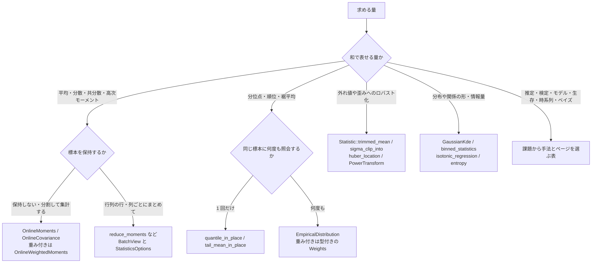

統計量を求める手法は、二つの問いでおおよそ決まる。
一つは全標本を保持できるかで、もう一つは求める量が和で表せる量（平均・分散・共分散）か、順序に依存する量（分位点・順位・裾平均）かである。
推定や検定、モデルの当てはめでは、そのうえで課題とデータの構造（打ち切り、時間の依存、多変量、事前分布）から手法を選ぶ。
このページは、課題から手法と解説のページを選ぶ表と、要約に使う型と関数を選ぶ判断の流れ、既定の設定で一度だけ計算するときの関数、分位点の定義・重みの意味・形の推定を選ぶための比較表をまとめる。
各手法の数理は[統計の数理と共通の規約](../algorithms/)から、型と関数の約束事は [API ガイド](../api/)から引く。

## 判断の流れ

## 課題から手法とページを選ぶ

課題ごとに、使う手法、最初に使う型や関数、導出と前提を説明するページ、結果を使う前に確かめることを並べる。
これらの関数の多くには、既定の設定で一度だけ計算するワンショット関数と、設定を受け取るオプション付き形式がある（[呼び出しの形](oxref:stats-execution-forms)）。

| 課題 | 手法 | 最初に使う型と関数 | 解説のページ | 確かめること |
|---|---|---|---|---|
| 要約：平均・分散・高次モーメント・共分散 | Welford の漸化式と部分集計の結合 | `OnlineMoments`、`OnlineCovariance`、`reduce_moments` | [逐次平均・分散・高次モーメント・共分散の数理](../algorithms/online-moments-and-covariance/) | 保持する次数、結合の順序 |
| 要約：重み付きの平均と分散 | 重みの意味ごとの推定量と有効標本サイズ | `OnlineWeightedMoments`、`Weights` | [重み付き推定・標準誤差・信頼区間の数理](../algorithms/weighted-estimation-and-confidence/) | 重みが頻度・信頼度・逆分散のどれを表すか |
| 要約：分位点・順位・経験分布関数 | 整列と選択、Hyndman と Fan の九つの定義 | `EmpiricalDistribution`、`quantile_in_place`、`rank_slice`、`cdf` | [経験分布・標本分位点・補間規約の数理](../algorithms/empirical-quantiles/) | 分位点の型の番号、同順位の扱い |
| 要約：裾平均 | 重み付きの逆経験分布関数と境界の質量の按分 | `tail_mean_in_place`、`EmpiricalDistribution::tail_mean` | [重み付き経験分布と裾平均の数理](../algorithms/tail-means-and-weighted-empirical/) | 裾の側、裾に入る観測の数 |
| 要約：外れ値にロバストな位置と散らばり | トリム平均、Huber の M-推定量、シグマクリッピング | `Statistic::trimmed_mean`、`huber_location`、`sigma_clip_into` | [順序統計・極値・ロバスト位置推定量](../algorithms/order-statistics-and-robust-estimation/) | 崩壊点、反復の終了理由 |
| 要約：軸ごとの統計量・標準化・べき変換 | 統計量のセレクター、z スコア、Box–Cox と Yeo–Johnson 変換 | `statistics`、`standardize`、`PowerTransform`、`probplot` | [記述統計・標準化・べき変換の数理](../algorithms/descriptive-statistics-and-transforms/) | 変換後の正規性を確率プロットで確かめたか |
| 要約：分布の形 | ヒストグラム、ガウス核密度推定、単調回帰 | `binned_statistics`、`GaussianKde`、`isotonic_regression` | [単調回帰・ビン集計・核密度推定の数理](../algorithms/isotonic-bins-and-kde/) | 範囲外の観測の数え方、帯域幅 |
| 要約：角度・情報量・分布間の距離 | 平均合成ベクトル、エントロピー、Wasserstein 距離 | `Statistic::circular`、`entropy`、`differential_entropy`、`distribution_distance` | [円周統計・情報量・分布間距離の数理](../algorithms/circular-information-and-distances/) | 角度の周期、微分エントロピーの偏り |
| 推定：平均の信頼区間 | Student の t 区間 | `mean_confidence_interval`、`MomentsSnapshot::confidence_interval_of_mean`、`MeanIntervalPlan` | [重み付き推定・標準誤差・信頼区間の数理](../algorithms/weighted-estimation-and-confidence/) | 記録された方法と仮定（独立性・正規性） |
| 推定：分布の母数 | 最尤法、モーメント法、分位点の一致 | `PreparedFit`、`fit` と注入した `FitSolver` | [分布の当てはめと観測情報行列](../algorithms/distribution-fitting-and-confidence-limits/) | `StatsTermination`、識別可能性、観測情報行列 |
| 推定：割合・率・分散・非心度の正確な信頼限界 | 検定の反転と裾確率による母数の逆算 | `binomial_confidence_limits`、`poisson_rate_confidence_limits`、`invert_parameter` | [裾確率による母数の逆算と正確な信頼限界](../algorithms/parameter-inversion-and-confidence-limits/) | 離散分布では被覆確率が名目以上になること |
| 推定：任意の統計量の区間 | ブートストラップ（パーセンタイル法・基本法・BCa 法）、ジャックナイフ | `bootstrap`、`jackknife`、`ResamplingPlan` | [リサンプリングによる区間と検定](../algorithms/resampling/) | 抽出の設計（ブロック・対応・層）、Monte Carlo の誤差 |
| 検定：位置・順位・相関 | t 検定、Mann–Whitney、Wilcoxon、Brunner–Munzel、相関の検定 | `t_test_independent`、`mann_whitney_test`、`wilcoxon_test`、`spearman_test` | [古典的仮説検定と順位検定の数理](../algorithms/classical-tests/) | 実際に使った較正 `ClassicalMethod`、効果量の区間 |
| 検定：分布の当てはまり・正規性・等分散 | KS・Cramér–von Mises・Anderson–Darling、Shapiro–Wilk、Levene | `ks_one_sample_test`、`shapiro_wilk_test`、`goodness_of_fit_test_into`、`levene_test` | [分布適合度検定と分散等質性検定](../algorithms/distribution-and-variance-tests/) | パラメータを推定したかどうか（`NullParameters`） |
| 検定：分割表 | カイ二乗検定、Fisher・Barnard・Boschloo の正確検定 | `chi2_contingency_test`、`fisher_exact_test`、`barnard_exact_test` | [分割表検定・多重比較・p 値統合](../algorithms/contingency-and-multiple-testing/) | 期待度数の大きさ、周辺和を固定するかどうか |
| 検定：多数の仮説 | FWER と FDR の調整、p 値の統合 | `adjust_pvalues`、`combine_pvalues` | [分割表検定・多重比較・p 値統合](../algorithms/contingency-and-multiple-testing/) | 制御する誤り率と、検定間の依存の仮定 |
| 検定：置換・Monte Carlo・MGC | 置換検定、モンテカルロ検定、多重尺度グラフ相関 | `permutation_test`、`monte_carlo_test`、`MgcPlan` | [リサンプリングによる区間と検定](../algorithms/resampling/) | 交換可能性、反復の数と p 値の Monte Carlo の誤差 |
| 検定：検出力と標本サイズ | 非心 t 分布による検出力、模擬実験 | `power`、`sample_size`、`simulated_power` | [検出力と標本サイズの設計](../algorithms/power-and-sample-size/) | 想定した効果量と有意水準、模擬の Wilson 区間 |
| モデル：線形回帰・分散分析 | 最小二乗、HC3 の共分散、F 検定、群の比較 | `ordinary_least_squares`、`linear_regression`、`PreparedRegression`、`PreparedGroups` | [回帰分析・分散分析・GLM](../algorithms/regression-anova-and-glm/) | 対比の推定可能性、計画行列のランク |
| モデル：一般化線形モデル | 反復重み付き最小二乗法 | `glm_fit`、`PreparedGlm` | [回帰分析・分散分析・GLM](../algorithms/regression-anova-and-glm/) | 終了理由（分離、未収束） |
| モデル：ロバスト回帰・直交距離回帰 | Huber 回帰、Theil–Sen・Siegel の傾き、ODR | `PreparedHuber`、`robust_slope`、`linear_odr` | [回帰分析・分散分析・GLM](../algorithms/regression-anova-and-glm/) | 外れ値の割合、説明変数の誤差の扱い |
| 生存時間 | Kaplan–Meier、Nelson–Aalen、log-rank 検定、Cox 回帰 | `kaplan_meier`、`nelson_aalen`、`logrank_test`、`cox_fit` | [生存時間分析](../algorithms/survival-analysis/) | 打ち切りの独立性、比例ハザード性 |
| 時系列 | 自己相関・偏自己相関、ペリオドグラム、ARIMA | `time_series_summary`、`periodogram_diagnostics_into`、`PreparedArimaFit` | [時系列解析](../algorithms/time-series/) | 定常性、可逆性、残差の白色性 |
| 多変量 | 標本共分散と縮小推定、主成分分析、正準相関分析 | `sample_covariance`、`ledoit_wolf_covariance`、`PreparedPca`、`PreparedCca` | [多変量統計と共分散の縮小推定](../algorithms/multivariate-statistics/) | 次元 $p$ に対する標本数 $n$、縮小の強度 |
| 感度 | Sobol 指数の pick-freeze 推定、乱択準モンテカルロ法 | `sobol_indices_monte_carlo`、`sobol_indices_qmc`、`sobol_bootstrap` | [大域的感度解析と Sobol 指数](../algorithms/global-sensitivity-analysis/) | 入力の独立性、標本数と区間の幅 |
| ベイズ：共役更新と信用区間 | Beta–二項、Gamma–Poisson、正規–逆ガンマ | `BetaBinomialPrior`、`GammaPoissonPrior`、`NormalInverseGammaPrior`、`credible_interval` | [共役事前分布とベイズ更新](../algorithms/bayesian-conjugate-updates/) | 事前分布が正則か、信頼区間との解釈の違い |
| ベイズ：MCMC の標本の診断 | 分割と順位正規化による R̂、有効標本数 | `posterior_summary` | [MCMC の収束診断と事後要約](../algorithms/mcmc-diagnostics/) | R̂ と有効標本数の目安、モンテカルロ標準誤差 |

scioxide-stats は MCMC の標本器（Metropolis–Hastings 法、Gibbs サンプリングなど）を提供しない。
連鎖は scioxide-random の生成器と分布で呼び出し側が作り、`posterior_summary` には連鎖を並べた行列のビューを渡す。

## ワンショット関数で足りる場合

標本がスライスで手元にあり、既定の設定（重みなし、分散の除数 $n-1$、分位点は型 7、両側の検定、95% の区間、欠測と非有限値の拒否）で一度だけ計算するなら、問題のデータだけを受け取るワンショット関数を使う。
既定と違う設定は、同じ名前に `_with_options` を付けたオプション付き形式で最後に渡す。
呼び出しの形の一覧と、ワンショット呼び出しが固定する選択の全体は[呼び出しの形](oxref:stats-execution-forms)にある。

| 課題 | ワンショット関数 | 設定を変えるとき |
|---|---|---|
| 平均・分散・中央値・分位点・最小・最大 | `mean`、`sample_variance`、`sample_standard_deviation`、`median`、`quantile`、`minimum`、`maximum` | `statistic` と `Statistic`、重み付きは `Weights` |
| 平均の信頼区間 | `mean_confidence_interval` | `MomentsSnapshot::confidence_interval_of_mean_with_options` |
| 配列の軸ごと・移動ウインドウの要約 | `statistics`、`rolling_statistics` | `statistics_with_options`、`rolling_statistics_with_options` |
| 位置・順位・相関・分布の検定 | `t_test_independent`、`mann_whitney_test`、`wilcoxon_test`、`spearman_test`、`ks_two_sample_test`、`shapiro_wilk_test`、`levene_test` など | 各検定の `_with_options` と `ClassicalOptions` |
| 分割表と多重性 | `chi2_contingency_test`、`fisher_exact_test`、`adjust_pvalues` | `power_divergence_contingency_test`、`fisher_exact_test_with_options`、`adjust_pvalues_with_options` |
| 回帰 | `linear_regression`（直線）、`ordinary_least_squares`、`glm_fit`、`robust_slope` | `PreparedRegression`、`PreparedGlm`、`robust_slope_with_options` |
| リサンプリング | `bootstrap`、`jackknife`、`permutation_test`、`monte_carlo_test` | `ResamplingPlan` |
| 生存時間 | `kaplan_meier`、`nelson_aalen`、`logrank_test`、`cox_fit` | 各関数の `_with_options` と `SurvivalOptions` |
| 形の推定と多変量 | `histogram`、`GaussianKde::new`、`isotonic_regression`、`sample_covariance`、`PreparedPca::new` | `BinPlan`、`GaussianKde::with_options`、`isotonic_regression_with_options`、`MultivariateOptions` |
| 時系列・感度・検出力 | `time_series_summary`、`sobol_indices_monte_carlo`、`simulated_power` | `time_series_summary_with_options`、`_scoped`、`simulated_power_into` |

乱数を使うワンショット関数も、生成器を呼び出し側から受け取る。
反復を伴うワンショット呼び出し（Huber、GLM、Cox、注入したソルバーによる当てはめ、リサンプリング）は、収束や完了に至らなければ推定値を返さず `Err` を返す。

## 逐次集計と全標本の保持

| 状況 | 型と関数 | 得られる量 | 注意 |
|---|---|---|---|
| 測定列を保存せずに要約する、区画ごとに集計して結合する | `OnlineMoments::new(MomentOrder::Second)`、`merge` | 件数・平均・極値・分散・標準誤差 | 1 点以下では標本分散が `None` |
| 歪度・尖度も追う | `OnlineMoments::new(MomentOrder::Fourth)` | 3 次・4 次の中心モーメント、歪度、尖度 | 次数は作るときに決め、違う次数は結合できない |
| 二変量の共分散と相関 | `OnlineCovariance` | 平均の組、共分散、Pearson の相関 | 定数の座標では相関が `None` |
| 重みの付いた観測 | `OnlineWeightedMoments`、`OnlineWeightedCovariance` | 加重平均、有効標本サイズ、意味ごとの分散 | 重みの意味を型（`Frequency`・`Reliability`・`Analytic`）で指定する |
| 行列の軸ごと、欠測マスク付き | `reduce_moments`、`reduce_covariance`、`reduce_trimmed_moments` | 行・列・全体ごとの要約 | 欠測と非有限値の方針は既定で拒否 |
| 分位点・裾平均を 1 回だけ | `quantile_in_place`、`tail_mean_in_place` | 規約付きの値 | 作業用の配列の順を変える |
| 同じ標本に繰り返し照会 | `EmpiricalDistribution` | 分位点（$O(1)$）、裾平均、経験分布関数 | 構成に $O(n \log n)$ と複製 |

## 順序統計・ロバスト推定・変換の選び方

| 課題 | 手法と型・関数 | 特徴 | 適用条件と注意 |
|---|---|---|---|
| 特定の順序の値（最小、最大、k 番目） | `minimum`、`maximum`、`quantile_in_place` | 選択による $O(n)$ の抽出 | `quantile_in_place` は作業用の配列の順を変える |
| 外れ値を含む標本の位置 | トリム平均（`Statistic::trimmed_mean`、`TrimLimits`）、`huber_location` | 外れ値の影響を有界にする | 刈り込む割合の選び方、Huber の調整定数（既定 $c = 1.345$） |
| 外れ値にロバストな多変量の散布行列 | `PreparedHuberScatter` | 楕円型の分布を仮定した Huber の重みによる推定 | 標本数 $n$ が次元 $p$ より十分大きいこと |
| 外れた観測の反復的な除去 | `sigma_clip_into` と `SigmaClipOptions` | 平均から母標準偏差の倍率で外れた観測を、除く観測がなくなるまで繰り返し除く | 通過回数の上限に達したかを結果で確かめる |
| 歪んだ分布の正規化 | `PowerTransform::BoxCox`（正の値）、`PowerTransform::YeoJohnson`（実数全体）、`power_transform_normmax` | 変換のパラメータ $\lambda$ の最尤推定 | 変換後の分布の正規性を確率プロット（`probplot`）で確かめる |

## 分位点の定義の選び方

`QuantileMethod` の九つの定義は、比べる相手のソフトウェアと、データが離散か連続かで選ぶ。
定義の式は[経験分布・標本分位点・補間規約の数理](oxref:stats-quantile-hyndman-fan-definitions)にある。

| 目的 | 定義 | 理由 |
|---|---|---|
| 標本分位点を線形補間で求める | 型 7 `Linear` | 端の観測値を確率 0・1 に置く |
| 観測された値だけを返す（整数の件数、離散の測定） | 型 1 `NearestRank` | 逆経験分布関数で、補間しない |
| 分布の形によらず中央値がほぼ不偏な推定 | 型 8 `MedianUnbiased` | Hyndman と Fan の推奨 |
| 正規母集団の順序統計量の期待値に近い位置 | 型 9 `NormalUnbiased` | 正規確率プロットの位置に対応 |
| 重みが相対的な質量 | 重み付きの逆経験分布関数（`QuantileRule::inverse_ecdf()`） | 型 1 に当たる定義だけが定まる |
| 重みが整数の独立反復数 | `quantile_in_place` | 展開せずに九つの定義を使える |

レポートには型の番号を添える。
小さな標本では、定義の違いで四分位数が観測の間隔の程度まで変わる。

## 裾平均の側と境界

| 側 | 使う場面 | 意味 |
|---|---|---|
| `TailSide::Upper` | 損失、遅延、負荷、濃度など、大きいほど困る量 | 確率 $p$ より上の質量 $1-p$ の平均 |
| `TailSide::Lower` | 強度、残量、余裕など、小さいほど困る量 | 確率 $p$ までの質量 $p$ の平均 |

境界の観測は `TailMeanConvention::FractionalInverseEcdf` により端数の質量だけ含め、裾の質量を正確に $1-p$（または $p$）に合わせる。
裾に入る質量が数件しかない水準では、推定値は少数の観測で決まる。

## 重みの意味の選び方

| 重みが表すもの | 重みの型 | 自由度 | 重みを定数倍したとき |
|---|---|---|---|
| 同じ値を観測した回数（度数分布表） | `Frequency` | $N - 1$（$N = \sum w_i$） | 標本が増えたとみなし標準誤差が変わる |
| 標本の代表性、抽出確率の逆数、相対的な質量 | `Reliability` | $W^2/Q - 1$（近似） | 変わらない |
| 測定の相対的な精度（分散の逆数に比例） | `Analytic` | $n - 1$ | 変わらない |

重みの意味は型で選び、結果の `WeightSemantics` はどの意味で計算したかを返す。
信頼度重みの t 区間は有効標本サイズによる近似で、正規独立標本の厳密な t 分布の保証を持たない。
導出は[重み付き推定・標準誤差・信頼区間の数理](../algorithms/weighted-estimation-and-confidence/)にある。

## 形の推定・情報量・距離の選び方

| 手法 | 型と関数 | 特徴 | 注意 |
|---|---|---|---|
| ヒストグラムとビンごとの統計量 | `BinPlan`、`binned_statistics` | 直交格子の件数・質量・相対度数・密度・平均・中央値 | 相対度数は範囲外を含めた全体で、密度は範囲内で正規化する |
| ガウス核密度推定 | `GaussianKde` | Scott・Silverman の帯域幅、全共分散か対角、支持区間での切断 | 帯域幅の規則は正規分布に近い母集団の目安 |
| 単調回帰 | `isotonic_regression` | PAVA による重み付きの最適解、$O(n)$ | 単調性を仮定できるときだけ使う |
| 離散・連続のエントロピー | `entropy`、`differential_entropy` | Shannon エントロピー、間隔による微分エントロピーの推定 | 微分エントロピーは負の値も取る |
| 分布間の距離と最適輸送 | `distribution_distance`、`TransportProblem` | Wasserstein 距離、エネルギー距離、輸送計画 | 多次元の輸送はソルバー（`TransportSolver`）を呼び出し側から渡す |

## まとめ

課題が決まったら、課題の表で手法と解説のページを選び、結果を使う前に確かめることを読む。
既定の設定で一度だけ計算するならワンショット関数を使い、設定を変えるときは `_with_options` のオプション付き形式に移る。
和で表せる量は逐次集計で求めて区画ごとの集計を結合し、順序に依存する量は標本を保持して、1 回だけなら選択による関数、繰り返すなら整列済みの経験分布を使う。
分位点の定義、裾の側、重みの意味は結果の値を変えるので、目的に合わせて明示し、レポートに残す。
推定や検定の結果は、記録された較正・仮定・終了理由を確かめてから解釈する。

## 次に読むページ

- [統計の数理と共通の規約](../algorithms/)：選んだ手法の前提と導出を読む前に、記法、欠測の扱い、呼び出しの形を確かめる。
- [統計解析の API ガイド](../api/)：表に挙げた型と関数の引数、エラー、確保の有無を確かめる。
- [統計集約と経験分布の実例](../examples/)：選んだ手法を具体的な題材で使い、独立な検算と比べる。
