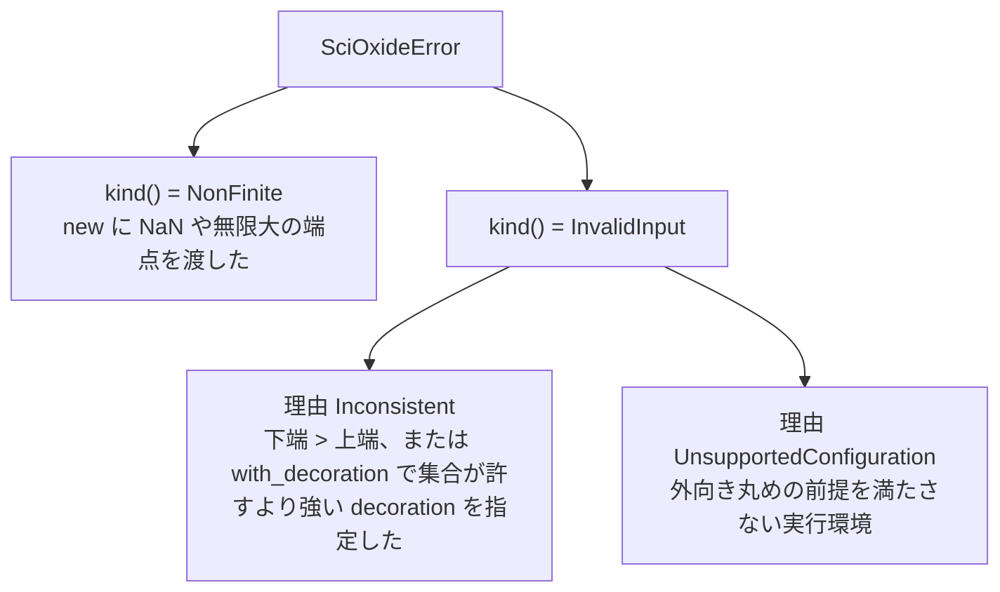

区間演算は実行環境と入力の前提が満たされると像を含む区間を求めるが、演算の選び方によって幅が変わる。
変数の相関、定義域からの除外、集合演算と算術演算の違いを確かめて選ぶ。

## 演算子選定の指針：独立性と代数的相関の判別

数式を区間演算で評価するときは、独立な変数の演算か、同じ変数が複数回現れる式かを区別する。

| 目的 | 操作 | 真の像集合 | 過大評価防止の要点 |
|---|---|---|---|
| 独立な二集合の積 | `mul` | $\{xy \mid x \in X, y \in Y\}$ | 四隅の積の最小・最大から外向き丸めで包含区間を算出 |
| 同一変数の自乗 | `square` | $\{x^2 \mid x \in X\}$ | $\lvert X \rvert$ の端点を自乗する。$0 \in X$ なら下端は 0 |
| 独立な二集合の加算 | `add` | $\{x+y \mid x \in X, y \in Y\}$ | 下端を下向き、上端を上向きに丸める（最近接値から高々 1 ulp） |
| 同一変数の相殺 | — | $x - x = 0$ | 区間減算 `sub` は独立とみなすため幅が倍増する。事前に代数約分を行う |
| 特異点を含む除算 | `div` | $\{x/y \mid x \in X, y \in Y, y \neq 0\}$ | ゼロ分母を除外し、定義可能部分の凸包を算出（`Trv` へ降格） |
| 非負領域の平方根 | `sqrt` | $\{\sqrt{x} \mid x \in X, x \ge 0\}$ | 負領域を除外。入力全域が負なら空集合を返却 |
| 共通部分の制約 | `intersection`, `restrict` | $X \cap Y$ | 集合論的交差。丸めは生じないが decoration は `Trv` |
| 包含凸包の生成 | `hull` | $\operatorname{conv}(X \cup Y)$ | 非連結な和集合の間の空隙を埋めて単一区間化 |

例えば $X = [-1, 1]$ で独立に動く二変数の積の値域は $[-1,1]$ である。
これは集合の記述であり、値がどの頻度で現れるかは定めない。
同じ変数の自乗の値域は $[0,1]$ なので、`x.mul(&x)` より `x.square()` のほうが狭い包含区間になる。

同様に `x.sub(&x)` は $[-1,1]-[-1,1]=[-2,2]$ を返し、真の像 $\{0\}$ に対して幅 4 の過大評価になる。
式を代数的に簡単化して変数の出現回数を減らすと、この過大評価を避けられる。
式変形で消せない相関には、雑音記号を共有する [アフィン演算](../algorithms/affine-arithmetic/) を使える。

## ゼロ除算・定義域外除外と Decoration の格下げ則

区間演算のもう一つの課題は、関数の特異点（零での除算や負数の平方根）の処理である。
点の浮動小数点計算では $1/0$ は無限大、負数の平方根は NaN になり、以後の値の意味が失われる。
`scioxide-validated` は定義できる実数値の像の凸包を返し、除外があったことを [`Decoration`](https://docs.rs/scioxide-validated/0.1.0/scioxide_validated/enum.Decoration.html) に記録する。

次のセルは分子 $[1, 2]$ を端に零を持つ分母 $[0, 4]$ と内部に零を持つ分母 $[-1, 4]$ で割った商と、$[-1, 4]$ と $[0, 4]$ の平方根を含む区間を求める。
比較のため、各区間を 100 等分した格子で、分母の零と負の数の平方根を除いた f64 の標本の最小・最大も並べる。
標本の範囲は保証のない参照値で、格子を細かくすると零の近くの商はさらに大きくなる。
標本の列はどの環境でも出るが、包含区間の列はネイティブ環境だけで埋まり、wasm32 では「未実行」と表示する。

```rust
//| id: validated-domain-restriction
//| ref: validated-domain-restriction
//| title: 零を含む分母の区間除算
//| run: button
//| crates: [scioxide-validated, scioxide-core]
//| tests:
//|   - case: default
//|     expect:
//|       - {"artifact":"table-0","path":"/rows/0/0","equals":"[1, 2] / [0, 4]"}
//|       - {"artifact":"table-0","path":"/rows/0/1","approx":{"value":0.25,"atol":1e-15}}
//|       - {"artifact":"table-0","path":"/rows/0/2","approx":{"value":50,"atol":1e-12}}
//|       - {"artifact":"table-0","path":"/rows/1/1","approx":{"value":-40,"atol":1e-12}}
//|       - {"artifact":"table-0","path":"/rows/1/2","approx":{"value":40,"atol":1e-12}}
//|       - {"artifact":"table-0","path":"/rows/2/1","approx":{"value":0,"atol":1e-15}}
//|       - {"artifact":"table-0","path":"/rows/2/2","approx":{"value":2,"atol":1e-15}}
//|       - {"artifact":"table-0","path":"/rows/3/1","approx":{"value":0,"atol":1e-15}}
//|       - {"artifact":"table-0","path":"/rows/3/2","approx":{"value":2,"atol":1e-15}}
use scioxide_core::{SciOxideError, SciOxideErrorView, InvalidInputReason};
use scioxide_validated::DecoratedInterval as D;

// 1. 独立な参照: 端点を 100 等分した格子での f64 の標本（保証のない値）。
//    分母の零と負の平方根の入力は除き、定義できる値だけを集める。
let grid = |lo: f64, hi: f64| -> Vec<f64> {
    (0..=100)
        .map(|k| lo + (hi - lo) * f64::from(k) / 100.0)
        .collect()
};
let quotients = |denominators: &[f64]| -> Vec<f64> {
    grid(1.0, 2.0)
        .iter()
        .flat_map(|&x| {
            denominators
                .iter()
                .filter(|&&y| y != 0.0)
                .map(move |&y| x / y)
        })
        .collect()
};
let roots = |values: &[f64]| -> Vec<f64> {
    values
        .iter()
        .filter(|&&x| x >= 0.0)
        .map(|&x| x.sqrt())
        .collect()
};
let range = |values: Vec<f64>| {
    let lo = values.iter().copied().fold(f64::INFINITY, f64::min);
    let hi = values.iter().copied().fold(f64::NEG_INFINITY, f64::max);
    (lo, hi)
};
let samples = [
    ("[1, 2] / [0, 4]", range(quotients(&grid(0.0, 4.0)))),
    ("[1, 2] / [-1, 4]", range(quotients(&grid(-1.0, 4.0)))),
    ("sqrt([-1, 4])", range(roots(&grid(-1.0, 4.0)))),
    ("sqrt([0, 4])", range(roots(&grid(0.0, 4.0)))),
];
// 2. 外向き丸めの包含区間: 除算は分母の零を除いた商の凸包、平方根は非負部分の像を返す
let calculation = || -> Result<_, SciOxideError> {
    let num = D::new(1.0_f64, 2.0)?;
    let edge = D::new(0.0, 4.0)?;
    let inner = D::new(-1.0, 4.0)?;
    Ok([
        num.div(&edge)?,
        num.div(&inner)?,
        inner.sqrt()?,
        edge.sqrt()?,
    ])
};
let unsupported = |error: &SciOxideError| {
    matches!(
        error.view(),
        SciOxideErrorView::InvalidInput {
            argument,
            reason: InvalidInputReason::UnsupportedConfiguration,
            ..
        } if argument == scioxide_core::argument!("rounding_environment")
    )
};
let enclosures = match calculation() {
    Ok(results) => Some(results),
    Err(error) if unsupported(&error) => None,
    Err(error) => return Err(error.to_string()),
};
use serde_json::json;
let rows: Vec<_> = samples
    .iter()
    .enumerate()
    .map(|(i, &(name, (lo, hi)))| {
        let y = enclosures.as_ref().map(|v| v[i]);
        let bounds = y.and_then(|v| v.set().bounds());
        (
            name,
            lo,
            hi,
            bounds.and_then(|b| b.0),
            bounds.and_then(|b| b.1),
            y.map(|v| format!("{:?}", v.decoration())),
        )
    })
    .collect();
let fmt = json!({"significantDigits":8});
let missing = if enclosures.is_none() {
    "未実行"
} else {
    "非有界"
};
emit_table_with_columns!(
    json!([
        {"key":"0","label":"式"},
        {"key":"1","label":"標本の最小（保証なし）","type":"number","format":fmt},
        {"key":"2","label":"標本の最大（保証なし）","type":"number","format":fmt},
        {"key":"3","label":"下端","type":"number","format":fmt,"nullText":missing},
        {"key":"4","label":"上端","type":"number","format":fmt,"nullText":missing},
        {"key":"5","label":"decoration","nullText":"未実行"}
    ]),
    rows,
    metadata = json!({"id":"table-0"})
);
emit_outcome!(if enclosures.is_some() {
    Outcome::satisfied("像の包含区間を計算した")
} else {
    Outcome::unavailable("この環境では証明計算は未実行")
});
```

ネイティブ環境（x86_64）で実行すると、表の四つの式はそれぞれ $[0.25, +\infty)$・$(-\infty, +\infty)$・$[0, 2]$・$[0, 2]$ を返し、decoration は最後の `sqrt([0, 4])` だけが `Com`、他は `Trv` になる（下端の零は符号付きゼロの規約で `-0` と表示される）。
標本の範囲は $[0.25, 50]$、$[-40, 40]$、$[0, 2]$、$[0, 2]$ で、どれも包含区間に含まれる。
商の標本の最大が有限なのは格子が零を避けたからで、零に近い分母を取れば商はいくらでも大きくなる。

分母 $[0, 4]$ では零が端にあるので、商は $(0, 4]$ に対する $[0.25, +\infty)$ になる。
分母が $0$ を内部に含む場合（例：$[-1, 4]$）、真の商の集合は $(-\infty, -1] \cup [0.25, +\infty)$ という非連結な二つの半無限区間になる。
`DecoratedInterval` は一つの区間しか持たないので、この非連結集合の凸包である全実数 $(-\infty, +\infty)$ を返す。
どちらの場合も分母の零を除外したので、decoration は `Trv`（Trivial：包含だけを主張し、入力全体での定義・連続性は主張しない）に下がる。
逆数の二つの分枝を別々に保つ必要がある場合は、`powi(-1)` を使う。
負の奇数乗は負側と正側の分枝を別々に持つ `ElementaryEnclosure` を返す（[初等関数の値域の包含区間](../algorithms/elementary-enclosures/)）。

平方根演算 [`sqrt()`](https://docs.rs/scioxide-validated/0.1.0/scioxide_validated/struct.DecoratedInterval.html#method.sqrt) も同様の規約に従う。
区間 $[-1, 4]$ の平方根は、実数として定義できない負の区間 $[-1, 0)$ を切り捨て、非負部分 $[0, 4]$ の像である $[0, 2]$ を返す。
この場合も定義域の切り捨てが発生したため、付随情報は `Trv` となる。

対照的に、区間 $[0, 4]$ に対する平方根は、端点 0 で導関数が発散するものの、関数そのものは $[0, 4]$ 全体で定義され連続である。
したがって入力が `Com`（有界な入力と結果で定義・連続）であれば、出力も `Com` を保つ。
微分可能性の特異点と関数の連続性は別の性質である。

## 集合論的操作（交差・制限）と凸包包含（Hull）の使い分け

代数演算のほかに、外部の物理制約や不変条件を用いて区間を絞り込む集合論的操作が用意されている。

1. 共通部分の抽出（`intersection`, `restrict`）: 二つの区間が重なる実数集合を計算する。
   例えば、正の値しか取り得ない変数の包含区間が丸めや過大評価で $[-10^{-16}, 2.0]$ に広がった場合、`restrict` で正の領域 $[0, +\infty)$ との交差を取れば負の部分を除ける。
   丸めを伴わない集合演算だが、外部の制約を当てはめた結果なので、decoration は保守的に `Trv` となる。
2. 凸包（`hull`）: 二つの区間 $X, Y$ の双方を含む最小の閉区間 $\operatorname{conv}(X \cup Y) = [\min(a, c), \max(b, d)]$ を返す。
   条件分岐の両方の枝で異なる区間が得られた場合の合流点で、両方の可能性を含む区間を求めるために使う。
   和集合の間の隙間も含むので区間幅が広がり、decoration は `Trv` になる。

集合演算は外向き丸めを使わないので、wasm32 でも実行できる。

## 証明の呼び出し方の選び方

線形系・根・積分の証明には、既定の設定で一度だけ解く関数と、設定・提案・作業領域を選べる検証器がある。

| 問題 | ワンショット関数 | 検証器・Plan | ワンショット関数で足りない場合 |
|---|---|---|---|
| 正方の線形系 $Ax = b$ | `solve(a, b)` | `LinearVerifier` | 区間の係数、疎行列、複数の右辺、自分の近似解の検証 |
| 区間の中の実数の根 | `roots(f, df, lower, upper)` | `ScalarRootVerifier` | 個別の主張（存在・一意・不在）の検証、分割の閾値と節点数の指定 |
| 非線形方程式系の根 | 提供しない | `SystemRootVerifier` | 常に検証器を使う |
| 多項式の根の個数 | `polynomial_roots(coefficients, approximations)` | `PolynomialRootPlan` | 円板と個数の提案の検証、円板の初期半径の指定 |
| 定積分 | `integrate(f, d2f, lower, upper)` | `QuadratureVerifier` | 無限区間・特異点・高次の剰余、許容誤差の指定、多成分の積分 |

ワンショット関数は証明が成り立った結果だけを `Ok` で返し、計算回数の上限や容量の上限、決まらない判定は `ConvergenceFailure` などのエラーにする。
検証器と Plan は同じ結果をレポートの状態（`Verified`・`Proved`・`Inconclusive` など）として `Ok` で返し、`ValidatedOptions` の計算回数の上限・バイト上限・実行方針と作業領域の再利用を選べる。
どちらも外向き丸めを使うので、wasm32 では `InvalidInput`（`UnsupportedConfiguration`）のエラーになる。
呼び出しの形と状態の読み方は [API ガイド](oxref:validated-api-index-entry-points) にある。

## 異常系・非対応環境の診断戦略

区間の構築と演算の失敗は `SciOxideError` で返る。
分類は `kind()`、理由は `view()` で読む。



`DecoratedInterval::new(lower, upper)` と `DecoratedInterval::point(value)` は有限の端点だけを受け取り、NaN や無限大を渡すと構築の時点で `NonFinite` のエラーになる。
非有界な区間は `f64::INFINITY` ではなく、端点を `None` にした `ExtendedInterval::new(Some(a), None)` から `DecoratedInterval::from` で作るか、`entire()` を使う。

演算で返る `UnsupportedConfiguration` は、演算の入力ではなく実行環境の問題を示す。
x86（SSE2）・x86_64 では MXCSR と x87 の制御語、AArch64 では FPCR を読み、最近接偶数丸め、段階的アンダーフロー（Flush-to-Zero と Denormals-are-Zero の無効化）、例外トラップの無効化を確かめる。
それ以外のアーキテクチャ（wasm32 を含む）では常にこのエラーになる。
前提を確かめられない環境では包含区間を出力しない。

## まとめと次に読むページ

独立な二つの区間の積には `mul`、同じ変数の自乗には `square` を使い、同じ変数の出現は式の変形で減らす。
零を含む分母と負の平方根はエラーにならず、定義できる部分の像と `Trv` の decoration で返る。
`intersection`・`restrict`・`hull` は丸めを伴わない集合演算で、decoration は `Trv` になる。
線形系・根・積分を既定の設定で一度だけ証明するならワンショット関数、区間の係数や提案の検証、作業領域の再利用が要るなら検証器を選ぶ。
構築の失敗は `NonFinite` または `InvalidInput`（`Inconsistent`）、実行環境の拒否は `InvalidInput`（`UnsupportedConfiguration`）として区別できる。

- [外向き丸めと包含の数理](../algorithms/)：端点の丸め方と decoration の伝播則を確かめる。
- [初等関数の値域の包含区間と極による分枝](../algorithms/elementary-enclosures/)：二つの分枝を持つ包含区間の読み方を確かめる。
- [API ガイド](../api/)：ワンショット関数と検証器の仕様、全公開項目、検証状態の読み方を確かめる。
